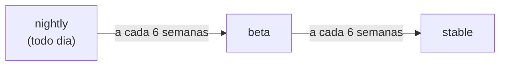

# 02 — Instalação e toolchains

**Objetivos.** Ao final, você vai saber:

- instalar o Rust com o `rustup` e deixar o ambiente pronto;
- o que são toolchains, canais e perfis;
- o que é uma *edition* e por que ela não é a mesma coisa que a versão do compilador.

## Instalando com o `rustup`

O `rustup` é o instalador e gerenciador de versões oficial do Rust. Ele faz o papel do `pyenv` (ou do `uv python`) do Python. Em C++ não há um equivalente direto, porque o compilador normalmente vem do sistema ou da IDE.

**Linux e macOS:**

```bash
curl --proto '=https' --tlsv1.2 https://sh.rustup.rs -sSf | sh
```

**Windows:** baixe o instalador em <https://www.rust-lang.org/tools/install>. Ele pede as *Build Tools* do Visual Studio, que trazem o linker.

> [!WARNING]
> Rust precisa de um **linker**, e ele não vem com o `rustup`. Sem ele, o primeiro build falha com um erro de "linker not found". No macOS, rode `xcode-select --install`. No Ubuntu/Debian, `sudo apt install build-essential`.

Prefira o `rustup` em vez do Rust do Homebrew ou do `apt`: os gerenciadores de pacotes do sistema costumam trazer versões antigas.

Depois de instalar, abra um terminal novo e confira:

```bash
rustc --version     # o compilador
cargo --version     # o gerenciador de projetos e pacotes
rustup show         # o que está instalado e o que está ativo
```

Este curso exige **Rust 1.96 ou mais novo**. Para atualizar:

```bash
rustup update
```

## Toolchains e canais

Uma **toolchain** é um conjunto completo: compilador, `cargo`, biblioteca padrão e ferramentas. O `rustup` pode ter várias instaladas ao mesmo tempo, e cada uma vem de um **canal**:

| Canal | O que é | Quando usar |
|---|---|---|
| `stable` | versão oficial, lançada a cada 6 semanas | sempre (é o que o curso usa) |
| `beta` | a próxima stable, em teste | testar seu projeto antes do lançamento |
| `nightly` | build diário, com recursos experimentais | ferramentas específicas ou experimentos |

O ciclo é um "trem": a cada 6 semanas, o que está no nightly vira beta, e o beta vira a nova stable. Por isso a versão do Rust sobe rápido (1.96, 1.97, 1.98...) sem que isso signifique mudanças grandes. Cada versão traz melhorias pequenas e compatíveis.



Você pode rodar um comando com outra toolchain usando `+`:

```bash
cargo +beta test       # roda os testes com a beta
```

## Perfis e componentes

Ao instalar, o `rustup` usa um **perfil** que define quais componentes vêm junto. O padrão (`default`) inclui:

- `rustc`, `cargo` e `rust-std` (a biblioteca padrão);
- `rustfmt` (formatador) e `clippy` (linter);
- `rust-docs` (a documentação offline).

O **`rust-analyzer`**, que dá autocompletar e erros em tempo real no editor, **não** vem no perfil padrão:

- **VS Code:** instale a extensão `rust-analyzer`. Ela já traz o próprio binário.
- **Outros editores:** `rustup component add rust-analyzer`.

Também existe o RustRover, IDE da JetBrains com suporte próprio a Rust.

## Fixando a toolchain de um projeto

Um projeto pode pedir uma toolchain específica com um arquivo `rust-toolchain.toml` na raiz:

```toml
[toolchain]
channel = "stable"
components = ["rustfmt", "clippy"]
```

Ao entrar na pasta, o `rustup` usa essa configuração automaticamente. Isso é útil em equipes e em CI.

> [!NOTE]
> Os projetos deste curso **não** usam `rust-toolchain.toml`. Eles declaram só a versão **mínima** no `Cargo.toml` (`rust-version = "1.96"`), e você usa a stable mais recente.

## Editions

Uma **edition** é um "dialeto" da linguagem. Existem quatro: 2015, 2018, 2021 e **2024**. Cada edition pode mudar regras que quebrariam código antigo, como palavras reservadas novas ou regras de escopo.

A diferença importante:

- **Versão do compilador** (1.99, 1.100...): o programa `rustc` que você instalou. Cada versão nova entende **todas** as editions.
- **Edition** (2021, 2024): a regra que o compilador usa para ler **o seu código**. Ela é escolhida por projeto, no `Cargo.toml`.

```toml
[package]
name = "meu-projeto"
version = "0.1.0"
edition = "2024"
```

Isso permite que a linguagem evolua sem quebrar o código existente: um projeto 2021 continua compilando nos compiladores novos, e pode usar como dependência uma biblioteca escrita na 2024, e vice-versa.

> [!WARNING]
> Se o `Cargo.toml` **não** tiver a chave `edition`, o Cargo assume **2015**. Isso pega quem copia um `Cargo.toml` de um tutorial antigo: recursos básicos de hoje param de funcionar, com erros confusos. O `cargo new` sempre preenche a edition mais recente.

Para comparar: é parecido com escolher `-std=c++17` ou `-std=c++20` no C++, mas com a garantia de que código de editions diferentes funciona junto no mesmo programa.

## Nota sobre plataforma (macOS)

- **Mac com Apple Silicon** (M1 em diante): plataforma de primeira linha (*Tier 1*).
- **Mac Intel:** desde o Rust 1.90 está no *Tier 2*. O Rust continua compilando e sendo distribuído para ele, mas os testes automáticos do projeto não rodam mais nessa plataforma. Para este curso, não faz diferença.

> [!TIP]
> Se você migrou de um Mac Intel para um Apple Silicon restaurando um backup, a toolchain antiga (`x86_64`) pode estar rodando via Rosetta, mais devagar. Rode `rustup show` e confira se a linha `Default host` mostra `aarch64-apple-darwin`.

## Resumo

- Instale com o `rustup` e mantenha atualizado com `rustup update`. O curso exige Rust 1.96+.
- Toolchain = compilador + Cargo + std + ferramentas. Canais: stable, beta e nightly, com lançamentos a cada 6 semanas.
- O perfil padrão traz `rustfmt` e `clippy`. O `rust-analyzer` você instala à parte (ou pela extensão do editor).
- A edition (2024) é escolhida por projeto, e a versão do compilador é outra coisa. Sem a chave `edition`, vale a 2015.

## Exercícios

Veja o exercício 1 em [`exercicios.md`](exercicios.md).

## Leitura complementar

- [The Rust Programming Language, 1.1 Installation](https://doc.rust-lang.org/stable/book/ch01-01-installation.html)
- [The rustup book: Toolchains](https://rust-lang.github.io/rustup/concepts/toolchains.html), [Profiles](https://rust-lang.github.io/rustup/concepts/profiles.html), [Overrides](https://rust-lang.github.io/rustup/overrides.html)
- [The Rust Programming Language, Apêndice E: Editions](https://doc.rust-lang.org/stable/book/appendix-05-editions.html)
- [rust-analyzer: Installation](https://rust-analyzer.github.io/book/installation.html)

---

[← Lição anterior](01-por-que-rust.md) · [Índice do módulo](README.md) · [Próxima lição →](03-cargo-essencial.md)
