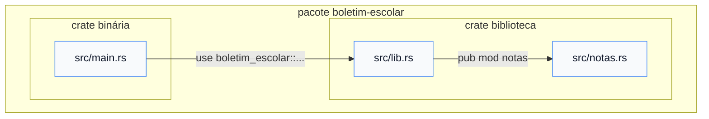

# 09 — Kit: módulos, `lib.rs` e `main.rs`

> [!NOTE]
> Lição do **kit mínimo**: o suficiente para dividir um projeto em arquivos e separar a lógica do `main`. Visibilidades mais finas (`pub(crate)`), *re-exports*, *workspaces* e publicação ficam para o Módulo 08.

**Objetivos.** Ao final, você vai saber:

- declarar módulos com `mod`, torná-los visíveis com `pub` e criar atalhos com `use`;
- como um arquivo vira módulo (e por que ele não entra sozinho);
- organizar um pacote com `lib.rs` (a lógica) e `main.rs` (o programa);
- por que o pacote `boletim-escolar` vira `boletim_escolar` no código.

## O projeto de exemplo

Esta lição e a próxima usam o projeto [`codigo/boletim-escolar`](codigo/boletim-escolar/):

```text
boletim-escolar/
├── Cargo.toml        # name = "boletim-escolar"
└── src/
    ├── lib.rs        # a biblioteca: agrupa as notas por aluno
    ├── notas.rs      # módulo `notas`: média e conceito
    └── main.rs       # o programa: imprime o boletim
```

```bash
cd codigo/boletim-escolar
cargo run
```

```text
Ana    [9.5, 8.5] média 9.00 conceito A
Bruno  [6.0, 7.5] média 6.75 conceito C
Carla  [4.0, 5.5] média 4.75 conceito D
aprovados: 2 de 3
```

## Pacote, *crate* e as duas raízes

Alguns termos primeiro:

- **Pacote** (*package*): uma pasta com um `Cargo.toml`. É o que o `cargo new` cria.
- ***Crate***: a unidade que o compilador compila de uma vez. Pode ser uma *binary crate* (gera um executável, e tem `main`) ou uma *library crate* (gera uma biblioteca para outras crates usarem).

Um pacote pode ter **no máximo uma** *library crate*, cuja raiz é `src/lib.rs`, e quantas *binary crates* quiser. A principal tem raiz em `src/main.rs`. As duas crates levam o nome do pacote.

Quando os dois arquivos existem, são **duas crates diferentes no mesmo pacote**, e o `main.rs` usa a biblioteca como se fosse uma dependência externa:



O livro oficial recomenda este padrão: **a lógica fica em `lib.rs`, e o `main.rs` só lê a entrada, chama a biblioteca e mostra o resultado**. Ganhos:

- a biblioteca pode ser testada sem passar pelo `main` (próxima lição);
- o `main.rs` só enxerga o que for `pub`, o que obriga você a pensar na API pública;
- outra crate (um segundo executável, um servidor) pode reaproveitar a mesma lógica.

O Projeto 1 é organizado assim.

## `mod`: declarar um módulo

Um **módulo** agrupa funções, tipos e outros módulos sob um nome, como um *namespace* do C++. O `lib.rs` do exemplo começa assim:

```rust
pub mod notas;
```

Essa linha **declara** o módulo `notas` e faz o compilador procurar o código dele em `src/notas.rs` (ou em `src/notas/mod.rs`, o estilo antigo). Não é um `#include`: o arquivo não é colado no lugar, e cada arquivo é carregado **uma única vez**, no ponto em que é declarado.

O caminho inverso é a armadilha clássica: **criar um arquivo `.rs` não basta**. Se nenhum `mod` o declarar, o compilador nem olha para ele. Se você criar um `src/extra.rs` e chamar `boletim_escolar::extra::extra()` no `main.rs` sem declarar `mod extra;` no `lib.rs`, o erro é `cannot find extra in boletim_escolar` (E0433).

Um módulo também pode ser escrito direto no arquivo, entre chaves. É assim que os testes da próxima lição são declarados:

```rust
mod tests {
    // ...
}
```

Comparado com Python: lá, todo arquivo é um módulo automaticamente, e o `import` executa o arquivo. Em Rust, o arquivo só entra na compilação se algum `mod` o declarar, e nada é "executado" ao importar.

## `pub`: privado por padrão

Tudo é **privado por padrão**: funções, módulos, tipos. Um item privado só é visível no próprio módulo e nos módulos de dentro dele. Para usar de fora, marque com `pub`.

No exemplo, `media` e `conceito` são `pub`, e `soma` é um detalhe interno:

```rust
// src/notas.rs
pub fn media(notas: &[f64]) -> Option<f64> { /* ... */ }
pub fn conceito(media: f64) -> char { /* ... */ }
fn soma(notas: &[f64]) -> f64 { /* ... */ }      // privada
```

Tentar usar a função privada no `main.rs`:

```rust
// ❌ NÃO COMPILA
use boletim_escolar::notas::soma;

fn main() {
    println!("{}", soma(&[1.0, 2.0]));
}
```

```text
error[E0603]: function `soma` is private
  --> src/main.rs:1:29
   |
 1 | use boletim_escolar::notas::soma;
   |                             ^^^^ private function
   |
note: the function `soma` is defined here
  --> src/notas.rs:21:1
   |
21 | fn soma(notas: &[f64]) -> f64 {
   | ^^^^^^^^^^^^^^^^^^^^^^^^^^^^^
```

E o `pub` vale para cada nível. Um módulo `pub` com funções privadas não expõe as funções, e funções `pub` dentro de um módulo privado também não ficam acessíveis. Se o `lib.rs` tivesse `mod notas;` em vez de `pub mod notas;`:

```text
error[E0603]: module `notas` is private
 --> src/main.rs:1:22
  |
1 | use boletim_escolar::notas::{conceito, media};
  |                      ^^^^^   -------- function `conceito` is not publicly re-exported
  |                      |
  |                      private module
...
```

Comparações: o `_nome` do Python é só uma convenção, e o `pub` do Rust é verificado. Em C++, a visibilidade fora de classes depende de *headers*, `static` e *namespaces* anônimos. Em Rust, é sempre o `pub`.

Para *structs* e *enums*, que aparecem no Módulo 04, há uma regra a mais: numa `pub struct`, os **campos continuam privados** até você marcá-los com `pub`, enquanto as variantes de um `pub enum` são todas públicas.

## `use`: atalhos para caminhos

Todo item tem um **caminho**, como um caminho de arquivo, com `::` no lugar de `/`:

- `crate::notas::media`: a partir da raiz da crate atual;
- `super::media`: a partir do módulo pai;
- `boletim_escolar::notas::media`: a partir de outra crate (aqui, a biblioteca vista pelo `main.rs`);
- `std::collections::HashMap`: a partir da biblioteca padrão.

O `use` cria um atalho para um caminho, e só isso. Ele **não carrega arquivo nenhum** (quem faz isso é o `mod`):

```rust
// src/main.rs
use boletim_escolar::notas::{conceito, media};
use boletim_escolar::{agrupar, nomes_ordenados};
```

As chaves importam vários nomes do mesmo módulo de uma vez.

### `crate::` no `main.rs` não chega à biblioteca

Como `lib.rs` e `main.rs` são crates diferentes, `crate::` dentro do `main.rs` se refere à crate **binária**, que não contém o `agrupar`:

```rust
// ❌ NÃO COMPILA
use crate::agrupar;
```

```text
error[E0432]: unresolved import `crate::agrupar`
 --> src/main.rs:1:5
  |
1 | use crate::agrupar;
  |     ^^^^^^^-------
  |            |
  |            no `agrupar` in the root
```

No `main.rs`, use o nome do pacote: `use boletim_escolar::agrupar;`.

### Hífen no nome do pacote

Hífen não é permitido em identificadores Rust, então o pacote `boletim-escolar` vira a crate `boletim_escolar` no código. Escrever com hífen é um erro de sintaxe:

```text
error: expected one of `::`, `;`, or `as`, found `-`
 --> src/main.rs:1:12
  |
1 | use boletim-escolar::agrupar;
  |            ^ expected one of `::`, `;`, or `as`
```

## Armadilhas comuns

- **Arquivo `.rs` criado e nunca declarado**: faltou o `mod nome;` no `lib.rs` (ou no módulo pai).
- **Função `pub` num módulo privado** (E0603 `module ... is private`): o módulo também precisa ser `pub`.
- **`use crate::...` no `main.rs` para algo da biblioteca** (E0432): use o nome da crate da biblioteca.
- **Hífen no `use`**: troque por `_`.
- **Declarar o mesmo módulo também no `main.rs`.** Se o `main.rs` tiver `mod notas;`, o `notas.rs` passa a ser compilado **duas vezes**: uma como parte da biblioteca e outra como um módulo separado, duplicado, da crate binária. Compila, mas o sintoma é uma série de avisos estranhos:

  ```text
  warning: function `media` is never used
   --> src/notas.rs:2:8
    |
  2 | pub fn media(notas: &[f64]) -> Option<f64> {
    |        ^^^^^
  ...
  warning: `boletim-escolar` (bin "boletim-escolar") generated 3 warnings
  ```

  O `(bin ...)` na última linha denuncia: os avisos são da cópia na crate binária. No `main.rs`, não declare módulos da biblioteca. Use `use boletim_escolar::notas`.

## Resumo

- Um pacote tem no máximo uma *library crate* (`src/lib.rs`) e uma ou mais *binary crates* (`src/main.rs`). São crates diferentes.
- Padrão recomendado: a lógica em `lib.rs`, e o `main.rs` usando a biblioteca pelo nome do pacote (com `_` no lugar de `-`).
- `mod nome;` declara um módulo e carrega `nome.rs`, uma vez. Arquivo sem `mod` não existe para o compilador.
- Tudo é privado por padrão. `pub` em cada nível: módulo e item.
- `use` só cria atalhos: `crate::`, `super::`, o nome de outra crate ou `std::`.

## Exercícios

Veja o exercício 6 em [`exercicios.md`](exercicios.md).

## Leitura complementar

- [The Rust Programming Language, 7.1 Packages and Crates](https://doc.rust-lang.org/stable/book/ch07-01-packages-and-crates.html)
- [The Rust Programming Language, 7.2 Defining Modules](https://doc.rust-lang.org/stable/book/ch07-02-defining-modules-to-control-scope-and-privacy.html)
- [The Rust Programming Language, 7.3 Paths](https://doc.rust-lang.org/stable/book/ch07-03-paths-for-referring-to-an-item-in-the-module-tree.html)
- [The Rust Programming Language, 7.5 Separating Modules into Different Files](https://doc.rust-lang.org/stable/book/ch07-05-separating-modules-into-different-files.html)

---

[← Lição anterior](08-kit-closures.md) · [Índice do módulo](README.md) · [Próxima lição →](10-kit-testes.md)
