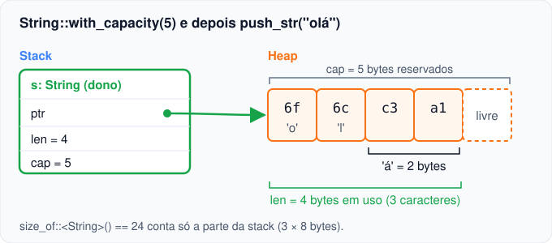

# 01 — Quem libera a memória?

**Objetivos.** Ao final, você vai saber:

- o que vai para a stack e o que vai para o heap num programa Rust;
- como uma `String` é organizada na memória (`ptr`, `len` e `cap`);
- como C, C++ e Python respondem à pergunta "quem libera esta memória?";
- qual é a resposta do Rust, e por que ela é verificada na compilação.

## O problema

Todo programa que cria dados de tamanho variável (um texto digitado, uma lista que cresce) precisa pedir memória ao sistema e, em algum momento, devolvê-la. Essa devolução tem três jeitos de dar errado:

- **ninguém devolve:** vazamento de memória (*leak*);
- **alguém devolve duas vezes:** *double free*, que corrompe o alocador;
- **alguém usa depois de devolver:** *use-after-free*, que lê lixo ou dados de outro objeto.

Os dois últimos são **comportamento indefinido** (*undefined behavior*, UB): o programa pode funcionar, travar ou virar uma falha de segurança. O livro da Brown University resume bem o objetivo do Rust: *segurança é ausência de comportamento indefinido*. O sistema de *ownership* (posse) existe para responder, sem ambiguidade, **quem libera cada pedaço de memória e quando**.

## Stack e heap, só o que importa aqui

Você já conhece os dois. Em Rust, a regra prática é esta:

- **Stack:** valores com tamanho **conhecido na compilação** (`i32`, `f64`, `bool`, `char`, tuplas e arrays de tamanho fixo). Cada chamada de função ganha um espaço na stack, e esse espaço some quando a função retorna. Ninguém precisa "liberar" nada.
- **Heap:** dados cujo tamanho só se sabe **em tempo de execução**, ou que precisam sobreviver à função que os criou. A memória é pedida ao alocador e precisa ser devolvida por alguém.

```rust
let n: i32 = 42;                    // 4 bytes, na stack
let s = String::from("olá");        // um pedaço na stack, o texto no heap
```

O Rust Book diz que o propósito principal do ownership é justamente **gerenciar dados no heap**. Com dados que vivem só na stack, o problema não existe.

## Como uma `String` fica na memória

Uma `String` tem duas partes. Na stack ficam três números de 8 bytes (numa máquina de 64 bits):

| Campo | O que é |
|---|---|
| `ptr` | endereço do buffer no heap |
| `len` | quantos **bytes** estão em uso |
| `cap` | quantos bytes foram reservados (capacidade) |

No heap fica o texto em si, em UTF-8:

```rust
let mut s = String::with_capacity(5);
s.push_str("olá");
println!("len = {}, capacity = {}", s.len(), s.capacity());
println!("bytes no heap = {:x?}", s.as_bytes());
```

```text
len = 4, capacity = 5
bytes no heap = [6f, 6c, c3, a1]
```



Repare que `len` é 4, e não 3: o `á` ocupa **dois bytes** em UTF-8. Isso volta na [lição 06](06-strings-utf8.md).

O tamanho de uma `String` na stack é sempre o mesmo, não importa o tamanho do texto:

```rust
println!("{}", size_of::<String>());     // 24
let grande = "x".repeat(1_000);
println!("{}", size_of_val(&grande));    // 24: o texto de 1000 bytes está no heap
```

`size_of` mede só a parte da stack. `Vec<T>` tem o mesmo formato (`ptr`, `len`, `cap`), e uma `String` é, por dentro, um `Vec<u8>` com a garantia de que os bytes são UTF-8 válido.

Código completo em [`codigo/memoria-da-string`](codigo/memoria-da-string/).

## Três respostas conhecidas

### C: você libera

```c
char *s = malloc(3);
strcpy(s, "oi");
free(s);
printf("%s\n", s);   /* use-after-free */
```

Compila sem nenhum aviso com `clang -Wall -Wextra`. Toda responsabilidade é sua: esquecer o `free` vaza, chamar duas vezes corrompe, usar depois é UB.

### C++: o destrutor libera (RAII)

C++ resolve a parte "esquecer de liberar" com **RAII** (*Resource Acquisition Is Initialization*): o objeto adquire o recurso no construtor e o devolve no destrutor, que roda automaticamente no fim do escopo.

```cpp
{
    std::string s = "oi";            // aloca
    std::vector<int> v(1000);        // aloca
}                                    // os destrutores rodam aqui: nada vaza
```

`std::unique_ptr` leva a mesma ideia para qualquer objeto no heap. É um avanço enorme, e Rust copia essa ideia sem disfarçar. O que RAII não resolve é **quem ainda está olhando** para o recurso:

```cpp
std::string* p;
{
    std::string s = "oi";
    p = &s;
}                        // s é destruída aqui
std::cout << *p;         // ponteiro pendente: compila sem aviso
```

### Python: o runtime libera

Em Python, toda variável é uma referência para um objeto no heap, e o interpretador conta quantas referências existem (*reference counting*). Quando a contagem zera, o objeto é liberado. Ciclos de referências ficam para um coletor de lixo (*garbage collector*, GC) que roda de tempos em tempos.

```python
a = [1, 2, 3]
b = a            # outra referência para a MESMA lista (refcount 2)
b.append(4)
print(a)         # [1, 2, 3, 4]
```

Não existe use-after-free nem double free: é seguro. O preço é custo em tempo de execução (contar referências em toda atribuição, pausas do GC) e um efeito colateral que todo programador Python já sentiu: **várias variáveis podem alterar o mesmo objeto**, e fica difícil saber quem mexeu em quê.

## A resposta do Rust

Rust fica com a ideia do C++ (o recurso é liberado no fim do escopo de quem é responsável por ele) e acrescenta uma regra que o compilador **verifica**: **cada valor tem exatamente um dono**. Quando o dono sai de escopo, o compilador insere a liberação ali. Como só existe um dono, não há como liberar duas vezes. Como o compilador sabe onde o dono morre, ele recusa qualquer uso depois disso.

```rust
{
    let s = String::from("oi");   // s é dona do texto no heap
    println!("{s}");
}                                 // s sai de escopo: o heap é liberado aqui
```

Não há `free`, não há destrutor para escrever e não há contador em tempo de execução. As regras completas, e o que acontece quando você tenta ter dois donos, são o assunto da [próxima lição](02-regras-de-ownership-e-move.md).

| | C | C++ | Python | Rust |
|---|---|---|---|---|
| Quem libera | você (`free`) | o destrutor (RAII, `unique_ptr`, `shared_ptr`) | o runtime (refcount + GC de ciclos) | o dono, com o `drop` inserido pelo compilador |
| Quando | quando você lembrar | fim do escopo ou último `shared_ptr` | quando o refcount zera ou o GC roda | fim do escopo do dono, sempre no mesmo ponto |
| O que ainda pode dar errado | leak, double free, use-after-free | ponteiro pendente, uso depois de `std::move` | ciclos liberados tarde, alteração por outra referência | vazamento, só se você pedir (`Rc` em ciclo, `mem::forget`, no Módulo 10) |
| Custo em tempo de execução | nenhum | quase nenhum (contador atômico no `shared_ptr`) | contagem em toda atribuição e pausas do GC | nenhum para o dono único |

> [!NOTE]
> Rust não promete que nada vaza: um vazamento não corrompe memória, e por isso é considerado "seguro". O que ele garante é que você não vai liberar duas vezes nem usar memória já liberada, a menos que use `unsafe` (Módulo 15).

## Armadilhas comuns

**Achar que `size_of` mede o valor inteiro.** `size_of::<String>()` é sempre 24, com 1 byte ou 1 GB de texto. Ele mede o que fica na stack. Para saber quanto texto existe, use `len()`. Para saber quanto foi reservado, use `capacity()`.

**Achar que `len()` conta caracteres.** Conta bytes. `"olá".len()` é 4. A [lição 06](06-strings-utf8.md) mostra como contar caracteres.

**Trazer o modelo do Python.** Em Python, `b = a` nunca copia e nunca invalida nada: as duas variáveis apontam para o mesmo objeto. Em Rust, `let b = a;` faz outra coisa, e é o erro mais comum de quem começa. Ele é o assunto da próxima lição.

**Trazer o modelo do C++.** Em C++, `b = a` copia o `std::string` inteiro (um buffer novo no heap). Em Rust, a cópia profunda nunca é automática: ela tem nome (`clone()`), como você vai ver na [lição 03](03-copy-e-clone.md).

## Resumo

- Valores de tamanho fixo ficam na stack e somem sozinhos. Dados de tamanho dinâmico ficam no heap e precisam de alguém que os libere.
- Uma `String` é `ptr` + `len` + `cap` na stack (24 bytes) e o texto UTF-8 no heap. `len` conta bytes.
- C deixa a liberação com você. C++ automatiza com RAII, mas não impede uso de memória já liberada. Python libera com refcount e GC, a um custo em tempo de execução.
- Rust usa RAII com uma regra a mais, verificada na compilação: cada valor tem um único dono, e o valor é liberado quando o dono sai de escopo.

## Exercícios

Esta lição prepara o terreno. Os exercícios começam na próxima. Se quiser experimentar agora, rode o projeto [`codigo/memoria-da-string`](codigo/memoria-da-string/) e mude o texto e a capacidade.

## Leitura complementar

- [The Rust Programming Language, 4.1 What is Ownership?](https://doc.rust-lang.org/stable/book/ch04-01-what-is-ownership.html) (seção "The Stack and the Heap")
- [Brown "Rust Book Experiment", 4.1](https://rust-book.cs.brown.edu/ch04-01-what-is-ownership.html): segurança como ausência de comportamento indefinido
- [Comprehensive Rust: Review of Program Memory](https://google.github.io/comprehensive-rust/memory-management/review.html) e [Approaches to Memory Management](https://google.github.io/comprehensive-rust/memory-management/approaches.html)
- [100 Exercises to Learn Rust: Heap](https://rust-exercises.com/100-exercises/03_ticket_v1/09_heap.html)

---

[Índice do módulo](README.md) · [Próxima lição →](02-regras-de-ownership-e-move.md)
