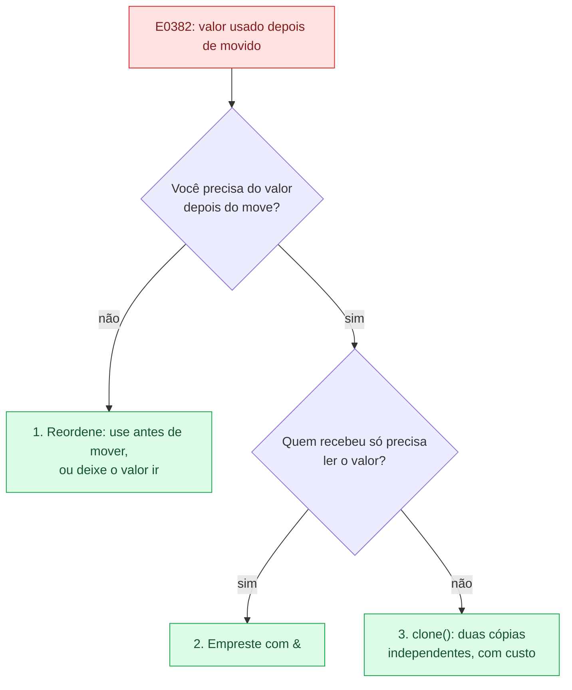

# 02 — Regras de ownership e move

**Objetivos.** Ao final, você vai saber:

- as três regras de ownership e o que cada uma impede;
- o que é um *move* (mover) e por que `let s2 = s1;` invalida `s1`;
- onde moves acontecem sem você escrever `=`: chamadas, retornos, laços, índices e campos;
- as três saídas para o erro E0382, e em que ordem tentá-las.

## As três regras

O Rust Book resume o sistema em três frases:

1. Cada valor tem um **dono** (*owner*): uma variável, ou algo que contém o valor, como um campo de struct ou um `Vec`.
2. Só pode haver **um dono por vez**.
3. Quando o dono sai de escopo, o valor é **descartado** (*dropped*): o Rust chama o código de limpeza dele, que libera o heap.

A regra 3 é o RAII da [lição anterior](01-quem-libera-a-memoria.md). A regra 2 é a novidade, e é ela que gera quase todos os erros deste módulo. Se só pode haver um dono, o que acontece quando você atribui um valor a outra variável?

## Move: a posse muda de mão

```rust
// ❌ NÃO COMPILA
fn main() {
    let s1 = String::from("oi");
    let s2 = s1;
    println!("{s1} {s2}");
}
```

```text
error[E0382]: borrow of moved value: `s1`
 --> src/main.rs:4:16
  |
2 |     let s1 = String::from("oi");
  |         -- move occurs because `s1` has type `String`, which does not implement the `Copy` trait
3 |     let s2 = s1;
  |              -- value moved here
4 |     println!("{s1} {s2}");
  |                ^^ value borrowed here after move
  |
help: consider cloning the value if the performance cost is acceptable
  |
3 |     let s2 = s1.clone();
  |                ++++++++
```

Leia os rótulos de baixo para cima: `s1` foi usada na linha 4, mas o valor dela **foi movido** na linha 3, e isso aconteceu porque `String` não é `Copy` (linha 2). O E0382 é o erro mais comum de quem está aprendendo Rust. Vale entender o que ele protege.

Na linha 3, o Rust copia os 24 bytes de `s1` (`ptr`, `len`, `cap`) para `s2`. Agora existem dois ponteiros para o mesmo buffer no heap. Se as duas variáveis continuassem valendo, as duas tentariam liberar o buffer no fim do escopo: *double free*. Em vez de copiar o texto (caro) ou contar referências (custo em tempo de execução), o Rust escolhe uma terceira saída: **`s1` deixa de valer**. A posse passou para `s2`, e só `s2` vai liberar o buffer.


O projeto [`codigo/memoria-da-string`](codigo/memoria-da-string/) imprime o endereço do buffer antes e depois do move:

```text
== move ==
buffer antes do move:  0x10105ac10
buffer depois do move: 0x10105ac10
mesmo buffer? true
```

Os endereços mudam a cada execução, mas são sempre iguais entre si: o heap não foi tocado.

Duas consequências práticas:

- **Mover é barato.** Para uma `String`, são 24 bytes copiados, e muitas vezes nem isso depois da otimização. O tamanho do texto não importa. O Rust Book diz que o Rust *nunca* cria cópias profundas automaticamente, então qualquer cópia automática é barata.
- **Não é uma "cópia rasa".** Numa cópia rasa, as duas variáveis continuariam valendo. Num move, a origem deixa de existir para o compilador. O que se move, de verdade, é a **responsabilidade** de liberar.

## Comparando com C++ e Python

![Três faixas. C++: depois de s2 = s1 e s3 = std::move(s1), s2 e s3 apontam cada uma para o seu buffer "oi", e s1 continua viva, mas vazia. Python: depois de b = a, as variáveis a e b apontam para a mesma lista [1, 2, 3], com refcount 2. Rust: depois de let s2 = s1, só s2 (verde, dona) aponta para o buffer; s1 fica cinza e tracejada, inválida.](assets/tres-linguagens.svg)

**C++.** O `=` chama o construtor de cópia, que duplica o buffer. O move existe, mas é opcional (`std::move`), e a origem continua viva:

```cpp
std::string s1 = "oi";
std::string s2 = s1;              // cópia: dois buffers
std::string s3 = std::move(s1);   // move: o buffer de s1 vai para s3
std::cout << "[" << s1 << "]";    // compila sem aviso e imprime "[]"
```

Usar `s1` depois do `std::move` **não é UB** para `std::string`: o padrão diz que o objeto fica "válido, mas em estado não especificado" (na prática, vazio). O problema é que o compilador não avisa, e para outros tipos a história é pior:

```cpp
auto p = std::make_unique<int>(42);
auto q = std::move(p);   // p agora é nullptr
std::cout << *p;         // compila; desreferenciar nullptr é UB
```

`unique_ptr` é o parente mais próximo do ownership do Rust: um dono só, move explícito, liberação no destrutor. A diferença é que o C++ só garante "não liberar duas vezes". O Rust garante isso **e** "não usar depois de mover", na compilação.

**Python.** O `=` nunca copia e nunca move. Ele cria outro nome para o mesmo objeto, e as duas variáveis continuam valendo:

```python
a = [1, 2, 3]
b = a
b.append(4)
print(a)    # [1, 2, 3, 4]
```

Em Rust, a mesma linha (`let b = a;`) com um `Vec` move a posse, e `a` fica inutilizável. Não existe "dois nomes para o mesmo dado" sem você pedir. Pedir é o assunto das referências, logo abaixo e no Módulo 03.

## Um jeito de visualizar: permissões

O livro da Brown University propõe pensar em **permissões** que cada variável tem sobre o seu valor. Por enquanto, bastam duas:

- **R** (*read*): pode ler.
- **O** (*own*): é dona, ou seja, pode mover o valor e é responsável por descartá-lo.

(Uma variável `mut` ganha também **W**, de *write*.) Um move tira **todas** as permissões da origem:

```text
linha                            s1      s2
let s1 = String::from("oi");     R O
let s2 = s1;                     -       R O
println!("{s1}");                ❌ s1 não tem R
```

No Módulo 03, essa tabela ganha as referências `&` e `&mut`, que tiram permissões **temporariamente**.

## Moves em chamadas e retornos

Passar um valor **por valor** para uma função é um move, exatamente como `let`:

```rust
// ❌ NÃO COMPILA
fn consome(s: String) {
    println!("recebi {s}");
}

fn main() {
    let nome = String::from("Ferris");
    consome(nome);
    println!("{nome}");
}
```

```text
error[E0382]: borrow of moved value: `nome`
 --> src/main.rs:8:16
  |
6 |     let nome = String::from("Ferris");
  |         ---- move occurs because `nome` has type `String`, which does not implement the `Copy` trait
7 |     consome(nome);
  |             ---- value moved here
8 |     println!("{nome}");
  |                ^^^^ value borrowed here after move
  |
note: consider changing this parameter type in function `consome` to borrow instead if owning the value isn't necessary
 --> src/main.rs:1:15
  |
1 | fn consome(s: String) {
  |    -------    ^^^^^^ this parameter takes ownership of the value
  |    |
  |    in this function
help: consider cloning the value if the performance cost is acceptable
  |
7 |     consome(nome.clone());
  |                 ++++++++
```

O parâmetro `s` virou o dono, e o texto foi liberado no fim de `consome`. Repare que, desta vez, o compilador oferece **duas** saídas: a `note:` sugere mudar o parâmetro para um empréstimo, e o `help:` sugere clonar. A `note` vem primeiro por um bom motivo, como você vai ver daqui a pouco.

Retornar um valor também é um move, de dentro da função para quem chamou:

```rust
fn cria() -> String {
    String::from("novo")     // a posse sai da função
}

fn tamanho(s: String) -> (String, usize) {
    let n = s.len();
    (s, n)                   // devolve a posse junto com o resultado
}

fn main() {
    let s = cria();
    let (s, n) = tamanho(s);
    println!("{s} tem {n} bytes");   // novo tem 4 bytes
}
```

Funciona, mas é cerimônia demais: para só *ler* o tamanho, a função precisou receber a posse e devolvê-la numa tupla. É exatamente isso que as referências resolvem.

## As três saídas para o E0382

Quando o compilador diz "value moved here", pergunte, nesta ordem:



**1. Reordenar.** Muitas vezes o valor precisa mesmo ir embora (para um vetor, para outra estrutura), e o erro é só usar depois:

```rust
let mut nomes = Vec::new();
let nome = String::from("Ferris");
println!("adicionei {nome}");   // ✅ usa antes
nomes.push(nome);               // e então entrega a posse ao vetor
```

**2. Emprestar com `&`.** Se a função só lê, ela não precisa ser dona. Escrever `&nome` cria uma **referência**: um empréstimo que deixa a função usar o valor sem tomar a posse. Quando a função termina, o empréstimo acaba, e `nome` continua sendo a dona.

```rust
fn tamanho(s: &String) -> usize {
    s.len()
}

fn main() {
    let nome = String::from("Ferris");
    let n = tamanho(&nome);              // ✅ empresta
    println!("{nome} tem {n} bytes");    // Ferris tem 6 bytes
}
```

Isso é só uma prévia. As regras dos empréstimos (quantos podem existir, quando um `&mut` é permitido, por quanto tempo duram) são o Módulo 03. E, na [lição 05](05-string-e-str.md), você vai ver que o tipo idiomático para esse parâmetro é `&str`, e não `&String`.

**3. Clonar.** Se você precisa de duas cópias independentes (uma vai ser alterada e a outra não), `clone()` é a resposta certa, e o custo dela fica visível no código. É o assunto da [próxima lição](03-copy-e-clone.md).

> [!TIP]
> O `help: consider cloning` aparece em quase todo E0382, mas é a última opção, e não a primeira. Clonar faz o erro sumir, mas pode esconder um desenho ruim (uma função que pede posse sem precisar). Tente reordenar e emprestar antes.

## Uma variável movida pode receber outro valor

Mover tira a posse, mas a variável continua existindo. Se ela for `mut`, você pode dar a ela um valor novo:

```rust
let mut s = String::from("primeiro");
let t = s;                       // s fica sem valor
s = String::from("segundo");     // s volta a valer
println!("{s} {t}");             // segundo primeiro
```

O compilador acompanha isso linha a linha: entre o move e a nova atribuição, `s` não pode ser lida.

## Partial move: mover um campo

Ainda não vimos structs (Módulo 04), mas a ideia é simples: um agrupamento de campos com nome, como um `struct` do C ou uma `dataclass` do Python. Você pode mover **um campo** para fora:

```rust
// ❌ NÃO COMPILA
struct Pessoa {
    nome: String,
    idade: u32,
}

fn main() {
    let p = Pessoa {
        nome: String::from("Ana"),
        idade: 30,
    };
    let nome = p.nome;
    println!("{nome} tem {} anos", p.idade);
    let outra = p;
    println!("{}", outra.idade);
}
```

```text
error[E0382]: use of partially moved value: `p`
  --> src/main.rs:13:17
   |
11 |     let nome = p.nome;
   |                ------ value partially moved here
12 |     println!("{nome} tem {} anos", p.idade);
13 |     let outra = p;
   |                 ^ value used here after partial move
   |
   = note: partial move occurs because `p.nome` has type `String`, which does not implement the `Copy` trait
```

O compilador acompanha cada campo separadamente. `p.idade` continua válido (a linha 12 compila), mas `p` como um todo não pode mais ser usada, porque está incompleta: falta o `nome`.


Se você precisa da `Pessoa` inteira depois, empreste o campo (`&p.nome`) ou clone-o (`p.nome.clone()`). O Módulo 04 mostra como desestruturar structs inteiras com *patterns*.

## Armadilhas comuns

### Mover dentro de um laço

```rust
// ❌ NÃO COMPILA
fn consome(s: String) -> usize {
    s.len()
}

fn main() {
    let s = String::from("oi");
    for _ in 0..3 {
        println!("{}", consome(s));
    }
}
```

```text
error[E0382]: use of moved value: `s`
 --> src/main.rs:8:32
  |
6 |     let s = String::from("oi");
  |         - move occurs because `s` has type `String`, which does not implement the `Copy` trait
7 |     for _ in 0..3 {
  |     ------------- inside of this loop
8 |         println!("{}", consome(s));
  |                                ^ value moved here, in previous iteration of loop
...
```

Na primeira volta, `s` é movida para `consome`. Na segunda, não há mais o que mover. A mensagem "in previous iteration of loop" é a pista. A correção é a mesma de sempre: se `consome` só lê, ela deveria receber `&String` (ou `&str`).

### `for x in vec` consome o vetor

```rust
// ❌ NÃO COMPILA
fn main() {
    let nomes = vec![String::from("Ana"), String::from("Bia")];
    for n in nomes {
        println!("{n}");
    }
    println!("{}", nomes.len());
}
```

```text
error[E0382]: borrow of moved value: `nomes`
   --> src/main.rs:6:20
    |
  2 |     let nomes = vec![String::from("Ana"), String::from("Bia")];
    |         ----- move occurs because `nomes` has type `Vec<String>`, which does not implement the `Copy` trait
  3 |     for n in nomes {
    |              ----- `nomes` moved due to this implicit call to `.into_iter()`
...
  6 |     println!("{}", nomes.len());
    |                    ^^^^^ value borrowed here after move
    |
note: the `for` loop is desugared into a call to `std::iter::IntoIterator::into_iter`, which takes ownership of the receiver `self`, which moves `nomes`
...
help: consider iterating over a slice of the `Vec<String>`'s content to avoid moving into the `for` loop
    |
  3 |     for n in &nomes {
    |              +
```

`for n in nomes` entrega o vetor inteiro ao laço, que entrega cada `String` a `n` (e as descarta no fim de cada volta). É útil quando você não precisa mais do vetor. Para só percorrer, use `for n in &nomes`, a receita que você viu no Módulo 01. Agora você sabe o porquê.

### Mover para fora de um índice (E0507)

```rust
// ❌ NÃO COMPILA
fn main() {
    let nomes = vec![String::from("Ana"), String::from("Bia")];
    let primeiro = nomes[0];
    println!("{primeiro}");
}
```

```text
error[E0507]: cannot move out of index of `Vec<String>`
 --> src/main.rs:3:20
  |
3 |     let primeiro = nomes[0];
  |                    ^^^^^^^^ move occurs because value has type `String`, which does not implement the `Copy` trait
  |
help: consider borrowing here
  |
3 |     let primeiro = &nomes[0];
  |                    +
help: consider cloning the value if the performance cost is acceptable
  |
3 |     let primeiro = nomes[0].clone();
  |                            ++++++++
```

Se esse move fosse permitido, o vetor ficaria com um "buraco": a posição 0 sem dono válido, e o `Vec` tentaria liberá-la no fim. Ao contrário do partial move de um campo de struct, que o compilador acompanha campo a campo, ele não acompanha posições de um vetor, que só são conhecidas em tempo de execução. Por isso o erro é outro (E0507) e não há "vetor parcialmente movido". As saídas: emprestar (`&nomes[0]`), clonar, ou **tirar** o item do vetor de propósito com métodos como `remove` e `swap_remove` (Módulo 07).

### `move` em closures

Uma closure com `move` toma posse do que usa:

```rust
// ❌ NÃO COMPILA
fn main() {
    let s = String::from("oi");
    let f = move || println!("{s}");
    f();
    println!("{s}");
}
```

```text
error[E0382]: borrow of moved value: `s`
 --> src/main.rs:5:16
  |
2 |     let s = String::from("oi");
  |         - move occurs because `s` has type `String`, which does not implement the `Copy` trait
3 |     let f = move || println!("{s}");
  |             -------            - variable moved due to use in closure
  |             |
  |             value moved into closure here
4 |     f();
5 |     println!("{s}");
  |                ^ value borrowed here after move
...
```

Aqui o `move` não faz falta (sem ele, a closure só emprestaria `s`). Ele vira essencial com threads (Módulo 11). As regras de captura das closures estão no Módulo 07.

### Ler o `help:` com desconfiança

Em todos os erros acima, o compilador sugere `.clone()`. Às vezes é a resposta certa, mas quase nunca é a primeira. Antes de aceitar, use o fluxograma das três saídas.

## Resumo

- Cada valor tem um dono. Só pode haver um dono por vez. Quando o dono sai de escopo, o valor é descartado.
- `let b = a;`, passar `a` por valor para uma função e retornar `a` são **moves**: a posse muda de mão e a origem fica inutilizável (E0382).
- Um move copia só a parte da stack (24 bytes numa `String`). O heap não é duplicado nem liberado duas vezes.
- Diferente do C++, a origem de um move não continua viva. Diferente do Python, `=` não cria um segundo nome para o mesmo dado.
- Para resolver um E0382: reordene, empreste com `&` ou, se precisar de duas cópias, use `clone()`, nessa ordem.
- Moves também acontecem em laços, em `for x in vec`, em campos (*partial move*) e em closures `move`. Mover para fora de um índice é proibido (E0507).

## Exercícios

Veja o exercício 1 em [`exercicios.md`](exercicios.md).

## Leitura complementar

- [The Rust Programming Language, 4.1 What is Ownership?](https://doc.rust-lang.org/stable/book/ch04-01-what-is-ownership.html) (seções "Ownership Rules" e "Variables and Data Interacting with Move")
- [Brown "Rust Book Experiment", 4.2](https://rust-book.cs.brown.edu/ch04-02-references-and-borrowing.html): o modelo de permissões
- [Comprehensive Rust: Move Semantics](https://google.github.io/comprehensive-rust/memory-management/move.html)
- [Rust by Example: Ownership and moves](https://doc.rust-lang.org/rust-by-example/scope/move.html) e [Partial moves](https://doc.rust-lang.org/rust-by-example/scope/move/partial_move.html)
- `rustc --explain E0382` e `rustc --explain E0507`

---

[← Lição anterior](01-quem-libera-a-memoria.md) · [Índice do módulo](README.md) · [Próxima lição →](03-copy-e-clone.md)
