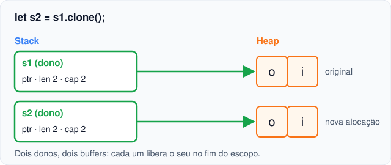

# 03 — Copy e Clone

**Objetivos.** Ao final, você vai saber:

- por que `let y = x;` com um inteiro não move nada;
- o que define um tipo `Copy` (e por que "dados na stack" é a definição errada);
- como pedir `Copy` e `Clone` para os seus tipos, e quando o compilador recusa;
- quando `clone()` é a resposta certa, e quando é só um jeito de calar o compilador.

## Por que inteiros não dão E0382

Depois da lição anterior, isto parece errado:

```rust
let x = 5;
let y = x;
println!("{x} {y}");   // 5 5
```

Não há erro porque `i32` é um tipo **`Copy`**: em vez de mover, a atribuição copia o valor, e as duas variáveis continuam válidas. A mensagem do E0382 já dava a pista: "move occurs because `s1` has type `String`, which does not implement the `Copy` trait".

## O que é `Copy`

Um tipo é `Copy` quando duplicar os seus bytes produz um valor **independente e completo**, sem precisar rodar nenhum código. Na prática:

- a cópia é **implícita** (acontece em `=`, em chamadas e em retornos, no lugar do move);
- a cópia é **bit a bit**, sem lógica customizada (não existe "construtor de cópia");
- o tipo **não pode ter `Drop`**: se não há nada a liberar, duplicar é inofensivo.

São `Copy`: os inteiros, `f32`/`f64`, `bool`, `char`, as referências compartilhadas `&T`, e tuplas e arrays cujos elementos são todos `Copy`. Não são `Copy`: `String`, `Vec<T>`, `Box<T>` e qualquer tipo que seja dono de memória no heap. Uma `String` não pode ser `Copy` porque duplicar os seus 24 bytes daria dois donos para o mesmo buffer, exatamente o que o move evita.

> [!WARNING]
> O Rust Book chama esses tipos de "*stack-only data*". É um atalho que engana. `Copy` diz **como** o valor é duplicado, e não **onde** ele mora:
>
> - os `i32` de um `Vec<i32>` estão no heap e são `Copy`: `let x = nums[0];` funciona (compare com o E0507 da lição anterior, com `Vec<String>`);
> - uma `&String` é `Copy` e aponta para dados no heap: copiá-la cria outra referência, e não outro texto;
> - um `[u8; 4096]` é `Copy` e mora na stack, mas copiá-lo custa 4 KB. `Copy` não quer dizer "de graça".

```rust
let nums: Vec<i32> = vec![1, 2, 3];
let x = nums[0];               // copia o i32 que está no heap
println!("{x} {nums:?}");      // 1 [1, 2, 3]

let s = String::from("oi");
let r1 = &s;
let r2 = r1;                   // copia a referência, não o texto
println!("{r1} {r2}");         // oi oi
```

`&mut T` **não** é `Copy`: o Módulo 03 mostra que só pode existir um `&mut` para cada valor por vez, e copiar quebraria essa regra.

## `Copy` e `Clone` nos seus tipos

Um struct novo não é `Copy` nem `Clone` por padrão. Você pede ao compilador para gerar as duas implementações com `#[derive]`:

```rust
#[derive(Debug, Clone, Copy)]
struct Ponto {
    x: f64,
    y: f64,
}

fn main() {
    let p = Ponto { x: 1.0, y: 2.0 };
    let q = p;              // cópia, não move
    println!("{p:?} {q:?}");
}
```

```text
Ponto { x: 1.0, y: 2.0 } Ponto { x: 1.0, y: 2.0 }
```

(`Debug` é o que permite imprimir com `{:?}`. O `derive` e as *traits* em geral são o Módulo 06. Aqui basta saber que `derive` pede ao compilador para escrever o código por você.)

O compilador só aceita `Copy` se **todos os campos** forem `Copy`:

```rust
// ❌ NÃO COMPILA
#[derive(Clone, Copy)]
struct Usuario {
    id: u32,
    nome: String,
}
```

```text
error[E0204]: the trait `Copy` cannot be implemented for this type
 --> src/main.rs:2:8
  |
1 | #[derive(Clone, Copy)]
  |                 ---- in this derive macro expansion
2 | struct Usuario {
  |        ^^^^^^^
3 |     id: u32,
4 |     nome: String,
  |     ------------ this field does not implement `Copy`
```

O rótulo secundário aponta o culpado: `nome`. A correção é tirar o `Copy` e ficar só com `Clone`. Um `Usuario` passa a ser movido em `=`, e copiado só quando você pedir.

## `Clone`: a cópia que você pede

`clone()` cria um valor novo e independente, com custo. Para uma `String`, isso significa alocar outro buffer no heap e copiar os bytes:

```rust
let s1 = String::from("oi");
let s2 = s1.clone();
println!("{s1} {s2}");   // as duas continuam válidas
```



O projeto [`codigo/memoria-da-string`](codigo/memoria-da-string/) confirma que os buffers são diferentes:

```text
== clone ==
buffer de s1: 0x10105ac10
buffer de s2: 0x10105ac80
mesmo buffer? false
s1 = oi, s2 = oi (as duas continuam válidas)
```

`clone()` copia **tudo o que o valor possui**. Clonar um `Vec<Vec<String>>` clona o vetor de fora, cada vetor de dentro e cada `String`:

```rust
let a = vec![vec![String::from("x")], vec![String::from("y")]];
let mut b = a.clone();
b[0].push(String::from("!"));
println!("a = {a:?}");   // a = [["x"], ["y"]]
println!("b = {b:?}");   // b = [["x", "!"], ["y"]]
```

Todo tipo `Copy` também é `Clone` (chamar `.clone()` num `i32` funciona e faz a mesma cópia bit a bit). O contrário não vale.

> [!NOTE]
> "Copiar tudo o que possui" é a regra para tipos donos como `String` e `Vec`. Os ponteiros com contagem de referências (`Rc`, `Arc`, no Módulo 10) não possuem o dado sozinhos, e por isso o `clone()` deles só incrementa um contador. Sempre vale olhar o que o `clone` de um tipo faz.

### Comparando com C++

Em C++, a cópia implícita vale para **qualquer** tipo com construtor de cópia, inclusive os caros:

```cpp
void processa(std::vector<std::string> v);   // por valor

std::vector<std::string> nomes = carregar();
processa(nomes);            // copia o vetor e todas as strings, sem aviso
auto outro = nomes;         // de novo
```

Em Rust, `processa(nomes)` **move** o vetor (barato) e, se você quiser uma cópia, precisa escrever `processa(nomes.clone())`. O Rust Book resume: quando você vê um `clone`, sabe que algum código possivelmente caro vai rodar. A cópia cara não some, ela fica **visível**.

### Comparando com Python

Em Python, as cópias comuns são **rasas**:

```python
import copy

a = [["x"], ["y"]]
b = list(a)          # também: a[:], a.copy(), copy.copy(a)
b[0].append("!")
print(a)             # [['x', '!'], ['y']]: a lista de dentro é compartilhada

c = copy.deepcopy(a)
c[1].append("?")
print(a, c)          # [['x', '!'], ['y']] [['x', '!'], ['y', '?']]
```

O `clone()` de um `Vec<Vec<String>>` se comporta como `copy.deepcopy`, e não como `list(a)`: como cada valor tem um único dono, não existe "lista de dentro compartilhada" para a cópia esquecer. Se você quiser de fato compartilhar, precisa pedir isso de forma explícita (com referências, no Módulo 03, ou com `Rc`, no Módulo 10).

## O antipadrão: clonar para calar o compilador

Este código compila:

```rust
fn contar_letras(texto: String) -> usize {
    texto.chars().filter(|c| c.is_alphabetic()).count()
}

fn main() {
    let frase = String::from("Olá, mundo!");
    for _ in 0..3 {
        let n = contar_letras(frase.clone());   // aloca e copia a cada volta
        println!("{n}");
    }
    println!("{frase}");
}
```

O `clone()` resolve o E0382, mas o problema real é a assinatura: `contar_letras` só lê o texto e mesmo assim exige a posse. A correção é a de sempre, emprestar: `fn contar_letras(texto: &str)` e `contar_letras(&frase)`. Nenhuma alocação, nenhuma cópia.

Use `clone()` quando você **quer** duas cópias independentes (uma vai mudar e a outra não, ou cada uma vai para um dono diferente). Se a única razão é "o compilador reclamou", volte ao fluxograma da [lição anterior](02-regras-de-ownership-e-move.md#as-três-saídas-para-o-e0382).

> [!TIP]
> Clonar não é proibido nem vergonhoso. Em código que não é crítico em desempenho, um `clone()` que deixa o código mais simples é uma troca razoável. O antipadrão é clonar **sem pensar**, por reflexo do `help:`.

## Armadilhas comuns

### `Copy` sem `Clone`

```rust
// ❌ NÃO COMPILA
#[derive(Copy)]
struct Ponto {
    x: f64,
    y: f64,
}
```

```text
error[E0277]: the trait bound `Ponto: Clone` is not satisfied
   --> src/main.rs:2:8
    |
  1 | #[derive(Copy)]
    |          ---- in this derive macro expansion
  2 | struct Ponto {
    |        ^^^^^ the trait `Clone` is not implemented for `Ponto`
    |
note: required by a bound in `Copy`
...
help: consider annotating `Ponto` with `#[derive(Clone)]`
    |
  2 + #[derive(Clone)]
  3 | struct Ponto {
    |
```

Todo `Copy` precisa ser `Clone`. Peça os dois juntos: `#[derive(Clone, Copy)]`.

### Campo que não é `Copy` (E0204)

Visto acima: um único campo `String`, `Vec` ou `Box` impede o `Copy`. Use só `Clone`.

### Tipo com `Drop` não pode ser `Copy` (E0184)

Um tipo que precisa rodar código de limpeza não pode ser duplicado em silêncio. Esse erro aparece na [próxima lição](04-drop-e-raii.md).

### Achar que `Copy` é sobre a stack

Pergunte "duplicar os bytes dá um valor independente e sem dono duplicado?", e não "isto está na stack?". Os exemplos do `Vec<i32>` e da `&String` acima mostram por quê.

## Resumo

- Tipos `Copy` são copiados em vez de movidos: a cópia é implícita, bit a bit e não pode ter lógica customizada.
- São `Copy`: números, `bool`, `char`, `&T`, e tuplas e arrays de `Copy`. Tipos que são donos de memória no heap (`String`, `Vec`, `Box`) e `&mut T` não são.
- `Copy` é sobre como o valor é duplicado, e não sobre onde ele mora.
- `#[derive(Clone, Copy)]` só funciona se todos os campos forem `Copy` (E0204), e `Copy` exige `Clone`.
- `clone()` é a cópia explícita e possivelmente cara. Num `Vec<Vec<String>>`, ele age como o `deepcopy` do Python.
- Clone quando você precisa de duas cópias independentes, e não para calar o compilador.

## Exercícios

Veja o exercício 2 em [`exercicios.md`](exercicios.md).

## Leitura complementar

- [The Rust Programming Language, 4.1](https://doc.rust-lang.org/stable/book/ch04-01-what-is-ownership.html) (seções "Variables and Data Interacting with Clone" e "Stack-Only Data: Copy")
- [Comprehensive Rust: Copy Types](https://google.github.io/comprehensive-rust/memory-management/copy-types.html) e [Clone](https://google.github.io/comprehensive-rust/memory-management/clone.html)
- Documentação de [`Copy`](https://doc.rust-lang.org/std/marker/trait.Copy.html) e [`Clone`](https://doc.rust-lang.org/std/clone/trait.Clone.html)
- [Rust Design Patterns: Clone to satisfy the borrow checker](https://rust-unofficial.github.io/patterns/anti_patterns/borrow_clone.html)

---

[← Lição anterior](02-regras-de-ownership-e-move.md) · [Índice do módulo](README.md) · [Próxima lição →](04-drop-e-raii.md)
