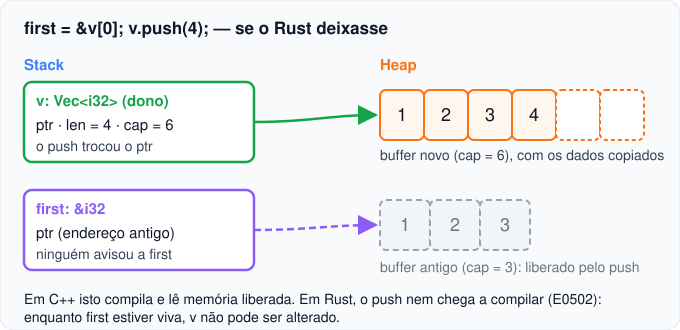

# 01 — Referências e empréstimos

**Objetivos.** Ao final, você vai saber:

- criar e usar referências compartilhadas (`&T`) e exclusivas (`&mut T`);
- explicar a regra "vários leitores **ou** um escritor" e o problema que ela evita;
- ler um erro de empréstimo com o modelo de permissões R/W/O;
- comparar as referências de Rust com as de C++ e com os nomes do Python.

## O problema: emprestar sem dar

No [Módulo 02](../02-ownership/README.md) você viu que passar uma `String` para uma função **move** o valor. Se quem chamou ainda precisa dela, a função tem de devolvê-la:

```rust
fn calculate_length(s: String) -> (String, usize) {
    let len = s.len();
    (s, len)
}

fn main() {
    let s1 = String::from("olá");
    let (s1, len) = calculate_length(s1);
    println!("{s1} tem {len} bytes");
}
```

```text
olá tem 4 bytes
```

Funciona, mas é cerimônia demais só para ler um tamanho. (E são 4 bytes, não 3, porque o `á` ocupa 2 bytes em UTF-8, como no M02.)

O que você quer é **emprestar** a string: a função usa o valor por um tempo e devolve o acesso no fim, sem nunca virar dona dele. Para isso existem as referências:

```rust
fn calculate_length(s: &String) -> usize {
    s.len()
}

fn main() {
    let s1 = String::from("olá");
    let len = calculate_length(&s1);
    println!("{s1} tem {len} bytes");
}
```

`&s1` cria uma **referência** para `s1`, e o tipo `&String` diz "referência para uma `String`". Criar uma referência se chama *borrowing* (emprestar). Como `s` não é dona do valor, nada é liberado quando `s` sai de escopo. A `String` continua com `s1`, que a libera no fim de `main`.

> [!NOTE]
> Na lição 03 você vai ver que o parâmetro idiomático aqui é `&str`, e não `&String`. Por enquanto, `&String` deixa mais claro de onde vem o empréstimo.

## `&mut`: emprestar para alterar

Uma referência comum só permite ler. Para alterar o valor de outra pessoa, peça uma **referência mutável** (exclusiva), com `&mut`:

```rust
fn add_suffix(s: &mut String) {
    s.push_str(", Esq.");
}

fn main() {
    let mut name = String::from("Fulano");
    add_suffix(&mut name);
    println!("{name}");
}
```

```text
Fulano, Esq.
```

Três lugares precisam concordar: a variável é `let mut`, a chamada passa `&mut name` e o parâmetro é `&mut String`. Isso deixa visível, na chamada, que a função pode mudar o seu valor. Em C++, `f(x)` pode receber `x` por cópia ou por `T&`, e você só descobre olhando a assinatura.

Se a variável não for `mut`, não dá para emprestá-la como `&mut`:

```rust
// ❌ NÃO COMPILA
fn main() {
    let s = String::from("oi");
    let r = &mut s;
    r.push('!');
}
```

```text
error[E0596]: cannot borrow `s` as mutable, as it is not declared as mutable
 --> src/main.rs:3:13
  |
3 |     let r = &mut s;
  |             ^^^^^^ cannot borrow as mutable
  |
help: consider changing this to be mutable
  |
2 |     let mut s = String::from("oi");
  |         +++
```

## Desreferência e o ponto automático

`*r` acessa o valor para onde `r` aponta, como em C/C++:

```rust
fn main() {
    let mut x = 10;
    let r = &mut x;
    *r += 1;
    println!("{x}");

    let v = vec![3, 1, 2];
    let rv = &v;
    println!("{} {}", rv.len(), (*rv).len());
}
```

```text
11
3 3
```

Na chamada de método você quase nunca escreve `*`: o compilador insere `&`, `&mut` ou `*` sozinho para casar com o que o método espera (*auto-referencing*). Por isso `rv.len()` funciona, e por isso Rust não precisa do operador `->` do C++. O Módulo 04 volta a isso quando você escrever seus próprios métodos.

## A regra: vários leitores ou um escritor

Em qualquer ponto do programa, para um mesmo valor, você pode ter:

- **qualquer número de referências `&T`** (ninguém altera, todo mundo lê), **ou**
- **exatamente uma referência `&mut T`** (só ela acessa, e pode alterar).

Nunca as duas coisas ao mesmo tempo. Por isso é melhor pensar em `&T` como referência **compartilhada** e em `&mut T` como referência **exclusiva**. O "mut" do nome engana: a garantia principal de `&mut` é a exclusividade, e é ela que permite a mutação com segurança.

O livro da Brown University resume o motivo num princípio: um dado nunca deve ser, ao mesmo tempo, **acessível por mais de um caminho** (*aliased*) e **alterado**. Cada combinação sozinha é inofensiva. As duas juntas causam bugs.

Veja o exemplo clássico, em C++:

```cpp
std::vector<int> v{1, 2, 3};
int& first = v[0];
v.push_back(4);           // pode realocar o buffer
std::cout << first << "\n";  // lê memória já liberada
```

Isso compila sem aviso com `clang++ -Wall -Wextra`. Na máquina em que este curso foi testado, imprimiu `2` (lixo). Com o *AddressSanitizer* ligado, a execução para com:

```text
==44405==ERROR: AddressSanitizer: heap-use-after-free on address 0x6020000000d0 ...
READ of size 4 at 0x6020000000d0 thread T0
    #0 0x000102464b1c in main push.cpp:8
```

O que aconteceu: `v` tinha capacidade 3. O `push_back` alocou um buffer maior, copiou os elementos e liberou o antigo. `first` continuou apontando para o buffer antigo.



Aqui, `first` é o *alias* e o `push` é a mutação. Em Rust, o mesmo código não compila:

```rust
// ❌ NÃO COMPILA
fn main() {
    let mut v = vec![1, 2, 3];
    let first = &v[0];
    v.push(4);
    println!("{first}");
}
```

```text
error[E0502]: cannot borrow `v` as mutable because it is also borrowed as immutable
 --> src/main.rs:4:5
  |
3 |     let first = &v[0];
  |                  - immutable borrow occurs here
4 |     v.push(4);
  |     ^^^^^^^^^ mutable borrow occurs here
5 |     println!("{first}");
  |                ----- immutable borrow later used here
```

Os três rótulos contam a história inteira:

| Rótulo | Linha | Significado |
|---|---|---|
| `immutable borrow occurs here` | 3 | aqui nasce a referência compartilhada `first` |
| `mutable borrow occurs here` (primário, `^^^`) | 4 | `push` recebe `&mut self`, ou seja, pede acesso exclusivo a `v` |
| `immutable borrow later used here` | 5 | e `first` ainda é usada depois, então estava viva durante o `push` |

O erro não diz "o vetor vai realocar". O compilador nem sabe se vai. Ele aplica a regra: havia uma `&` viva quando alguém pediu `&mut`. É uma regra simples e local, e ela cobre esse caso e muitos outros.

## Lendo erros com permissões (R/W/O)

O [livro da Brown University](https://rust-book.cs.brown.edu/ch04-02-references-and-borrowing.html) (uma versão do Rust Book com quizzes e visualizações) propõe um modelo mental que ajuda muito a ler esses erros. A ideia: cada *lugar* do programa (uma variável, um campo `p.x`, um `*r`, um `v[i]`) tem **permissões**:

- **R** (*read*): pode ser lido;
- **W** (*write*): pode ser alterado;
- **O** (*own*): pode ser movido ou liberado (*dropado*).

As permissões não existem em tempo de execução. São só o raciocínio do compilador. As regras básicas:

- `let x = ...` dá a `x` as permissões R e O. `let mut x` dá R, W e O.
- Criar `&x` **tira W e O de `x`** enquanto a referência viver. R continua: todo mundo pode ler.
- Criar `&mut x` **tira R, W e O de `x`**: só a referência acessa o valor.
- Quando a referência é usada pela última vez, as permissões **voltam**.

O exemplo do `push`, linha a linha (a versão que compila, com o `println!` antes):

| Código | `v` | `first` | `*first` |
|---|---|---|---|
| `let mut v = vec![1, 2, 3];` | R W O | | |
| `let first = &v[0];` | R ~~W~~ ~~O~~ | R O | R |
| `println!("{first}");` (último uso de `first`) | R **W O** (voltaram) | (morreu) | (morreu) |
| `v.push(4);` (precisa de R e W em `v`) | R W O | | |

Na versão que não compila, o `push` vem **antes** do último uso de `first`. Naquele ponto, `v` está sem W, e o `push` precisa de W. É exatamente o que o E0502 diz.

O mesmo raciocínio explica por que não dá para mover um valor emprestado: mover precisa de O, e o empréstimo tirou O.

```rust
// ❌ NÃO COMPILA
fn main() {
    let v = vec![1, 2, 3];
    let first = &v[0];
    let w = v;
    println!("{first} {w:?}");
}
```

```text
error[E0505]: cannot move out of `v` because it is borrowed
 --> src/main.rs:4:13
  |
2 |     let v = vec![1, 2, 3];
  |         - binding `v` declared here
3 |     let first = &v[0];
  |                  - borrow of `v` occurs here
4 |     let w = v;
  |             ^ move out of `v` occurs here
5 |     println!("{first} {w:?}");
  |                ----- borrow later used here
...
```

Se o move fosse aceito, `w` poderia liberar o vetor enquanto `first` ainda aponta para ele.

> [!TIP]
> Diante de um erro de empréstimo, pergunte: "que permissão esta linha precisa, e qual referência viva tirou essa permissão?". Os rótulos secundários do erro respondem a segunda parte.

## Comparando com C++

| | C++ | Rust |
|---|---|---|
| leitura | `const T&` | `&T` |
| escrita | `T&` | `&mut T` |
| nula | "impossível", mas `*ptr` nulo cria uma | não existe; "talvez" é `Option<&T>` (M04) |
| trocar o alvo | impossível: `r = b` escreve em quem `r` aponta | `let mut r = &a; r = &b;` troca o ponteiro |
| aliasing | livre: vários `T&` e `const T&` para o mesmo objeto | verificado: muitos `&T` ou um `&mut T` |
| validade | por conta do programador | verificada pelo compilador (lições 02 e 04) |

A linha do `const` merece atenção. Em C++, `const T&` impede que **você** escreva por aquele caminho, mas outro caminho pode alterar o objeto enquanto você lê:

```cpp
void add_twice(int& total, const int& delta) {
    total += delta;
    total += delta;  // se delta for alias de total, ele mudou no meio
}

int main() {
    int x = 5;
    add_twice(x, x);
    std::cout << x << "\n";
}
```

```text
20
```

Quem lê a assinatura espera 15. Em Rust, `add_twice(&mut x, &x)` não compila: enquanto existe um `&T`, **ninguém** altera o valor. É uma garantia mais forte que o `const` do C++. Ela também ajuda o otimizador, que pode manter o valor atrás de `&T` num registrador sem reler a memória.

Trocar o alvo de uma referência funciona assim:

```rust
fn main() {
    let a = 1;
    let b = 2;
    let mut r = &a;
    println!("{r}");
    r = &b;
    println!("{r} {a}");
}
```

```text
1
2 1
```

`r = &b` mudou para onde `r` aponta. `a` ficou intacto. Note também a diferença entre `let mut r: &i32` (posso trocar o alvo de `r`) e `r: &mut i32` (posso alterar o valor apontado).

## Comparando com Python

Em Python, todo nome é uma referência compartilhada, e qualquer uma delas pode alterar o objeto:

```python
a = [1, 2, 3]
b = a
b.append(4)
print(a)
```

```text
[1, 2, 3, 4]
```

Isso é aliasing com mutação, e o garbage collector não protege você de bugs de lógica. O clássico:

```python
grade = [[0] * 3] * 3
grade[0][0] = 1
print(grade)
```

```text
[[1, 0, 0], [1, 0, 0], [1, 0, 0]]
```

As três linhas são a mesma lista. Em Rust, os aliases ficam explícitos no tipo (`&` ou `&mut`), e a mutação através de um alias só acontece quando ele é o único acesso ao valor. A regra não é só sobre memória: ela também elimina essa classe de surpresa.

## Armadilhas comuns

**Ler `&mut` como "vou escrever".** O que importa é a exclusividade. Uma `&mut` viva conflita com qualquer outro acesso, mesmo que você nunca escreva por ela. A lição 02 mostra o erro.

**Aceitar o `help:` sem pensar.** No E0505 acima, o compilador sugere:

```text
help: consider cloning the value if the performance cost is acceptable
  |
3 |     let first = &v.clone()[0];
  |                   ++++++++
```

Isso compila, mas copia o vetor **inteiro** (com alocação no heap) só para ler um elemento, e `first` passa a apontar para essa cópia. A correção real é decidir a ordem: use `first` antes de mover `v`, ou guarde uma cópia do **elemento** (`let first = v[0];`, já que `i32` é `Copy`).

**Esquecer o `mut` em algum dos três lugares.** `let mut x`, `&mut x` e `&mut T` no parâmetro. O E0596 aponta qual está faltando.

## Resumo

- `&T` empresta para leitura (compartilhada). `&mut T` empresta com acesso exclusivo, e só ela pode alterar.
- Em cada ponto do programa: muitas `&T` **ou** uma `&mut T`. Aliasing e mutação nunca juntos.
- `*r` desreferencia. Em chamadas de método, o compilador insere `&`/`*` sozinho.
- Modelo R/W/O: `&x` tira W e O de `x`, `&mut x` tira tudo. As permissões voltam depois do último uso da referência.
- Ao contrário do `const T&` do C++, `&T` garante que **ninguém** altera o valor enquanto ela vive.

## Exercícios

Veja o exercício 1 em [`exercicios.md`](exercicios.md).

## Leitura complementar

- [The Rust Programming Language, 4.2 References and Borrowing](https://doc.rust-lang.org/stable/book/ch04-02-references-and-borrowing.html)
- [Brown University, 4.2 References and Borrowing](https://rust-book.cs.brown.edu/ch04-02-references-and-borrowing.html) (origem do modelo de permissões R/W/O, com visualizações interativas)
- [Comprehensive Rust: Borrowing](https://google.github.io/comprehensive-rust/borrowing.html)
- [Rust by Example: Borrowing](https://doc.rust-lang.org/rust-by-example/scope/borrow.html)
- Código desta lição: [`codigo/emprestimos`](codigo/emprestimos/)

---

[Índice do módulo](README.md) · [Próxima lição →](02-borrow-checker-e-nll.md)
