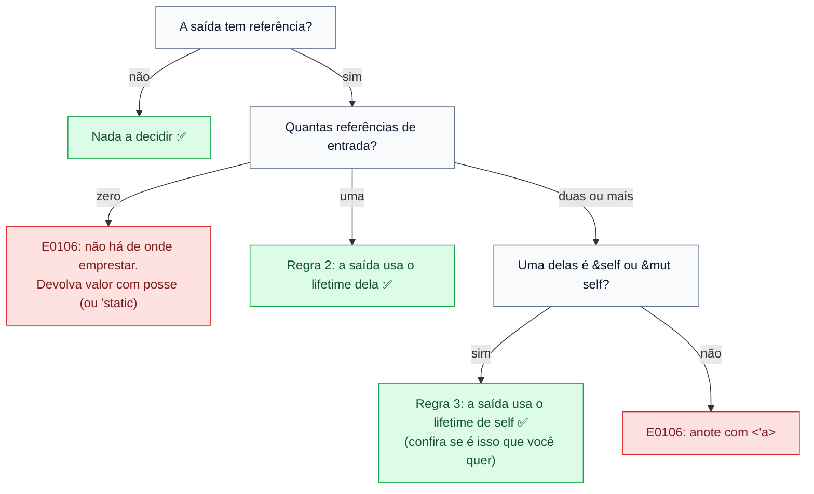

# 05 — Elisão e lifetime anônimo

**Objetivos.** Ao final, você vai saber:

- as três regras de elisão e prever quando uma assinatura precisa de anotação;
- reconhecer quando a regra do `&self` liga o retorno à coisa errada;
- usar `'_` para deixar visível um lifetime elidido, e por que o compilador avisa quando você não usa.

## Você já escreveu lifetimes sem saber

Na lição 03, `first_word` compilou sem nenhum `'a`:

```rust
fn first_word(s: &str) -> &str
```

Mas a lição 04 disse que toda referência tem um lifetime. Onde ele está? O compilador preencheu sozinho. A assinatura acima é exatamente esta:

```rust
fn first_word<'a>(s: &'a str) -> &'a str {
    s.split(' ').next().unwrap_or("")
}
```

Omitir lifetimes óbvios se chama *lifetime elision* (elisão). Ela não é inferência a partir do corpo: são **três regras fixas**, aplicadas só à assinatura. Se as regras não determinam todos os lifetimes da saída, você recebe o E0106 e precisa anotar.

Tanto que o clippy reclama se você escrever o que a elisão já cobre:

```text
warning: the following explicit lifetimes could be elided: 'a
 --> src/main.rs:1:15
  |
1 | fn first_word<'a>(s: &'a str) -> &'a str {
  |               ^^      ^^          ^^
...
help: elide the lifetimes
  |
1 - fn first_word<'a>(s: &'a str) -> &'a str {
1 + fn first_word(s: &str) -> &str {
  |
```

## As três regras

Chame de **entrada** os lifetimes dos parâmetros e de **saída** os do retorno.

1. **Cada referência de entrada sem nome ganha um lifetime próprio.** `fn f(x: &str, y: &str)` vira `fn f<'a, 'b>(x: &'a str, y: &'b str)`.
2. **Se há exatamente um lifetime de entrada**, ele vai para todas as referências de saída. `fn f(x: &str) -> (&str, &str)` vira `fn f<'a>(x: &'a str) -> (&'a str, &'a str)`.
3. **Se há vários lifetimes de entrada, mas um deles é de `&self` ou `&mut self`**, o lifetime de `self` vai para todas as saídas. É a regra dos métodos.

Se depois das três regras ainda sobrar um lifetime de saída sem dono, é erro. O fluxo:



Parâmetros que não são referência (`char`, `usize`, `String`) não contam. Por isso `fn split_pair(s: &str, sep: char) -> (&str, &str)` compila: só há uma referência de entrada.

## Preveja a elisão

Antes de abrir a resposta, decida para cada assinatura: compila como está, ou precisa de anotação?

| # | Assinatura |
|---|---|
| a | `fn first_word(s: &str) -> &str` |
| b | `fn split_pair(s: &str, sep: char) -> (&str, &str)` |
| c | `fn get(v: &Vec<i32>, i: &usize) -> &i32` |
| d | `fn name(&self, prefix: &str) -> &str` (num `impl`) |
| e | `fn longest(x: &str, y: &str) -> &str` |
| f | `fn new_label() -> &str` |

<details>
<summary>Respostas</summary>

| # | Resultado | Por quê |
|---|---|---|
| a | compila | regra 2: uma entrada |
| b | compila | regra 2: `sep` não é referência |
| c | **E0106** | duas referências de entrada, sem `self`. Aqui o certo seria `i: usize` (por valor), e aí a regra 2 resolve |
| d | compila | regra 3: o retorno fica ligado a `self` |
| e | **E0106** | duas entradas, sem `self` (lição 04) |
| f | **E0106** | nenhuma entrada. Devolva `String`, ou `&'static str` se for literal |

Todas foram conferidas com o compilador.

</details>

## Quando a regra 3 escolhe errado

A regra 3 aposta que um método devolve algo emprestado de `self`. Na maioria das vezes, acerta. Quando não acerta, o erro aparece no corpo:

```rust
// ❌ NÃO COMPILA
struct Config {
    name: String,
}

impl Config {
    fn name_or<'a>(&'a self, fallback: &'a str) -> &'a str {
        if self.name.is_empty() { fallback } else { &self.name }
    }
    fn name_or_bad(&self, fallback: &str) -> &str {
        if self.name.is_empty() { fallback } else { &self.name }
    }
}

fn main() {
    let c = Config { name: String::new() };
    println!("{}", c.name_or("anônimo"));
    println!("{}", c.name_or_bad("anônimo"));
}
```

```text
error: lifetime may not live long enough
  --> src/main.rs:10:35
   |
 9 |     fn name_or_bad(&self, fallback: &str) -> &str {
   |                    -                - let's call the lifetime of this reference `'1`
   |                    |
   |                    let's call the lifetime of this reference `'2`
10 |         if self.name.is_empty() { fallback } else { &self.name }
   |                                   ^^^^^^^^ method was supposed to return data with lifetime `'2` but it is returning data with lifetime `'1`
   |
help: consider introducing a named lifetime parameter and update trait if needed
   |
 9 |     fn name_or_bad<'a>(&self, fallback: &'a str) -> &'a str {
   |                   ++++                   ++          ++
```

Este erro não tem código `E`, e os rótulos usam nomes inventados (`'1`, `'2`) para os lifetimes elididos. Leia assim: pela regra 3, o retorno tem o lifetime de `self` (`'2`), mas o corpo pode devolver `fallback`, que tem outro (`'1`).

Repare também que o `help:` desta vez está **incompleto**: ele liga o retorno só a `fallback`, mas o corpo também devolve `&self.name`. A versão que compila é a `name_or` de cima, com `'a` em `&self`, em `fallback` e no retorno. Como sempre: entenda o erro antes de aplicar a sugestão.

## `'_`: o lifetime anônimo

Às vezes um tipo tem um parâmetro de lifetime "escondido". O iterador de slice, por exemplo, é `std::slice::Iter<'a, T>`: ele empresta o slice que percorre. Se você omitir esse parâmetro, o código compila, mas o compilador avisa desde a versão 1.89:

```rust
struct Stack {
    items: Vec<i32>,
}

impl Stack {
    fn iter(&self) -> std::slice::Iter<i32> {
        self.items.iter()
    }
}
```

```text
warning: hiding a lifetime that's elided elsewhere is confusing
 --> src/main.rs:6:13
  |
6 |     fn iter(&self) -> std::slice::Iter<i32> {
  |             ^^^^^     ^^^^^^^^^^^^^^^^^^^^^ the same lifetime is hidden here
  |             |
  |             the lifetime is elided here
  |
  = help: the same lifetime is referred to in inconsistent ways, making the signature confusing
  = note: `#[warn(mismatched_lifetime_syntaxes)]` on by default
help: use `'_` for type paths
  |
6 |     fn iter(&self) -> std::slice::Iter<'_, i32> {
  |                                        +++
```

O problema é de leitura: quem vê `-> std::slice::Iter<i32>` não percebe que o retorno empresta de `self`. Com `&i32` isso estaria óbvio (há um `&`), mas num tipo com nome o empréstimo fica invisível. O lint `mismatched_lifetime_syntaxes` pede consistência.

A correção é `'_`, o **lifetime anônimo**: "aqui tem um lifetime, siga as regras de elisão para ele".

```rust
impl Stack {
    fn iter(&self) -> std::slice::Iter<'_, i32> {
        self.items.iter()
    }

    fn top(&self) -> Option<&i32> {
        self.items.last()
    }
}
```

Regra prática deste curso: **em tipos com parâmetro de lifetime, escreva sempre `'_`** quando não for nomear. Você vai ver isso em `std::slice::Iter<'_, T>`, em `std::fmt::Formatter<'_>` (Módulo 06) e nos seus próprios tipos com referência, como o `Excerpt<'_>` da próxima lição.

> [!NOTE]
> Muito material antigo (inclusive trechos do Rust Book) mostra assinaturas sem `'_`. Elas compilam, mas geram o aviso acima nas versões atuais.

## Armadilhas comuns

**"Meu código não tem lifetimes."** Toda referência numa assinatura tem um. A elisão só esconde os que as três regras conseguem deduzir.

**Achar que a elisão olha o corpo.** Ela só aplica as regras à assinatura. Se o corpo devolve algo de outra origem, o erro aparece no corpo.

**Confiar cegamente na regra 3.** Se o método devolve algo que vem de outro parâmetro, ou de um dado que o próprio `self` só empresta (próxima lição), anote.

**Closures não seguem as mesmas regras.** A elisão descrita aqui vale para `fn`. *Closures* que recebem e devolvem referências às vezes precisam de outro arranjo. O Módulo 07 trata disso.

## Resumo

- Elisão são três regras fixas aplicadas à assinatura: cada entrada ganha seu lifetime; com uma entrada, ela vai para a saída; com `&self`, o lifetime de `self` vai para a saída.
- Se as regras não determinam a saída, é E0106 e você anota.
- A regra 3 pode ligar o retorno a `self` quando você queria outro parâmetro. O erro "lifetime may not live long enough" indica isso.
- `'_` marca um lifetime elidido de forma visível. Use em tipos com parâmetro de lifetime (`Iter<'_, T>`), como pede o lint `mismatched_lifetime_syntaxes`.

## Exercícios

Veja o exercício 2 em [`exercicios.md`](exercicios.md).

## Leitura complementar

- [The Rust Programming Language, 10.3, seção Lifetime Elision](https://doc.rust-lang.org/stable/book/ch10-03-lifetime-syntax.html#lifetime-elision)
- [Reference: Lifetime elision](https://doc.rust-lang.org/reference/lifetime-elision.html)
- [Comprehensive Rust: Lifetime Elision](https://google.github.io/comprehensive-rust/lifetimes/lifetime-elision.html)
- [rustc: lint `mismatched_lifetime_syntaxes`](https://doc.rust-lang.org/rustc/lints/listing/warn-by-default.html#mismatched-lifetime-syntaxes)
- [pretzelhammer: Common Rust Lifetime Misconceptions](https://github.com/pretzelhammer/rust-blog/blob/master/posts/common-rust-lifetime-misconceptions.md) (mitos 4 e 10)
- Código desta lição: [`codigo/lifetimes`](codigo/lifetimes/)

---

[← Lição anterior](04-lifetimes-em-funcoes.md) · [Índice do módulo](README.md) · [Próxima lição →](06-lifetimes-em-structs-e-static.md)
