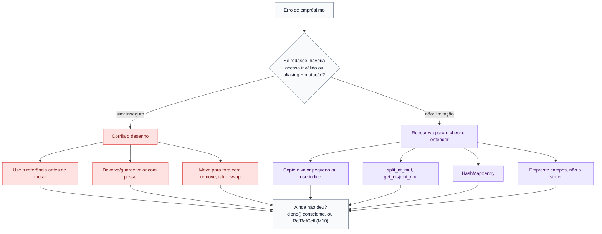

# 07 — Brigando menos com o borrow checker

**Objetivos.** Ao final, você vai saber:

- separar os erros de empréstimo em "programa inseguro" e "limitação do checker";
- aplicar o catálogo de correções idiomáticas, na ordem certa;
- resolver o "busca ou insere" num `HashMap` com a Entry API;
- usar `clone()` de forma consciente, e não para calar o compilador.

## A pergunta certa

O [livro da Brown University](https://rust-book.cs.brown.edu/ch04-03-fixing-ownership-errors.html) sugere que, diante de um erro de empréstimo, você pergunte primeiro:

> **O programa é inseguro, ou o checker é que não consegue provar que ele é seguro?**

As duas situações pedem respostas diferentes:

- **Inseguro**: se o código rodasse, haveria memória liberada sendo lida, dois donos liberando o mesmo valor ou aliasing com mutação. Aqui a correção muda o **desenho**: quem é dono, quem empresta, em que ordem.
- **Seguro, mas rejeitado**: o programa não faria nada de errado, mas o borrow checker trabalha com regras simples (olha assinaturas, trata `a[i]` como `a[_]`) e não consegue provar isso. Aqui você **reescreve** de um jeito que o checker entenda, quase sempre com uma API pronta.



## Programas inseguros

Você já viu vários: referência para local (E0515), referência guardada enquanto a coleção cresce (E0502), referência que sobrevive ao dono (E0597). Falta um muito comum: **mover para fora** de uma coleção ou de uma referência.

```rust
// ❌ NÃO COMPILA
fn main() {
    let v = vec![String::from("a"), String::from("b")];
    let s = v[0];
    println!("{s}");
}
```

```text
error[E0507]: cannot move out of index of `Vec<String>`
 --> src/main.rs:3:13
  |
3 |     let s = v[0];
  |             ^^^^ move occurs because value has type `String`, which does not implement the `Copy` trait
  |
help: consider borrowing here
  |
3 |     let s = &v[0];
  |             +
help: consider cloning the value if the performance cost is acceptable
  |
3 |     let s = v[0].clone();
  |                 ++++++++
```

Se isso compilasse, `s` e o vetor seriam donos da mesma `String`, e ela seria liberada duas vezes (*double free*). O mesmo vale para `*r` quando `r` é uma referência:

```text
error[E0507]: cannot move out of `*r` which is behind a shared reference
 --> src/main.rs:4:13
  |
4 |     let s = *r;
  |             ^^ move occurs because `*r` has type `String`, which does not implement the `Copy` trait
```

Em permissões: mover precisa de O, e um elemento de `Vec` acessado por índice (ou um `*r`) não tem O. As saídas, conforme o que você quer:

```rust
fn main() {
    let mut v = vec![String::from("a"), String::from("b"), String::from("c")];
    let r = &v[0];                          // só ler: empreste
    println!("emprestado: {r}");
    let copia = v[0].clone();               // precisa de uma cópia independente
    let tirado = v.remove(0);               // tirar de verdade da coleção
    let trocado = std::mem::take(&mut v[0]); // pegar e deixar um valor padrão ("")
    println!("{copia} {tirado} {trocado} {v:?}");
}
```

```text
emprestado: a
a a b ["", "c"]
```

`std::mem::take` (e o primo `std::mem::replace`) e `Option::take` são as formas de "tirar" um valor de dentro de algo emprestado: você deixa um substituto no lugar, e a coleção continua válida.

## Seguros, mas rejeitados

### O checker só lê assinaturas

```rust
// ❌ NÃO COMPILA
fn get_first(name: &(String, String)) -> &String {
    &name.0
}

fn main() {
    let mut name = (String::from("Ferris"), String::from("Rustáceo"));
    let first = get_first(&name);
    name.1.push_str(", Esq.");
    println!("{first} {}", name.1);
}
```

```text
error[E0502]: cannot borrow `name.1` as mutable because it is also borrowed as immutable
 --> src/main.rs:8:5
  |
7 |     let first = get_first(&name);
  |                           ----- immutable borrow occurs here
8 |     name.1.push_str(", Esq.");
  |     ^^^^^^^^^^^^^^^^^^^^^^^^^ mutable borrow occurs here
9 |     println!("{first} {}", name.1);
  |                ----- immutable borrow later used here
```

`get_first` só lê `name.0`, e o `push_str` mexe em `name.1`. Seria seguro. Mas a assinatura diz "empresto a tupla **inteira**", e o checker não olha o corpo. Sem a função, ele vê os campos separados e aceita:

```rust
fn main() {
    let mut name = (String::from("Ferris"), String::from("Rustáceo"));
    let first = &name.0;
    name.1.push_str(", Esq.");
    println!("{first} {}", name.1);
}
```

```text
Ferris Rustáceo, Esq.
```

O mesmo acontece com métodos, e é aqui que mais gente trava:

```rust
// ❌ NÃO COMPILA
struct Player {
    name: String,
    score: u32,
}

impl Player {
    fn name(&self) -> &str {
        &self.name
    }

    fn add_score(&mut self, points: u32) {
        self.score += points;
    }
}

fn main() {
    let mut p = Player { name: String::from("Ana"), score: 0 };
    let name = p.name();
    p.add_score(10);
    println!("{name}: {}", p.score);
}
```

```text
error[E0502]: cannot borrow `p` as mutable because it is also borrowed as immutable
  --> src/main.rs:19:5
   |
18 |     let name = p.name();
   |                - immutable borrow occurs here
19 |     p.add_score(10);
   |     ^^^^^^^^^^^^^^^ mutable borrow occurs here
20 |     println!("{name}: {}", p.score);
   |                ---- immutable borrow later used here
```

`p.name()` empresta `p` inteiro (é `&self`), e `add_score` pede `&mut self` inteiro. Saídas, da mais simples para a mais estrutural:

1. **Reordene**: chame `add_score` antes de pegar `name`, ou use `name` antes.
2. **Acesse os campos direto** (dentro do módulo, onde eles são visíveis): `let name = &p.name; p.score += 10;` compila, porque são lugares diferentes.
3. **Devolva algo com posse** quando fizer sentido (`fn label(&self) -> String`).
4. **Divida o struct**: se dois grupos de campos são sempre usados de forma independente, talvez sejam dois structs.

### Índices do mesmo array

Você viu na lição 03: `&mut a[1]` e `&a[2]` dão E0502, porque o checker vê `a[_]`. Saídas: `split_at_mut`, `get_disjoint_mut` ou, se os valores forem `Copy`, ler o valor antes (`let y = a[2]; a[1] += y;`).

### "Busca ou insere": a limitação mais famosa

Uma função que devolve o valor de uma chave, inserindo um padrão se ela não existir:

```rust
// ❌ NÃO COMPILA (programa seguro, limitação do borrow checker atual)
use std::collections::HashMap;

fn get_or_default(map: &mut HashMap<u32, String>, k: u32) -> &String {
    if let Some(v) = map.get(&k) {
        return v;
    }
    map.insert(k, String::new());
    &map[&k]
}

fn main() {
    let mut m = HashMap::new();
    println!("{:?}", get_or_default(&mut m, 1));
}
```

```text
error[E0502]: cannot borrow `*map` as mutable because it is also borrowed as immutable
 --> src/main.rs:7:5
  |
3 | fn get_or_default(map: &mut HashMap<u32, String>, k: u32) -> &String {
  |                        - let's call the lifetime of this reference `'1`
4 |     if let Some(v) = map.get(&k) {
  |                      --- immutable borrow occurs here
5 |         return v;
  |                - returning this value requires that `*map` is borrowed for `'1`
6 |     }
7 |     map.insert(k, String::new());
  |     ^^^^^^^^^^^^^^^^^^^^^^^^^^^^ mutable borrow occurs here
```

O programa é seguro: se a chave existe, a função retorna e o `insert` nunca roda. Se não existe, o empréstimo do `get` não é usado. Mas o checker atual raciocina assim: "`v` é devolvido, então o empréstimo de `map.get` precisa durar até o fim da função (`'1`)". E, se dura até o fim da função, cobre o `insert`. Ele não separa os dois caminhos do `if`.

O próximo borrow checker, chamado **Polonius**, aceita esse código. Na versão 1.99, ele ainda não está estável, então você precisa contornar. A forma idiomática é a **Entry API**, que faz a busca e a inserção numa operação só:

```rust
use std::collections::HashMap;

fn get_or_default(map: &mut HashMap<u32, String>, k: u32) -> &mut String {
    map.entry(k).or_default()
}

fn main() {
    let mut m = HashMap::new();
    get_or_default(&mut m, 1).push_str("um");
    get_or_default(&mut m, 1).push_str("!");
    println!("{:?}", m);
}
```

```text
{1: "um!"}
```

`map.entry(k)` empresta o mapa **uma vez** e devolve uma "vaga" para a chave. `or_default()` insere `String::default()` se a vaga estiver vazia e devolve `&mut` para o valor. Variantes: `or_insert(valor)`, `or_insert_with(|| ...)`. O caso de uso mais comum é contar coisas:

```rust
*counts.entry(word).or_insert(0) += 1;
```

Também dá para escrever com duas buscas (`if !map.contains_key(&k) { map.insert(...) }` seguido de `&map[&k]`), que compila, porque nenhum empréstimo atravessa o `if`. Mas faz o *hash* da chave duas ou três vezes. A `entry` faz uma vez.

## O catálogo de correções

Na ordem em que vale tentar:

1. **Encurte ou reordene o empréstimo.** Use a referência antes de mutar. Com NLL (lição 02), muitas vezes basta mover uma linha.
2. **Copie o valor pequeno em vez de guardar a referência.** Se você só precisa do tamanho, guarde o `usize`:

   ```rust
   let largest_len = names.iter().map(|s| s.len()).max().unwrap_or(0);
   names.push(String::from("Zé")); // ok: nenhuma referência para names está viva
   ```

3. **Devolva ou guarde valores com posse.** `String` em vez de `&str` quando o dado precisa sobreviver ao escopo (lições 04 e 06).
4. **Junte primeiro, aplique depois.** Colete as mudanças num `Vec` e chame `extend` depois do laço (lição 02).
5. **Use índices em vez de referências.** Um índice é um `usize`: não empresta nada. Ache a posição primeiro, mute depois.
6. **Use as APIs feitas para isso.** `split_at_mut`, `get_disjoint_mut`, `HashMap::entry`, `Vec::retain` (remove durante a "iteração" com segurança), `std::mem::take`/`replace`, `Option::take`.
7. **Empreste campos, não o struct.** Métodos `&self`/`&mut self` emprestam tudo. Acesse os campos ou divida o struct.
8. **`clone()` consciente.** Veja abaixo.
9. **Mutabilidade interior e posse compartilhada** (`Rc`, `RefCell`, `Arc`, `Mutex`). Elas existem para os casos em que a posse realmente precisa ser compartilhada. São assunto do Módulo 10. Não comece por elas.

Exemplos de todos os itens estão em [`codigo/padroes-borrow`](codigo/padroes-borrow/).

## `clone()` consciente

`clone()` resolve quase todo erro de empréstimo, porque cria um valor independente que ninguém mais empresta. Não é pecado:

- em código que roda poucas vezes (configuração, inicialização, testes);
- em protótipos, para destravar e voltar depois;
- quando o valor é pequeno (uma `String` curta, um struct de poucos campos).

O antipadrão é clonar **sem entender o erro**. Às vezes o erro estava apontando um bug real (você ia ler um dado desatualizado). Às vezes o clone fica num laço quente e copia megabytes a cada volta. A regra: entenda por que o checker reclamou e, se a resposta for "é só uma limitação e a cópia é barata", clone com tranquilidade.

## Armadilhas comuns

**Aceitar o primeiro `help:`.** O compilador sugere a correção mais local (`&`, `.clone()`, `'static`). Pergunte antes se o programa é inseguro ou se é uma limitação.

**Ir direto para `Rc<RefCell<T>>`.** Resolve o erro de compilação trocando-o por verificação em runtime (e possíveis *panics*). Quase sempre há uma solução mais simples na lista acima.

**Esperar que o checker entenda o corpo das funções.** Ele lê assinaturas. Se a assinatura empresta o todo, o todo fica emprestado.

**Achar que todo erro de empréstimo é bug seu.** Alguns são limitações conhecidas, como o "busca ou insere". Reconhecer o padrão poupa tempo.

## Resumo

- Diante do erro, pergunte: o programa é inseguro, ou o checker é que não consegue provar?
- Inseguro: corrija o desenho (ordem, posse, `remove`/`take` em vez de mover para fora).
- Limitação: reescreva com valores copiados, índices, empréstimos de campos e APIs como `split_at_mut`, `get_disjoint_mut` e `entry`.
- O "busca ou insere" com retorno condicional ainda dá E0502 sem Polonius. Use `map.entry(k).or_default()`.
- `clone()` é uma ferramenta legítima quando você entende o erro e a cópia é barata. `Rc`/`RefCell` ficam para o Módulo 10.

## Exercícios

Veja os exercícios 5 e 6 em [`exercicios.md`](exercicios.md).

## Leitura complementar

- [Brown University, 4.3 Fixing Ownership Errors](https://rust-book.cs.brown.edu/ch04-03-fixing-ownership-errors.html) (a origem da pergunta "inseguro ou limitação?")
- [std: `HashMap::entry`](https://doc.rust-lang.org/std/collections/struct.HashMap.html#method.entry)
- [Polonius](https://rust-lang.github.io/polonius/) (o próximo borrow checker, ainda instável)
- [QuineDot: Learning Rust](https://quinedot.github.io/rust-learning/) (boas intuições sobre erros de empréstimo)
- Código desta lição: [`codigo/padroes-borrow`](codigo/padroes-borrow/)

---

[← Lição anterior](06-lifetimes-em-structs-e-static.md) · [Índice do módulo](README.md)
