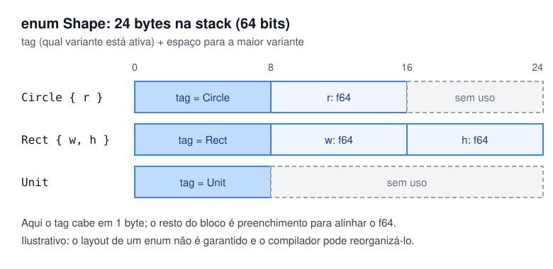

# 03 — Enums algébricos

**Objetivos.** Ao final, você vai saber:

- declarar enums cujas variantes carregam dados diferentes;
- implementar métodos num enum e tratar cada variante com `match`;
- por que um enum do Rust faz mais que um `enum class` do C++ ou um `Enum` do Python;
- como um enum fica na memória, em linhas gerais.

## O problema: "um destes, cada um com seus dados"

Você precisa representar formas geométricas: um círculo tem raio, um retângulo tem largura e altura, e um ponto não tem nada. Como guardar isso num tipo só?

As saídas clássicas não são boas:

- **Uma struct com todos os campos** (`r`, `w`, `h` e um `kind`): metade dos campos fica sem sentido em cada caso, e nada impede ler `r` de um retângulo.
- **Uma hierarquia de classes** (`Shape` com `virtual double area()`): funciona, mas exige heap, ponteiros e despacho dinâmico, e qualquer um pode criar uma subclasse nova.
- **Um `enum` simples + `union`** em C: rápido, mas é você quem precisa lembrar qual campo está ativo.

Em Rust, a resposta é um `enum` em que **cada variante tem seus próprios dados**:

```rust
#[derive(Debug, Clone, PartialEq)]
enum Shape {
    Circle { r: f64 },
    Rect { w: f64, h: f64 },
    Unit,
}

impl Shape {
    fn area(&self) -> f64 {
        match self {
            Shape::Circle { r } => std::f64::consts::PI * r * r,
            Shape::Rect { w, h } => w * h,
            Shape::Unit => 0.0,
        }
    }
}

fn main() {
    let shapes = [
        Shape::Circle { r: 1.0 },
        Shape::Rect { w: 2.0, h: 3.0 },
        Shape::Unit,
    ];
    for s in &shapes {
        println!("{s:?} -> área {:.2}", s.area());
    }
}
```

```text
Circle { r: 1.0 } -> área 3.14
Rect { w: 2.0, h: 3.0 } -> área 6.00
Unit -> área 0.00
```

Um valor `Shape` é **exatamente um** dos três casos, e o compilador sabe qual. Esse tipo de enum se chama *sum type* (tipo soma) ou *tagged union*: os valores possíveis são os do círculo **ou** os do retângulo **ou** o ponto. Uma struct é o oposto, um *product type*: ela tem `w` **e** `h`. Juntos, os dois formam os chamados tipos algébricos, daí o título da lição.

Código completo, com testes, em [`codigo/formas`](codigo/formas/).

## Os dados só existem dentro do `match`

Você não consegue acessar `r` diretamente, porque nada garante que o valor seja um círculo:

```rust
// ❌ NÃO COMPILA
let s = Shape::Circle { r: 1.0 };
println!("{}", s.r);
```

```text
error[E0609]: no field `r` on type `Shape`
 --> src/main.rs:8:22
  |
8 |     println!("{}", s.r);
  |                      ^ unknown field
```

Para chegar ao raio, é preciso perguntar qual variante está ali, e o jeito de perguntar é o `match` (ou `if let`, lição 07). Dentro do braço `Shape::Circle { r } =>`, o `r` existe e tem tipo conhecido. Fora dele, não. É assim que o Rust elimina a classe de bugs "li o campo da variante errada".

## Três formatos de variante

As variantes podem ter campos nomeados, campos por posição ou nenhum campo, como as structs da lição 01:

```rust
#[derive(Debug)]
enum Message {
    Quit,                       // sem dados
    Move { x: i32, y: i32 },    // campos nomeados
    Write(String),              // um campo por posição
    ChangeColor(u8, u8, u8),    // vários campos por posição
}

fn describe(m: &Message) -> String {
    match m {
        Message::Quit => String::from("sair"),
        Message::Move { x, y } => format!("mover para ({x}, {y})"),
        Message::Write(text) => format!("escrever {text:?}"),
        Message::ChangeColor(r, g, b) => format!("cor #{r:02x}{g:02x}{b:02x}"),
    }
}
```

```text
mover para (3, -1)
escrever "oi"
cor #ff8000
sair
```

Variantes com campos por posição funcionam também como funções construtoras: `Message::Write` é uma função que recebe uma `String` e devolve uma `Message`.

## Comparando com C++ e Python

O equivalente mais próximo em C++ é o `std::variant` (C++17) com `std::visit`:

```cpp
struct Circle { double r; };
struct Rect { double w, h; };
struct Unit {};
using Shape = std::variant<Circle, Rect, Unit>;

template <class... Ts> struct overloaded : Ts... { using Ts::operator()...; };

double area(const Shape& s) {
    return std::visit(overloaded{
        [](const Circle& c) { return std::numbers::pi * c.r * c.r; },
        [](const Rect& r)   { return r.w * r.h; },
        [](const Unit&)     { return 0.0; },
    }, s);
}
```

É a mesma ideia, e o `std::visit` também se recusa a compilar se faltar um caso. As diferenças estão no resto:

- o acesso direto `std::get<Rect>(s)` compila e **lança** `std::bad_variant_access` em tempo de execução se a variante for outra; em Rust, não existe acesso sem `match`;
- esquecer um caso gera uma parede de erros de template, e não "falta a variante `Unit`";
- o `variant` pode ficar `valueless_by_exception`; um enum do Rust sempre tem uma variante válida;
- o truque `overloaded` é código de biblioteca; o `match` é da linguagem e aceita padrões aninhados, guards e faixas (lição 05).

O `enum class` do C++ não chega a ser comparável: ele só dá nomes a inteiros. Não há como colocar um raio dentro de `Shape::Circle`.

Em Python, a forma moderna é uma união de dataclasses com o `match` do 3.10:

```python
@dataclass
class Circle:
    r: float

@dataclass
class Rect:
    w: float
    h: float

@dataclass
class Unit:
    pass

Shape = Circle | Rect | Unit

def area(s: Shape) -> float:
    match s:
        case Circle(r=r):
            return math.pi * r * r
        case Rect(w=w, h=h):
            return w * h
        case Unit():
            return 0.0
```

O formato é quase igual ao do Rust. A diferença é quem garante: se você esquecer o `case Unit()`, o Python roda e a função devolve `None` em silêncio. Um verificador como mypy ou pyright acusa o caso faltando se você usar `assert_never`, mas é uma etapa opcional. Em Rust, é erro de compilação, sempre.

O `Enum` do Python também não resolve: cada membro é um valor único e fixo (`Color.RED`), e não um "molde" que carrega dados diferentes a cada uso.

| | C++ `enum class` | Python `Enum` | C++ `std::variant` | Python união + `match` | Rust `enum` |
|---|---|---|---|---|---|
| dados por variante | não | não (valor fixo por membro) | sim | sim | sim |
| caso esquecido | aviso opcional (`-Wswitch`) | não se aplica | erro (de template) | `None` em runtime (mypy avisa) | erro claro (E0004) |
| acesso à variante errada | não se aplica | não se aplica | exceção em runtime | `AttributeError` | não compila |
| padrões aninhados | não | não | não | sim | sim |

## Métodos e conjuntos fechados

Um enum aceita `impl` como uma struct, e o padrão é um `match self` dentro de cada método, como em `area`. Isso inverte a organização de uma hierarquia de classes: em vez de cada classe ter seu `area()`, uma função `area` trata todos os casos num lugar só.

Isso tem uma consequência de projeto. O conjunto de variantes é **fechado**: ninguém de fora acrescenta um `Triangle`. Quando você mesmo acrescenta, o compilador aponta cada `match` que precisa mudar (lição 05). Isso é ótimo quando os casos são conhecidos (tokens de um parser, estados de uma conexão, comandos de um protocolo). Quando o conjunto precisa ser aberto, para que outros tipos entrem sem mexer no seu código, a ferramenta é *trait object* (`dyn Trait`). A escolha entre os dois é discutida no Módulo 06.

## Como um enum fica na memória

Um enum ocupa espaço para um *tag* (o número que diz qual variante está ativa) mais o espaço da **maior** variante. Não há alocação no heap: o `Shape` inteiro fica na stack, como uma struct.



Os números vêm de `std::mem::size_of` numa máquina de 64 bits ([`codigo/tamanhos`](codigo/tamanhos/)):

```text
Shape                24 bytes
Direction             1 bytes
```

`Rect` precisa de 16 bytes (dois `f64`), e o tag ocupa mais 8 por causa do alinhamento: 24 no total. `Direction`, um enum de quatro variantes sem dados, cabe em 1 byte.

> [!NOTE]
> O layout de um enum não é garantido pela linguagem: o compilador escolhe o tamanho e a posição do tag e pode reaproveitar bits livres dos campos. A próxima lição mostra o caso mais famoso, o `Option`. Se você precisar de um layout fixo (para falar com C, por exemplo), existe `#[repr(...)]`, assunto do Módulo 15.

## Enums "estilo C"

Quando nenhuma variante tem dados, o enum funciona como o `enum class` do C++, e você pode dar valores explícitos às variantes e convertê-las com `as`:

```rust
#[derive(Debug, Clone, Copy, PartialEq)]
enum HttpStatus {
    Ok = 200,
    NotFound = 404,
    Teapot = 418,
}

fn main() {
    let s = HttpStatus::NotFound;
    println!("{s:?} = {}", s as u16);
}
```

```text
NotFound = 404
```

O caminho contrário (de inteiro para enum) não existe com `as`, porque nem todo número corresponde a uma variante. Você escreve uma função com `match` que devolve `Option<HttpStatus>`, ou usa `TryFrom` (Módulo 06).

## Armadilhas comuns

**Tentar ler um campo da variante.** `s.r` dá E0609. Use `match` ou `if let` para chegar aos dados.

**Achar que enum é "só uma lista de constantes".** Se você está criando uma struct com um campo `kind` e vários campos `Option` que só fazem sentido para certos `kind`, provavelmente quer um enum com dados. A lição 08 volta a esse ponto.

**Variante muito maior que as outras.** Como o enum tem o tamanho da maior variante, uma variante com um array de 1 KB faz **todas** ocuparem 1 KB. O clippy avisa (`large_enum_variant`), e a solução é guardar o dado grande no heap com `Box` (Módulo 10).

## Resumo

- Um enum do Rust é um *sum type*: o valor é exatamente uma das variantes, e cada variante tem seus próprios dados.
- Variantes podem ter campos nomeados, por posição ou nenhum.
- Os dados só são acessíveis por `match`/`if let`, então não existe "ler a variante errada".
- Em relação ao `std::variant`, o Rust tem acesso seguro, erros claros e padrões aninhados. Em relação ao `match` do Python, a verificação de casos é obrigatória.
- Na memória: tag + espaço da maior variante, sem heap. O layout exato fica a critério do compilador.
- Enums são conjuntos fechados. Para conjuntos abertos, `dyn Trait` (Módulo 06).

## Exercícios

Os exercícios 1, 3 e 6 em [`exercicios.md`](exercicios.md) usam enums com dados.

## Leitura complementar

- [The Rust Programming Language, 6.1 Defining an Enum](https://doc.rust-lang.org/stable/book/ch06-01-defining-an-enum.html)
- [Rust by Example: Enums](https://doc.rust-lang.org/rust-by-example/custom_types/enum.html)
- [Effective Rust, Item 1: Use the type system to express your data structures](https://effective-rust.com/use-types.html)
- [Microsoft RustTraining (C/C++), cap. 6: enums e match](https://microsoft.github.io/RustTraining/c-cpp-book/ch06-enums-and-pattern-matching.html)
- [cppreference: `std::variant`](https://en.cppreference.com/w/cpp/utility/variant)

---

[← Lição anterior](02-impl-metodos-e-funcoes-associadas.md) · [Índice do módulo](README.md) · [Próxima lição →](04-option.md)
