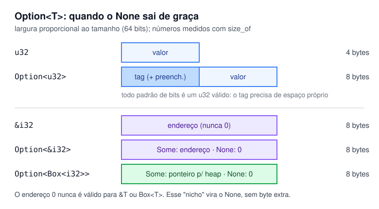

# 04 — `Option<T>`: adeus, `null`

**Objetivos.** Ao final, você vai saber:

- por que `Option<T>` substitui o `null` e o que o compilador passa a garantir;
- por que `Option<&T>` e `Option<Box<T>>` não custam nenhum byte a mais;
- o kit mínimo de métodos: `unwrap_or`, `map`, `as_ref`, `as_deref`, `take` e o operador `?`;
- quando `unwrap` e `expect` são aceitáveis.

## O erro de um bilhão de dólares

Tony Hoare, que inventou a referência nula, chamou-a de seu "erro de um bilhão de dólares". O problema não é a ideia de "pode não haver valor", que é útil. O problema é que, em C++, Java ou Python, **qualquer** referência pode ser nula, e o tipo não avisa. O resultado são `NullPointerException`, `AttributeError: 'NoneType' object has no attribute...` e *segfaults*.

Rust não tem `null`. Uma `&T` ou um `Box<T>` sempre apontam para algo válido. Quando a ausência é possível, ela aparece **no tipo**, com um enum comum da biblioteca padrão:

```rust
enum Option<T> {
    None,
    Some(T),
}
```

Você já viu uma prévia no Módulo 01. Agora que conhece enums, dá para ver que não há mágica: `Option` é um enum genérico de duas variantes, tão comum que `Some` e `None` estão no *prelude* e podem ser usados sem o prefixo `Option::`.

## O tipo obriga você a tratar o `None`

Um `Option<i32>` não é um `i32`. Não dá para usá-lo como número sem antes decidir o que fazer se ele estiver vazio:

```rust
// ❌ NÃO COMPILA
let nums = [10, 20, 30];
let first: Option<&i32> = nums.first();
let total = first + 1;
```

```text
error[E0369]: cannot add `{integer}` to `Option<&i32>`
   --> src/main.rs:4:23
    |
  4 |     let total = first + 1;
    |                 ----- ^ - {integer}
    |                 |
    |                 Option<&i32>
...
```

Essa é toda a diferença em relação ao `None` do Python ou ao `std::optional` do C++:

```python
# Python: a anotação é uma promessa; nada impede o uso direto
def first(nums: list[int]) -> int | None: ...
first([]) + 1   # TypeError em tempo de execução
```

```cpp
// C++: *opt num optional vazio é comportamento indefinido; .value() lança
std::optional<int> opt = std::nullopt;
int x = *opt + 1;   // compila
```

```rust
// Rust: para chegar ao valor, você passa pelo caso None
let total = match nums.first() {
    Some(n) => n + 1,
    None => 0,
};
```

## Um exemplo completo

Uma busca que pode não encontrar nada devolve `Option`:

```rust
#[derive(Debug)]
struct Person {
    name: String,
    nickname: Option<String>,
}

fn find<'a>(people: &'a [Person], name: &str) -> Option<&'a Person> {
    for p in people {
        if p.name == name {
            return Some(p);
        }
    }
    None
}

fn main() {
    let people = [
        Person { name: String::from("Ana"), nickname: Some(String::from("Aninha")) },
        Person { name: String::from("Bia"), nickname: None },
    ];

    match find(&people, "Bia") {
        Some(p) => println!("achei: {}", p.name),
        None => println!("não achei"),
    }
}
```

O campo `nickname: Option<String>` documenta no tipo que o apelido é opcional. Quem lê a struct não precisa adivinhar se `""` significa "sem apelido".

> [!TIP]
> O clippy sugere trocar o laço de `find` por `people.iter().find(|p| p.name == name)`. É o jeito idiomático, e iteradores são o assunto do Módulo 07.

## O kit mínimo de métodos

Escrever `match` toda vez cansa. `Option` tem dezenas de métodos, e estes resolvem a maior parte dos casos do dia a dia (os outros, junto com os de `Result`, ficam para o Módulo 05):

```rust
let count: Option<u32> = Some(12);
let missing: Option<u32> = None;

assert_eq!(count.unwrap_or(0), 12);          // o valor, ou um padrão
assert_eq!(missing.unwrap_or(0), 0);
assert_eq!(missing.unwrap_or_default(), 0);  // o padrão do tipo (0, "", vetor vazio...)
assert_eq!(count.map(|n| n * 2), Some(24));  // transforma o valor, se houver
assert_eq!(missing.map(|n| n * 2), None);    // nada a transformar
assert!(count.is_some());
assert!(missing.is_none());
```

O `|n| n * 2` é uma *closure* (função anônima), vista rapidamente no Módulo 01 e em detalhe no Módulo 07.

> [!WARNING]
> `x or padrao` do Python **não** equivale a `unwrap_or`. O `or` também troca `0`, `""` e `[]` pelo padrão, porque eles são "falsos". `Some(0).unwrap_or(5)` devolve `0`.

### `as_ref` e `as_deref`: olhar sem tirar

Métodos como `map` e `unwrap_or` recebem o `Option` **por valor** (`self`). Num `Option<String>` que está atrás de uma referência, isso tentaria mover a `String` para fora:

```rust
// ❌ NÃO COMPILA
fn nickname_len(p: &Person) -> usize {
    p.nickname.map(|s| s.len()).unwrap_or(0)
}
```

```text
error[E0507]: cannot move out of `p.nickname` which is behind a shared reference
    --> src/main.rs:7:5
     |
   7 |     p.nickname.map(|s| s.len()).unwrap_or(0)
     |     ^^^^^^^^^^ ---------------- `p.nickname` moved due to this method call
     |     |
     |     move occurs because `p.nickname` has type `Option<String>`, which does not implement the `Copy` trait
     |
...
help: consider calling `.as_ref()` to borrow the value's contents
     |
   7 |     p.nickname.as_ref().map(|s| s.len()).unwrap_or(0)
     |               +++++++++
```

O compilador já dá a resposta. `as_ref` transforma `&Option<String>` em `Option<&String>`: um `Option` novo, que só empresta o conteúdo. A variante `as_deref` vai além e entrega `Option<&str>`, o que é ótimo para combinar com outros `&str`:

```rust
// ✅
fn nickname_len(p: &Person) -> usize {
    p.nickname.as_ref().map(|s| s.len()).unwrap_or(0)
}

fn display_name(p: &Person) -> &str {
    p.nickname.as_deref().unwrap_or(&p.name)
}
```

### `take`: tirar e deixar `None` no lugar

`take` move o valor para fora de um `Option` mutável e deixa `None` no lugar. Serve para "consumir" um campo sem precisar de posse da struct inteira:

```rust
let mut slot = Some(String::from("token"));
let taken = slot.take();
println!("{taken:?} {slot:?}");
```

```text
Some("token") None
```

### `?`: propagar o `None`

Numa função que devolve `Option`, o operador `?` desembrulha um `Some` ou devolve `None` imediatamente:

```rust
fn first_initial(text: &str) -> Option<char> {
    let c = text.chars().next()?; // se não houver caractere, a função devolve None aqui
    Some(c.to_ascii_uppercase())
}
```

`first_initial("rust")` dá `Some('R')`, e `first_initial("")` dá `None`. O `?` brilha mesmo com `Result`, no Módulo 05.

## `unwrap` e `expect`

`unwrap()` devolve o valor de um `Some` e encerra o programa com *panic* se for `None`:

```rust
// 💥 PANIC EM RUNTIME
let v: Vec<i32> = Vec::new();
let first = v.first().unwrap();
```

```text
thread 'main' (191477) panicked at src/main.rs:3:27:
called `Option::unwrap()` on a `None` value
```

`expect("mensagem")` faz o mesmo, mas com a sua mensagem, o que ajuda muito quando o panic acontece longe de você. Use os dois só quando o `None` for um **bug** (uma invariante quebrada) e não uma situação esperada, e prefira `expect`, explicando por que o valor deveria existir. Em testes e protótipos, `unwrap` está liberado. O Módulo 05 aprofunda quando é aceitável deixar o programa parar.

## Quanto custa um `Option`

Se `Option<T>` é um enum, ele precisa de um tag, certo? Nem sempre. Os números abaixo vêm de [`codigo/tamanhos`](codigo/tamanhos/), numa máquina de 64 bits:

```text
u32                   4 bytes
Option<u32>           8 bytes
u64                   8 bytes
Option<u64>          16 bytes

&i32                  8 bytes
Option<&i32>          8 bytes
Box<i32>              8 bytes
Option<Box<i32>>      8 bytes
String               24 bytes
Option<String>       24 bytes
NonZeroU32            4 bytes
Option<NonZeroU32>    4 bytes
bool                  1 bytes
Option<bool>          1 bytes
```

Para `u32`, todo padrão de 32 bits é um número válido, então o tag precisa de espaço próprio: 4 bytes viram 8 (com o alinhamento). Já uma `&i32` **nunca** vale zero, porque referências não são nulas. Esse valor proibido é um *nicho*, e o compilador o usa para representar `None`. Resultado: `Option<&i32>` tem o mesmo tamanho de `&i32`, e na memória é exatamente um ponteiro que pode ser nulo, como em C. A diferença é que o tipo obriga você a checar.



A documentação da std **garante** essa otimização para `&T`, `&mut T`, `Box<T>`, `NonNull<T>`, os tipos `NonZero*` e alguns outros. Para os demais (como `String`, que também aproveita um nicho), ela acontece na prática, mas não é promessa.

Em C++, `std::optional<T&>` nem existia até o C++26, e o costume é usar um ponteiro cru que pode ser nulo. Em Rust, `Option<&T>` é o caminho natural e não custa nada.

## Armadilhas comuns

**`map` ou `unwrap_or` num `Option` emprestado.** E0507 "cannot move out of ... behind a shared reference". Use `as_ref()` ou `as_deref()` antes.

**`unwrap` como reflexo.** Ele transforma um erro de compilação útil num panic em produção. Antes de escrever `unwrap`, pergunte se o `None` é mesmo impossível. Se não for, trate o caso com `match`, `if let`, `unwrap_or` ou `?`.

**`Option<Option<T>>` por acidente.** Às vezes aparece quando você faz `map` com uma função que já devolve `Option`. Isso é sinal de que você queria outro método (`and_then`, no Módulo 05).

## Resumo

- Rust não tem `null`. A ausência aparece no tipo, com `Option<T>` (`Some(T)` ou `None`).
- Não há como usar o valor sem tratar o `None`: é aí que mora a diferença para `None` do Python e `std::optional` do C++.
- Kit mínimo: `unwrap_or`, `unwrap_or_default`, `map`, `is_some`/`is_none`, `as_ref`/`as_deref`, `take` e `?`.
- `unwrap`/`expect` encerram o programa no `None`. Use só para invariantes, e prefira `expect`.
- `Option<&T>` e `Option<Box<T>>` têm o tamanho de um ponteiro: o `None` usa o valor 0, que é um nicho.

## Exercícios

Os exercícios 2 e 5 em [`exercicios.md`](exercicios.md) devolvem `Option`.

## Leitura complementar

- [The Rust Programming Language, 6.1 (seção "The Option Enum")](https://doc.rust-lang.org/stable/book/ch06-01-defining-an-enum.html#the-option-enum-and-its-advantages-over-null-values)
- [Documentação de `std::option`](https://doc.rust-lang.org/std/option/index.html), incluindo a seção "Representation"
- [Effective Rust, Item 3: transformações de `Option` e `Result`](https://effective-rust.com/transform.html)

---

[← Lição anterior](03-enums-algebricos.md) · [Índice do módulo](README.md) · [Próxima lição →](05-match-e-padroes.md)
