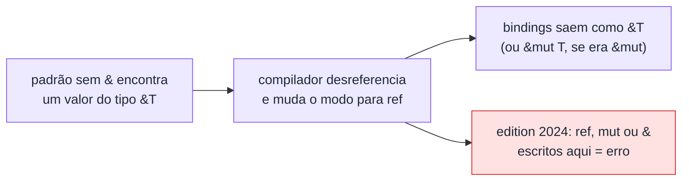

# 06 — Padrões e referências

**Objetivos.** Ao final, você vai saber:

- o que acontece quando um padrão sem `&` encontra uma referência (*match ergonomics*);
- o estilo idiomático: `match &x`, `for item in &v` e padrões sem `ref`;
- as três regras novas da edition 2024 sobre `ref`, `mut` e `&` em padrões, e como migrar código antigo;
- onde `&` em padrão continua certo.

## O problema: casar com uma referência

No fim da lição anterior, `match opt { Some(s) => ... }` movia a `String` para fora de `opt`. Queremos só olhar. Então casamos com uma referência:

```rust
let mut opt = Some(String::from("oi"));

match &opt {
    Some(s) => println!("tamanho {}", s.len()),
    None => println!("nada"),
}

println!("{opt:?}"); // opt continua inteiro
```

Repare: o valor casado tem tipo `&Option<String>`, mas o padrão `Some(s)` é de `Option<String>`, sem `&`. Mesmo assim compila. Qual é o tipo de `s`? Um truque útil para descobrir é provocar um erro de tipo:

```rust
// ❌ NÃO COMPILA (de propósito, para ver o tipo)
if let Some(s) = &opt {
    let () = s;
}
```

```text
error[E0308]: mismatched types
 --> src/main.rs:4:13
  |
4 |         let () = s;
  |             ^^   - this expression has type `&String`
  |             |
  |             expected `String`, found `()`
```

`s` é uma `&String`: o compilador emprestou o conteúdo em vez de movê-lo.

## *Match ergonomics*: o modo de binding

Esse comportamento se chama *match ergonomics* e existe desde 2018. A regra: quando um padrão que **não** é de referência (como `Some(s)`) encontra um valor que **é** referência (`&Option<String>`), o compilador "atravessa" a referência e passa a criar as variáveis por empréstimo. Ele guarda um **modo de binding padrão**, que começa em "mover" e muda ao atravessar referências:



Com `&mut`, o modo vira "empréstimo mutável", e você pode alterar o conteúdo pelo binding:

```rust
if let Some(s) = &mut opt {
    s.push_str(", mundo"); // s: &mut String
}
println!("{opt:?}");
```

```text
Some("oi, mundo")
```

O mesmo vale para `let` e `for`:

```rust
let pair = (String::from("a"), String::from("b"));
let (x, y) = &pair;      // x, y: &String; pair continua intacto

let v = vec![String::from("p"), String::from("q")];
for s in &v {            // s: &String
    println!("{s}");
}
```

**A regra prática do curso:** para olhar sem mover, escreva `match &x`, `if let ... = &x` ou `for item in &v`, e use padrões **sem** `&` e sem `ref`. O compilador cuida do resto.

Para quem vem de C++: é parecido com escrever `const auto& [x, y] = pair;` nos *structured bindings*. A diferença é que o Rust deduz o tipo de empréstimo de cada binding a partir do valor casado, inclusive dentro de padrões aninhados.

## O jeito antigo: `ref` e `&` explícitos

Antes de 2018, o mesmo `match` precisava ser escrito assim:

```rust
match &opt {
    &Some(ref s) => println!("{s}"),
    &None => {}
}
```

O `&` no padrão casa com a referência, e o `ref s` diz "crie `s` como empréstimo, não como move". Você ainda vai encontrar isso em código antigo, e em código novo o `ref` continua válido num caso: quando o valor casado **não** é referência. É o que o compilador sugeriu na lição anterior:

```rust
match opt {
    Some(ref s) => println!("{s}"), // ok: opt não é referência, o padrão é explícito
    None => {}
}
```

Funciona, mas `match &opt` com `Some(s)` diz a mesma coisa de um jeito mais simples. Prefira esse.

## Edition 2024: o que virou erro

A mistura dos dois estilos gerava confusão. Na edition 2024, **dentro de um padrão que já está emprestando implicitamente**, três coisas passaram a ser erro. Todos os exemplos abaixo compilam com `edition = "2021"` e falham com `edition = "2024"`.

### 1. `ref` redundante

```rust
// ❌ NÃO COMPILA (edition 2024)
let opt = Some(String::from("oi"));
match &opt {
    Some(ref s) => println!("{s}"),
    None => {}
}
```

```text
error: cannot explicitly borrow within an implicitly-borrowing pattern
 --> src/main.rs:4:14
  |
4 |         Some(ref s) => println!("{s}"),
  |              ^^^ explicit `ref` binding modifier not allowed when implicitly borrowing
  |
  = note: for more information, see <https://doc.rust-lang.org/reference/patterns.html#binding-modes>
note: matching on a reference type with a non-reference pattern implicitly borrows the contents
 --> src/main.rs:4:9
  |
4 |         Some(ref s) => println!("{s}"),
  |         ^^^^^^^^^^^ this non-reference pattern matches on a reference type `&_`
help: remove the unnecessary binding modifier
  |
4 -         Some(ref s) => println!("{s}"),
4 +         Some(s) => println!("{s}"),
  |
```

O `ref` não fazia nada ali, porque `s` já seria um empréstimo. A correção é apagá-lo.

### 2. `mut` num binding emprestado

Este é o caso mais traiçoeiro, porque na 2021 ele mudava o **tipo** da variável em silêncio:

```rust
// ❌ NÃO COMPILA (edition 2024)
let pair = &(1, 2);
let (a, mut b) = pair;
b += 10;
println!("{a} {b}");
```

```text
error: cannot mutably bind by value within an implicitly-borrowing pattern
 --> src/main.rs:3:13
  |
3 |     let (a, mut b) = pair;
  |             ^^^ `mut` binding modifier not allowed when implicitly borrowing
  |
  = note: for more information, see <https://doc.rust-lang.org/reference/patterns.html#binding-modes>
note: matching on a reference type with a non-reference pattern implicitly borrows the contents
 --> src/main.rs:3:9
  |
3 |     let (a, mut b) = pair;
  |         ^^^^^^^^^^ this non-reference pattern matches on a reference type `&_`
help: match on the reference with a reference pattern and borrow explicitly using a variable binding mode
  |
3 |     let &(ref a, mut b) = pair;
  |         + +++
```

Na edition 2021 esse código compila e imprime `1 12`: o `mut` "zerava" o modo de binding, então `a` saía como `&i32` e `b` como `i32` (uma cópia). Dois bindings vizinhos com tipos de natureza diferente, por causa de uma palavra. A 2024 recusa e obriga você a ser explícito. A forma sugerida pelo compilador funciona, mas a mais legível costuma ser separar as coisas:

```rust
// ✅
let pair = &(1, 2);
let (a, b) = pair;  // a, b: &i32
let b = *b + 10;    // agora uma cópia, explícita
println!("{a} {b}");
```

### 3. `&` no meio de um padrão que já empresta

```rust
// ❌ NÃO COMPILA (edition 2024)
let one = 1;
let two = 2;
let refs = &[&one, &two];
let [&x, y] = refs;
```

```text
error: cannot explicitly dereference within an implicitly-borrowing pattern
 --> src/main.rs:5:10
  |
5 |     let [&x, y] = refs;
  |          ^ reference pattern not allowed when implicitly borrowing
  |
  = note: for more information, see <https://doc.rust-lang.org/reference/patterns.html#binding-modes>
note: matching on a reference type with a non-reference pattern implicitly borrows the contents
 --> src/main.rs:5:9
  |
5 |     let [&x, y] = refs;
  |         ^^^^^^^ this non-reference pattern matches on a reference type `&_`
help: match on the reference with a reference pattern and borrow explicitly using a variable binding mode
  |
5 |     let &[&x, ref y] = refs;
  |         +     +++
```

As três regras têm o mesmo motivo: quando o compilador já está emprestando por você, escrever `ref`, `mut` ou `&` ali era redundante ou tinha um efeito surpreendente. Ao proibir esses casos agora, a linguagem reserva espaço para deixar o *match ergonomics* mais previsível em versões futuras.

> [!TIP]
> Para migrar um projeto, rode `cargo fix --edition` **antes** de mudar a edition no `Cargo.toml` (ele aplica o lint `rust_2024_incompatible_pat`). O resultado é correto, mas costuma ser a forma "totalmente explícita", como `let &(_, mut age) = entry;`. Vale revisar à mão e simplificar para o estilo desta lição. O exercício 4 pede exatamente isso.

## Onde `&` em padrão continua certo

`&` num padrão não foi proibido. Ele continua certo quando casa com uma referência **de verdade** e não há empréstimo implícito em volta. O caso mais comum é desestruturar uma tupla que vem por valor, mas contém referências:

```rust
let v = vec![10, 20, 30];
for (i, &n) in v.iter().enumerate() {
    println!("{i}: {}", n + 1); // n: i32, copiado da &i32
}
```

`enumerate` produz tuplas `(usize, &i32)` **por valor**. O padrão `(i, &n)` casa a tupla diretamente (sem empréstimo implícito), e o `&n` casa com a `&i32`, copiando o número. O mesmo vale para closures como `.map(|&x| x * 2)` sobre um iterador de `&i32`.

## Armadilhas comuns

**`&` no padrão quando o valor dentro não é referência.**

```rust
// ❌ NÃO COMPILA
if let Some(&n) = &Some(5) {
    println!("{n}");
}
```

```text
error[E0308]: mismatched types
 --> src/main.rs:2:17
  |
2 |     if let Some(&n) = &Some(5) {
  |                 ^^    -------- this expression has type `&Option<{integer}>`
  |                 |
  |                 expected integer, found `&_`
  |
...
help: consider removing `&` from the pattern
  |
2 -     if let Some(&n) = &Some(5) {
2 +     if let Some(n) = &Some(5) {
  |
```

O `&` de fora (em `&Some(5)`) já foi "atravessado" pelo `Some(...)`. Dentro, há um inteiro, não uma referência. Tire o `&` do padrão e use `*n` se precisar do valor (ou deixe o compilador fazer a conversão automática nas operações).

**Copiar exemplos antigos.** Material escrito antes de 2024 (inclusive respostas populares em fóruns) usa `ref` e `&` à vontade. Se aparecer um dos três erros desta lição, a correção quase sempre é apagar o `ref`/`&`/`mut` e casar com `&valor`.

**`ref` como reflexo.** Se o compilador sugerir `ref s` num `match` por valor, considere trocar o `match x` por `match &x`. O resultado é o mesmo e o código fica no estilo moderno.

## Resumo

- Padrão sem `&` + valor do tipo `&T` = o compilador atravessa a referência, e os bindings saem como `&` (ou `&mut`).
- Estilo idiomático: `match &x`, `if let ... = &mut x`, `for item in &v`, padrões sem `ref` e sem `&`.
- Edition 2024: dentro de um padrão que já empresta implicitamente, `ref`, `mut` e `&` são erro.
- `ref` continua válido em padrões explícitos (o valor casado não é referência), mas raramente é a melhor escolha.
- `&` em padrão continua certo para casar com referências reais, como em `for (i, &n) in v.iter().enumerate()`.
- `cargo fix --edition` migra o código; revise o resultado à mão.

## Exercícios

Veja o exercício 4 em [`exercicios.md`](exercicios.md).

## Leitura complementar

- [Edition Guide: Rust 2024, match ergonomics reservations](https://doc.rust-lang.org/edition-guide/rust-2024/match-ergonomics.html)
- [The Rust Reference: binding modes](https://doc.rust-lang.org/reference/patterns.html#binding-modes)
- [The Rust Programming Language, 19.3 Pattern Syntax](https://doc.rust-lang.org/stable/book/ch19-03-pattern-syntax.html)

---

[← Lição anterior](05-match-e-padroes.md) · [Índice do módulo](README.md) · [Próxima lição →](07-if-let-let-else-e-let-chains.md)
