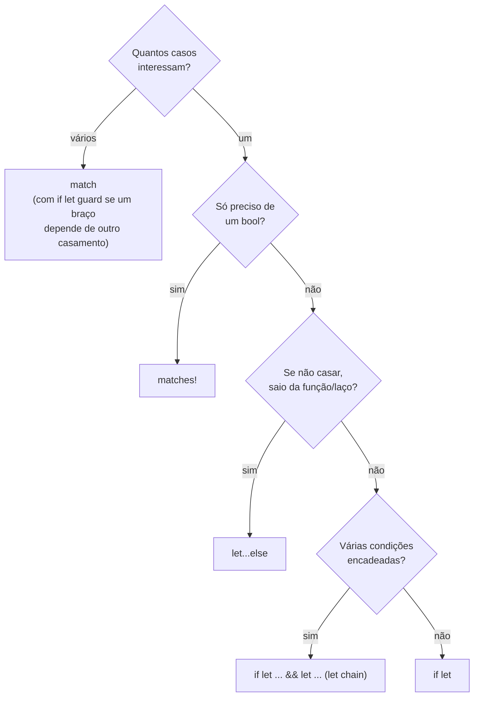

# 07 — `if let`, `let...else` e *let chains*

**Objetivos.** Ao final, você vai saber:

- usar `if let` e `while let` quando só um caso interessa;
- escrever o "caminho feliz" com `let...else`, sem pirâmides de `if`;
- encadear testes com *let chains* (Rust 1.88, edition 2024);
- usar `if let` guards dentro do `match` (Rust 1.95) e `matches!`.

## `if let`: um caso só

Quando só uma variante interessa, um `match` com `_ => {}` é verboso. O `if let` diz o mesmo de forma direta:

```rust
let config = Some(3);

if let Some(level) = config {
    println!("nível {level}");
} else {
    println!("sem nível");
}
```

É um `match` de um braço mais um `_`. O preço é que você abre mão da exaustividade: se o tipo ganhar uma variante nova, o `if let` não reclama. Para "só me interessa este caso", esse preço é aceitável.

O `while let` repete enquanto o padrão casar, o que é perfeito para esvaziar uma pilha ou uma fila:

```rust
let mut stack = vec![1, 2, 3];
while let Some(top) = stack.pop() {
    print!("{top} ");
}
```

```text
3 2 1
```

## `let...else`: o caminho feliz

Validar entrada costuma gerar uma pirâmide: cada `if let` empurra o código um nível para a direita. O `let...else` (estável desde 1.65) inverte a lógica. Se o padrão casar, as variáveis ficam disponíveis **depois** do `let`, no escopo normal. Se não casar, o bloco `else` roda e precisa sair dali:

```rust
fn parse_age(s: &str) -> Option<u32> {
    let Ok(n) = s.trim().parse::<u32>() else {
        return None;
    };
    if n > 150 {
        return None;
    }
    Some(n)
}
```

`parse` devolve um `Result`, outro enum da std (`Ok(valor)` ou `Err(erro)`), que o Módulo 05 detalha. Aqui só interessa o caso `Ok`.

O bloco `else` **precisa divergir**: terminar com `return`, `break`, `continue` ou `panic!`. Se ele terminar normalmente, não haveria valor para `n`:

```rust
// ❌ NÃO COMPILA
fn parse(s: &str) -> u32 {
    let Ok(n) = s.parse::<u32>() else {
        println!("inválido");
    };
    n
}
```

```text
error[E0308]: `else` clause of `let...else` does not diverge
 --> src/main.rs:2:39
  |
2 |       let Ok(n) = s.parse::<u32>() else {
  |  _______________________________________^
3 | |         println!("inválido");
4 | |     };
  | |_____^ expected `!`, found `()`
  |
  = note:   expected type `!`
          found unit type `()`
  = help: try adding a diverging expression, such as `return` or `panic!(..)`
  = help: ...or use `match` instead of `let...else`
```

O `!` na mensagem é o *never type* do Módulo 01: o tipo de uma expressão que nunca termina normalmente. O compilador exige que o `else` tenha esse tipo.

O `let...else` é a resposta para o E0005 da lição 05 (`let Some(x) = opt;`). Pense nele como um *guard clause*: trate o caso ruim primeiro, saia, e siga com o caso bom sem indentação extra.

## *Let chains*: vários testes num `if` só

Agora um caso com três condições: ler a porta de uma configuração, convertê-la para número e checar se é uma porta não privilegiada. Com `if let` aninhados:

```rust
fn port_old(cfg: &HashMap<&str, &str>) -> u16 {
    if let Some(p) = cfg.get("port") {
        if let Ok(port) = p.parse::<u16>() {
            if port >= 1024 {
                return port;
            }
        }
    }
    8080
}
```

Desde o Rust 1.88, na edition 2024, dá para encadear `let` e condições comuns com `&&` no mesmo `if`. É a *let chain*:

```rust
fn port_from(cfg: &HashMap<&str, &str>) -> u16 {
    if let Some(p) = cfg.get("port")
        && let Ok(port) = p.parse::<u16>()
        && port >= 1024
    {
        port
    } else {
        8080
    }
}
```

Cada `let` deixa seus bindings disponíveis para as condições seguintes e para o bloco: `p` é usado no segundo `let`, e `port` na terceira condição e no corpo. Se qualquer elo falhar, vai para o `else`. O mesmo vale para `while`.

O clippy conhece o recurso: no `port_old` acima, ele avisa `this 'if' statement can be collapsed` (lint `collapsible_if`) e sugere justamente a let chain. Código completo, com testes, em [`codigo/config-porta`](codigo/config-porta/).

Duas restrições:

```rust
// ❌ NÃO COMPILA
if let Some(x) = a && x > 0 || b {
    println!("ok");
}
```

```text
error: `||` operators are not supported in let chain conditions
 --> src/main.rs:4:33
  |
4 |     if let Some(x) = a && x > 0 || b {
  |                                 ^^
```

Só `&&` encadeia `let`. Se você precisar de um `||`, coloque-o entre parênteses numa condição comum (`&& (x > 0 || b)`), ou use um `match`.

E elas só existem na edition 2024. Num projeto com `edition = "2021"`:

```text
error: let chains are only allowed in Rust 2024 or later
 --> src/main.rs:3:8
  |
3 |     if let Some(x) = a && x > 0 {
  |        ^^^^^^^^^^^^^^^
```

## `if let` guards no `match`

Às vezes um braço do `match` depende de um **segundo** casamento. Por exemplo, um comando `Set` só é válido se o texto for um número positivo. Desde o Rust 1.95, o guard de um braço pode ter `if let`, inclusive encadeado com `&&`:

```rust
#[derive(Debug)]
enum Cmd {
    Set(String),
    Reset,
}

fn run(cmd: &Cmd) -> String {
    match cmd {
        Cmd::Set(v)
            if let Ok(n) = v.parse::<i32>()
                && n > 0 =>
        {
            format!("valor = {n}")
        }
        Cmd::Set(v) => format!("valor inválido: {v:?}"),
        Cmd::Reset => String::from("zerado"),
    }
}
```

```text
Set("7"): valor = 7
Set("-2"): valor inválido: "-2"
Reset: zerado
```

O `n` criado no guard está disponível no corpo do braço. Se o `parse` falhar ou `n` não for positivo, o `match` segue para o próximo braço, que trata o caso inválido. Sem esse recurso, você teria que fazer o `parse` dentro do braço e aninhar outro `match`. (O `rustfmt` quebra o guard em várias linhas, como acima.)

Como qualquer guard, o `if let` guard **não conta para a exaustividade**:

```rust
// ❌ NÃO COMPILA
fn describe(x: Option<&str>) -> i32 {
    match x {
        Some(s) if let Ok(n) = s.parse::<i32>() => n,
        None => 0,
    }
}
```

```text
error[E0004]: non-exhaustive patterns: `Some(_)` not covered
   --> src/main.rs:2:11
    |
  2 |     match x {
    |           ^ pattern `Some(_)` not covered
...
    = note: the matched value is of type `Option<&str>`
    = note: match arms with guards don't count towards exhaustivity
```

Falta um braço para "`Some`, mas o `parse` falhou".

## `matches!`: só quero um `bool`

Quando a pergunta é "este valor casa com este padrão?", a macro `matches!` devolve um `bool`:

```rust
let x = Some(5);
assert!(matches!(x, Some(1..=9)));

let c = Cmd::Reset;
let is_reset = matches!(c, Cmd::Reset);
```

Ela aceita guard também: `matches!(x, Some(n) if n % 2 == 0)`. É muito útil em testes (`assert!(matches!(...))`) e em filtros.

## Qual usar?



| Situação | Construção |
|---|---|
| um caso, com ou sem `else` | `if let` |
| repetir enquanto casar | `while let` |
| extrair o valor ou sair cedo | `let...else` |
| vários testes encadeados | let chain |
| vários casos, todos tratados | `match` |
| um braço depende de outro casamento | `match` com `if let` guard |
| só um `bool` | `matches!` |

## Armadilhas comuns

**`else` do `let...else` que não diverge.** E0308 "`else` clause of `let...else` does not diverge". Termine o bloco com `return`, `break`, `continue` ou `panic!`.

**`||` numa let chain.** Não é suportado. Use parênteses numa condição comum ou um `match`.

**Contar com o guard para a exaustividade.** Braços com `if` ou `if let` guard não contam. Sempre deixe um braço sem guard para o mesmo padrão (ou um `_`).

**`if let` onde cabia um `match`.** Uma cadeia de `if let ... else if let ... else if let` sobre o mesmo valor é um `match` disfarçado, e sem a verificação de exaustividade. Troque.

## Resumo

- `if let` e `while let` tratam um caso só, sem exaustividade.
- `let...else` extrai o valor ou sai cedo; o `else` precisa divergir (`!`).
- *Let chains* (1.88, edition 2024) encadeiam `let` e condições com `&&`. `||` não é aceito.
- `if let` guards (1.95) deixam um braço do `match` depender de um segundo casamento. Não contam para a exaustividade.
- `matches!(valor, padrão)` devolve um `bool`.

## Exercícios

Os exercícios 4 e 5 em [`exercicios.md`](exercicios.md) usam `let...else`, let chains e `if let` guards.

## Leitura complementar

- [The Rust Programming Language, 6.3 Concise Control Flow with `if let` and `let...else`](https://doc.rust-lang.org/stable/book/ch06-03-if-let.html)
- [Edition Guide: let chains in `if` and `while`](https://doc.rust-lang.org/edition-guide/rust-2024/let-chains.html)
- [Anúncio do Rust 1.88 (let chains)](https://blog.rust-lang.org/2025/06/26/Rust-1.88.0/)
- [Anúncio do Rust 1.95 (`if let` guards)](https://blog.rust-lang.org/2026/04/16/Rust-1.95.0/)
- [The Rust Reference: `match` e guards](https://doc.rust-lang.org/reference/expressions/match-expr.html)
- [Documentação de `matches!`](https://doc.rust-lang.org/std/macro.matches.html)

---

[← Lição anterior](06-padroes-e-referencias.md) · [Índice do módulo](README.md) · [Próxima lição →](08-estados-invalidos-irrepresentaveis.md)
