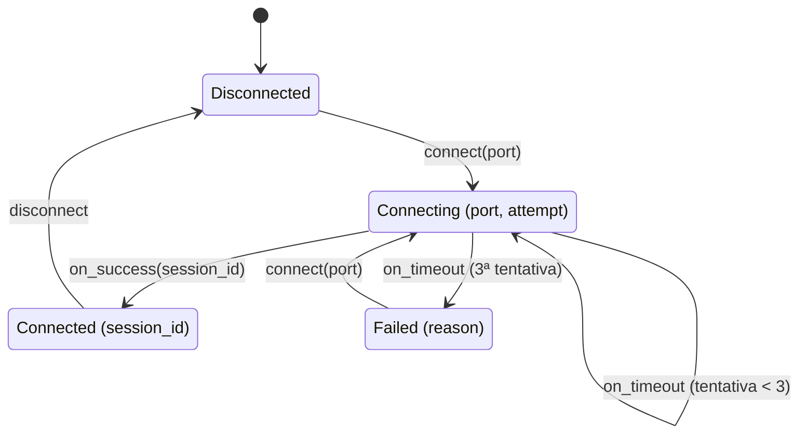

# 08 — Estados inválidos irrepresentáveis

**Objetivos.** Ao final, você vai saber:

- trocar combinações de flags e `Option`s por um enum de estados;
- trocar parâmetros `bool` por enums que dizem o que significam;
- criar um *newtype* com construtor validado, para que todo valor do tipo seja válido;
- o que é *typestate*, em uma frase (o Módulo 13 aprofunda).

## O problema: tipos que permitem bobagens

Uma conexão de rede, modelada do jeito mais comum:

```rust
struct Conn {
    connected: bool,
    connecting: bool,
    attempt: u8,
    session_id: Option<u64>,
    error: Option<String>,
}
```

Quantos valores desse tipo fazem sentido? Só considerando os dois `bool` e os dois `Option`, há 16 combinações. Conectado **e** conectando ao mesmo tempo? Desconectado com `session_id`? Com erro e conectado? O tipo aceita tudo isso, e cada função que recebe um `Conn` precisa se defender de estados que "nunca deveriam acontecer". Quando um deles acontece, o bug aparece longe de onde foi criado.

A ideia desta lição cabe numa frase: **faça o tipo aceitar só os valores válidos**. Se um estado inválido não pode ser construído, ninguém precisa checá-lo.

## Um enum por estado

A conexão tem, na verdade, quatro estados, e cada um tem seus próprios dados:

```rust
#[derive(Debug, Clone, PartialEq)]
enum Conn {
    Disconnected,
    Connecting { port: Port, attempt: u8 },
    Connected { session_id: u64 },
    Failed { reason: String },
}
```



Agora:

- `session_id` só existe em `Connected`. Não há como ter uma sessão estando desconectado.
- `reason` só existe em `Failed`. Não há "erro e conectado".
- O `match` obriga cada função a tratar os quatro estados, e o compilador avisa quando um quinto aparecer.

As transições viram métodos que **consomem** o estado atual e devolvem o próximo:

```rust
impl Conn {
    fn on_success(self, session_id: u64) -> Conn {
        match self {
            Conn::Connecting { .. } => Conn::Connected { session_id },
            other => other, // fora de Connecting, o evento é ignorado
        }
    }

    fn on_timeout(self) -> Conn {
        match self {
            Conn::Connecting { port, attempt } if attempt < 3 => Conn::Connecting {
                port,
                attempt: attempt + 1,
            },
            Conn::Connecting { .. } => Conn::Failed {
                reason: String::from("tempo esgotado"),
            },
            other => other,
        }
    }
}
```

Receber `self` (lição 02) é importante aqui: depois da transição, o estado antigo deixa de existir, e ninguém fica com uma cópia desatualizada. Usar o padrão `other => other` devolve o estado intacto quando o evento não se aplica. Uma alternativa, quando a transição inválida é um erro do chamador, é devolver um `Result` (Módulo 05).

```text
conectando na porta 8080 (tentativa 1)
conectando na porta 8080 (tentativa 2)
conectado, sessão 42
desconectado
falhou: tempo esgotado
```

Código completo, com testes, em [`codigo/conexao`](codigo/conexao/).

Em C++, o equivalente é um `std::variant<Disconnected, Connecting, Connected, Failed>` com `std::visit`. Em Python, uma dataclass por estado, uma união e `match`, com `assert_never` para o mypy ou pyright acusarem casos esquecidos. As três linguagens conseguem expressar a ideia. Em Rust, ela é o caminho mais curto, e a verificação vem do compilador sem configuração extra.

## Enums no lugar de `bool`

O mesmo raciocínio vale para parâmetros. O que significa esta chamada?

```rust
struct Doc;

fn print_old(_doc: &Doc, _landscape: bool, _color: bool) {}

let doc = Doc;
print_old(&doc, true, false);
```

Ninguém sabe sem abrir a assinatura, e trocar a ordem dos dois `bool` compila sem reclamar. Com enums, a chamada se explica sozinha, e argumentos trocados viram erro de compilação:

```rust
enum Orientation {
    Portrait,
    Landscape,
}

enum Color {
    Mono,
    Full,
}

fn print(_doc: &Doc, _orientation: Orientation, _color: Color) {}

print(&doc, Orientation::Landscape, Color::Mono);
```

Isso também deixa espaço para crescer: se um dia surgir um terceiro modo de cor, você acrescenta uma variante, e o compilador aponta cada `match` que precisa tratar o caso novo. Com um `bool`, não há onde caber a terceira opção.

## Newtype com construtor validado

Um número de porta é um `u16`, mas nem todo `u16` é uma porta que seu servidor aceita. Digamos que só portas a partir de 1024 sejam válidas. Se a porta for um `u16` comum, toda função que a recebe precisa checar de novo, ou confiar que alguém checou antes.

A alternativa é um newtype (lição 01) com o campo **privado** e um construtor que valida:

```rust
mod net {
    #[derive(Debug, Clone, Copy, PartialEq)]
    pub struct Port(u16); // o campo não é `pub`

    impl Port {
        pub fn new(value: u16) -> Option<Port> {
            if value >= 1024 {
                Some(Port(value))
            } else {
                None
            }
        }

        pub fn get(self) -> u16 {
            self.0
        }
    }
}
```

Fora do módulo `net`, a **única** forma de obter uma `Port` é `Port::new`, que valida. Tentar contornar não compila:

```rust
// ❌ NÃO COMPILA
use net::Port;

fn main() {
    let p = Port(80);
    let q = Port::new(8080).unwrap();
    println!("{}", q.0);
}
```

```text
error[E0423]: cannot initialize a tuple struct which contains private fields
  --> src/main.rs:19:13
   |
19 |     let p = Port(80);
   |             ^^^^
   |
   = note: a struct named `Port` exists in another namespace
note: constructor is not visible here due to private fields
  --> src/main.rs:3:21
   |
 3 |     pub struct Port(u16);
   |                     ^^^ private field
help: consider making the field publicly accessible
   |
 3 |     pub struct Port(pub u16);
   |                     +++

error[E0616]: field `0` of struct `Port` is private
  --> src/main.rs:21:22
   |
21 |     println!("{}", q.0);
   |                      ^ private field
```

Não siga o `help:` aqui: tornar o campo `pub` é justamente o que destrói a garantia. A leitura é feita pelo getter `get()`, e a escrita não existe fora do módulo.

O ganho aparece em todo o resto do programa. Uma função com a assinatura `fn listen(port: Port)` **sabe** que a porta é válida, sem checar nada, porque não existe `Port` inválida. A validação acontece uma vez, na fronteira (onde o dado entra: um arquivo de configuração, um argumento de linha de comando), e o tipo carrega essa informação daí em diante. Um lema comum para essa ideia é *"parse, don't validate"*: em vez de checar um `u16` e seguir com um `u16`, converta-o num tipo que só pode conter valores bons.

Outros exemplos do mesmo padrão: `Email(String)` que só é criado se tiver `@`, `NonEmptyVec<T>`, `Percentage(f64)` entre 0 e 100. A biblioteca padrão faz o mesmo com `NonZeroU32` (lição 04) e com `String`, que garante ser UTF-8 válido.

> [!NOTE]
> Aqui `new` devolve `Option`, o que contraria a convenção da lição 02 de que `new` não falha. Num código de verdade, um nome como `Port::try_new` ou `Port::parse` devolvendo `Result`, com uma mensagem de erro, seria melhor. Isso fica para o Módulo 05.

## Prévia: *typestate*

O enum `Conn` resolve muito, mas ainda permite chamar `on_success` numa conexão desconectada (o método só ignora o evento). Dá para ir um passo além: fazer de cada estado um **tipo** diferente (`Disconnected`, `Connecting`, `Connected`), com métodos só nos tipos certos. Aí `on_success` simplesmente não existe em `Disconnected`, e a chamada errada vira erro de compilação. Essa técnica se chama *typestate* e aparece no Módulo 13, junto com generics e `PhantomData`.

## Armadilhas comuns

**Uma struct cheia de `Option`.** Se vários campos são `Option` e só fazem sentido juntos (ou só em certos casos), é sinal de que faltam variantes num enum.

**Tornar o campo `pub` para "facilitar".** O compilador sugere `pub` no E0423, mas um campo público deixa qualquer um criar o valor sem validar. Mantenha privado e exponha um getter.

**Validar e descartar o tipo.** Uma função `fn is_valid_port(p: u16) -> bool` valida, mas devolve um `bool` e o resto do programa continua com um `u16` qualquer. Devolver uma `Port` (ou `Option<Port>`) guarda o resultado da validação no tipo.

**Exagerar.** Nem todo `String` precisa virar um newtype. Use a técnica onde um valor inválido causaria um bug real e onde o mesmo dado circula por muitas funções.

## Resumo

- Modele com tipos que só aceitam valores válidos. Estado inválido que não pode ser construído não precisa ser checado.
- Um enum de estados, cada um com seus dados, substitui combinações de `bool` e `Option`.
- Transições como métodos que consomem `self` e devolvem o próximo estado.
- Enums no lugar de parâmetros `bool` deixam as chamadas legíveis e seguras.
- Newtype com campo privado + construtor que valida: todo valor do tipo é válido ("parse, don't validate").
- *Typestate* (Módulo 13) leva a ideia além, fazendo transições inválidas virarem erro de compilação.

## Exercícios

Os exercícios 2 e 6 em [`exercicios.md`](exercicios.md) aplicam estas técnicas.

## Leitura complementar

- [Effective Rust, Item 1: Use the type system to express your data structures](https://effective-rust.com/use-types.html)
- [The Rust Programming Language, 9.3 (seção "Creating Custom Types for Validation")](https://doc.rust-lang.org/stable/book/ch09-03-to-panic-or-not-to-panic.html#creating-custom-types-for-validation)
- [Rust API Guidelines: newtypes (C-NEWTYPE)](https://rust-lang.github.io/api-guidelines/type-safety.html#newtypes-provide-static-distinctions-c-newtype)

---

[← Lição anterior](07-if-let-let-else-e-let-chains.md) · [Índice do módulo](README.md)
