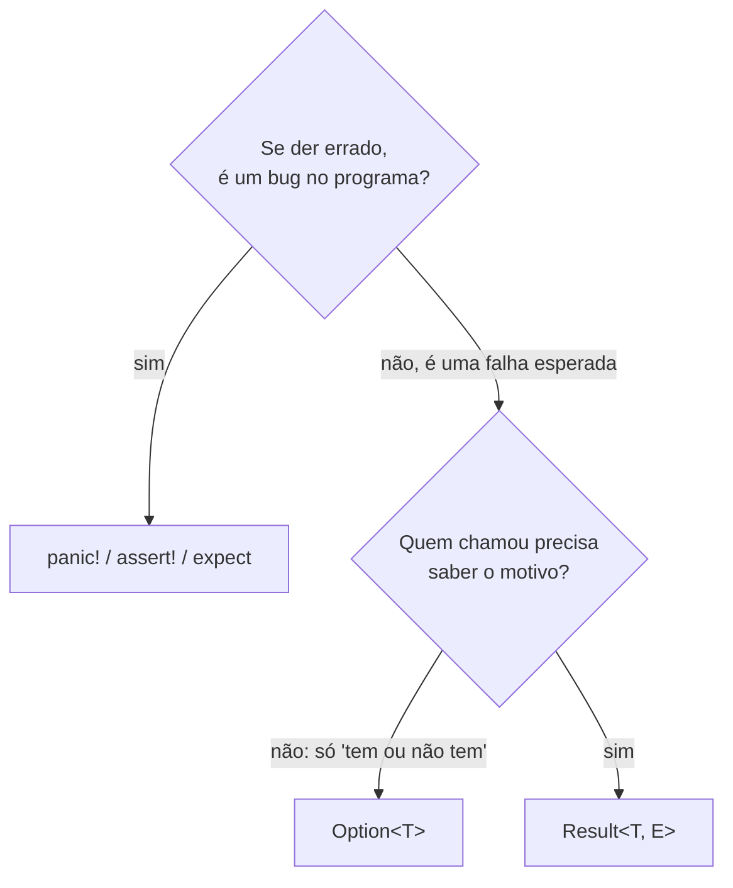

# 01 — `panic!` e erros irrecuperáveis

**Objetivos.** Ao final, você vai saber:

- a diferença entre um bug e uma falha esperada, e por que Rust trata as duas de jeitos diferentes;
- o que acontece num *panic*: a mensagem, o *unwind*, o código de saída e o backtrace;
- reconhecer os panics implícitos (índice, `unwrap`, overflow) e usar `assert!`;
- decidir quando panicar é a escolha certa.

## Dois tipos de erro

Pense em duas situações:

1. O usuário passou o nome de um arquivo que não existe.
2. Seu código acessou o índice 10 de um vetor com 3 elementos.

A primeira é uma **falha esperada**: faz parte da vida do programa, e quem chamou a função quer saber o que houve para decidir o que fazer (pedir outro nome, usar um padrão, avisar). A segunda é um **bug**: não existe "tratamento" razoável, porque o programa já está num estado que você não previu.

Python e C++ usam o mesmo mecanismo, exceções, para as duas coisas. Rust separa:

| Situação | Mecanismo | Assunto |
|---|---|---|
| falha esperada | `Result<T, E>` (um valor de retorno comum) | lições 02 a 05 |
| bug, invariante quebrada | `panic!` (encerra a thread) | esta lição |

Essa separação é a ideia central do módulo. Um `panic!` não é para ser "capturado" e tratado: ele é o programa dizendo "isto nunca deveria ter acontecido".

## `panic!`

```rust
// 💥 PANIC EM RUNTIME
fn main() {
    let saldo = -10;
    if saldo < 0 {
        panic!("saldo negativo: {saldo}");
    }
    println!("nunca chega aqui");
}
```

```text
thread 'main' (182588) panicked at src/main.rs:4:9:
saldo negativo: -10
note: run with `RUST_BACKTRACE=1` environment variable to display a backtrace
```

A mensagem diz em qual thread foi (com o id do sistema entre parênteses), o arquivo, a linha e a coluna, e o texto que você passou. `panic!` aceita formatação igual a `println!`. O processo termina com **código de saída 101**, que distingue um panic de um erro "normal" (que costuma sair com 1).

## Panics que você já viu

Quase nunca você escreve `panic!` à mão. Os panics que aparecem na prática vêm de operações da biblioteca padrão que não têm como continuar:

```rust
// 💥 PANIC EM RUNTIME
fn main() {
    let v: Vec<i32> = Vec::new();
    println!("{}", v[0]);
}
```

```text
thread 'main' (182701) panicked at src/main.rs:3:21:
index out of bounds: the len is 0 but the index is 0
```

Outros casos comuns:

- `None.unwrap()` e `Err(..).unwrap()`, que você vai ver na lição 03: ``called `Option::unwrap()` on a `None` value``;
- fatiar uma `String` no meio de um caractere UTF-8 (`&s[0..1]` em `"ção"`), visto no [Módulo 02](../02-ownership/README.md);
- overflow aritmético no perfil de debug (`255u8 + 1`), visto no [Módulo 01](../01-tour-da-sintaxe/README.md);
- divisão inteira por zero.

Compare com C++: lá, `v[10]` fora dos limites é **comportamento indefinido**, que pode ler lixo, corromper memória ou "funcionar". Em Rust, o acesso é verificado e o pior resultado é um panic com uma mensagem clara. Se você quer um acesso que **não** panica, use `v.get(10)`, que devolve `Option<&T>`.

## O que acontece num panic: *unwind*

Por padrão, o panic faz *unwind* (desenrolar a pilha): ele volta pela pilha de chamadas, função por função, e roda o `Drop` de cada valor vivo, como os destrutores no *stack unwinding* do C++. Arquivos são fechados, locks são liberados:

```rust
// 💥 PANIC EM RUNTIME
struct Conexao(&'static str);

impl Drop for Conexao {
    fn drop(&mut self) {
        println!("fechando {}", self.0);
    }
}

fn main() {
    let _c = Conexao("banco");
    let v: Vec<i32> = Vec::new();
    let _x = v[0];
}
```

```text
thread 'main' (182808) panicked at src/main.rs:12:15:
index out of bounds: the len is 0 but the index is 0
note: run with `RUST_BACKTRACE=1` environment variable to display a backtrace
fechando banco
```

Um panic encerra **a thread** em que aconteceu. Se for a thread principal, o programa inteiro termina. (Panics em outras threads aparecem no Módulo 11.)

> [!NOTE]
> Dá para trocar o unwind por *abort* no `Cargo.toml`, com `panic = "abort"` no perfil (`[profile.release]`, por exemplo). Aí o processo morre na hora, sem rodar nenhum `Drop`: no exemplo acima, o "fechando banco" não aparece, e o código de saída vira 134 (sinal `SIGABRT`). O binário fica menor, e é comum em sistemas embarcados. Na dúvida, fique com o padrão.

## Backtrace

A nota no fim da mensagem sugere a variável `RUST_BACKTRACE`. Com ela, o panic mostra a pilha de chamadas:

```rust
// 💥 PANIC EM RUNTIME
fn a() { b(); }
fn b() { c(); }
fn c() { panic!("algo impossível aconteceu"); }
fn main() { a(); }
```

```bash
RUST_BACKTRACE=1 cargo run
```

```text
thread 'main' (183154) panicked at src/main.rs:3:10:
algo impossível aconteceu
stack backtrace:
   0: __rustc::rust_begin_unwind
             at /rustc/.../library/std/src/panicking.rs:679:5
   1: core::panicking::panic_fmt
             at /rustc/.../library/core/src/panicking.rs:80:14
   2: lab::c
             at ./src/main.rs:3:10
   3: lab::b
             at ./src/main.rs:2:10
   4: lab::a
             at ./src/main.rs:1:10
   5: lab::main
             at ./src/main.rs:4:13
...
```

Leia de cima para baixo e pule as linhas da biblioteca padrão até achar o seu código (aqui o crate se chama `lab`). A primeira linha sua é onde o panic aconteceu. As de baixo são quem chamou. Com `RUST_BACKTRACE=full`, sai tudo, sem omissões. No build de release o backtrace fica menos útil: as otimizações juntam funções (*inlining*) e, sem informação de depuração, as linhas somem.

## `assert!` e `debug_assert!`

Para verificar uma condição que **precisa** ser verdadeira, use `assert!`. Ele panica com a mensagem que você der:

```rust
// 💥 PANIC EM RUNTIME
fn media(v: &[f64]) -> f64 {
    assert!(!v.is_empty(), "media() exige ao menos um valor");
    v.iter().sum::<f64>() / v.len() as f64
}

fn main() {
    println!("{}", media(&[1.0, 2.0, 3.0]));
    println!("{}", media(&[]));
}
```

```text
2

thread 'main' (182939) panicked at src/main.rs:2:5:
media() exige ao menos um valor
```

Há também `assert_eq!(a, b)` e `assert_ne!(a, b)`, que mostram os dois valores quando falham (você já os usa nos testes).

Atenção a uma diferença com Python e C++: o `assert` do Python some com `python -O`, e o `assert` do C++ some com `NDEBUG`. O `assert!` do Rust **fica** no build de release. Quem some no release é o `debug_assert!`, que serve para verificações caras que você só quer durante o desenvolvimento.

## Quando panicar é a escolha certa

O [capítulo 9.3 do Rust Book](https://doc.rust-lang.org/stable/book/ch09-03-to-panic-or-not-to-panic.html) resume bem. Panicar é razoável quando:

1. **É um exemplo, um protótipo ou um teste.** Nos testes, o panic é justamente o que marca a falha.
2. **Você sabe mais que o compilador.** Às vezes uma operação devolve `Result`, mas, pelo contexto, ela não tem como falhar:

   ```rust
   use std::net::Ipv4Addr;

   let ip: Ipv4Addr = "127.0.0.1".parse().expect("IP fixo no código é válido");
   ```

   O texto do `expect` registra **por que** você acha que não falha. Se um dia falhar, a mensagem explica qual suposição quebrou. (A lição 03 trata do `expect`.)
3. **Um contrato foi violado.** A função exige algo que o tipo não consegue expressar (como "a lista não pode estar vazia"), e quem chamou desrespeitou. Isso é um bug de quem chamou, e a documentação da função deve dizer que ela panica nesse caso.

E **não** panique quando a falha é esperada: entrada do usuário, arquivo que pode não existir, rede, dados vindos de fora. Nesses casos, devolva `Result` e deixe quem chamou decidir. Uma biblioteca que panica por causa de uma entrada inválida tira essa decisão de quem a usa.

Uma alternativa melhor que espalhar `assert!` é validar **uma vez**, na criação de um tipo. Uma `struct Porta(u16)` que só pode ser criada por uma função que verifica o valor garante que toda `Porta` do programa é válida, e as funções que a recebem não precisam checar de novo. Você viu a técnica com *structs* no [Módulo 04](../04-structs-enums-e-patterns/README.md).



## `catch_unwind` não é `try/catch`

Existe uma função `std::panic::catch_unwind` que intercepta um panic. Ela serve para casos específicos, como impedir que um panic atravesse uma fronteira com código C (Módulo 15) ou isolar a falha de uma tarefa num servidor. Não é o `try/except` do Rust, e não deve ser usada para controle de fluxo: com `panic = "abort"`, ela nem funciona. Para erros que você quer tratar, o caminho é `Result`.

## Comparação

| | Python | C++ | Rust |
|---|---|---|---|
| bug / estado impossível | exceção (`AssertionError`, `IndexError`...) | `assert`, `std::terminate`, ou comportamento indefinido | `panic!` |
| falha esperada | exceção | exceção ou código de erro | `Result<T, E>` |
| limpeza ao sair por erro | `finally`, `with` | destrutores (RAII) | `Drop` (RAII) |
| `assert` no build otimizado | some com `-O` | some com `NDEBUG` | `assert!` fica, `debug_assert!` some |

O que se ganha com a separação: quando você vê um `panic!`, sabe que é um bug, e quando vê um `Result`, sabe que é uma falha a tratar. O que se perde: não há um mecanismo único para tudo, e você precisa decidir, função por função, de que lado cada falha fica.

## Armadilhas comuns

**Panicar por causa de entrada do usuário.** Um `.unwrap()` no resultado de `parse()` de algo que o usuário digitou derruba o programa com uma mensagem técnica (`ParseIntError { kind: InvalidDigit }`). Isso não é tratamento de erro. Devolva `Result` e mostre uma mensagem decente (lição 02).

**Achar que o overflow sempre panica.** No perfil de debug, `u8::MAX + 1` panica. No release, a verificação é desligada e o valor dá a volta (255 + 1 = 0). Se o overflow importa, use `checked_add` (que devolve `Option`) ou `wrapping_add`/`saturating_add` para deixar a intenção explícita (Módulo 01).

**Esperar que `panic = "abort"` rode a limpeza.** Com abort, nenhum `Drop` roda: dados em buffer podem não ser gravados. Se você depende de limpeza no panic, fique com o unwind.

## Resumo

- Rust separa bugs (`panic!`) de falhas esperadas (`Result`). Python e C++ usam exceções para os dois.
- Um panic mostra a mensagem e o local, faz unwind (rodando os `Drop`), encerra a thread e sai com código 101.
- `RUST_BACKTRACE=1` mostra a pilha de chamadas.
- Índice fora dos limites, `unwrap` em `None`/`Err` e overflow em debug panicam. `get()` e `checked_*` são as versões que não panicam.
- `assert!` fica no release; `debug_assert!` não.
- Panique em testes, protótipos, contratos violados e quando você sabe que não falha (com `expect` explicando o porquê). Para o resto, `Result`.

## Exercícios

Veja o exercício 5 em [`exercicios.md`](exercicios.md), que transforma um código cheio de `panic!` em código com `Result`.

## Leitura complementar

- [The Rust Programming Language, 9.1 Unrecoverable Errors with `panic!`](https://doc.rust-lang.org/stable/book/ch09-01-unrecoverable-errors-with-panic.html)
- [The Rust Programming Language, 9.3 To `panic!` or Not to `panic!`](https://doc.rust-lang.org/stable/book/ch09-03-to-panic-or-not-to-panic.html)
- [Documentação de `std::panic`](https://doc.rust-lang.org/std/panic/index.html)
- [Cargo: `profile.*.panic`](https://doc.rust-lang.org/cargo/reference/profiles.html#panic)
- [Effective Rust, Item 18: Don't panic](https://effective-rust.com/panic.html)

---

[Índice do módulo](README.md) · [Próxima lição →](02-result-e-o-operador-interrogacao.md)
