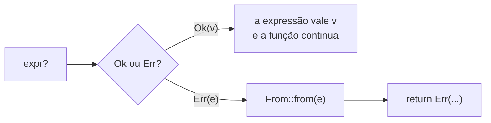

# 02 — `Result` e o operador `?`

**Objetivos.** Ao final, você vai saber:

- representar uma falha esperada com `Result<T, E>` e tratá-la com `match`;
- propagar erros com o operador `?`, e o que ele faz por baixo;
- usar `?` com `Option`, e entender os erros do compilador quando os tipos não batem;
- escrever um `main` que devolve `Result` ou `ExitCode`.

## O erro faz parte do tipo

`Result` é um *enum* comum, da biblioteca padrão, igual aos que você escreveu no [Módulo 04](../04-structs-enums-e-patterns/README.md):

```rust
enum Result<T, E> {
    Ok(T),  // deu certo, e aqui está o valor
    Err(E), // deu errado, e aqui está o motivo
}
```

`T` e `E` são parâmetros de tipo: `Result<String, io::Error>` é "uma `String` ou um `io::Error`". Por enquanto, use-os como você usa `Option<T>`. Escrever os seus próprios tipos genéricos fica para o Módulo 06.

`fs::read_to_string` devolve `Result<String, io::Error>`. Para chegar à `String`, você precisa olhar qual variante veio:

```rust
use std::fs;
use std::io::ErrorKind;

fn main() {
    match fs::read_to_string("config.txt") {
        Ok(texto) => println!("li {} bytes", texto.len()),
        Err(e) if e.kind() == ErrorKind::NotFound => {
            println!("config.txt não existe, usando o padrão");
        }
        Err(e) => println!("erro inesperado: {e}"),
    }
}
```

```text
config.txt não existe, usando o padrão
```

O `match` é exaustivo, então não dá para esquecer o caso de erro. E o `e.kind()` deixa você reagir de forma diferente a cada tipo de falha de I/O (`NotFound`, `PermissionDenied`...).

Compare com Python:

```python
# Python: nada na assinatura diz que open() pode falhar
try:
    with open("config.txt") as f:
        texto = f.read()
except FileNotFoundError:
    print("config.txt não existe, usando o padrão")
```

O estilo é parecido: os dois **tentam** a operação e depois olham o que aconteceu, em vez de perguntar antes se o arquivo existe. É o *EAFP* (*easier to ask forgiveness than permission*) do Python, e ele evita a corrida entre "verifiquei" e "abri". A diferença está em onde a informação mora. Em Python, só a documentação diz que `open` levanta exceção. Em Rust, está na assinatura, e o compilador não deixa você usar o `Ok` sem passar pelo `Err`.

## Ignorar um `Result` gera aviso

E se você chamar uma função que devolve `Result` e não fizer nada com o valor?

```rust
use std::fs;

fn main() {
    fs::write("/nao-existe/x.txt", "oi");
}
```

```text
warning: unused `Result` that must be used
 --> src/main.rs:4:5
  |
4 |     fs::write("/nao-existe/x.txt", "oi");
  |     ^^^^^^^^^^^^^^^^^^^^^^^^^^^^^^^^^^^^
  |
  = note: this `Result` may be an `Err` variant, which should be handled
  = note: `#[warn(unused_must_use)]` (part of `#[warn(unused)]`) on by default
help: use `let _ = ...` to ignore the resulting value
  |
4 |     let _ = fs::write("/nao-existe/x.txt", "oi");
  |     +++++++
```

Repare que é um **aviso**, não um erro: o programa compila e roda, e a falha passa em silêncio. `Result` é marcado com o atributo `#[must_use]`, e é isso que gera o aviso. Se você quer mesmo descartar o resultado, escreva `let _ = ...`: fica explícito para quem lê que a decisão foi de propósito.

## O operador `?`

Na maioria das vezes, uma função que encontra um erro não sabe o que fazer com ele, e só quer devolvê-lo para quem chamou. Com `match`, fica assim:

```rust
use std::fs;
use std::io;

fn read_first_line(path: &str) -> Result<String, io::Error> {
    let text = match fs::read_to_string(path) {
        Ok(t) => t,
        Err(e) => return Err(e),
    };
    Ok(text.lines().next().unwrap_or("").to_string())
}
```

Esse padrão é tão comum que tem um operador. O `?` faz exatamente isso:

```rust
fn read_first_line(path: &str) -> Result<String, io::Error> {
    let text = fs::read_to_string(path)?;
    Ok(text.lines().next().unwrap_or("").to_string())
}
```

Se o valor é `Ok(t)`, a expressão `fs::read_to_string(path)?` vale `t`, e a função continua. Se é `Err(e)`, a função **retorna na hora** com o erro. Há só um detalhe a mais: antes de retornar, o `?` converte o erro para o tipo de erro da função, chamando `From::from(e)`. Em pseudocódigo:

```rust
// o que `expr?` significa (simplificado)
match expr {
    Ok(v) => v,
    Err(e) => return Err(From::from(e)),
}
```



A conversão com `From` é o que permite juntar erros de tipos diferentes numa função só. Ela é o assunto da lição 04.

### `?` torna as saídas visíveis

Para quem vem de C++ ou Python, este é o ponto mais importante. Com exceções, **qualquer** chamada pode sair da função no meio, e nada no código mostra isso. Com `?`, cada ponto em que a função pode sair mais cedo está marcado com um caractere. Ao ler o código, você sabe exatamente onde o fluxo pode ser interrompido.

E a limpeza continua automática: quando o `?` retorna, os valores locais saem de escopo e o `Drop` de cada um roda normalmente. Não existe `finally` porque não precisa existir.

## Os erros do `?`

O `?` tem regras, e o compilador explica cada uma. A primeira: ele só funciona dentro de uma função que devolve `Result` (ou `Option`).

```rust
// ❌ NÃO COMPILA
use std::fs;

fn main() {
    let s = fs::read_to_string("config.txt")?;
    println!("{s}");
}
```

```text
error[E0277]: the `?` operator can only be used in a function that returns `Result` or `Option` (or another type that implements `FromResidual`)
 --> src/main.rs:4:45
  |
3 | fn main() {
  | --------- this function should return `Result` or `Option` to accept `?`
4 |     let s = fs::read_to_string("config.txt")?;
  |                                             ^ cannot use the `?` operator in a function that returns `()`
  |
help: consider adding return type
  |
3 ~ fn main() -> Result<(), Box<dyn std::error::Error>> {
4 |     let s = fs::read_to_string("config.txt")?;
5 |     println!("{s}");
6 +     Ok(())
  |
```

Faz sentido: se a função devolve `()`, o `?` não tem como "devolver o erro". O compilador sugere mudar o `main` para devolver `Result`, o que é permitido (veja mais abaixo).

A segunda regra: o erro precisa ser conversível para o tipo de erro da função.

```rust
// ❌ NÃO COMPILA
use std::fs;
use std::io;

fn read_port(path: &str) -> Result<u16, io::Error> {
    let text = fs::read_to_string(path)?;
    let port = text.trim().parse::<u16>()?;
    Ok(port)
}
```

```text
error[E0277]: `?` couldn't convert the error to `std::io::Error`
 --> src/main.rs:6:42
  |
4 | fn read_port(path: &str) -> Result<u16, io::Error> {
  |                             ---------------------- expected `std::io::Error` because of this
5 |     let text = fs::read_to_string(path)?;
6 |     let port = text.trim().parse::<u16>()?;
  |                            --------------^ the trait `From<ParseIntError>` is not implemented for `std::io::Error`
  |                            |
  |                            this can't be annotated with `?` because it has type `Result<_, ParseIntError>`
  |
  = note: the question mark operation (`?`) implicitly performs a conversion on the error value using the `From` trait
...
```

A função promete devolver `io::Error`, mas o `parse` falha com `ParseIntError`, e não existe conversão de um para o outro. A nota confirma o que vimos: o `?` usa `From`. A solução é ter um tipo de erro que represente as duas falhas. A saída rápida é `Box<dyn Error>` (o que o compilador sugeriu no erro anterior), e a saída boa é um tipo de erro seu, ambos na lição 04.

## `?` em `Option`

O `?` também funciona com `Option`, dentro de funções que devolvem `Option`. Se o valor é `None`, a função devolve `None`:

```rust
fn last_char_of_first_line(text: &str) -> Option<char> {
    text.lines().next()?.chars().last()
}

fn main() {
    println!("{:?}", last_char_of_first_line("olá\nmundo"));
    println!("{:?}", last_char_of_first_line(""));
}
```

```text
Some('á')
None
```

O que você **não** pode é misturar: `?` em `Option` dentro de uma função que devolve `Result`.

```rust
// ❌ NÃO COMPILA
fn first_char_upper(s: &str) -> Result<char, String> {
    let c = s.chars().next()?;
    Ok(c.to_ascii_uppercase())
}
```

```text
error[E0277]: the `?` operator can only be used on `Result`s, not `Option`s, in a function that returns `Result`
 --> src/main.rs:2:29
  |
1 | fn first_char_upper(s: &str) -> Result<char, String> {
  | ---------------------------------------------------- this function returns a `Result`
2 |     let c = s.chars().next()?;
  |                             ^ use `.ok_or(...)?` to provide an error compatible with `Result<char, String>`
```

O motivo: um `None` não traz nenhum erro para colocar no `Err`. A sugestão do compilador é transformar o `Option` em `Result` antes, dizendo qual é o erro:

```rust
// ✅
fn first_char_upper(s: &str) -> Result<char, String> {
    let c = s.chars().next().ok_or("texto vazio".to_string())?;
    Ok(c.to_ascii_uppercase())
}
```

`ok_or` e seus parentes são o assunto da próxima lição.

## `main` que devolve `Result`

O `main` pode devolver `Result<(), E>`. Se ele devolver `Err`, o Rust imprime o erro e sai com código 1:

```rust
use std::num::ParseIntError;

fn main() -> Result<(), ParseIntError> {
    let n: i32 = "12a".parse()?;
    println!("{n}");
    Ok(())
}
```

```text
Error: ParseIntError { kind: InvalidDigit }
```

Repare no formato: o erro é impresso com **`Debug`** (`{:?}`), não com `Display` (`{}`). Para um erro de I/O, o resultado fica assim:

```text
Error: Os { code: 2, kind: NotFound, message: "No such file or directory" }
```

Isso é ótimo para você, que está desenvolvendo, e ruim para quem usa o programa. Por isso o `main -> Result` é bom para protótipos e exemplos, mas uma ferramenta de linha de comando de verdade costuma controlar a mensagem por conta própria. (A crate `anyhow`, da lição 05, contorna o problema, porque o `Debug` dela é feito para humanos.)

## `main` que devolve `ExitCode`

Para controlar a mensagem **e** o código de saída, devolva `std::process::ExitCode`. O padrão é deixar a lógica numa função `run` que devolve `Result`, e o `main` só traduz o resultado:

```rust
use std::fs;
use std::process::ExitCode;

fn run() -> Result<usize, std::io::Error> {
    let text = fs::read_to_string("config.txt")?;
    Ok(text.lines().count())
}

fn main() -> ExitCode {
    match run() {
        Ok(n) => {
            println!("{n} linhas");
            ExitCode::SUCCESS
        }
        Err(e) => {
            eprintln!("erro: não consegui ler config.txt: {e}");
            ExitCode::from(2)
        }
    }
}
```

```text
erro: não consegui ler config.txt: No such file or directory (os error 2)
```

```bash
echo $?   # 2
```

A mensagem vai para a saída de erro (`eprintln!`), com o texto que você escolheu, e o código de saída é o que você definiu. `ExitCode::SUCCESS` é 0, `ExitCode::FAILURE` é 1, e `ExitCode::from(n)` aceita qualquer `u8`.

Talvez você encontre por aí `std::process::exit(1)`, inclusive no Rust Book. Funciona, mas encerra o processo **na hora**, sem rodar o `Drop` dos valores vivos, e uma função que chama `exit` no meio da lógica não pode ser testada. Prefira propagar o erro até o `main` e devolver um `ExitCode`. É o que você vai fazer no Projeto 1.

## Comparação com C++

C++23 ganhou `std::expected<T, E>`, que é a mesma ideia do `Result`:

```cpp
// C++23
std::expected<int, std::string> parse_port(std::string_view s);

std::expected<int, std::string> read_port() {
    auto r = parse_port("8080");
    if (!r) return std::unexpected(r.error()); // propagação manual
    return *r;
}
```

```rust
// Rust
fn read_port() -> Result<u16, String> {
    let p = parse_port("8080")?;
    Ok(p)
}
```

As diferenças práticas:

- **Propagação.** O `?` é parte da linguagem. Em C++ você escreve o `if` à mão ou encadeia `and_then`/`transform` (que também existem em Rust, lição 03).
- **Acesso ao valor.** Em C++, `*r` num `expected` com erro é comportamento indefinido, e `r.value()` lança exceção. Em Rust, não há como pegar o `T` sem passar pelo erro: ou você usa `match`/`?`, ou chama `unwrap`, que panica de forma definida.
- **Aviso ao ignorar.** `Result` é `#[must_use]` sempre. Em C++, só se a função for marcada `[[nodiscard]]`.
- **Ecossistema.** Toda a biblioteca padrão do Rust usa `Result`. Em C++, `expected` convive com exceções e códigos de erro (`errno`, `std::error_code`), e o mesmo programa costuma usar os três.

Sendo justo com as exceções: o caminho feliz delas não tem nenhum `if` para checar erro, e o `Result` tem um desvio a cada `?`. Na prática a diferença costuma ser pequena e o compilador otimiza bem, mas não faça afirmações de desempenho sem medir. E Python e C++ têm uma vantagem real de concisão: uma função no meio da pilha não precisa mencionar o erro para deixá-lo passar. Em Rust, ela precisa de um `?` e do tipo certo na assinatura. É esse o preço da visibilidade.

## Armadilhas comuns

**Esquecer o `Ok(...)` no final.** O `?` "desembrulha" o valor, mas a função continua devolvendo `Result`, então o valor final precisa ser embrulhado de novo:

```rust
// ❌ NÃO COMPILA
use std::num::ParseIntError;

fn parse_port(s: &str) -> Result<u16, ParseIntError> {
    let port: u16 = s.trim().parse()?;
    port
}
```

```text
error[E0308]: mismatched types
 --> src/main.rs:5:5
  |
3 | fn parse_port(s: &str) -> Result<u16, ParseIntError> {
  |                           -------------------------- expected `Result<u16, ParseIntError>` because of return type
4 |     let port: u16 = s.trim().parse()?;
5 |     port
  |     ^^^^ expected `Result<u16, ParseIntError>`, found `u16`
...
help: try wrapping the expression in `Ok`
  |
5 |     Ok(port)
  |     +++    +
```

Com `Result<(), E>`, o final é `Ok(())`.

**Achar que `main -> Result` imprime uma mensagem bonita.** Ele imprime o `Debug` do erro. Para uma ferramenta usada por outras pessoas, use `ExitCode` (ou `anyhow`, na lição 05).

**Chamar `process::exit` no meio do código.** Não roda os `Drop` e impede testes. Propague com `?` até o `main`.

**Achar que tratar o `Result` é obrigatório.** Ignorar gera aviso, não erro. Não deixe avisos de `unused_must_use` acumularem: cada um é uma falha que passa em silêncio.

## Resumo

- `Result<T, E>` é um enum com `Ok(T)` e `Err(E)`. O erro faz parte da assinatura.
- Ignorar um `Result` gera o aviso `unused_must_use`. Para descartar de propósito, use `let _ =`.
- `expr?` vale o `Ok`, ou retorna da função com o `Err` convertido por `From::from`.
- `?` em `Option` funciona em funções que devolvem `Option`. Para usar em funções que devolvem `Result`, converta antes com `ok_or`.
- `main -> Result` imprime o erro com `Debug` e sai com 1. `main -> ExitCode` dá controle total da mensagem e do código.

## Exercícios

Veja os exercícios 1 e 2 em [`exercicios.md`](exercicios.md).

## Leitura complementar

- [The Rust Programming Language, 9.2 Recoverable Errors with `Result`](https://doc.rust-lang.org/stable/book/ch09-02-recoverable-errors-with-result.html)
- [Documentação de `std::result`](https://doc.rust-lang.org/std/result/index.html)
- [Documentação de `std::process::ExitCode`](https://doc.rust-lang.org/std/process/struct.ExitCode.html)
- [Rust by Example: Error handling](https://doc.rust-lang.org/rust-by-example/error.html)
- [cppreference: `std::expected`](https://en.cppreference.com/w/cpp/utility/expected)

---

[← Lição anterior](01-panic-e-erros-irrecuperaveis.md) · [Índice do módulo](README.md) · [Próxima lição →](03-unwrap-expect-e-combinadores.md)
