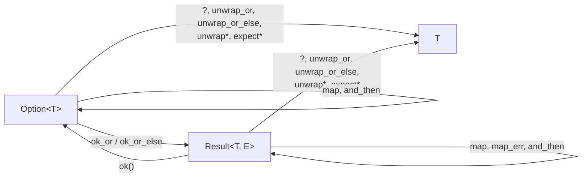

# 03 — `unwrap`, `expect` e combinadores

**Objetivos.** Ao final, você vai saber:

- quando `unwrap` e `expect` são aceitáveis, e como escrever uma boa mensagem de `expect`;
- transformar `Option` e `Result` com combinadores (`map`, `map_err`, `and_then`, `unwrap_or_else`...);
- converter entre `Option` e `Result` (`ok_or`, `ok`, `transpose`);
- coletar uma sequência de `Result` com `collect`, e a diferença para `filter_map`.

## `unwrap` e `expect`

`unwrap()` pega o valor de um `Ok` ou de um `Some`, e **panica** se vier `Err` ou `None`:

```rust
// 💥 PANIC EM RUNTIME
fn main() {
    let porta: Option<&str> = None;
    let p: u16 = porta.unwrap().parse().unwrap();
    println!("{p}");
}
```

```text
thread 'main' (189589) panicked at src/main.rs:3:24:
called `Option::unwrap()` on a `None` value
```

`expect("...")` faz o mesmo, mas com uma mensagem sua na frente do erro:

```rust
// 💥 PANIC EM RUNTIME
fn main() {
    let porta = "80a";
    let p: u16 = porta.parse().expect("PORT deve ser um número");
    println!("{p}");
}
```

```text
thread 'main' (189697) panicked at src/main.rs:3:32:
PORT deve ser um número: ParseIntError { kind: InvalidDigit }
```

Os dois transformam uma falha esperada em panic, ou seja, em "isto é um bug". Pela regra da lição 01, isso é aceitável em três situações: testes, protótipos e quando você sabe que a falha é impossível.

Ao usar `expect`, escreva **por que deveria funcionar**, e não que falhou. `expect("falhou ao ler")` não ajuda ninguém (o panic já diz que falhou). `expect("PORT deve ser um número")` ou `expect("o regex é fixo e foi testado")` dizem qual suposição quebrou. Em código que vai para produção, prefira `expect` a `unwrap`, pelo mesmo motivo.

> [!TIP]
> `unwrap` em protótipo é uma dívida com endereço certo: quando o código amadurecer, procure por `unwrap` e decida, caso a caso, entre `?`, um valor padrão ou um `expect` com justificativa.

## Combinadores: transformar sem desembrulhar

Muitas vezes você não quer tratar o erro agora, só transformar o valor (ou o erro) e seguir em frente. Escrever um `match` para cada transformação fica verboso. Os combinadores são métodos de `Option` e `Result` que recebem uma *closure* (as funções anônimas `|x| ...` que você viu no [Módulo 01](../01-tour-da-sintaxe/README.md)) e fazem a transformação para você.

Os de uso diário, agrupados pelo que fazem:

### Transformar o valor ou o erro

```rust
use std::num::ParseIntError;

// map: transforma o Ok (ou o Some) e mantém o Err como está
let dobro: Result<i32, ParseIntError> = "21".parse::<i32>().map(|n| n * 2);
println!("{dobro:?}"); // Ok(42)

// map_err: transforma o Err e mantém o Ok como está
let r: Result<i32, String> = "x".parse::<i32>().map_err(|e| format!("número inválido: {e}"));
println!("{r:?}"); // Err("número inválido: invalid digit found in string")
```

`and_then` encadeia uma operação que **também pode falhar**. A closure recebe o valor de dentro e devolve um novo `Result`:

```rust
let positivo = "-5".parse::<i32>().map_err(|e| e.to_string()).and_then(|n| {
    if n > 0 { Ok(n) } else { Err(format!("{n} não é positivo")) }
});
println!("{positivo:?}"); // Err("-5 não é positivo")
```

A diferença entre `map` e `and_then` é o tipo que a closure devolve: com `map`, um valor comum (`T`), e com `and_then`, outro `Result` (ou `Option`). Se você usar `map` com uma closure que devolve `Result`, vai acabar com um `Result<Result<..>>`.

### Valor padrão

```rust
let a = "x".parse::<i32>().unwrap_or(0);            // valor fixo
let b = "x".parse::<i32>().unwrap_or_default();     // Default do tipo: 0, "", vec![]...
let c = "x".parse::<i32>().unwrap_or_else(|e| {     // calculado (só roda no Err)
    eprintln!("aviso: {e}; usando 8080");
    8080
});
println!("{a} {b} {c}");
```

```text
aviso: invalid digit found in string; usando 8080
0 0 8080
```

Use `unwrap_or_else` quando o valor padrão é caro de calcular ou quando você quer olhar o erro. O argumento de `unwrap_or` é avaliado **sempre**, mesmo quando o resultado é `Ok`.

### Converter entre `Option` e `Result`

```rust
use std::collections::HashMap;

let env: HashMap<&str, &str> = HashMap::from([("HOME", "/home/ana")]);

// Option -> Result: diga qual é o erro quando vier None
let user = env.get("USER").ok_or("variável USER ausente");
println!("{user:?}"); // Err("variável USER ausente")

// Result -> Option: descarte o erro
let talvez: Option<i32> = "42".parse().ok();
println!("{talvez:?}"); // Some(42)
```

`ok_or` é a resposta para o erro da lição anterior ("use `.ok_or(...)?`"): ele dá ao `None` um erro, e aí o `?` funciona numa função que devolve `Result`. Como no `unwrap_or`, o argumento de `ok_or` é sempre avaliado. Se construir o erro custa algo (um `format!`, por exemplo), use `ok_or_else(|| ...)`.

### Perguntar sem desembrulhar

```rust
let idade: Option<u32> = Some(20);
println!("{}", idade.is_some_and(|i| i >= 18));     // true
println!("{}", None::<u32>.is_none_or(|i| i >= 18)); // true: None passa
```

`Result` tem `is_ok_and` e `is_err_and`, no mesmo estilo.

### Olhar sem consumir

`inspect` e `inspect_err` rodam uma closure com uma referência ao valor ou ao erro e devolvem o `Result` intacto. São úteis para registrar um erro (*log*) no meio de uma cadeia:

```rust
let n = "x"
    .parse::<i32>()
    .inspect_err(|e| eprintln!("log: falhou com {e}"))
    .unwrap_or(0);
println!("{n}");
```

```text
log: falhou com invalid digit found in string
0
```

## O mapa das conversões



Os marcados com `*` podem panicar. O `?` não panica: ele devolve o `None` ou o `Err` para quem chamou.

## Coletar uma sequência de `Result`

Uma situação frequente: você tem uma lista de textos e quer convertê-los em números. Cada `parse` pode falhar. O que fazer com as falhas é uma decisão sua, e há duas respostas comuns:

```rust
let entrada = "1,2,x,4";

// tudo ou nada: para no primeiro erro
let todos: Result<Vec<i32>, _> = entrada.split(',').map(|s| s.parse::<i32>()).collect();
println!("{todos:?}");

// só os válidos: descarta os erros em silêncio
let validos: Vec<i32> = entrada.split(',').filter_map(|s| s.parse().ok()).collect();
println!("{validos:?}");
```

```text
Err(ParseIntError { kind: InvalidDigit })
[1, 2, 4]
```

O `collect` sabe montar um `Result<Vec<T>, E>` a partir de vários `Result<T, E>`: se todos forem `Ok`, você recebe `Ok(vec)`, e se algum for `Err`, recebe o primeiro erro (e o resto nem é processado). Isso **não** é uma questão de estilo: é a semântica que você quer. Num arquivo de configuração, uma linha inválida provavelmente deve parar tudo. Numa planilha de dados sujos, talvez faça sentido pular os inválidos, mas nesse caso é bom pelo menos contar quantos foram pulados.

`map`, `filter_map` e `collect` são métodos de iteradores, que o Módulo 07 aprofunda. Por ora, leia como "para cada item, faça isto, e junte o resultado".

## Dois combinadores menos comuns

`transpose` troca `Option<Result<T, E>>` por `Result<Option<T>, E>` (e vice-versa). Aparece com campos opcionais que, se presentes, precisam ser válidos:

```rust
let campo: Option<&str> = Some("42");
let r: Result<Option<i32>, _> = campo.map(|s| s.parse::<i32>()).transpose();
println!("{r:?}"); // Ok(Some(42)); com None, seria Ok(None)
```

`flatten` junta um `Result<Result<T, E>, E>` num `Result<T, E>`:

```rust
let aninhado: Result<Result<i32, String>, String> = Ok(Err("interno".to_string()));
println!("{:?}", aninhado.flatten()); // Err("interno")
```

## Combinadores, `?` ou `match`?

Não existe uma regra única, mas na prática:

- Para **propagar**, use `?`. É o mais curto e o mais legível.
- Para **ajustar** o valor ou o erro antes de propagar, use um combinador seguido de `?`: `.map_err(...)?`, `.ok_or(...)?`.
- Para **decidir** entre caminhos diferentes, use `match`, `if let` ou `let ... else`.

O que você deve evitar é a "pirâmide" de `match` aninhados:

```rust
fn port_from_line(line: &str) -> Result<u16, String> {
    match line.split_once('=') {
        Some((key, value)) => {
            if key.trim() == "port" {
                match value.trim().parse::<u16>() {
                    Ok(p) => Ok(p),
                    Err(e) => Err(format!("porta inválida: {e}")),
                }
            } else {
                Err(format!("esperava `port`, veio `{}`", key.trim()))
            }
        }
        None => Err("linha sem `=`".to_string()),
    }
}
```

Com `let ... else` (do [Módulo 04](../04-structs-enums-e-patterns/README.md)) e um combinador, o caminho feliz fica reto, e cada erro é tratado logo onde aparece:

```rust
// ✅
fn port_from_line(line: &str) -> Result<u16, String> {
    let Some((key, value)) = line.split_once('=') else {
        return Err("linha sem `=`".to_string());
    };
    if key.trim() != "port" {
        return Err(format!("esperava `port`, veio `{}`", key.trim()));
    }
    value
        .trim()
        .parse()
        .map_err(|e| format!("porta inválida: {e}"))
}
```

Quem vem de C++23 vai reconhecer os combinadores: `std::optional` e `std::expected` ganharam `and_then`, `transform` (o `map`) e `or_else`. A diferença é que, em Rust, eles convivem com o `?`, então você não precisa escrever uma cadeia longa só para propagar.

## Armadilhas comuns

**`map` quando era `and_then`.** Se a closure devolve `Result`, `map` cria um `Result` dentro de outro:

```rust
// ❌ NÃO COMPILA
fn parse_positive(s: &str) -> Result<i32, String> {
    s.parse::<i32>()
        .map_err(|e| e.to_string())
        .map(|n| if n > 0 { Ok(n) } else { Err("não positivo".to_string()) })
}
```

```text
error[E0308]: mismatched types
 --> src/main.rs:2:5
  |
1 |   fn parse_positive(s: &str) -> Result<i32, String> {
  |                                 ------------------- expected `Result<i32, String>` because of return type
2 | /     s.parse::<i32>()
3 | |         .map_err(|e| e.to_string())
4 | |         .map(|n| if n > 0 { Ok(n) } else { Err("não positivo".to_string()) })
  | |_____________________________________________________________________________^ expected `Result<i32, String>`, found `Result<Result<i32, String>, String>`
  |
  = note: expected enum `Result<i32, _>`
             found enum `Result<Result<i32, String>, _>`
help: use the `?` operator to extract the `Result<Result<i32, String>, String>` value, propagating a `Result::Err` value to the caller
...
```

A sugestão do compilador (um `?` no fim) compila, mas fica confusa. A correção certa é trocar o último `map` por `and_then`.

**`map_err(|e| e.to_string())` em todo lugar.** Funciona, mas joga fora o tipo do erro (o chamador não consegue mais distinguir os casos) e a cadeia de causas. É aceitável num protótipo. Num código maior, a resposta é um tipo de erro próprio (lição 04).

**`unwrap` em código de produção "para resolver depois".** O "depois" costuma ser um panic às três da manhã. Ou use `?`, ou use `expect` com a justificativa de por que não falha.

## Resumo

- `unwrap`/`expect` transformam a falha em panic. Use em testes, protótipos e quando a falha é impossível. A mensagem do `expect` diz por que deveria funcionar.
- `map` e `map_err` transformam o valor e o erro; `and_then` encadeia outra operação que pode falhar.
- `unwrap_or`, `unwrap_or_default` e `unwrap_or_else` dão um valor padrão. As versões `_else` só calculam quando precisam.
- `ok_or` converte `Option` em `Result` (e resolve o `?` em `Option`); `ok()` faz o contrário.
- `collect::<Result<Vec<_>, _>>()` para no primeiro erro; `filter_map(|x| x.ok())` descarta os erros. Escolha pela semântica.
- `?` para propagar, combinadores para ajustar, `match`/`let else` para decidir.

## Exercícios

Veja o exercício 3 em [`exercicios.md`](exercicios.md).

## Leitura complementar

- [The Rust Programming Language, 9.2 (seção "Shortcuts for Panic on Error")](https://doc.rust-lang.org/stable/book/ch09-02-recoverable-errors-with-result.html#shortcuts-for-panic-on-error-unwrap-and-expect)
- [Documentação de `Option`](https://doc.rust-lang.org/std/option/enum.Option.html) e [de `Result`](https://doc.rust-lang.org/std/result/enum.Result.html): a lista completa de métodos
- [Effective Rust, Item 3: Prefer `Option` and `Result` transforms over explicit `match` expressions](https://effective-rust.com/transform.html)
- [Documentação de `expect`: "Recommended Message Style"](https://doc.rust-lang.org/std/result/enum.Result.html#recommended-message-style)

---

[← Lição anterior](02-result-e-o-operador-interrogacao.md) · [Índice do módulo](README.md) · [Próxima lição →](04-tipos-de-erro-proprios.md)
