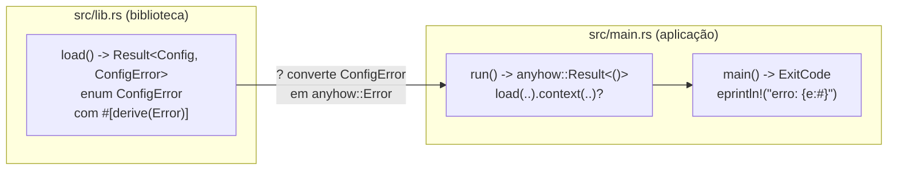

# 05 — `thiserror` e `anyhow`

> Última revisão: 2026-10-15 (`thiserror` 2.0.21 e `anyhow` 1.0.104)

**Objetivos.** Ao final, você vai saber:

- a regra "biblioteca usa tipo concreto, aplicação usa `anyhow`", e por quê;
- gerar a receita da lição 04 com `thiserror` (`#[error]`, `#[from]`, `#[source]`, `transparent`);
- propagar e reportar erros numa aplicação com `anyhow` (`context`, `bail!`, `ensure!`, `{:#}`);
- evitar a mensagem de erro duplicada.

## Duas crates, dois papéis

A lição 04 terminou com dois caminhos: um enum próprio, que dá informação ao chamador mas exige escrever a receita, e `Box<dyn Error>`, que é prático mas esconde o tipo. O ecossistema tem uma crate para cada caminho, e elas são usadas juntas com frequência:

| | `thiserror` | `anyhow` |
|---|---|---|
| para quê | **bibliotecas**: definir tipos de erro concretos | **aplicações**: propagar e reportar qualquer erro |
| o que faz | gera `Display`, `Error` e `From` para o seu enum | oferece `anyhow::Error`, um `Box<dyn Error>` melhorado |
| quem chama pode | casar variantes com `match` | ler a mensagem (e, se precisar, fazer `downcast`) |

A regra vem do que cada lado precisa. Quem usa uma biblioteca precisa **reagir** a erros específicos ("se o arquivo não existe, crio um novo"), então a biblioteca expõe um enum. Uma aplicação, no topo da pilha, quase sempre só precisa **reportar** o erro bem e sair, então qualquer erro serve, desde que tenha contexto.

Para instalar, dentro do projeto:

```bash
cargo add thiserror anyhow
```

```toml
[dependencies]
anyhow = "1"
thiserror = "2"
```

(O `cargo add` grava a versão exata, como `"2.0.21"`. Os projetos do curso usam só o número principal, que dá o mesmo resultado.) Se você encontrar material antigo com `thiserror = "1"`, a sintaxe vista aqui é a mesma.

## `thiserror`: a receita escrita por você

Este é o `ConfigError` da lição 04, agora com `thiserror`:

```rust
use std::num::ParseIntError;
use thiserror::Error;

#[derive(Debug, Error)]
enum ConfigError {
    #[error("porta inválida")]
    BadPort(#[from] ParseIntError),
    #[error("a porta {0} é reservada")]
    PortTooLow(u16),
}

fn parse_port(s: &str) -> Result<u16, ConfigError> {
    let p: u16 = s.parse()?;
    if p < 1024 {
        return Err(ConfigError::PortTooLow(p));
    }
    Ok(p)
}

fn main() {
    for s in ["8080", "80", "abc"] {
        match parse_port(s) {
            Ok(p) => println!("ok: {p}"),
            Err(ConfigError::PortTooLow(p)) => println!("reservada: {p}"),
            Err(e) => println!("erro: {e}"),
        }
    }
}
```

```text
ok: 8080
reservada: 80
erro: porta inválida
```

O `#[derive(Error)]` escreve os três blocos `impl` da lição 04 a partir dos atributos:

- **`#[error("...")]`** gera o `Display`. Dentro do texto, `{0}` é o primeiro campo de uma variante tupla, `{campo}` é um campo com nome, e `{campo:?}` usa o `Debug` dele.
- **`#[from]`** gera o `impl From<ParseIntError>`, para o `?` converter sozinho, e também marca o campo como a causa (`source()`).
- **`#[source]`** marca a causa **sem** gerar `From`. Um campo chamado `source` é marcado automaticamente.

O código gerado é o mesmo que você escreveria à mão. `thiserror` não aparece na sua API pública: para quem usa a sua biblioteca, `ConfigError` é um enum comum que implementa `Error`.

### Variantes com contexto: `#[source]` e `map_err`

O `Io(io::Error)` da lição 04 tem um defeito: a mensagem "não consegui ler o arquivo" não diz **qual** arquivo. A solução é acrescentar um campo com o caminho. Só que aí o `#[from]` não serve mais:

```rust
// ❌ NÃO COMPILA
use thiserror::Error;

#[derive(Debug, Error)]
enum ConfigError {
    #[error("não consegui ler {path}")]
    Io {
        #[from]
        source: std::io::Error,
        path: String,
    },
}
```

```text
error: deriving From requires no fields other than source and backtrace
 --> src/main.rs:7:9
  |
7 |         #[from]
  |         ^^^^^^^
```

Faz sentido: um `From<io::Error>` receberia só o `io::Error`, e não teria de onde tirar o `path`. Nesse caso, use `#[source]` e construa a variante com `map_err`, no ponto onde você conhece o caminho:

```rust
#[derive(Debug, Error)]
pub enum ConfigError {
    #[error("não consegui ler {path}")]
    Io {
        path: String,
        #[source]
        source: io::Error,
    },
    // ...
}

pub fn load(path: &str) -> Result<Config, ConfigError> {
    let text = fs::read_to_string(path).map_err(|source| ConfigError::Io {
        path: path.to_string(),
        source,
    })?;
    parse(&text)
}
```

`#[from]` é sobre **conversão automática**. `#[source]` é sobre **causa**. Quando a variante precisa de dados que o erro de baixo não tem, é `#[source]` + `map_err`.

Para quem vem de Python: o `raise ConfigError(...) from e` corresponde a `#[source]` (uma exceção nova, com contexto, apontando para a causa), e não a `#[from]`. Alguns materiais fazem essa associação, mas `#[from]` não acrescenta contexto nenhum: só embrulha o erro.

### `#[error(transparent)]`

Às vezes uma variante só repassa outro erro, sem nada a acrescentar. `transparent` faz o `Display` e o `source()` irem direto para o erro de dentro:

```rust
#[derive(Debug, Error)]
enum ConfigError {
    #[error("arquivo de configuração vazio")]
    Empty,
    #[error(transparent)]
    Io(#[from] io::Error),
}
```

Imprimir um `ConfigError::Io` com `{}` mostra só a mensagem do `io::Error`:

```text
No such file or directory (os error 2)
```

## A mensagem duplicada

É a armadilha mais comum com `thiserror`, e aparece em muitos exemplos na internet. Ela acontece quando o `#[error]` inclui a causa **e** a causa também é exposta como `source()`:

```rust
#[derive(Debug, Error)]
enum ConfigError {
    #[error("porta inválida: {0}")] // ⚠️ a causa no texto...
    BadPort(#[from] ParseIntError), // ...e no source(), por causa do #[from]
}
```

Qualquer ferramenta que percorra a cadeia de causas, como o `report` da lição 04 ou o `anyhow` logo abaixo, mostra a causa duas vezes:

```text
porta inválida: invalid digit found in string: invalid digit found in string
```

A correção é tirar o `{0}` do texto: `#[error("porta inválida")]`. Aí a saída fica `porta inválida: invalid digit found in string`.

> [!WARNING]
> Regra do curso: o `#[error]` descreve só a camada atual. A causa sai pelo `source()`. A exceção aceitável é num programa que imprime só `{e}`, sem nunca percorrer a cadeia; aí, pôr a causa no texto é a forma de ela aparecer. Mas escolha um dos dois, nunca os dois.

## `anyhow`: erros numa aplicação

`anyhow::Error` é um tipo que guarda qualquer erro, como `Box<dyn Error>`, com três vantagens: dá para acrescentar **contexto** em cada camada, o `Debug` dele é feito para humanos, e ele captura um backtrace quando você pede. `anyhow::Result<T>` é um atalho para `Result<T, anyhow::Error>`.

### `context` e `with_context`

O método `.context(...)` embrulha o erro com uma mensagem que diz **o que você estava fazendo**:

```rust
use anyhow::{Context, Result};
use std::fs;

fn read_config() -> Result<String> {
    fs::read_to_string("app.toml").context("falha ao ler a configuração")
}
```

Quando a mensagem precisa de `format!`, use `.with_context(|| ...)`: a closure só roda se houver erro, então o caminho feliz não paga a formatação.

```rust
fn read_all(paths: &[&str]) -> Result<usize> {
    let mut total = 0;
    for path in paths {
        let text = fs::read_to_string(path).with_context(|| format!("falha ao ler {path}"))?;
        total += text.len();
    }
    Ok(total)
}
```

Cada `context` acrescenta uma camada à cadeia de causas, como o `add_note()` das exceções do Python 3.11, mas com estrutura: cada camada é um erro próprio, com o erro de baixo como `source()`.

### Os três formatos

O mesmo `anyhow::Error` sai diferente conforme o formato:

```rust
let e = read_config().unwrap_err();
println!("{e}");
println!("{e:#}");
println!("{e:?}");
```

```text
falha ao ler a configuração
falha ao ler a configuração: No such file or directory (os error 2)
falha ao ler a configuração

Caused by:
    No such file or directory (os error 2)
```

| Formato | Mostra |
|---|---|
| `{}` | só a camada de fora |
| `{:#}` | a cadeia inteira numa linha, separada por `: ` (bom para logs e para `eprintln!`) |
| `{:?}` | a camada de fora mais um bloco "Caused by:" (bom para o terminal) |

O `{:?}` é o que importa para o `main`. Lembra que `main -> Result` imprime o erro com `Debug`? Com `anyhow`, isso deixa de ser um problema:

```rust
use anyhow::{Context, Result};

fn main() -> Result<()> {
    let n = read_all(&["a.txt", "b.txt"]).context("falha ao somar os arquivos")?;
    println!("{n} bytes");
    Ok(())
}
```

Com `a.txt` existente e `b.txt` não:

```text
Error: falha ao somar os arquivos

Caused by:
    0: falha ao ler b.txt
    1: No such file or directory (os error 2)
```

O programa sai com código 1. Para uma ferramenta simples, `fn main() -> anyhow::Result<()>` é tudo o que você precisa. Se quiser outro código de saída ou um formato diferente, volte ao `ExitCode` da lição 02 (o projeto de exemplo, abaixo, faz isso).

> [!TIP]
> Com `RUST_BACKTRACE=1` (ou `RUST_LIB_BACKTRACE=1`, que afeta só os erros, e não os panics), o `anyhow` captura e mostra um backtrace no `{:?}`.

### `bail!`, `ensure!` e `anyhow!`

Para criar um erro na hora, sem definir um tipo:

```rust
use anyhow::{Result, anyhow, bail, ensure};

fn check_age(age: i32) -> Result<u8> {
    ensure!(age >= 0, "idade negativa: {age}");
    if age > 150 {
        bail!("idade improvável: {age}");
    }
    u8::try_from(age).map_err(|e| anyhow!("não cabe em u8: {e}"))
}

fn main() {
    println!("{:?}", check_age(30).map_err(|e| e.to_string()));
    println!("{:?}", check_age(-1).map_err(|e| e.to_string()));
    println!("{:?}", check_age(200).map_err(|e| e.to_string()));
}
```

```text
Ok(30)
Err("idade negativa: -1")
Err("idade improvável: 200")
```

- `bail!(...)` é `return Err(anyhow!(...))`: o `raise` de uma linha.
- `ensure!(cond, ...)` faz o `bail!` se a condição for falsa. Parece um `assert!`, mas devolve um erro em vez de panicar.
- `anyhow!(...)` cria um `anyhow::Error` a partir de uma mensagem formatada.

### Recuperando o tipo: `downcast_ref`

Se a aplicação precisar reagir a um erro específico da biblioteca, `downcast_ref` procura o tipo na cadeia, mesmo depois de `context`:

```rust
if let Some(ConfigError::PortTooLow(_)) = e.downcast_ref::<ConfigError>() {
    eprintln!("dica: portas abaixo de 1024 exigem privilégios de administrador");
}
```

Se você precisar fazer isso com frequência, é sinal de que aquela parte do código quer um tipo de erro concreto, e não `anyhow`.

## Juntando: biblioteca + aplicação

O projeto [`codigo/config-thiserror-anyhow`](codigo/config-thiserror-anyhow/) tem as duas metades. O `src/lib.rs` lê um arquivo `chave = valor` e expõe um `ConfigError` com `thiserror` (com `path` e número de linha como contexto). O `src/main.rs` usa `anyhow` para acrescentar contexto, imprime a cadeia com `{:#}` e usa `downcast_ref` para dar uma dica num caso específico.



```bash
cargo run -- exemplos/porta-invalida.conf
cargo run -- exemplos/porta-reservada.conf
cargo run -- nao-existe.conf
```

```text
erro: falha ao carregar a configuração: linha 2: porta inválida: invalid digit found in string
erro: falha ao carregar a configuração: a porta 80 é reservada (use 1024 ou mais)
dica: portas abaixo de 1024 exigem privilégios de administrador
erro: falha ao carregar a configuração: não consegui ler nao-existe.conf: No such file or directory (os error 2)
```

Cada camada contribui com uma parte da frase, e nenhuma se repete: a aplicação diz o que estava fazendo, a biblioteca diz onde e por quê, e o erro da biblioteca padrão diz o que o sistema operacional respondeu.

> [!NOTE]
> Existem outras crates na mesma linha. `miette` e `color-eyre` focam em relatórios bonitos no terminal, e `snafu` é uma alternativa ao `thiserror` com foco em contexto. `thiserror` + `anyhow` é a combinação mais comum, e o Módulo 17 mostra o panorama.

## Comparação

| Python | C++ | Rust |
|---|---|---|
| `class MeuErro(Exception)` | classe derivada de `std::exception` | enum com `#[derive(Error)]` |
| `raise MeuErro(...) from e` | `std::throw_with_nested` | variante com `#[source]` |
| `e.add_note("...")` | (sem equivalente direto) | `.context("...")` |
| `raise ValueError("...")` | `throw std::runtime_error("...")` | `bail!("...")` |
| `except Exception as e:` no topo | `catch (const std::exception& e)` no `main` | `main() -> anyhow::Result<()>` |
| traceback | (depende da plataforma; `std::stacktrace` no C++23) | `RUST_BACKTRACE=1` |

## Armadilhas comuns

**Esquecer de importar `Context`.** O `.context()` é um método da trait `anyhow::Context`, que precisa estar no escopo:

```rust
// ❌ NÃO COMPILA
fn main() -> anyhow::Result<()> {
    let s = std::fs::read_to_string("x.txt").context("lendo x.txt")?;
    println!("{s}");
    Ok(())
}
```

```text
error[E0599]: no method named `context` found for enum `Result<T, E>` in the current scope
   --> src/main.rs:2:46
    |
  2 |     let s = std::fs::read_to_string("x.txt").context("lendo x.txt")?;
    |                                              ^^^^^^^
...
    = help: items from traits can only be used if the trait is in scope
help: trait `Context` which provides `context` is implemented but not in scope; perhaps you want to import it
    |
  1 + use anyhow::Context;
    |
help: there is a method `with_context` with a similar name
...
```

O primeiro `help` é a correção: `use anyhow::Context;`. O segundo (trocar por `with_context`) não resolve, porque o problema é o import, e não o nome.

**A mensagem duplicada.** Causa no `#[error("...: {0}")]` **e** no `#[from]`/`#[source]`. Tire o `{0}`.

**`anyhow` na API pública de uma biblioteca.** Quem usa a biblioteca perde o `match` nas variantes. Use `thiserror` na biblioteca, e `anyhow` só no binário.

**`#[from]` em variante com campos extras.** Não compila. Use `#[source]` e construa a variante com `map_err`.

**Contexto que repete o erro de baixo.** Se a biblioteca já diz "não consegui ler config.toml", a aplicação não precisa dizer "falha ao ler config.toml". Diga o que a aplicação estava tentando fazer ("falha ao carregar a configuração").

## Resumo

- Biblioteca: enum concreto com `thiserror`, para o chamador poder reagir. Aplicação: `anyhow`, para propagar e reportar.
- `#[error("...")]` gera o `Display`; `#[from]` gera o `From` e marca a causa; `#[source]` só marca a causa; `transparent` repassa tudo para o erro de dentro.
- Variante com contexto (como o caminho do arquivo) usa `#[source]` + `map_err`, não `#[from]`.
- Não repita a causa no `#[error]`: ela já sai pelo `source()`.
- `anyhow`: `.context()`/`.with_context()` (com `use anyhow::Context`), `bail!`, `ensure!`, `anyhow!`. `{}` mostra uma camada, `{:#}` a cadeia numa linha, `{:?}` a cadeia com "Caused by:".
- `main() -> anyhow::Result<()>` imprime o erro de forma legível e sai com 1.

## Exercícios

Veja o exercício 6 em [`exercicios.md`](exercicios.md).

## Leitura complementar

- [Documentação do `thiserror`](https://docs.rs/thiserror/latest/thiserror/)
- [Documentação do `anyhow`](https://docs.rs/anyhow/latest/anyhow/)
- [Comprehensive Rust: Error Handling](https://google.github.io/comprehensive-rust/error-handling.html) (slides sobre `thiserror` e `anyhow`)
- [Effective Rust, Item 4: Prefer idiomatic `Error` types](https://effective-rust.com/errors.html)

---

[← Lição anterior](04-tipos-de-erro-proprios.md) · [Índice do módulo](README.md)
