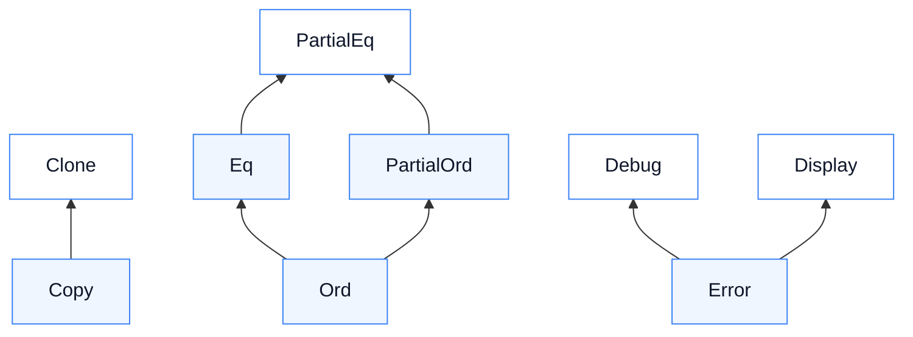

# 04 — Traits da std e `derive`

**Objetivos.** Ao final, você vai saber:

- o que o `#[derive(...)]` gera e o que ele exige dos campos;
- para que servem `Debug`, `Clone`, `Copy`, `PartialEq`, `Eq`, `PartialOrd`, `Ord`, `Hash` e `Default`;
- por que existe o "parcial" em `PartialEq` e `PartialOrd`, e por que `f64` não tem `Eq`, `Ord` nem `Hash`;
- quando escrever uma dessas traits à mão, e as regras de consistência que você precisa manter.

## O que o `derive` faz

Desde o Módulo 02 você escreve `#[derive(Debug, Clone, PartialEq)]` em cima das structs. O Módulo 04 adiantou que isso gera implementações de traits. Agora dá para ver o que é gerado. Para esta struct:

```rust
#[derive(PartialEq)]
struct Ponto {
    x: i32,
    y: i32,
}
```

o `derive` escreve, em essência, este bloco:

```rust
impl PartialEq for Ponto {
    fn eq(&self, other: &Ponto) -> bool {
        self.x == other.x && self.y == other.y
    }
}
```

É sempre assim: o código derivado trata **campo a campo**, usando a mesma trait em cada campo. Duas consequências:

1. **Todos os campos precisam implementar a trait.** Se um campo não tem `PartialEq`, a struct não pode derivar `PartialEq`. Você já viu isso no Módulo 02, com o E0204 ao derivar `Copy` numa struct com `String`.
2. **O comportamento é o "óbvio" e nada mais.** Igualdade é igualdade de todos os campos; ordem é a ordem dos campos. Se o significado do seu tipo é outro, escreva à mão.

O `derive` só gera o que você pede. Diferente de uma `@dataclass` do Python, que já vem com `__eq__` e `__repr__`, ou de uma classe C++, que ganha construtor de cópia e atribuição sem você pedir, um tipo Rust novo não sabe nem se comparar nem se copiar.

> [!TIP]
> Para ver o código que um `derive` gera, a ferramenta `cargo expand` (instalada à parte, com `cargo install cargo-expand`) mostra o arquivo depois da expansão das macros. É o assunto do Módulo 14.

## Mapa das traits

As traits desta lição se apoiam umas nas outras. Uma *supertrait* é uma trait que outra exige: `trait Eq: PartialEq` quer dizer que, para implementar `Eq`, o tipo precisa implementar `PartialEq` também.



A seta vai de quem exige para quem é exigido. É esse mapa que explica a receita do Módulo 05: `Error` exige `Debug` e `Display`, por isso o tipo de erro precisava do `#[derive(Debug)]` e do `impl Display` antes do `impl Error`.

## `Debug`: para quem programa

`Debug` é a saída de `{:?}` (e `{:#?}`, com quebras de linha), do `dbg!` e do `assert_eq!` quando o teste falha. Derive em praticamente todo tipo seu.

O formato de `Debug` não é estável nem pensado para usuários: pode mudar entre versões do Rust, e não deve ser analisado por outro programa. Para mostrar ao usuário, `Display` (lição 02). Em Python, a divisão é a mesma: `__repr__` para quem programa, `__str__` para quem usa.

## `Clone` e `Copy`

Revisão do Módulo 02, agora com o nome certo das coisas:

- `Clone` é uma trait comum, com um método `clone(&self) -> Self`. A cópia é explícita, e cada tipo decide quão profunda ela é (`String` copia o texto; o `Rc` do Módulo 10 só incrementa um contador).
- `Copy` é uma *marker trait* (trait marcadora): não tem método nenhum. Ela só avisa o compilador de que copiar os bytes do valor é seguro, e aí uma atribuição copia em vez de mover. Por isso `Copy: Clone`, e você sempre deriva as duas juntas.

No C++, a cópia é implícita por padrão e você precisa apagar o construtor de cópia (`= delete`) para proibir. Em Rust, é o contrário: nada se copia até você pedir.

## Igualdade: `PartialEq` e `Eq`

`PartialEq` dá `==` e `!=`. `Eq` é outra marcadora, que promete algo a mais: que a igualdade é **reflexiva**, ou seja, `a == a` sempre.

Parece óbvio, mas não vale para números de ponto flutuante: pelo padrão IEEE 754, `NaN` não é igual a nada, nem a si mesmo.

```rust
let nan: f64 = "NaN".parse().unwrap();
let outro = nan;
println!("{}", nan == outro); // false
```

Por isso `f64` implementa `PartialEq`, mas não `Eq`. E, como o `derive` exige a trait em todos os campos, uma struct com `f64` também não pode derivar `Eq`:

```rust
// ❌ NÃO COMPILA
#[derive(PartialEq, Eq, Hash)]
struct Ponto {
    x: f64,
    y: f64,
}
```

```text
error[E0277]: the trait bound `f64: Eq` is not satisfied
   --> src/main.rs:3:5
    |
  1 | #[derive(PartialEq, Eq, Hash)]
    |                     -- in this derive macro expansion
  2 | struct Ponto {
  3 |     x: f64,
    |     ^^^^^^ the trait `Eq` is not implemented for `f64`
...
error[E0277]: the trait bound `f64: Hash` is not satisfied
```

(São três erros: `Eq` no primeiro campo e `Hash` nos dois.) `Eq` e `Hash` andam juntos porque é a dupla que `HashMap` e `HashSet` exigem das chaves, como mostra a seção sobre `Hash`, mais abaixo.

## Ordem: `PartialOrd` e `Ord`

`PartialOrd` dá `<`, `>`, `<=`, `>=` e o método `partial_cmp`, que devolve `Option<Ordering>`: `None` quando os valores não são comparáveis. De novo, é o caso do `NaN`:

```rust
println!("{:?}", 1.0_f64.partial_cmp(&nan)); // None
```

`Ord` é a ordem **total**: quaisquer dois valores se comparam, e `cmp` devolve `Ordering` direto, sem `Option`. É o que `sort()`, `max()`, `min()` e o `BTreeMap` (Módulo 07) exigem. É por isso que `vec_de_f64.sort()` não compila; o Módulo 07 mostra a saída com `total_cmp`.

A ordem derivada segue a ordem de declaração: compara o primeiro campo; se empatar, o segundo, e assim por diante (ordem lexicográfica). Em enums, vale a ordem das variantes:

```rust
#[derive(Debug, Clone, Copy, PartialEq, Eq, PartialOrd, Ord, Hash)]
struct Versao(u32, u32, u32);

#[derive(Debug, Clone, Copy, PartialEq, Eq, PartialOrd, Ord)]
enum Prioridade {
    Baixa,
    Media,
    Alta,
}

let mut versoes = vec![Versao(1, 10, 0), Versao(1, 2, 3), Versao(0, 9, 9)];
versoes.sort();
println!("{versoes:?}");
println!("{}", Prioridade::Alta > Prioridade::Baixa);
```

```text
[Versao(0, 9, 9), Versao(1, 2, 3), Versao(1, 10, 0)]
true
```

`Versao(1, 2, 3) < Versao(1, 10, 0)`, como em versões de software (e diferente de comparar os textos `"1.2.3"` e `"1.10.0"`). Trocar a ordem dos campos na declaração muda a ordem do tipo, então cuidado ao reorganizar uma struct que deriva `Ord`.

`PartialOrd` exige `PartialEq` (veja o mapa), e o compilador avisa se faltar:

```rust
// ❌ NÃO COMPILA
#[derive(PartialOrd)]
struct Versao(u32, u32);
```

```text
error[E0277]: can't compare `Versao` with `Versao`
    --> src/main.rs:2:8
     |
   1 | #[derive(PartialOrd)]
     |          ---------- in this derive macro expansion
   2 | struct Versao(u32, u32);
     |        ^^^^^^ no implementation for `Versao == Versao`
     |
     = help: the trait `PartialEq` is not implemented for `Versao`
...
help: consider annotating `Versao` with `#[derive(PartialEq)]`
```

## `Hash`: a regra de ouro

`Hash` transforma um valor num número, e é o que `HashMap` e `HashSet` usam para achar as chaves. O `derive` combina o hash de todos os campos. A regra que toda implementação precisa respeitar:

> Se `a == b`, então `hash(a) == hash(b)`.

Com `derive` nos dois, a regra vale sozinha. O perigo é escrever `PartialEq` à mão e deixar o `Hash` derivado. Por exemplo, dois usuários são o mesmo se o `id` for o mesmo, não importa o nome:

```rust
use std::hash::{Hash, Hasher};

#[derive(Debug, Clone)]
struct Usuario {
    id: u32,
    nome: String,
}

impl PartialEq for Usuario {
    fn eq(&self, other: &Self) -> bool {
        self.id == other.id
    }
}

impl Eq for Usuario {}

impl Hash for Usuario {
    fn hash<H: Hasher>(&self, state: &mut H) {
        self.id.hash(state);
    }
}
```

Se o `Hash` fosse derivado, ele usaria `id` **e** `nome`, e dois usuários "iguais" teriam hashes diferentes. Um `HashSet` poderia guardar os dois, e um `contains` poderia falhar para um valor que está lá. Nada disso dá erro de compilação nem *panic*: o programa só se comporta errado. Com as três implementações coerentes:

```rust
use std::collections::HashSet; // conjunto sem repetição, como o set do Python (Módulo 07)

let mut vistos = HashSet::new();
vistos.insert(Usuario { id: 1, nome: String::from("Ana") });
let novo = vistos.insert(Usuario { id: 1, nome: String::from("Ana Maria") });
println!("inseriu de novo? {novo}; total: {}", vistos.len());
```

```text
inseriu de novo? false; total: 1
```

O `impl Eq for Usuario {}` vazio é tudo o que `Eq` pede: como é uma marcadora, você só declara a promessa. Em Python, a regra é a mesma, e a linguagem ajuda um pouco: se você define `__eq__` e não define `__hash__`, a classe deixa de ser *hashable*.

## `Default`: o valor "vazio"

`Default` tem uma função associada, `default() -> Self`, que cria um valor padrão. Derivado, ele usa o padrão de cada campo: `0`, `false`, `String::new()`, `Vec::new()`, `None`...

O Módulo 04 mostrou o uso mais comum, que agora fica claro: `..Default::default()` na criação de uma struct preenche os campos que você não escreveu.

```rust
#[derive(Debug, Default)]
struct Opcoes {
    verboso: bool,
    tentativas: u32,
    modo: Modo,
    nome: String,
}

let o = Opcoes {
    tentativas: 3,
    ..Default::default()
};
println!("{o:?}");
```

```text
Opcoes { verboso: false, tentativas: 3, modo: Seguro, nome: "" }
```

O `modo` saiu `Seguro`. Num enum, o compilador não tem como adivinhar qual variante é a padrão, então você marca uma com `#[default]`:

```rust
#[derive(Debug, Default, PartialEq)]
enum Modo {
    Rapido,
    #[default]
    Seguro,
}
```

Sem a marcação:

```text
error[E0665]: `#[derive(Default)]` on enum with no `#[default]`
 --> src/main.rs:1:10
  |
1 |   #[derive(Default, Debug)]
  |            ^^^^^^^
2 | / enum Modo {
3 | |     Rapido,
4 | |     Seguro,
5 | | }
  | |_- this enum needs a unit variant marked with `#[default]`
  |
help: make this unit variant default by placing `#[default]` on it
...
```

Por fim, o aviso do clippy que o Módulo 04 prometeu explicar. Se o seu tipo tem um `new()` sem argumentos, o clippy pede também um `Default` (o lint `new_without_default`), porque código genérico que exige `T: Default` (como `unwrap_or_default()` ou o `..Default::default()`) não conhece o seu `new`. Quando o derive não serve, a implementação à mão é curta:

```rust
impl Default for Contador {
    fn default() -> Self {
        Self::new()
    }
}
```

C++ gera um construtor padrão implícito em certos casos; Rust nunca gera nada implícito. Um tipo sem `Default` simplesmente não tem valor padrão.

Todos os exemplos desta lição estão em [`codigo/traits-da-std`](codigo/traits-da-std/).

## Dunder methods do Python e operadores do C++

| Python | C++ | Rust |
|---|---|---|
| `__repr__` | (nada padrão) | `Debug` |
| `__str__` | `operator<<` | `Display` |
| `copy.copy` / `copy.deepcopy` | construtor de cópia | `Clone` (explícita) |
| (não existe) | cópia trivial | `Copy` |
| `__eq__` | `operator==` | `PartialEq` (+ `Eq`) |
| `__lt__`, `__le__`... | `operator<`, `operator<=>` | `PartialOrd` (+ `Ord`) |
| `__hash__` | `std::hash<T>` | `Hash` |
| valor padrão nos argumentos do `__init__` | construtor padrão | `Default` |
| `__iter__` | `begin()`/`end()` | `IntoIterator` (Módulo 07) |
| `__add__` | `operator+` | `Add` (Módulo 13) |
| `__enter__`/`__exit__` | destrutor (RAII) | `Drop` (Módulo 02) |

Alguns dunders não viram traits: `__len__` e `__contains__` são métodos comuns (`len()`, `contains()`), sem trait por trás.

## Qual derivar?

As diretrizes de API do Rust (*C-COMMON-TRAITS*) recomendam que tipos públicos implementem, sempre que fizer sentido, `Debug`, `Clone`, `PartialEq`, `Eq`, `PartialOrd`, `Ord`, `Hash` e `Default`. A razão é a orphan rule: quem usa o seu crate **não pode** acrescentar essas traits ao seu tipo depois. Na prática:

- `Debug`: sempre.
- `Clone`, `PartialEq`: quase sempre.
- `Copy`: tipos pequenos, sem recursos (sem `String`, `Vec`, arquivos), que se comportam como valores, como `Ponto` ou `Versao`. Cuidado: tirar o `Copy` depois quebra quem usava o tipo.
- `Eq`, `Hash`: quando o tipo pode ser chave de mapa ou elemento de conjunto, e não tem `f64`.
- `PartialOrd`, `Ord`: quando existe uma ordem natural.
- `Default`: quando existe um valor vazio óbvio.

## Armadilhas comuns

**`PartialEq` à mão com `Hash` derivado.** Quebra a regra de ouro, e o `HashMap` passa a errar em silêncio. Se mudou um, mude o outro.

**Derivar `Ord` sem pensar na ordem dos campos.** A ordem é a da declaração. Reorganizar os campos muda o resultado de `sort()`.

**Tentar `Eq`, `Ord` ou `Hash` com `f64`.** Não existe, por causa do `NaN`. As saídas: guardar o número de outro jeito (centavos em `i64`, por exemplo), usar `total_cmp` para ordenar (Módulo 07), ou um newtype com a sua regra.

**`Debug` para o usuário.** O formato pode mudar e não é bonito. Para mensagens, `Display`.

## Resumo

- `derive` gera a implementação campo a campo, e exige a trait em todos os campos.
- `Copy` e `Eq` são marcadoras (sem métodos). `Copy: Clone`, `Eq: PartialEq`, `Ord: Eq + PartialOrd`, `Error: Debug + Display`.
- "Parcial" existe por causa do `NaN`: `f64` tem `PartialEq` e `PartialOrd`, mas não `Eq`, `Ord` nem `Hash`.
- A ordem derivada é a dos campos (ou das variantes). `Default` em enum precisa de `#[default]`.
- `a == b` implica `hash(a) == hash(b)`: se escrever `PartialEq` à mão, escreva `Hash` à mão.
- Tipo com `new()` sem argumentos deve ter `Default` (o clippy cobra).

## Exercícios

Veja o exercício 2 em [`exercicios.md`](exercicios.md).

## Leitura complementar

- [The Rust Programming Language, Apêndice C: Derivable Traits](https://doc.rust-lang.org/stable/book/appendix-03-derivable-traits.html)
- [Documentação de `std::cmp`](https://doc.rust-lang.org/std/cmp/index.html) e [de `std::hash::Hash`](https://doc.rust-lang.org/std/hash/trait.Hash.html) (seção *Hash and Eq*)
- [Rust API Guidelines: C-COMMON-TRAITS](https://rust-lang.github.io/api-guidelines/interoperability.html#types-eagerly-implement-common-traits-c-common-traits)
- [Effective Rust, Item 10: Familiarize yourself with standard traits](https://effective-rust.com/std-traits.html)
- [Comprehensive Rust: Deriving](https://google.github.io/comprehensive-rust/methods-and-traits/deriving.html)

---

[← Lição anterior](03-trait-bounds-where-e-impl-trait.md) · [Índice do módulo](README.md) · [Próxima lição →](05-conversoes-from-into-tryfrom.md)
