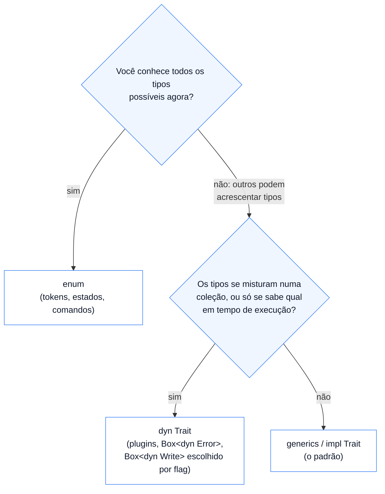

# 07 — Estático x dinâmico, e composição

**Objetivos.** Ao final, você vai saber:

- responder "Rust é orientado a objetos?" sem cair nos dois extremos;
- reaproveitar comportamento com métodos padrão e composição, em vez de herança;
- o que uma *supertrait* é e o que ela **não** é;
- escolher entre generics, `dyn Trait` e `enum` para um problema de polimorfismo.

## Rust é orientado a objetos?

Depende da definição. Das três coisas que costumam vir no pacote "OO":

- **Encapsulamento:** sim. Structs têm campos privados, e só os métodos do módulo mexem neles. O Módulo 08 detalha a visibilidade (`pub`).
- **Polimorfismo:** sim, de dois jeitos. Estático, com generics e bounds (lições 01 e 03), e dinâmico, com `dyn Trait` (lição 06).
- **Herança:** não. Uma struct não estende outra, não herda campos, e não existe `super`, `protected` nem `override`.

O que fica de fora é justamente a herança, e de propósito. Em hierarquias de classes, reaproveitar código e definir tipos ficam presos na mesma ferramenta: para reaproveitar um método, você herda **tudo** da classe base, inclusive campos e invariantes que talvez não façam sentido. Rust separa as duas coisas: traits definem comportamento compartilhado, e structs dentro de structs compartilham dados.

O Módulo 04 avisou que esperar herança é uma armadilha comum para quem vem de outras linguagens. Esta lição mostra o que usar no lugar.

## Reaproveitar código: métodos padrão

O primeiro motivo para herdar é reaproveitar uma implementação. Em Rust, isso vai para os métodos padrão da trait (lição 02): escritos uma vez, em termos dos métodos obrigatórios, e herdados por todo tipo que implementa a trait.

A biblioteca padrão faz isso em escala. A trait `std::io::Write` tem dois métodos obrigatórios, `write` e `flush`, e vários métodos padrão construídos em cima deles, como `write_all` e `write_fmt` (o que o `writeln!` chama). Quem implementa `Write` escreve dois métodos e ganha o resto. É o que a classe abstrata com "template methods" faz em C++ ou Java, sem a classe.

## Reaproveitar dados: composição

O segundo motivo é reaproveitar dados e comportamento de **outro tipo**. Aí entra a composição: em vez de "um `ContaBytes` **é** um escritor", "um `ContaBytes` **tem** um escritor".

O exemplo: um `Write` que repassa tudo para outro `Write` e conta os bytes no caminho. Em C++ seria uma subclasse de `std::ostream`; em Python, uma subclasse de `io.RawIOBase`. Em Rust, é uma struct genérica que guarda o escritor de dentro e implementa `Write` delegando:

```rust
use std::io::{self, Write};

pub struct ContaBytes<W: Write> {
    interno: W,
    total: usize,
}

impl<W: Write> Write for ContaBytes<W> {
    fn write(&mut self, buf: &[u8]) -> io::Result<usize> {
        let n = self.interno.write(buf)?;
        self.total += n;
        Ok(n)
    }

    fn flush(&mut self) -> io::Result<()> {
        self.interno.flush()
    }
}
```

```rust
let mut saida = ContaBytes::new(Vec::new());
writeln!(saida, "olá").unwrap();
write!(saida, "{}", 42).unwrap();
assert_eq!(saida.total(), 7); // "olá" tem 4 bytes em UTF-8, mais "\n" e "42"
```

Como `ContaBytes` é um `Write`, ele pode embrulhar outro `ContaBytes`, um arquivo, o stdout, ou ir para qualquer função que peça `&mut impl Write`. Esse é o padrão *decorador*, e a biblioteca padrão o usa em vários lugares: `BufWriter<W>` e `BufReader<R>` são exatamente isso. O código completo, com testes, está em [`codigo/composicao`](codigo/composicao/).

O preço da composição é escrever a delegação à mão: se o tipo de dentro tem 20 métodos e você quer expor todos, são 20 métodos de uma linha. Na prática, raramente você quer expor todos, e escrever a lista deixa claro qual é a interface do tipo novo.

## Supertraits não são herança

Uma trait pode exigir outra (você viu `Error: Debug + Display` na lição 04):

```rust
use std::fmt;

pub trait Moldura: fmt::Display {
    fn emoldurar(&self) -> String {
        let texto = self.to_string();
        let borda = "-".repeat(texto.chars().count() + 4);
        format!("{borda}\n| {texto} |\n{borda}")
    }
}
```

`trait Moldura: fmt::Display` se lê "para implementar `Moldura`, o tipo precisa implementar `Display`". Isso permite que os métodos padrão de `Moldura` usem `to_string()`. O que a supertrait **não** faz é fornecer a implementação de `Display`: ela só exige que exista.

```rust
// ❌ NÃO COMPILA
struct Ponto {
    x: i32,
    y: i32,
}

impl Moldura for Ponto {}
```

```text
error[E0277]: `Ponto` doesn't implement `std::fmt::Display`
  --> src/main.rs:14:18
   |
14 | impl Moldura for Ponto {}
   |                  ^^^^^ unsatisfied trait bound
   |
help: the trait `std::fmt::Display` is not implemented for `Ponto`
...
note: required by a bound in `Moldura`
  --> src/main.rs:3:16
   |
 3 | trait Moldura: fmt::Display {
   |                ^^^^^^^^^^^^ required by this bound in `Moldura`
```

Cada trait da cadeia é implementada separadamente, com o seu próprio `impl`. Não há campos herdados, nem "chamar o método da classe pai", nem conflito de diamante: se duas traits têm um método com o mesmo nome, você escolhe qual chamar com a sintaxe qualificada da [lição 08](08-tipos-associados-e-traits-genericas.md).

## Generics, `dyn` ou `enum`?

Você já conhece três formas de escrever um código que funciona com "vários tipos de forma":

```rust
// 1. Generics: dispatch estático, um tipo por chamada.
fn area_total<T: Forma>(formas: &[T]) -> f64 { /* ... */ }

// 2. Trait object: dispatch dinâmico, tipos misturados.
fn area_total_dyn(formas: &[Box<dyn Forma>]) -> f64 { /* ... */ }

// 3. Enum: conjunto fechado, um match por operação (Módulo 04).
enum Forma { Quadrado { lado: f64 }, Circulo { raio: f64 } }
```

Repare que as duas primeiras usam **a mesma trait** `Forma` (o projeto [`codigo/formas`](codigo/formas/) tem as duas lado a lado). Escrever uma trait não obriga a escolher entre estático e dinâmico: isso se decide em cada função.

| | generics / `impl Trait` | `dyn Trait` | `enum` |
|---|---|---|---|
| dispatch | estático (monomorfizado) | dinâmico (vtable) | `match` |
| coleção com tipos misturados | não | sim (`Vec<Box<dyn T>>`) | sim |
| quem pode acrescentar um tipo | qualquer um (até outro crate) | qualquer um (até outro crate) | só você, editando o enum |
| acrescentar uma operação | fácil (outra trait ou função) | difícil (muda a trait e todas as impls) | fácil (outra função com `match`) |
| custo | binário maior | indireção, sem inlining, `Box` no heap | nenhum, mas ocupa o tamanho da maior variante |
| o compilador avisa caso esquecido? | sim (impl faltando) | sim (impl faltando) | sim (`match` não exaustivo) |

A linha "acrescentar" é o coração da escolha. Com traits, é fácil acrescentar **tipos** e difícil acrescentar **operações**; com enums, o contrário. (Esse dilema tem nome, *expression problem*, e não tem solução perfeita em nenhuma linguagem.)



Regras práticas:

- **Comece com generics.** É o mais rápido, o mais simples de ler, e funciona na maioria dos casos.
- **Use `enum`** quando o conjunto de casos é seu e fechado. O Módulo 04 tem vários exemplos.
- **Use `dyn`** quando o conjunto é aberto **e** os tipos precisam conviver na mesma coleção, ou quando a escolha só acontece em tempo de execução. `Box<dyn Error>` é o exemplo que você já usa: qualquer erro, de qualquer crate, no mesmo tipo de retorno. O exercício 6 tem outro: escrever no stdout ou num arquivo, conforme uma opção da linha de comando.

## Comparando com C++ e Python

| Ideia | C++ | Python | Rust |
|---|---|---|---|
| interface | classe abstrata pura | `Protocol` / `ABC` | trait |
| implementação padrão | método virtual com corpo | método na classe base | método padrão na trait |
| polimorfismo dinâmico | `virtual` + ponteiro para base | qualquer chamada (duck typing) | `dyn Trait` |
| polimorfismo estático | templates, CRTP | (não existe) | generics com bounds |
| reaproveitar dados | herança de classe | herança de classe | composição |
| conjunto fechado | `std::variant` | união de tipos + `match` | `enum` |

O CRTP do C++ (uma classe base template que recebe a derivada como parâmetro, `struct Quadrado : Forma<Quadrado>`) existe para ter métodos "herdados" sem custo de `virtual`. Em Rust, é o que generics com métodos padrão já fazem, sem o truque.

## Armadilhas comuns

**Tentar modelar uma hierarquia de classes com traits.** `trait Animal`, `trait Mamifero: Animal`, `trait Cachorro: Mamifero`, cada uma com campos que você tenta simular com getters. Pare e pergunte: preciso de polimorfismo aqui, ou só de dados? Muitas vezes a resposta é uma struct com um campo `especie: Especie` (um enum).

**Achar que supertrait passa implementação.** `trait B: A` só exige `A`. Cada tipo ainda escreve o seu `impl A`.

**Usar `dyn` por reflexo.** Se todos os elementos da coleção são do mesmo tipo, `Vec<T>` com generics é mais simples e mais rápido do que `Vec<Box<dyn Trait>>`.

**Usar `Deref` para imitar herança.** Fazer um newtype "herdar" os métodos do tipo de dentro implementando `Deref` é tentador, mas confunde quem lê e quebra em casos sutis. O Módulo 10 explica quando `Deref` é o certo (ponteiros inteligentes).

## Resumo

- Rust tem encapsulamento e polimorfismo (estático e dinâmico), mas não herança de dados.
- Reaproveitar comportamento: métodos padrão nas traits. Reaproveitar dados: composição, com delegação explícita (padrão decorador, como `BufWriter<W>`).
- Uma supertrait só **exige** outra trait; não fornece implementação nem campos.
- A mesma trait serve para generics e para `dyn`; a escolha é por função.
- Generics por padrão; `enum` para conjuntos fechados; `dyn` para conjuntos abertos com tipos misturados ou escolhidos em tempo de execução.

## Exercícios

Veja os exercícios 3 e 6 em [`exercicios.md`](exercicios.md).

## Leitura complementar

- [The Rust Programming Language, 18.1 Characteristics of Object-Oriented Languages](https://doc.rust-lang.org/stable/book/ch18-01-what-is-oo.html) e [18.3 Implementing an Object-Oriented Design Pattern](https://doc.rust-lang.org/stable/book/ch18-03-oo-design-patterns.html)
- [Comprehensive Rust: Supertraits](https://google.github.io/comprehensive-rust/methods-and-traits/traits/supertraits.html)
- [Effective Rust, Item 12: generics x trait objects](https://effective-rust.com/generics.html)
- [Rust Design Patterns: Composition over inheritance e Deref polymorphism (antipadrão)](https://rust-unofficial.github.io/patterns/anti_patterns/deref.html)

---

[← Lição anterior](06-trait-objects-e-dyn.md) · [Índice do módulo](README.md) · [Próxima lição →](08-tipos-associados-e-traits-genericas.md)
