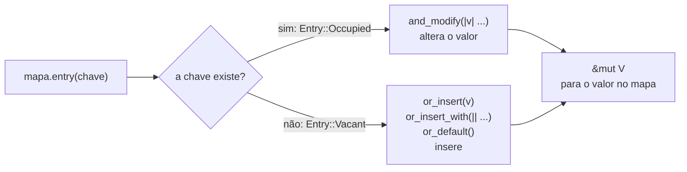

# 02 — `HashMap` e a *Entry API*

**Objetivos.** Ao final, você vai saber:

- o que um tipo precisa para ser chave, e quem fica dono das chaves e dos valores;
- por que `get("Ana")` funciona num `HashMap<String, _>`;
- usar a *Entry API* inteira, e entender o `*` da receita de contagem;
- remover, atualizar e pegar dois valores mutáveis ao mesmo tempo sem brigar com o *borrow checker*.

O [kit do Módulo 01](../01-tour-da-sintaxe/07-kit-vec-e-hashmap.md) deu `insert`, `get`, `contains_key`, o `for` sobre `&mapa` e a receita `*contagem.entry(p).or_insert(0) += 1`. Aqui você vai entender cada peça dessa receita e conhecer o resto.

## O que pode ser chave

Um `HashMap<K, V>` precisa calcular o *hash* da chave e comparar chaves por igualdade. Por isso exige `K: Hash + Eq`. O erro aparece no primeiro método que precisa disso, e não no `new`:

```rust
// ❌ NÃO COMPILA
use std::collections::HashMap;

fn main() {
    let mut precos: HashMap<f64, &str> = HashMap::new();
    precos.insert(9.99, "café");
}
```

```text
error[E0599]: the method `insert` exists for struct `HashMap<f64, &str>`, but its trait bounds were not satisfied
 --> src/main.rs:5:12
  |
5 |     precos.insert(9.99, "café");
  |            ^^^^^^
  |
  = note: the following trait bounds were not satisfied:
          `f64: Eq`
          `f64: Hash`
```

`f64` não é `Eq` pelo mesmo motivo da lição anterior: `NaN != NaN`, e uma chave que não é igual a si mesma nunca seria encontrada. Em Python, `float` serve como chave do `dict` (e `{float('nan'): 1}` cria uma chave que você nunca mais acha pelo valor). Em Rust, use centavos em inteiro, ou um tipo próprio.

Para usar uma struct sua como chave, derive as três traits (o [Módulo 06](../06-traits-e-generics/README.md) explica o que o `derive` gera e a regra de consistência entre `Hash` e `Eq`):

```rust
#[derive(Debug, PartialEq, Eq, Hash)]
struct Coordenada {
    x: i32,
    y: i32,
}
```

## Quem é dono do quê

`insert` **move** a chave e o valor para dentro do mapa, e devolve o valor antigo, se havia um:

```rust
use std::collections::HashMap;

let nome = String::from("Ana");
let mut idades = HashMap::new();
idades.insert(nome, 31); // `nome` foi movida para dentro do mapa

let antigo = idades.insert(String::from("Ana"), 32);
println!("{antigo:?}");

println!("{:?} {}", idades.get("Ana"), idades["Ana"]);
```

```text
Some(31)
Some(32) 32
```

Depois do primeiro `insert`, usar `nome` dá o E0382 do [Módulo 02](../02-ownership/02-regras-de-ownership-e-move.md): o mapa virou o dono. Com chaves `&str` (um `HashMap<&str, V>`), o mapa guarda só referências, e o [Módulo 03](../03-borrowing-e-lifetimes/README.md) garante que os textos vivam mais que ele.

### Por que `get("Ana")` funciona com chaves `String`

O mapa tem chaves `String`, mas você consultou com um `&str`, sem criar `String` nenhuma. A assinatura de `get` explica:

```rust
pub fn get<Q: ?Sized>(&self, k: &Q) -> Option<&V>
where
    K: Borrow<Q>,
    Q: Hash + Eq,
```

`String` implementa `Borrow<str>`, uma promessa de que uma `String` e o `str` que ela contém têm o mesmo hash e a mesma igualdade. Então você pode consultar com a forma emprestada da chave. O mesmo vale para `contains_key` e `remove`, e para `Vec<T>` com `&[T]`. Na prática: num `HashMap<String, _>`, consulte com `&str` e não crie `String` só para isso.

### Indexar com `[]` dá *panic*

`idades["Ana"]` funciona quando a chave existe. Quando não existe:

```rust
// 💥 PANIC EM RUNTIME
use std::collections::HashMap;

fn main() {
    let idades = HashMap::from([("Ana", 31)]);
    println!("{}", idades["Zé"]);
}
```

```text
thread 'main' (430848) panicked at src/main.rs:5:26:
no entry found for key
```

Use `[]` só quando a ausência é um bug. No resto, `get`. Em C++ é pior: `m["Zé"]` num `std::unordered_map` **insere** um valor padrão em silêncio e devolve uma referência para ele. Em Rust, "inserir se faltar" existe, mas é explícito: é a *Entry API*.

## A *Entry API*

O problema clássico é "atualize se existe, insira se não existe". Com `contains_key` + `insert` + `get_mut`, você faz duas ou três buscas no mapa e, dependendo do arranjo, briga com o borrow checker (o [Módulo 03](../03-borrowing-e-lifetimes/07-brigando-menos-com-o-borrow-checker.md) mostrou esse caso). A *entry API* faz uma busca só.

`mapa.entry(chave)` devolve um `Entry`, um enum com duas variantes: `Occupied` (a chave existe) e `Vacant` (não existe). Os métodos de `Entry` decidem o que fazer em cada caso e terminam devolvendo um `&mut V` para o valor que está **dentro** do mapa:



### O `*` da receita de contagem

Agora dá para ler a receita do M01 peça por peça:

```rust
for p in "a b a c b a".split_whitespace() {
    let n: &mut usize = contagem.entry(p).or_insert(0);
    *n += 1;
}
```

`or_insert(0)` devolve um `&mut usize`. Para somar ao número que está lá dentro, você precisa desreferenciar com `*`. Sem o `*`, o erro diz exatamente isso:

```rust
// ❌ NÃO COMPILA
use std::collections::HashMap;

fn main() {
    let mut contagem: HashMap<&str, usize> = HashMap::new();
    for p in "a b a".split_whitespace() {
        contagem.entry(p).or_insert(0) += 1;
    }
}
```

```text
error[E0368]: binary assignment operation `+=` cannot be applied to type `&mut usize`
 --> src/main.rs:6:9
  |
6 |         contagem.entry(p).or_insert(0) += 1;
  |         ------------------------------^^^^^
  |         |
  |         cannot use `+=` on type `&mut usize`
  |
help: `+=` can be used on `usize` if you dereference the left-hand side
  |
6 |         *contagem.entry(p).or_insert(0) += 1;
  |         +
```

### As variantes

```rust
use std::collections::HashMap;

fn caro(chave: &str) -> usize {
    println!("  calculando {chave}...");
    chave.len() * 100
}

// or_insert_with: a closure só roda se a chave faltar
let mut cache: HashMap<&str, usize> = HashMap::new();
for chave in ["abc", "abc", "de"] {
    let v = *cache.entry(chave).or_insert_with(|| caro(chave));
    println!("{chave} = {v}");
}

// or_insert_with_key: a closure recebe a chave
let mut tamanhos: HashMap<String, usize> = HashMap::new();
tamanhos.entry(String::from("rust")).or_insert_with_key(|k| k.len());

// or_default: insere o valor padrão do tipo (0, "", vec![]...)
let mut por_inicial: HashMap<char, Vec<&str>> = HashMap::new();
for nome in ["Ana", "Bia", "Alice", "Bruno", "Caio"] {
    let inicial = nome.chars().next().unwrap();
    por_inicial.entry(inicial).or_default().push(nome);
}

// and_modify + or_insert: um caminho para cada caso
let mut estoque: HashMap<&str, u32> = HashMap::new();
for item in ["pera", "uva", "pera"] {
    estoque.entry(item).and_modify(|q| *q += 10).or_insert(1);
}

println!("{tamanhos:?} {:?} {:?}", por_inicial[&'A'], estoque["pera"]);
```

```text
  calculando abc...
abc = 300
abc = 300
  calculando de...
de = 200
{"rust": 4} ["Ana", "Alice"] 11
```

| Método | Quando a chave falta | Quando existe |
|---|---|---|
| `or_insert(v)` | insere `v` (calculado sempre) | nada |
| `or_insert_with(\|\| ...)` | chama a closure e insere | nada (a closure não roda) |
| `or_insert_with_key(\|k\| ...)` | igual, com acesso à chave | nada |
| `or_default()` | insere `Default::default()` | nada |
| `and_modify(\|v\| ...)` | nada | altera o valor |

Todos os `or_*` devolvem `&mut V`. Por isso dá para encadear o `.push(nome)` direto no `or_default()`: é o padrão "agrupar por chave".

Para lógica mais elaborada, faça `match` no `Entry`:

```rust
use std::collections::HashMap;
use std::collections::hash_map::Entry;

fn cadastrar(usuarios: &mut HashMap<String, u32>, nome: &str, id: u32) -> Result<(), String> {
    match usuarios.entry(nome.to_string()) {
        Entry::Occupied(o) => Err(format!("{} já tem o id {}", o.key(), o.get())),
        Entry::Vacant(v) => {
            v.insert(id);
            Ok(())
        }
    }
}
```

```text
Ok(())
Err("ana já tem o id 1")
```

(É a saída de duas chamadas seguidas com `"ana"`.)

Repare que `entry` recebe a chave **por valor**. Num `HashMap<String, _>`, isso obriga a criar a `String` mesmo quando a chave já existe. Na maioria dos programas, não importa. Num laço muito quente, consulte com `get_mut(&str)` primeiro e só use `entry` quando faltar.

### Equivalências com o Python

| Python | Rust |
|---|---|
| `d.get(k, padrao)` | `d.get(k).copied().unwrap_or(padrao)` |
| `d.setdefault(k, v)` | `d.entry(k).or_insert(v)` |
| `defaultdict(list)` + `d[k].append(x)` | `d.entry(k).or_default().push(x)` |
| `Counter(palavras)` | `*d.entry(p).or_insert(0) += 1` num laço |
| `d.pop(k, None)` | `d.remove(k)` (devolve `Option<V>`) |
| `{k: v for ...}` | `iter.map(...).collect::<HashMap<_, _>>()` (lição 07) |

## Percorrer, atualizar e remover

`iter()`, `keys()`, `values()` e `values_mut()` fazem o que o nome diz. Para alterar todos os valores, `for v in mapa.values_mut() { *v *= 2; }`.

### Remover durante o `for`: `retain`

```rust
// ❌ NÃO COMPILA
use std::collections::HashMap;

fn main() {
    let mut estoque = HashMap::from([("maçã", 0), ("pera", 3), ("uva", 0)]);
    for (fruta, qtd) in &estoque {
        if *qtd == 0 {
            estoque.remove(fruta);
        }
    }
    println!("{estoque:?}");
}
```

```text
error[E0502]: cannot borrow `estoque` as mutable because it is also borrowed as immutable
 --> src/main.rs:7:13
  |
5 |       for (fruta, qtd) in &estoque {
  |       -                   --------
  |       |                   |
  |       |                   immutable borrow occurs here
  |  _____|                   immutable borrow later used here
  | |
6 | |         if *qtd == 0 {
7 | |             estoque.remove(fruta);
  | |             ^^^^^^^^^^^^^^^^^^^^^ mutable borrow occurs here
8 | |         }
9 | |     }
  | |_____- this for loop borrows `estoque` immutably, preventing mutation within its body
  |
  = help: consider using an index-based loop instead, or collecting modifications into a separate collection
```

É o *iterator invalidation* do [Módulo 03](../03-borrowing-e-lifetimes/02-borrow-checker-e-nll.md), agora num mapa. Em C++, `erase` dentro de um `for` sobre `unordered_map` compila e invalida o iterador. Em Python, dá `RuntimeError: dictionary changed size during iteration` em tempo de execução.

Desta vez, desconfie do `help:`: um "laço por índice" não faz sentido num `HashMap`. A resposta certa é a mesma do `Vec`, `retain`:

```rust
// ✅
let mut estoque = HashMap::from([("maçã", 0), ("pera", 3), ("uva", 0)]);
estoque.retain(|_, qtd| *qtd > 0);
println!("{estoque:?}");
```

```text
{"pera": 3}
```

A closure recebe a chave e um `&mut V` (dá para alterar o valor e decidir se ele fica, na mesma passada). Para remover e ficar com os removidos, existe `extract_if`, como no `Vec`.

### Dois valores mutáveis ao mesmo tempo

Transferir entre dois saldos exige dois `&mut` no mesmo mapa. Com dois `get_mut`, o borrow checker recusa (o mapa inteiro ficaria emprestado duas vezes). `get_disjoint_mut` (1.86) pega os dois de uma vez:

```rust
let mut saldos = HashMap::from([("ana", 100), ("bia", 50)]);
if let [Some(de), Some(para)] = saldos.get_disjoint_mut(["ana", "bia"]) {
    *de -= 30;
    *para += 30;
}
```

Ele devolve um array de `Option<&mut V>`, um por chave. Se você passar a mesma chave duas vezes, é *panic*: dois `&mut` para o mesmo valor seriam justamente o que a regra do M03 proíbe.

## A ordem é arbitrária

```rust
let m: HashMap<&str, i32> = ["um", "dois", "tres", "quatro"].into_iter().zip(1..).collect();
let chaves: Vec<_> = m.keys().collect();
println!("{chaves:?}");
```

Três execuções seguidas do mesmo programa:

```text
["quatro", "dois", "um", "tres"]
["um", "tres", "dois", "quatro"]
["tres", "um", "dois", "quatro"]
```

O hasher padrão (SipHash 1-3) usa uma semente aleatória por processo. Isso protege contra ataques de *HashDoS*, em que alguém manda chaves escolhidas para colidirem todas no mesmo balde e degradar o mapa para O(n). O preço: a ordem muda a cada execução.

> [!WARNING]
> Quem vem do Python costuma esperar ordem: o `dict` preserva a ordem de inserção desde o 3.7. O `HashMap` não preserva nenhuma. Não escreva testes que dependam dela. Quando a ordem importa, use `BTreeMap` (ordem das chaves, lição 03), ordene um `Vec` de pares antes de mostrar, ou use a crate `indexmap` (ordem de inserção).

Se o hashing aparecer num *profiler*, existem hashers mais rápidos e sem proteção contra HashDoS (as crates `foldhash` e `rustc-hash`), que entram pelo terceiro parâmetro genérico do mapa (`HashMap<K, V, S>`, onde `S: BuildHasher`). Só troque depois de medir, e nunca com chaves vindas de fora.

## Criar um mapa pronto

```rust
let a = HashMap::from([("ana", 1), ("bia", 2)]); // de um array de pares
let b: HashMap<&str, usize> = ["rust", "go"].iter().map(|s| (*s, s.len())).collect(); // de um iterador
```

O `collect` em mapas fica para a lição 07.

Um exemplo maior, com a *Entry API*, `retain`, `get_mut` com `&str` e testes, está em [`codigo/estoque`](codigo/estoque/src/lib.rs).

## Armadilhas comuns

- **Esquecer o `*`** em `*mapa.entry(k).or_insert(0) += 1` (E0368): `or_insert` devolve `&mut V`.
- **`or_insert(calculo_caro())`**: o argumento é calculado sempre, mesmo quando a chave existe. Use `or_insert_with(|| calculo_caro())`.
- **`mapa[&k]` com chave que pode faltar**: é *panic*. Use `get`.
- **Remover dentro do `for`** (E0502): use `retain`. Ignore o `help:` que sugere laço por índice.
- **Depender da ordem** do `HashMap`, em especial em testes.
- **Chave `f64`** (E0599/E0277 pedindo `Eq` e `Hash`): use inteiros ou um tipo próprio.

## Resumo

- Chaves precisam de `Hash + Eq`. `insert` move a chave e o valor para o mapa e devolve o valor antigo.
- `get` aceita a forma emprestada da chave (`&str` para `String`) por causa de `Borrow`.
- `entry(k)` devolve um `Entry` (`Occupied` ou `Vacant`). `or_insert`, `or_insert_with`, `or_default` e `and_modify` resolvem os dois casos com uma busca e devolvem `&mut V`.
- `retain` remove "durante a iteração" com segurança; `get_disjoint_mut` dá dois `&mut` de uma vez.
- A ordem é arbitrária (SipHash com semente aleatória). Para ordem, `BTreeMap` ou `indexmap`.

## Exercícios

Veja os exercícios 2 e 3 em [`exercicios.md`](exercicios.md).

## Leitura complementar

- [The Rust Programming Language, 8.3 Storing Keys with Associated Values in Hash Maps](https://doc.rust-lang.org/stable/book/ch08-03-hash-maps.html)
- [Documentação de `HashMap`](https://doc.rust-lang.org/std/collections/struct.HashMap.html) e [de `hash_map::Entry`](https://doc.rust-lang.org/std/collections/hash_map/enum.Entry.html)
- [Documentação de `std::collections`, seção *Entries*](https://doc.rust-lang.org/std/collections/index.html#entries)
- [Effective Rust, Item 8: Familiarize yourself with reference and pointer types](https://effective-rust.com/references.html) (o `Borrow` no `HashMap::get`)

---

[← Lição anterior](01-vec-em-profundidade.md) · [Índice do módulo](README.md) · [Próxima lição →](03-outras-colecoes.md)
