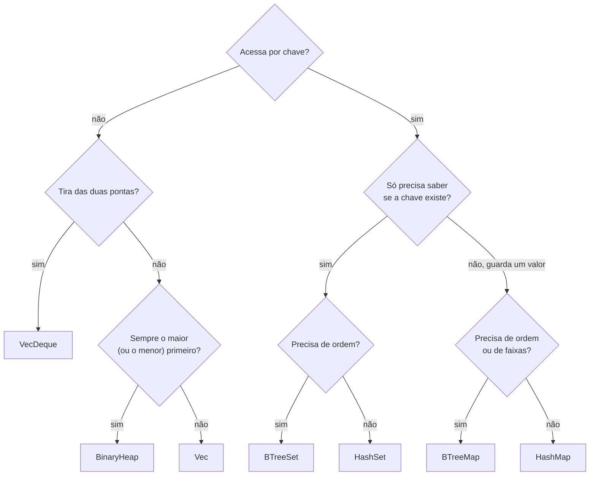

# 03 — Outras coleções

**Objetivos.** Ao final, você vai saber:

- usar `HashSet` e as operações de conjunto;
- quando trocar `HashMap` por `BTreeMap` (e `HashSet` por `BTreeSet`);
- usar `VecDeque` como fila e `BinaryHeap` como fila de prioridade;
- escolher a coleção certa, com o custo de cada operação.

A documentação de `std::collections` começa com um conselho que vale repetir: "você provavelmente só precisa de `Vec` ou `HashMap`". As coleções desta lição resolvem casos específicos. Todas ficam em `std::collections` e precisam de `use`.

## `HashSet`: só as chaves

Um `HashSet<T>` é um `HashMap<T, ()>`: guarda valores únicos, sem ordem, com as mesmas exigências (`T: Hash + Eq`). `insert` devolve `bool`, dizendo se o valor era novo:

```rust
use std::collections::HashSet;

let mut vistos = HashSet::new();
for p in ["rust", "go", "rust", "zig", "go"] {
    if !vistos.insert(p) {
        println!("repetido: {p}");
    }
}
```

```text
repetido: rust
repetido: go
```

Esse `bool` permite um truque útil: tirar duplicatas de um `Vec` **mantendo a ordem** da primeira aparição, coisa que o `dedup` da lição 01 não faz:

```rust
let mut ids = vec![3, 1, 3, 2, 1];
let mut ja_vi = HashSet::new();
ids.retain(|&id| ja_vi.insert(id));
println!("{ids:?}");
```

```text
[3, 1, 2]
```

### Operações de conjunto

```rust
let a = HashSet::from([1, 2, 3, 4]);
let b = HashSet::from([3, 4, 5]);
let mut inter: Vec<_> = a.intersection(&b).collect();
let mut so_em_a: Vec<_> = a.difference(&b).collect();
let mut uniao: Vec<_> = (&a | &b).into_iter().collect();
inter.sort();
so_em_a.sort();
uniao.sort();
println!("{inter:?} {so_em_a:?} {uniao:?}");
println!("{}", HashSet::from([3, 4]).is_subset(&a));
```

```text
[3, 4] [1, 2] [1, 2, 3, 4, 5]
true
```

- `intersection`, `union`, `difference` e `symmetric_difference` devolvem **iteradores** de referências, sem criar conjunto novo. Você decide o que fazer com eles (aqui, juntar num `Vec` e ordenar, porque a ordem do conjunto é arbitrária).
- Os operadores `&a | &b`, `&a & &b`, `&a - &b` e `&a ^ &b` criam um `HashSet` novo, como `a | b` no Python. Eles operam sobre referências (`&a`), para não consumir os conjuntos originais.
- `is_subset`, `is_superset` e `is_disjoint` respondem perguntas.

### Por que não existe `iter_mut`

```rust
// ❌ NÃO COMPILA
use std::collections::HashSet;

fn main() {
    let mut s = HashSet::from([1, 2, 3]);
    for x in s.iter_mut() {
        *x *= 10;
    }
}
```

```text
error[E0599]: no method named `iter_mut` found for struct `HashSet<T, S, A>` in the current scope
 --> src/main.rs:5:16
  |
5 |     for x in s.iter_mut() {
  |                ^^^^^^^^
  |
help: there is a method `iter` with a similar name
...
```

Não é esquecimento. A posição de cada valor no conjunto depende do seu hash. Se você mudasse o valor pelo `&mut`, ele ficaria no balde errado, e o conjunto não o acharia mais. Pelo mesmo motivo, o `HashMap` tem `values_mut`, mas não tem `keys_mut`. Para "alterar" um elemento, remova o antigo e insira o novo, ou monte outro conjunto: `s.iter().map(|x| x * 10).collect()`.

## `BTreeMap` e `BTreeSet`: ordenados

`BTreeMap<K, V>` tem a mesma interface de um `HashMap` (incluindo a *Entry API*), mas guarda as chaves **em ordem**. Em vez de `Hash + Eq`, exige `K: Ord`:

```rust
use std::collections::{BTreeMap, BTreeSet};

let mut notas = BTreeMap::new();
for (aluno, nota) in [("Caio", 7), ("Ana", 9), ("Bia", 8), ("Davi", 5)] {
    notas.insert(aluno, nota);
}
println!("{notas:?}");

let de_b_a_c: Vec<_> = notas.range("B".."D").collect();
println!("{de_b_a_c:?}");
println!("{:?} {:?}", notas.first_key_value(), notas.last_key_value());

let primeiro = notas.pop_first();
println!("{primeiro:?} sobram {}", notas.len());

let tags: BTreeSet<&str> = ["web", "cli", "async", "cli"].into_iter().collect();
println!("{tags:?}");
```

```text
{"Ana": 9, "Bia": 8, "Caio": 7, "Davi": 5}
[("Bia", 8), ("Caio", 7)]
Some(("Ana", 9)) Some(("Davi", 5))
Some(("Ana", 9)) sobram 3
{"async", "cli", "web"}
```

O que a ordem dá de graça:

- iteração sempre na mesma ordem, o que deixa a saída **determinística** (ótimo para testes e para relatórios);
- `range(a..b)`: todas as chaves numa faixa, em O(log n) para achar o começo;
- `first_key_value`, `last_key_value`, `pop_first`, `pop_last`: o menor e o maior.

O custo: cada operação é O(log n) em vez de O(1) médio. Na prática, para mapas pequenos e médios, a diferença costuma ser pequena. Se você precisa de ordem, use `BTreeMap` sem culpa.

A árvore é uma *B-tree*, e não a árvore rubro-negra do `std::map` do C++: cada nó guarda vários elementos contíguos, o que aproveita melhor o cache. Do lado do Python, o equivalente mais próximo é o `SortedDict` da biblioteca `sortedcontainers`.

Uma chave sem `Ord` dá um erro com uma sugestão incompleta:

```rust
// ❌ NÃO COMPILA
use std::collections::BTreeMap;

#[derive(Debug, PartialEq, Eq)]
struct Id(u32);

fn main() {
    let mut m = BTreeMap::new();
    m.insert(Id(1), "um");
}
```

```text
error[E0277]: the trait bound `Id: Ord` is not satisfied
    --> src/main.rs:8:7
     |
   8 |     m.insert(Id(1), "um");
     |       ^^^^^^ ----- `Id` doesn't satisfy the trait bound
     |       |
     |       the trait `Ord` is not implemented for `Id`
     |
...
help: consider annotating `Id` with `#[derive(Ord)]`
     |
   4 + #[derive(Ord)]
   5 | struct Id(u32);
```

`Ord` exige também `PartialOrd` (e `Eq`, que já está lá). O `derive` completo é `#[derive(Debug, PartialEq, Eq, PartialOrd, Ord)]`. O `derive` ordena pelos campos, na ordem em que são declarados.

## `VecDeque`: fila nas duas pontas

`VecDeque<T>` é um *buffer* circular: `push_front`, `push_back`, `pop_front` e `pop_back` são todos O(1). É a fila FIFO do dia a dia, e o `collections.deque` do Python:

```rust
use std::collections::VecDeque;

let mut fila: VecDeque<&str> = VecDeque::new();
fila.push_back("pedido 1");
fila.push_back("pedido 2");
fila.push_front("urgente");
println!("{fila:?} {}", fila[1]);

while let Some(p) = fila.pop_front() {
    println!("atendendo {p}");
}

// as últimas 3 leituras
let mut ultimas = VecDeque::with_capacity(3);
for leitura in [10, 12, 11, 15, 14] {
    if ultimas.len() == 3 {
        ultimas.pop_front();
    }
    ultimas.push_back(leitura);
}
println!("{ultimas:?}");
```

```text
["urgente", "pedido 1", "pedido 2"] pedido 1
atendendo urgente
atendendo pedido 1
atendendo pedido 2
[11, 15, 14]
```

O acesso por índice (`fila[1]`) continua O(1). A diferença para o `Vec` é que os elementos podem estar em dois pedaços do buffer, então ele não vira um `&[T]` direto (use `make_contiguous` ou `as_slices` se precisar). Para pilha (LIFO), o `Vec` com `push`/`pop` já basta.

## `BinaryHeap`: o maior primeiro

`BinaryHeap<T>` é uma fila de prioridade: `pop` sempre devolve o **maior** elemento, em O(log n), e `peek` o mostra sem tirar. Com tuplas, a prioridade é o primeiro campo:

```rust
use std::cmp::Reverse;
use std::collections::BinaryHeap;

let mut tarefas = BinaryHeap::new();
tarefas.push((2, "responder e-mail"));
tarefas.push((5, "consertar produção"));
tarefas.push((1, "regar a planta"));
println!("{:?}", tarefas.peek());
while let Some((prioridade, t)) = tarefas.pop() {
    println!("{prioridade}: {t}");
}

let mut min = BinaryHeap::new();
for x in [30, 10, 20] {
    min.push(Reverse(x));
}
let Some(Reverse(menor)) = min.pop() else { return };
println!("menor: {menor}");

let h = BinaryHeap::from([4, 1, 3]);
println!("{:?}", h.into_sorted_vec());
```

```text
Some((5, "consertar produção"))
5: consertar produção
2: responder e-mail
1: regar a planta
menor: 10
[1, 3, 4]
```

É um *max-heap*, como o `std::priority_queue` do C++. O `heapq` do Python é o contrário, um *min-heap*. Para o menor primeiro, embrulhe os valores em `std::cmp::Reverse`, que inverte a comparação (é a mesma `Reverse` do `sort_by_key` da lição 01). Os elementos precisam de `Ord`, então `f64` de novo não serve direto.

## `LinkedList`: quase nunca

A std tem uma lista duplamente encadeada, e a própria documentação diz para usá-la só se você tiver "*absolutamente* certeza". Cada nó é uma alocação separada, espalhada pela memória, e percorrer a lista é lento por causa do cache. `Vec` e `VecDeque` ganham em quase todo caso, até em inserções no meio de listas de tamanho moderado. A exceção real é juntar ou dividir listas em O(1) (`append`, `split_off`) quando os elementos são grandes ou não podem ser movidos.

## Qual coleção usar



Os custos, resumidos da tabela da documentação (n é o tamanho; "~" é custo médio e "*" é amortizado):

| Coleção | Buscar | Inserir | Remover | Observação |
|---|---|---|---|---|
| `Vec` | O(1) por índice | O(1)* no fim, O(n) no meio | O(1) no fim, O(n) no meio | contíguo, o mais rápido de percorrer |
| `VecDeque` | O(1) por índice | O(1)* nas pontas | O(1) nas pontas | buffer circular |
| `HashMap`/`HashSet` | O(1)~ | O(1)~* | O(1)~ | sem ordem |
| `BTreeMap`/`BTreeSet` | O(log n) | O(log n) | O(log n) | ordenado, com `range` |
| `BinaryHeap` | O(1) só o maior (`peek`) | O(1)~ | O(log n) só o maior (`pop`) | fila de prioridade |
| `LinkedList` | O(n) | O(1) com cursor | O(1) com cursor | quase nunca |

E a correspondência com o que você já conhece:

| C++ | Python | Rust |
|---|---|---|
| `std::vector` | `list` | `Vec` |
| `std::deque` | `collections.deque` | `VecDeque` |
| `std::unordered_map` / `unordered_set` | `dict` / `set` | `HashMap` / `HashSet` |
| `std::map` / `std::set` | `sortedcontainers.SortedDict` / `SortedSet` | `BTreeMap` / `BTreeSet` |
| `std::priority_queue` (max) | `heapq` (min) | `BinaryHeap` (max) |
| `std::list` | (não tem) | `LinkedList` |
| `std::multimap` | `defaultdict(list)` | `HashMap<K, Vec<V>>` com `or_default` |

Não há `multimap` nem `multiset` na std. Os substitutos são `HashMap<K, Vec<V>>` (vários valores por chave) e `BTreeMap<T, usize>` (contagem de cada elemento).

O projeto [`codigo/estoque`](codigo/estoque/src/lib.rs) junta as coleções desta lição e da anterior: `HashMap` para os itens, `BTreeMap` para o relatório por categoria, `HashSet` para as categorias e `BinaryHeap` com `Reverse` para decidir o que repor primeiro.

## Armadilhas comuns

- **`HashSet` sem `iter_mut`** (E0599): mudar o valor quebraria o hash. Remova e insira, ou monte outro conjunto.
- **`#[derive(Ord)]` sozinho**: siga o `help:` com `PartialOrd` junto, e `PartialEq` e `Eq` também.
- **Esperar o menor no `BinaryHeap`**: ele é *max-heap*. Use `Reverse` para inverter.
- **`LinkedList` para "inserir no meio rápido"**: achar o meio já custa O(n). Meça antes, e quase sempre fique com `Vec`.
- **`HashMap` quando o relatório precisa sair ordenado**: um `BTreeMap` resolve sem o passo extra de ordenar.

## Resumo

- `HashSet`: valores únicos, `insert` devolve `bool`, operações de conjunto como iteradores ou operadores (`&a | &b`). Não tem `iter_mut`.
- `BTreeMap`/`BTreeSet`: ordenados, exigem `Ord`, têm `range`, `first_key_value` e `pop_first`. Saída determinística.
- `VecDeque`: fila com O(1) nas duas pontas.
- `BinaryHeap`: o maior primeiro; `Reverse` para o menor.
- `LinkedList` quase nunca. Na dúvida, `Vec` ou `HashMap`.

## Exercícios

Veja o exercício 3 em [`exercicios.md`](exercicios.md).

## Leitura complementar

- [Documentação de `std::collections`](https://doc.rust-lang.org/std/collections/index.html): quando usar cada coleção e a tabela de custos
- [Documentação de `BTreeMap`](https://doc.rust-lang.org/std/collections/struct.BTreeMap.html), [`HashSet`](https://doc.rust-lang.org/std/collections/struct.HashSet.html), [`VecDeque`](https://doc.rust-lang.org/std/collections/struct.VecDeque.html) e [`BinaryHeap`](https://doc.rust-lang.org/std/collections/struct.BinaryHeap.html)
- [Learning Rust With Entirely Too Many Linked Lists](https://rust-unofficial.github.io/too-many-lists/), em especial a introdução, sobre por que listas encadeadas raramente valem a pena

---

[← Lição anterior](02-hashmap-e-entry-api.md) · [Índice do módulo](README.md) · [Próxima lição →](04-closures-e-captura.md)
