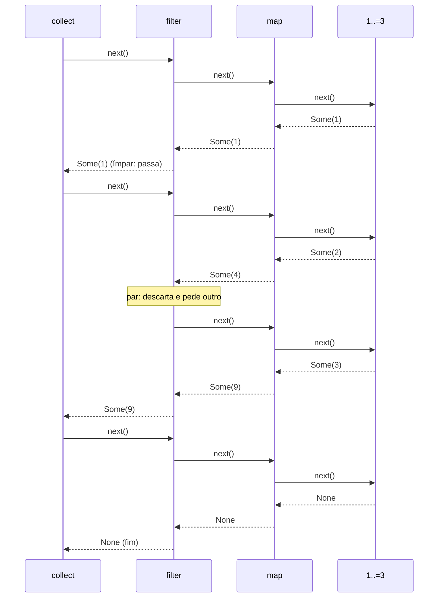

# 07 — Adaptadores, consumidores e `collect`

**Objetivos.** Ao final, você vai saber:

- por que uma cadeia de iteradores não faz nada até alguém puxar, e como os itens passam por ela;
- usar os adaptadores (`map`, `filter`, `filter_map`, `flat_map`, `zip`, `enumerate`, `scan`, `peekable`...) e os consumidores (`sum`, `fold`, `any`, `find`, `max_by_key`...);
- escolher o tipo de saída do `collect`, inclusive `HashMap`, `String`, `Result` e tuplas;
- quando uma cadeia de iteradores é melhor que um laço, e quando não é.

Os métodos de `Iterator` se dividem em dois grupos. **Adaptadores** recebem um iterador e devolvem outro (`map`, `filter`...). **Consumidores** percorrem o iterador e devolvem um resultado (`sum`, `collect`, `count`...). Todos vêm de graça para qualquer tipo que implemente `next`.

## Nada acontece até alguém puxar

```rust
let v = vec![1, 2, 3];
v.iter().map(|x| x * 2);
```

```text
warning: unused `Map` that must be used
 --> src/main.rs:3:5
  |
3 |     v.iter().map(|x| x * 2);
  |     ^^^^^^^^^^^^^^^^^^^^^^^
  |
  = note: iterators are lazy and do nothing unless consumed
...
```

`map` não multiplicou nada. Ele só criou uma struct `Map` que guarda o iterador de origem e a closure. Iteradores são *preguiçosos* (*lazy*): o trabalho só acontece quando um consumidor chama `next`. O aviso existe porque um adaptador solto, sem consumidor, é quase sempre um bug.

Quando o consumidor puxa, **cada item atravessa a cadeia inteira** antes de o próximo começar. O `inspect` (que só olha o item e o repassa) mostra a ordem:

```rust
let r: Vec<i32> = (1..=3)
    .inspect(|x| println!("gerou {x}"))
    .map(|x| {
        println!("  map {x} -> {}", x * x);
        x * x
    })
    .filter(|x| {
        println!("    filter {x}");
        x % 2 == 1
    })
    .collect();
println!("r = {r:?}");
```

```text
gerou 1
  map 1 -> 1
    filter 1
gerou 2
  map 2 -> 4
    filter 4
gerou 3
  map 3 -> 9
    filter 9
r = [1, 9]
```



É um modelo *pull*: quem está no fim da cadeia puxa, e o pedido desce até a origem. Duas consequências práticas:

- **Não há listas intermediárias.** Em Python, `[x*x for x in xs]` seguido de `[y for y in quadrados if y % 2]` cria duas listas. A cadeia Rust não cria nenhuma: o `collect` monta só o resultado final. (Uma *generator expression* do Python, `(x*x for x in xs)`, é preguiçosa como um iterador Rust; as *list comprehensions* não são.)
- **Iteradores infinitos funcionam**, desde que alguém pare de puxar. `(1..).map(|x| x * x).find(|x| x % 7 == 0)` devolve `Some(49)` e para ali. Já `(1..).max()` nunca termina.

O paralelo mais próximo em C++ são as *views* do C++20 (`v | views::filter(f) | views::transform(g)`), também preguiçosas. A diferença é que um iterador Rust que empresta uma coleção não pode sobreviver a ela: o borrow checker garante.

## Adaptadores

```rust
let nomes = ["ana", "bia", "caio"];
let idades = [30, 25, 41];

// enumerate e zip
for (i, (n, idade)) in nomes.iter().zip(idades).enumerate() {
    print!("{i}:{n}={idade} ");
}
println!();

// filter_map: filtra e transforma de uma vez
let numeros: Vec<i32> = "4 x 8 15 ?".split(' ').filter_map(|s| s.parse().ok()).collect();

// flat_map: cada item vira vários
let letras: Vec<char> = nomes.iter().flat_map(|n| n.chars().take(2)).collect();

// take, skip, step_by, chain, rev
let a: Vec<i32> = (1..=10).skip(2).step_by(3).collect();
let b: Vec<i32> = (1..=3).chain(7..=8).rev().collect();

// take_while: para no primeiro que falha
let c: Vec<i32> = [1, 2, 5, 1, 7].into_iter().take_while(|&x| x < 5).collect();

// scan: estado acumulado, um resultado por item
let saldo: Vec<i32> = [100, -30, -50, 20].into_iter().scan(0, |s, x| {
    *s += x;
    Some(*s)
}).collect();

println!("{numeros:?} {letras:?} {a:?} {b:?} {c:?} {saldo:?}");
```

```text
0:ana=30 1:bia=25 2:caio=41 
[4, 8, 15] ['a', 'n', 'b', 'i', 'c', 'a'] [3, 6, 9] [8, 7, 3, 2, 1] [1, 2] [100, 70, 20, 40]
```

| Grupo | Adaptadores | O que fazem |
|---|---|---|
| transformar | `map`, `copied`, `cloned` | um item novo para cada item |
| filtrar | `filter`, `filter_map`, `take_while`, `skip_while` | deixam passar alguns |
| numerar e combinar | `enumerate`, `zip`, `chain`, `unzip` (consumidor) | pares `(índice, item)`, pares de dois iteradores, um depois do outro |
| achatar | `flat_map`, `flatten` | cada item vira vários (ou um `Option`/`Vec` vira os seus itens) |
| posição | `take`, `skip`, `step_by`, `rev`, `cycle` | escolhem quais posições passam |
| estado | `scan`, `peekable`, `inspect` | carregam estado, espiam o próximo, observam |

Alguns detalhes:

- `zip` para no **menor** dos dois iteradores. Recebe qualquer `IntoIterator`, por isso `zip(idades)` aceita o array direto.
- `filter_map(f)` é `map(f)` seguido de "fique só com os `Some`". Com `.ok()`, transforma `Result` em `Option` e descarta os erros (o [Módulo 05](../05-tratamento-de-erros/03-unwrap-expect-e-combinadores.md) comparou isso com o `collect` em `Result`).
- `rev` exige um iterador que saiba andar de trás para frente (`DoubleEndedIterator`). Ranges, slices e `chars` sabem; a lição 08 mostra o caso em que não.

`peekable` permite olhar o próximo item sem consumi-lo, e `next_if` consome só se o item passar no teste. É a solução para o `take_while` que come um item a mais (lição 06):

```rust
let mut it = "aaabcc".chars().peekable();
let mut grupos = Vec::new();
while let Some(ch) = it.next() {
    let mut n = 1;
    while it.next_if_eq(&ch).is_some() {
        n += 1;
    }
    grupos.push(format!("{ch}{n}"));
}
println!("{}", grupos.join(" "));
```

```text
a3 b1 c2
```

## Consumidores

```rust
let v = [3, 8, 1, 9, 4];

let soma: i32 = v.iter().sum();
let produto: i64 = v.iter().map(|&x| i64::from(x)).product();
let pares = v.iter().filter(|&&x| x % 2 == 0).count();
println!("{soma} {produto} {pares}");

println!("{:?} {:?}", v.iter().max(), v.iter().min());
println!("{} {}", v.iter().any(|&x| x > 8), v.iter().all(|&x| x > 0));
println!("{:?} {:?}", v.iter().find(|&&x| x > 5), v.iter().position(|&x| x > 5));

let palavras = ["casa", "sol", "janela"];
println!("{:?}", palavras.iter().max_by_key(|p| p.len()));

// fold: o caso geral (sum, count, max... são folds prontos)
let texto = v.iter().fold(String::new(), |acc, x| {
    if acc.is_empty() { x.to_string() } else { format!("{acc}-{x}") }
});
println!("{texto}");

// reduce: como fold, mas começa pelo primeiro item (e devolve Option)
println!("{:?}", v.iter().copied().reduce(|a, b| a.max(b)));
```

```text
25 864 2
Some(9) Some(1)
true true
Some(8) Some(1)
Some("janela")
3-8-1-9-4
Some(9)
```

- `sum`, `product` e `count` fazem o que dizem. `max` e `min` exigem `Ord` (para `f64`, use `max_by` com `total_cmp`, como na lição 01) e devolvem `Option`, porque o iterador pode estar vazio.
- `any` e `all` param no primeiro item que decide a resposta. `find` e `position` param no primeiro que casa. Todos são *curto-circuito*: não percorrem o resto.
- `max_by_key`/`min_by_key` comparam por uma chave; `max_by`/`min_by` recebem uma comparação. Em empate, `max_by_key` devolve o **último** e `min_by_key` o primeiro.
- `fold(inicial, |acumulador, item| ...)` é o consumidor geral: todos os outros podem ser escritos com ele. Use quando nenhum pronto serve. `reduce` é um `fold` que usa o primeiro item como valor inicial.
- `for_each(|x| ...)` executa um efeito colateral para cada item. Em geral, um `for` lê melhor.

### `sum` precisa saber o tipo

```rust
// ❌ NÃO COMPILA
fn main() {
    let v = vec![1, 2, 3];
    let total = v.iter().sum();
    println!("{total}");
}
```

```text
error[E0283]: type annotations needed
    --> src/main.rs:3:9
     |
   3 |     let total = v.iter().sum();
     |         ^^^^^            --- type must be known at this point
     |
     = note: the type must implement `Sum<&i32>`
...
help: consider giving `total` an explicit type
     |
   3 |     let total: /* Type */ = v.iter().sum();
     |              ++++++++++++
```

`sum` é genérico no **retorno**: somar `&i32` pode produzir um `i32`, mas também outros tipos que implementam `Sum<&i32>`. Anote a variável (`let total: i32`) ou use o *turbofish* (`.sum::<i32>()`). O mesmo vale para `product` e, como você vai ver, para `collect`.

O tipo do resultado também é o tipo do acumulador, e ele pode estourar:

```rust
// 💥 PANIC EM RUNTIME
fn main() {
    let bytes: [u8; 2] = [200, 100];
    let total: u8 = bytes.iter().sum();
    println!("{total}");
}
```

```text
thread 'main' (440181) panicked at .../library/core/src/iter/traits/accum.rs:206:1:
attempt to add with overflow
```

Em *debug*, é *panic*. Em *release*, dá a volta, como qualquer soma de inteiros (o [Módulo 01](../01-tour-da-sintaxe/02-tipos-primitivos-e-conversoes.md) explica). Repare que o local do *panic* aponta para dentro da std, e não para o seu código: rode com `RUST_BACKTRACE=1` para achar a linha. A correção é somar num tipo maior, ou checar cada passo com `try_fold`, que para no primeiro `None`:

```rust
// ✅
let total: u32 = bytes.iter().map(|&b| u32::from(b)).sum();
let checado = bytes.iter().try_fold(0u8, |acc, &b| acc.checked_add(b));
println!("{total} {checado:?}");
```

```text
300 None
```

## `collect` e `FromIterator`

`collect` monta uma coleção a partir de um iterador. Qual coleção? A que você pedir: ele funciona para qualquer tipo que implemente a trait `FromIterator`. Sem anotação nenhuma, o compilador não tem como adivinhar:

```rust
// ❌ NÃO COMPILA
fn main() {
    let v = vec![1, 2, 3];
    let dobrados = v.iter().map(|x| x * 2).collect();
    println!("{}", dobrados.len());
}
```

```text
error[E0282]: type annotations needed
 --> src/main.rs:3:9
  |
3 |     let dobrados = v.iter().map(|x| x * 2).collect();
  |         ^^^^^^^^
4 |     println!("{}", dobrados.len());
  |                    -------- type must be known at this point
  |
help: consider giving `dobrados` an explicit type
  |
3 |     let dobrados: Vec<_> = v.iter().map(|x| x * 2).collect();
  |                 ++++++++
```

O `Vec<_>` diz "um `Vec`, e o tipo dos itens você deduz". O turbofish faz o mesmo no meio de uma expressão: `.collect::<Vec<_>>()`. As saídas mais úteis:

```rust
use std::collections::{BTreeMap, HashSet};

let palavras = ["rust", "go", "rust", "zig"];

let v: Vec<usize> = palavras.iter().map(|p| p.len()).collect();
let unicas: HashSet<&str> = palavras.iter().copied().collect();
let tamanhos: BTreeMap<&str, usize> = palavras.iter().map(|p| (*p, p.len())).collect();
let iniciais: String = palavras.iter().filter_map(|p| p.chars().next()).collect();
let frase: String = palavras.iter().map(|p| p.to_uppercase()).collect::<Vec<_>>().join(" ");
println!("{v:?} {} {tamanhos:?} {iniciais} {frase}", unicas.len());

let ok: Result<Vec<i32>, _> = "1,2,3".split(',').map(str::parse::<i32>).collect();
let talvez: Option<Vec<char>> = ["a", "b", ""].iter().map(|s| s.chars().next()).collect();
println!("{ok:?} {talvez:?}");

let (pares, impares): (Vec<i32>, Vec<i32>) = (1..=6).partition(|x| x % 2 == 0);
let (nomes, notas): (Vec<&str>, Vec<u8>) = [("Ana", 9), ("Bia", 7)].into_iter().unzip();
let (nums, letras): (Vec<i32>, String) = [(1, 'a'), (2, 'b')].into_iter().collect();
println!("{pares:?} {impares:?} {nomes:?} {notas:?} {nums:?} {letras}");
```

```text
[4, 2, 4, 3] 3 {"go": 2, "rust": 4, "zig": 3} rgrz RUST GO RUST ZIG
Ok([1, 2, 3]) None
[2, 4, 6] [1, 3, 5] ["Ana", "Bia"] [9, 7] [1, 2] ab
```

| Itens do iterador | Pode coletar em |
|---|---|
| `T` | `Vec<T>`, `VecDeque<T>`, `HashSet<T>`, `BTreeSet<T>`, `BinaryHeap<T>` |
| `(K, V)` | `HashMap<K, V>`, `BTreeMap<K, V>` (chave repetida: o último vence) |
| `char`, `&str` ou `String` | `String` |
| `Result<T, E>` | `Result<Vec<T>, E>`: para no primeiro `Err` ([Módulo 05](../05-tratamento-de-erros/03-unwrap-expect-e-combinadores.md)) |
| `Option<T>` | `Option<Vec<T>>`: para no primeiro `None` |
| `(A, B)` | `(Vec<A>, Vec<B>)` e outras tuplas de coleções (1.85) |

`partition(pred)` separa em duas coleções (os que passam e os que não passam). `unzip` separa pares em duas coleções. Ambos são consumidores.

### Traduzindo do Python

| Python | Rust |
|---|---|
| `[f(x) for x in xs]` | `xs.iter().map(f).collect::<Vec<_>>()` |
| `[x for x in xs if p(x)]` | `xs.iter().filter(p).collect()` |
| `[f(x, y) for x in xs for y in ys]` | `xs.iter().flat_map(\|x\| ys.iter().map(move \|y\| f(x, y))).collect()` |
| `{k: v for k, v in pares}` | `pares.into_iter().collect::<HashMap<_, _>>()` |
| `{f(x) for x in xs}` | `xs.iter().map(f).collect::<HashSet<_>>()` |
| `sum`, `any`, `all`, `zip`, `enumerate`, `reversed` | `sum`, `any`, `all`, `zip`, `enumerate`, `rev` |
| `itertools.chain`, `itertools.islice` | `chain`, `skip` + `take` |
| `functools.reduce(f, xs, inicial)` | `fold(inicial, f)` |
| `sorted(xs)` | `collect` num `Vec` + `sort` (não existe ordenação preguiçosa) |
| `next(it, padrao)` | `it.next().unwrap_or(padrao)` |

O `move` na closure interna do `flat_map` é necessário porque ela captura `x`, que pertence a uma chamada da closure externa e morreria antes de o iterador interno terminar (o E0373 da lição 04).

## Iterador ou laço?

**Desempenho.** O Book (13.4) compara um laço e uma cadeia de iteradores buscando palavras num livro inteiro: 19,6 ms contra 19,2 ms. Iteradores são uma *abstração de custo zero*: o compilador transforma a cadeia num laço comum, e muitas vezes elimina a checagem de limites que `v[i]` faria. Não troque iteradores por laços "para ficar mais rápido" sem medir.

**Legibilidade.** Uma cadeia curta (`filter` + `map` + `collect`) diz *o que* você quer; o laço equivalente diz *como*. O Clippy aponta laços que seriam melhores como iteradores, e iteradores que já têm um consumidor pronto:

```text
warning: this `.fold` can be written more succinctly using another method
 --> src/main.rs:3:25
  |
3 |     let soma = v.iter().fold(0, |acc, x| acc + x);
  |                         ^^^^^^^^^^^^^^^^^^^^^^^^^ help: try: `sum::<i32>()`

warning: the loop variable `i` is used to index `v`
 --> src/main.rs:4:14
  |
4 |     for i in 0..v.len() {
  |              ^^^^^^^^^^
...
help: consider using an iterator and enumerate()
```

Mas o laço continua sendo a melhor escolha quando:

- o corpo é grande, com vários passos e decisões;
- há retornos antecipados ou `?` no meio (dentro de uma closure, o `?` sai da closure, não da função);
- você altera várias variáveis de fora a cada passo (um `for_each` cheio de capturas `&mut` lê pior que um `for`);
- o efeito colateral é o objetivo (imprimir, escrever num arquivo): `for`, e não `map` sem consumidor.

### Lembra do minigrep?

A função `search` do [Projeto 1](../../projetos/01-minigrep/README.md) monta o resultado com um `Vec` mutável e um `push` num laço. Com adaptadores, ela vira uma cadeia:

```rust
pub fn search<'a>(pattern: &str, contents: &'a str, opts: SearchOptions) -> Vec<Match<'a>> {
    let pattern_lower = pattern.to_lowercase();
    contents
        .lines()
        .enumerate()
        .filter(|(_, line)| {
            let is_hit = if opts.ignore_case {
                line.to_lowercase().contains(&pattern_lower)
            } else {
                line.contains(pattern)
            };
            is_hit != opts.invert
        })
        .map(|(i, line)| Match { line_no: i + 1, line })
        .collect()
}
```

A assinatura não muda, e os testes das etapas 1 e 2 continuam passando, inclusive o que confere que as linhas apontam para dentro do texto original: `lines()` produz `&'a str`, e nenhum passo da cadeia copia. É a parte (a) do exercício 6.

O projeto [`codigo/relatorio-de-notas`](codigo/relatorio-de-notas/) roda o exemplo do `inspect` (`cargo run`) e monta um relatório só com iteradores: leitura com `collect` em `Result`, média, `max_by` com `total_cmp`, `partition` e agrupamento num `BTreeMap`. Repare no comentário em `aprovados_e_reprovados`: uma closure que recebe e devolve referências caiu no problema da lição 04.

## Armadilhas comuns

- **Adaptador sem consumidor** (`unused Map that must be used`): nada roda. Termine com um consumidor, ou use `for`.
- **`map` para efeito colateral**: `v.iter().map(|x| println!("{x}"));` ganha também o aviso `map_unit_fn`, que sugere `for_each`. Prefira um `for`.
- **`collect` ou `sum` sem tipo** (E0282, E0283): anote a variável ou use o turbofish.
- **Estouro no `sum`**: o acumulador tem o tipo do resultado. Some num tipo maior ou use `try_fold` com `checked_add`.
- **`max`/`min` em `f64`**: não compila (`f64` não é `Ord`). Use `max_by(|a, b| a.total_cmp(b))`.
- **`collect` seguido de `.iter()`** só para continuar a cadeia: o `Vec` intermediário é desnecessário (o Clippy avisa com `needless_collect`).
- **`for i in 0..v.len()` com `v[i]`**: use `iter()` ou `iter().enumerate()`.

## Resumo

- Adaptadores devolvem iteradores; consumidores devolvem resultados. Nada roda até um consumidor puxar, e cada item atravessa a cadeia inteira antes do próximo, sem listas intermediárias.
- Adaptadores do dia a dia: `map`, `filter`, `filter_map`, `flat_map`, `enumerate`, `zip`, `chain`, `take`/`skip`, `rev`, `scan`, `peekable`.
- Consumidores do dia a dia: `sum`, `count`, `min`/`max` (e `_by_key`), `any`/`all`, `find`/`position`, `fold`, `collect`, `partition`, `unzip`.
- `collect` monta qualquer `FromIterator`: `Vec`, `HashMap`, `String`, `Result<Vec<_>, _>`, `Option<Vec<_>>`, tuplas. O tipo vem da anotação ou do turbofish.
- Iteradores custam o mesmo que laços. Use a forma que lê melhor, e prefira o laço com corpo grande, `?` no meio ou muito estado mutável.

## Exercícios

Veja os exercícios 2 e 6 em [`exercicios.md`](exercicios.md).

## Leitura complementar

- [The Rust Programming Language, 13.2 Processing a Series of Items with Iterators](https://doc.rust-lang.org/stable/book/ch13-02-iterators.html) e [13.4 Comparing Performance: Loops vs. Iterators](https://doc.rust-lang.org/stable/book/ch13-04-performance.html)
- [Documentação de `Iterator`](https://doc.rust-lang.org/std/iter/trait.Iterator.html): a lista completa de métodos
- [Documentação de `FromIterator`](https://doc.rust-lang.org/std/iter/trait.FromIterator.html)
- [Effective Rust, Item 9: Consider using iterator transforms instead of explicit loops](https://effective-rust.com/iterators.html)

---

[← Lição anterior](06-iterator-e-intoiterator.md) · [Índice do módulo](README.md) · [Próxima lição →](08-implementando-seu-iterador.md)
