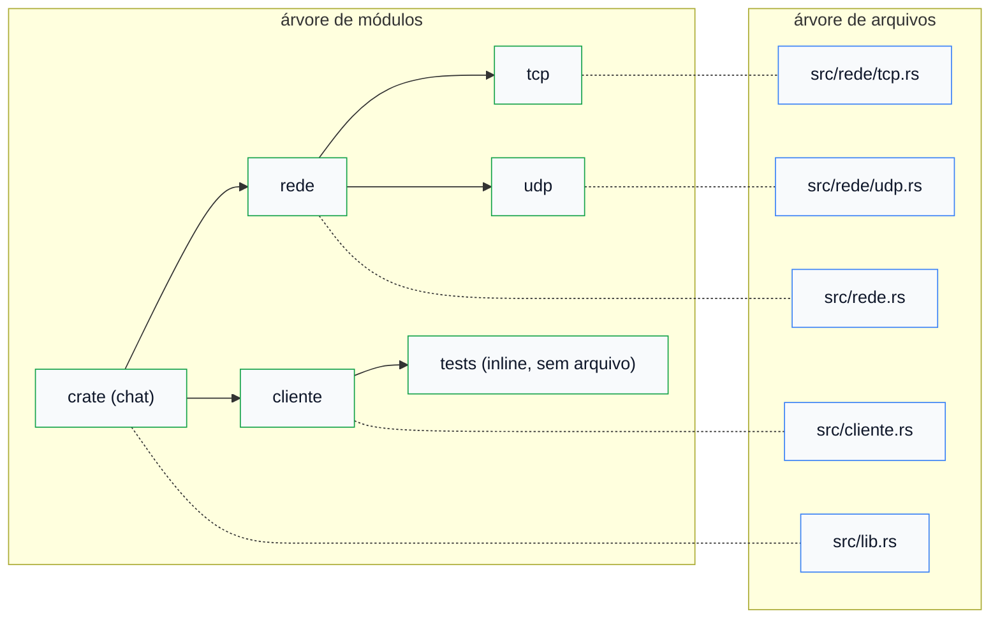

# 01 — A árvore de módulos

**Objetivos.** Ao final, você vai saber:

- como o compilador monta a árvore de módulos a partir da raiz da crate;
- em que arquivo ele procura cada `mod`, inclusive os submódulos;
- a diferença entre os estilos `rede.rs` + `rede/` e `rede/mod.rs`;
- por que `mod` não é um `#include`.

## Tudo começa na raiz

A [lição 09 do Módulo 01](../01-tour-da-sintaxe/09-kit-modulos-lib-e-main.md) mostrou que `mod notas;` carrega `src/notas.rs`. Agora vamos olhar o todo. Toda crate tem uma **raiz** (*crate root*): `src/lib.rs` para a biblioteca, `src/main.rs` para o binário. O compilador começa nesse arquivo e segue cada `mod x;`. Cada um pendura um nó na árvore. Um arquivo que nenhum `mod` alcança não existe para ele.

O projeto [`codigo/chat`](codigo/chat/) tem uma árvore com dois níveis:

```text
chat/src/
├── lib.rs          # raiz: pub mod cliente; pub mod rede;
├── cliente.rs      # módulo crate::cliente (com um mod tests inline)
├── rede.rs         # módulo crate::rede: pub mod tcp; pub mod udp;
├── rede/
│   ├── tcp.rs      # módulo crate::rede::tcp
│   └── udp.rs      # módulo crate::rede::udp
└── main.rs         # raiz da crate binária (outra crate)
```

As duas árvores, lado a lado:



A árvore de módulos é a que importa: é ela que define os caminhos (`crate::rede::tcp::conectar`). A de arquivos só diz onde o código está escrito. Um módulo inline como `mod tests { ... }` é um nó sem arquivo próprio.

## Onde o compilador procura

A regra: o arquivo de um módulo fica na pasta **do módulo pai**, e os filhos de um módulo ficam numa pasta **com o nome dele**.

| Declaração | Arquivo procurado |
|---|---|
| `mod rede;` em `src/lib.rs` (ou `src/main.rs`) | `src/rede.rs` ou `src/rede/mod.rs` |
| `mod tcp;` em `src/rede.rs` | `src/rede/tcp.rs` ou `src/rede/tcp/mod.rs` |
| `mod ipv6;` em `src/rede/tcp.rs` | `src/rede/tcp/ipv6.rs` ou `src/rede/tcp/ipv6/mod.rs` |

O `src/rede.rs` do exemplo só declara os filhos e guarda o que é comum a eles:

```rust
// src/rede.rs
pub mod tcp;
pub mod udp;

/// Porta usada quando o endereço não informa nenhuma.
pub const PORTA_PADRAO: u16 = 7000;

/// Privada de `rede`, mas visível nos filhos (`tcp` e `udp`).
fn host_valido(host: &str) -> bool {
    !host.is_empty() && host.chars().all(|c| c.is_ascii_alphanumeric() || c == '.' || c == '-')
}
```

E o `tcp.rs` usa o que está no pai com `super::` (a próxima lição explica por que ele enxerga a função privada):

```rust
// src/rede/tcp.rs
use super::{PORTA_PADRAO, host_valido};
```

Quando você erra o lugar do arquivo, a mensagem diz exatamente onde ele devia estar. É o que acontece se `tcp.rs` ficar em `src/` em vez de `src/rede/`:

```text
error[E0583]: file not found for module `tcp`
 --> src/rede.rs:3:1
  |
3 | pub mod tcp;
  | ^^^^^^^^^^^^
  |
  = help: to create the module `tcp`, create file "src/rede/tcp.rs" or "src/rede/tcp/mod.rs"
  = note: if there is a `mod tcp` elsewhere in the crate already, import it with `use crate::...` instead
```

## Dois estilos: `rede.rs` ou `rede/mod.rs`

Um módulo com filhos pode ter o próprio código em dois lugares:

```text
estilo atual (2018+)          estilo antigo
src/rede.rs                   src/rede/mod.rs
src/rede/tcp.rs               src/rede/tcp.rs
```

Os dois funcionam e você vai ver os dois em projetos reais. O Rust Book e o Comprehensive Rust recomendam o atual, e este curso o usa sempre. O motivo é prático: com vários `mod.rs` abertos, as abas do editor ficam todas com o mesmo nome. A exceção que você vai encontrar é `tests/common/mod.rs`, assunto do [Módulo 09](../09-testes-e-qualidade/README.md).

Para quem vem de Python: o `rede.rs` faz o papel do `rede/__init__.py`. A diferença é que, em Rust, a pasta sozinha não é nada. Sem o `mod rede;` no pai, nem `rede.rs` nem a pasta entram na compilação.

O que não pode é ter os dois para o mesmo módulo. Criar os dois "para garantir" dá erro:

```text
error[E0761]: file for module `rede` found at both "src/rede.rs" and "src/rede/mod.rs"
 --> src/lib.rs:7:1
  |
7 | pub mod rede;
  | ^^^^^^^^^^^^^
  |
  = help: delete or rename one of them to remove the ambiguity
```

> [!NOTE]
> O atributo `#[path = "outro.rs"] mod x;` muda o arquivo procurado. Ele existe para casos especiais (código gerado, testes no estilo `foo_test.rs`). Em código comum, siga a convenção.

## `mod` não é `#include`

Em C++, `#include "rede.h"` cola o texto do header no lugar, e cada `.cpp` é compilado separado. Por isso existem headers, declarações adiantadas e a ODR (*One Definition Rule*), que você precisa respeitar sem ajuda do compilador. Em Rust:

- **Cada arquivo entra uma vez**, no ponto da árvore em que foi declarado. Depois, ele é referenciado pelo caminho, nunca "incluído" de novo.
- **Não há headers nem declaração adiantada.** O compilador lê a crate inteira antes de resolver os nomes, então a ordem dos itens não importa: uma função pode chamar outra definida mais abaixo ou em outro módulo.
- **Um `mod` é fechado.** Um `namespace` do C++ pode ser reaberto em qualquer arquivo. Um módulo Rust tem um único lugar na árvore, e ninguém de fora pode acrescentar itens a ele.

E comparado com Python: `import` *executa* o módulo, e ciclos de import são um problema clássico. Um `mod` não executa nada (não existe código solto no nível do módulo), e módulos da mesma crate podem se referir mutuamente sem problema. Ciclos só são proibidos entre crates.

`use`, por sua vez, nunca carrega arquivo. Ele só cria um atalho para um caminho que já existe (lição 03).

## Armadilhas comuns

**Arquivo que não existe** (o `mod` está lá, o arquivo não):

```text
error[E0583]: file not found for module `rede`
 --> src/lib.rs:7:1
  |
7 | pub mod rede;
  | ^^^^^^^^^^^^^
  |
  = help: to create the module `rede`, create file "src/rede.rs" or "src/rede/mod.rs"
  = note: if there is a `mod rede` elsewhere in the crate already, import it with `use crate::...` instead
```

Leia o `help`: ele mostra o caminho completo esperado. A `note` cobre o outro erro comum, que é escrever `mod rede;` num segundo lugar para "importar" um módulo que já existe. Para isso, use `use crate::rede`.

**Submódulo no lugar errado.** O filho de `rede` fica em `src/rede/`, não em `src/`. A mensagem (mostrada acima) indica a pasta certa.

**`rede.rs` e `rede/mod.rs` juntos.** E0761. Escolha um.

**Arquivo criado e nunca declarado.** Não dá erro de módulo, só um "não encontrado" quando você tenta usar o item. Faltou o `mod` no pai (veja a [M01-09](../01-tour-da-sintaxe/09-kit-modulos-lib-e-main.md)).

**Declarar o módulo também no `main.rs`.** Compila o arquivo duas vezes, como duas cópias independentes. Também está na M01-09.

## Resumo

- Toda crate tem uma raiz (`lib.rs` ou `main.rs`), e cada `mod x;` pendura um nó na árvore. Só entram os arquivos alcançáveis a partir dela.
- O arquivo de `mod x;` fica na pasta do pai; os filhos de `x` ficam em `x/`.
- Use `rede.rs` + `rede/`. `rede/mod.rs` também funciona, mas nunca os dois.
- `mod` carrega o arquivo uma vez e não executa nada; `use` só cria atalhos.
- Sem headers, sem declaração adiantada e sem ODR para violar dentro da crate.

## Exercícios

Veja o exercício 1 em [`exercicios.md`](exercicios.md).

## Leitura complementar

- [The Rust Programming Language, 7.5 Separating Modules into Different Files](https://doc.rust-lang.org/stable/book/ch07-05-separating-modules-into-different-files.html)
- [The Rust Reference: Modules](https://doc.rust-lang.org/reference/items/modules.html)
- [Comprehensive Rust: Filesystem Hierarchy](https://google.github.io/comprehensive-rust/modules/filesystem.html)

---

[Índice do módulo](README.md) · [Próxima lição →](02-visibilidade.md)
