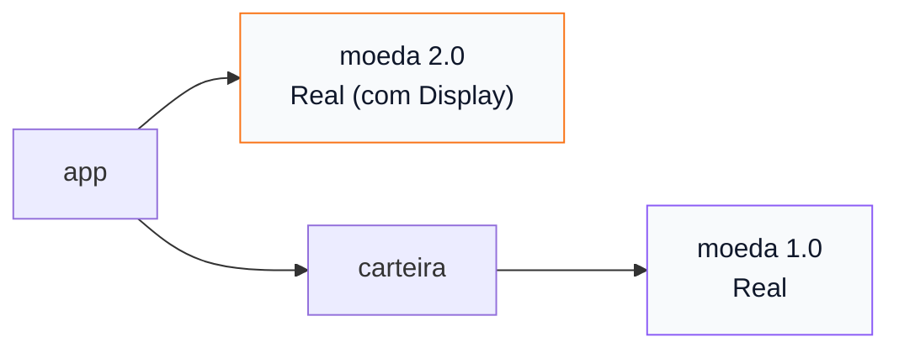

# 05 — Dependências e SemVer

> Última revisão: 2026-10-26 (versões de crates citadas: `rand` 0.10.3, `serde` 1.0.229, `proptest` 1.12.0)

**Objetivos.** Ao final, você vai saber:

- ler um requisito de versão do `Cargo.toml` (`"0.10.3"`, `"~1.2"`, `"=1.0.4"`);
- declarar dependências de registro, de pasta e de git, de desenvolvimento e por plataforma;
- o papel do `Cargo.lock` e de `cargo update`, e investigar o grafo com `cargo tree`;
- o que acontece quando duas versões da mesma crate entram no grafo.

## Versionamento semântico

No [Módulo 00](../00-introducao/03-cargo-essencial.md), o `cargo add rand` gravou `rand = "0.10.3"`, e a lição avisou que isso não é uma versão exata. As versões de crates seguem o *SemVer* (versionamento semântico): `MAJOR.MINOR.PATCH`. Mudar o `MAJOR` pode quebrar quem usa; o `MINOR` acrescenta coisas compatíveis; o `PATCH` só corrige.

Um requisito sem operador é um requisito *caret* (`^`): "esta versão ou qualquer uma compatível mais nova". A tabela do Cargo Book:

```text
1.2.3  :=  >=1.2.3, <2.0.0
1.2    :=  >=1.2.0, <2.0.0
1      :=  >=1.0.0, <2.0.0
0.2.3  :=  >=0.2.3, <0.3.0
0.2    :=  >=0.2.0, <0.3.0
0.0.3  :=  >=0.0.3, <0.0.4
0.0    :=  >=0.0.0, <0.1.0
0      :=  >=0.0.0, <1.0.0
```

Repare nas linhas com `0.`: antes da 1.0, o Cargo "desloca" o SemVer uma casa para a esquerda. Em `0.y.z`, mudar o `y` é quebra. Por isso `rand 0.9` e `rand 0.10` são incompatíveis, e `"0.10.3"` aceita de `0.10.3` até antes de `0.11.0`.

Outros operadores, menos usados:

| Requisito | Significa | Quando usar |
|---|---|---|
| `"~1.2.3"` | `>=1.2.3, <1.3.0` (só *patch*) | raramente |
| `"=1.2.3"` | exatamente essa | crates acopladas, como uma lib e a sua proc-macro |
| `">=1.2, <1.5"` | faixa explícita | contornar uma versão com bug |
| `"*"` | qualquer uma | nunca (o crates.io recusa) |

Para quem vem de Python: o `"1.2.3"` do Cargo é parecido com `~=1.2` ou `>=1.2.3,<2` do pip, e não com `==1.2.3`.

## Declarando dependências

O `cargo add` escreve a linha certa no `Cargo.toml` e mostra as *features* da crate (lição 06):

```bash
cargo add serde --features derive
```

```text
    Updating crates.io index
      Adding serde v1.0.229 to dependencies
             Features:
             + derive
             + serde_derive
             + std
             - alloc
             - rc
             - unstable
```

Variações úteis:

```bash
cargo add rand@0.9                  # uma versão específica
cargo add --dev proptest            # só para testes
cargo add rand@0.9 --rename rand09  # outro nome no código
cargo add --path ../nucleo          # uma crate local
```

O resultado no manifesto:

```toml
[dependencies]
rand = "0.10.3"
rand09 = { version = "0.9", package = "rand" }
serde = { version = "1.0.229", features = ["derive"] }

[dev-dependencies]
proptest = "1.12.0"
```

As fontes possíveis:

```toml
[dependencies]
nucleo = { path = "../nucleo" }                     # pasta local
utils = { git = "https://github.com/exemplo/utils", tag = "v1.2.0" }  # git (ou branch, rev)
modelo = { path = "../modelo", version = "0.3" }    # local no desenvolvimento, registro ao publicar
```

E dependências só para uma plataforma:

```toml
[target.'cfg(windows)'.dependencies]
itoa = "1"
```

### `dev-dependencies`

`[dev-dependencies]` valem só para testes, exemplos e benchmarks. Usar uma delas no código normal da biblioteca falha:

```rust
// ❌ NÃO COMPILA (proptest está em [dev-dependencies])
pub fn estrategia() -> proptest::num::u8::Any {
    proptest::num::u8::ANY
}
```

```text
error[E0433]: cannot find module or crate `proptest` in this scope
 --> src/lib.rs:5:24
  |
5 | pub fn estrategia() -> proptest::num::u8::Any {
  |                        ^^^^^^^^ use of unresolved module or unlinked crate `proptest`
  |
  = help: if you wanted to use a crate named `proptest`, use `cargo add proptest` to add it to your `Cargo.toml`
```

O `help` não percebe que ela já está no manifesto, só na seção errada.

## `Cargo.lock` e `cargo update`

O requisito diz o que é aceitável; o `Cargo.lock` registra o que foi escolhido, para todas as crates do grafo. O `cargo build` só lê o lockfile. Quem atualiza é o `cargo update`, sempre dentro dos requisitos:

```bash
cargo update -p itoa --precise 1.0.10   # trava numa versão específica
cargo update                            # tudo para o mais novo compatível
```

```text
    Updating crates.io index
 Downgrading itoa v1.0.18 -> v1.0.10
    Updating crates.io index
     Locking 1 package to highest Rust 1.96 compatible version
    Updating itoa v1.0.10 -> v1.0.18
```

(O "Rust 1.96 compatible" vem do `rust-version`, lição 08.)

A orientação oficial mudou em 2023: **commite o `Cargo.lock`**, também em bibliotecas. Ele dá builds reproduzíveis para quem trabalha no projeto e para a CI. Para quem depende da sua biblioteca, nada muda: o Cargo ignora o lockfile das dependências e resolve o grafo inteiro a partir do projeto final.

Não existe `venv`: cada projeto tem o próprio lockfile, e as crates compiladas ficam no `target/` do projeto.

## Investigando o grafo: `cargo tree`

```bash
cargo tree --depth 1     # dependências diretas
cargo tree -d            # crates que aparecem em mais de uma versão
cargo tree -i rand_core  # quem puxa uma crate (árvore invertida)
```

No projeto de teste com `rand` 0.10 e `rand09` (0.9):

```text
$ cargo tree --depth 1 -e normal
deps v0.1.0 (…)
├── rand v0.9.5
├── rand v0.10.3
└── serde v1.0.229
```

## Duas versões da mesma crate

Em Python, um ambiente só tem uma versão de cada pacote, e dois pacotes que pedem versões incompatíveis simplesmente não instalam juntos. O Cargo aceita **várias versões incompatíveis** da mesma crate no grafo (uma por faixa de SemVer). Isso evita o conflito, mas cria uma armadilha: os tipos de versões diferentes são **tipos diferentes**.

O projeto [`codigo/duas-versoes`](codigo/duas-versoes/) monta o cenário: a biblioteca `carteira` usa `moeda` 1.0, e o `app` usa `moeda` 2.0 e a `carteira`.



Passar um `Real` da versão 2 para a carteira:

```rust
// ❌ NÃO COMPILA
use moeda::Real;

fn main() {
    let total = carteira::somar(Real::centavos(1050), Real::centavos(250));
    println!("total: {total}");
}
```

```text
error[E0308]: arguments to this function are incorrect
 --> src/main.rs:4:17
  |
4 |     let total = carteira::somar(Real::centavos(1050), Real::centavos(250));
  |                 ^^^^^^^^^^^^^^^ --------------------  ------------------- expected `moeda::Real`, found `Real`
  |                                 |
  |                                 expected `moeda::Real`, found `Real`
  |
note: there are multiple different versions of crate `moeda` in the dependency graph
 --> …/moeda-1/src/lib.rs:5:1
  |
5 | pub struct Real(pub i64);
  | ^^^^^^^^^^^^^^^ this is the expected type
  |
 ::: …/moeda-2/src/lib.rs:8:1
  |
8 | pub struct Real(i64);
  | --------------- this is the found type
  = help: you can use `cargo tree` to explore your dependency tree
...
```

"expected `moeda::Real`, found `Real`" parece absurdo até você ler a `note`. O `cargo tree -d` confirma:

```text
moeda v1.0.0 (…/moeda-1)
└── carteira v0.1.0 (…/carteira)
    └── app v0.1.0 (…/app)

moeda v2.0.0 (…/moeda-2)
└── app v0.1.0 (…/app)
```

Compare com o C++: duas versões da mesma biblioteca no mesmo executável violam a ODR, e o resultado é comportamento indefinido silencioso ou um erro de *link* confuso. Em Rust, é um erro de tipo com a explicação.

As correções, da melhor para a pior:

1. **Alinhar as versões**: atualizar a `carteira` para `moeda` 2 (ou o app para a 1).
2. **A biblioteca reexporta a dependência** que aparece na sua API. A `carteira` faz `pub use moeda;`, e o app cria exatamente o tipo que ela espera:

```rust
use carteira::moeda as moeda_v1; // a versão que a carteira usa (reexportada por ela)
use moeda::Real; // a versão 2, dependência direta do app

fn main() {
    let total = carteira::somar(moeda_v1::Real(1050), moeda_v1::Real(250));
    let total = Real::centavos(total.0); // conversão explícita entre as versões
    println!("total: {total}");
}
```

```text
total: R$ 13,00
```

Se a sua biblioteca expõe tipos de outra crate na API pública, reexporte essa crate. Assim quem usa nunca precisa adivinhar qual versão você usa.

## O que quebra a compatibilidade

Para quem publica uma biblioteca, estas mudanças exigem um novo `MAJOR` (ou novo `MINOR`, se ainda for `0.x`):

- remover ou renomear um item público, ou mudar uma assinatura;
- acrescentar um campo público numa struct que dava para construir com literal;
- acrescentar uma variante num `pub enum` sem `#[non_exhaustive]` (o `match` de quem usa deixa de ser exaustivo);
- tornar privado algo que era público (lição 02);
- tirar uma *feature* ou mudar as *features* padrão (lição 06).

Acrescentar itens, tornar algo público e corrigir bugs são compatíveis. A ferramenta `cargo-semver-checks` compara duas versões da API e aponta quebras; vale conhecer quando você começar a publicar.

## Armadilhas comuns

- **Ler `"0.10.3"` como versão exata.** É `>=0.10.3, <0.11.0`.
- **Achar que `0.9` → `0.10` é compatível.** No `0.x`, o segundo número é o "major".
- **Dependência na seção errada** (`[dev-dependencies]` usada na biblioteca, E0433).
- **"expected `moeda::Real`, found `Real`"**: duas versões no grafo. `cargo tree -d`.
- **Não commitar o `Cargo.lock`** de uma biblioteca: a orientação atual é commitar.

## Resumo

- Requisitos sem operador são *caret*: `"1.2.3"` aceita até antes de `2.0.0`; `"0.2.3"`, até antes de `0.3.0`.
- Dependências vêm do registro, de `path` ou de `git`; `[dev-dependencies]` são só para testes e exemplos.
- O `Cargo.lock` trava as versões; `cargo update` atualiza dentro dos requisitos. Commite-o.
- `cargo tree`, `-d` e `-i` explicam o grafo.
- Duas versões da mesma crate dão tipos diferentes. Alinhe as versões, ou reexporte a dependência que aparece na API.

## Exercícios

Os exercícios 4 e 5 em [`exercicios.md`](exercicios.md) usam dependências entre crates locais.

## Leitura complementar

- [The Cargo Book: Specifying Dependencies](https://doc.rust-lang.org/cargo/reference/specifying-dependencies.html)
- [The Cargo Book: SemVer Compatibility](https://doc.rust-lang.org/cargo/reference/semver.html)
- [The Cargo Book: Cargo.toml vs Cargo.lock](https://doc.rust-lang.org/cargo/guide/cargo-toml-vs-cargo-lock.html)
- [Effective Rust, Item 21: Understand what semantic versioning promises](https://effective-rust.com/semver.html) e [Item 24: Re-export dependencies whose types appear in your API](https://effective-rust.com/re-export.html)

---

[← Lição anterior](04-pacotes-crates-e-alvos.md) · [Índice do módulo](README.md) · [Próxima lição →](06-features.md)
