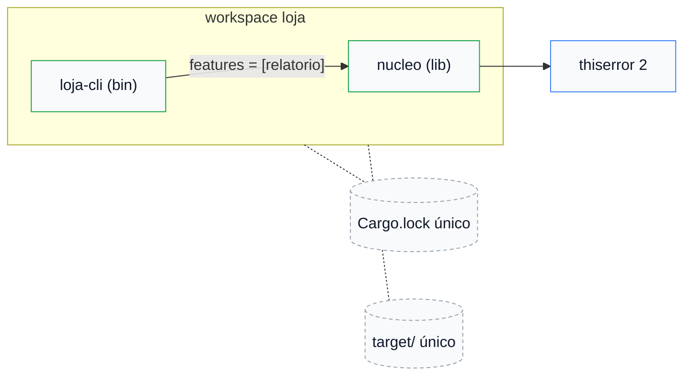

# 07 — Workspaces

**Objetivos.** Ao final, você vai saber:

- montar um *workspace* com manifesto virtual e `resolver = "3"`;
- centralizar metadados, dependências e lints no `Cargo.toml` raiz;
- rodar comandos em todos os membros ou em um só (`-p`);
- o que fica compartilhado (lockfile, `target/`, perfis) e o que cada membro declara.

## Quando usar

Um pacote com `lib.rs` e `main.rs` resolve muita coisa (lição 04). Quando o projeto cresce, você quer várias crates que mudam juntas: uma biblioteca, uma CLI, talvez um servidor. Um *workspace* agrupa esses pacotes com **um** `Cargo.lock` e **um** `target/`: as versões das dependências são as mesmas para todos, e nada é compilado duas vezes.

O Projeto 2 é assim (`csvlite` + `csvq`). Este curso, por outro lado, decidiu **não** ter um workspace na raiz do repositório: cada exemplo é independente, e você entra na pasta e roda.

O exemplo desta lição é o [`codigo/loja`](codigo/loja/):

```text
loja/
├── Cargo.toml            # manifesto virtual: só [workspace]
├── Cargo.lock            # um só, para todos os membros
└── crates/
    ├── nucleo/           # biblioteca: estoque e regras
    │   ├── Cargo.toml
    │   └── src/lib.rs
    └── loja-cli/         # binário: usa o nucleo
        ├── Cargo.toml
        └── src/main.rs
```



## O manifesto raiz

Escreva o `Cargo.toml` raiz **antes** de criar os membros:

```toml
[workspace]
resolver = "3"
members = ["crates/*"]
```

- **Manifesto virtual**: só tem `[workspace]`, sem `[package]`. É o formato recomendado. (A alternativa é um pacote raiz, com `[workspace]` e `[package]` no mesmo arquivo.)
- **`members`** aceita globs. O Cargo Book recomenda uma pasta plana `crates/`.
- **`resolver = "3"`** é obrigatório na prática. Num pacote, a edition 2024 já implica o resolver 3 (lição 08), mas um manifesto virtual não tem edition, e sem a linha o Cargo cai no antigo e avisa em todo comando:

```text
warning: virtual workspace defaulting to `resolver = "1"` despite one or more workspace members being on edition 2024 which implies `resolver = "3"`
  |
  = note: to keep the current resolver, specify `workspace.resolver = "1"` in the workspace root's manifest
  = note: to use the edition 2024 resolver, specify `workspace.resolver = "3"` in the workspace root's manifest
...
```

Com a raiz pronta, crie os membros de dentro dela:

```bash
cargo new --lib crates/nucleo
cargo new crates/loja-cli
```

Com glob, os membros novos já estão incluídos. Com uma lista explícita, o `cargo new` acrescenta o membro sozinho:

```text
    Creating binary (application) `loja-cli` package
      Adding `loja-cli` as member of workspace at `…/lista`
```

O contrário é uma armadilha: um membro listado que ainda não existe quebra **todos** os comandos do workspace:

```text
failed to load manifest for workspace member `…/lista/loja-cli`
referenced by workspace at `…/lista/Cargo.toml`

Caused by:
  failed to read `…/lista/loja-cli/Cargo.toml`

Caused by:
  No such file or directory (os error 2)
```

## Herdando do workspace

O manifesto raiz da `loja` centraliza três coisas:

```toml
# Metadados herdados pelos membros com `campo.workspace = true`.
[workspace.package]
version = "0.1.0"
edition = "2024"
rust-version = "1.96"
license = "MIT OR Apache-2.0"

# Versões decididas num lugar só. Cada membro ainda declara o que usa.
[workspace.dependencies]
nucleo = { path = "crates/nucleo" }
thiserror = "2"

# Lints herdados pelos membros com `[lints] workspace = true`.
[workspace.lints.rust]
unsafe_code = "forbid"
missing_docs = "warn"

[workspace.lints.clippy]
dbg_macro = "warn"
```

E cada membro herda o que quer:

```toml
# crates/nucleo/Cargo.toml
[package]
name = "nucleo"
version.workspace = true
edition.workspace = true
rust-version.workspace = true
license.workspace = true

[features]
# Relatório em texto do estoque.
relatorio = []

[dependencies]
thiserror.workspace = true

[lints]
workspace = true
```

```toml
# crates/loja-cli/Cargo.toml
[dependencies]
nucleo = { workspace = true, features = ["relatorio"] }
```

Pontos importantes:

- **Cada membro declara as próprias dependências.** `[workspace.dependencies]` só define versões; não acrescenta nada a ninguém. Usar `thiserror` na CLI sem declarar falha, mesmo que o `nucleo` dependa dela:

  ```text
  error[E0432]: unresolved import `thiserror`
   --> crates/loja-cli/src/main.rs:1:5
    |
  1 | use thiserror::Error;
    |     ^^^^^^^^^ use of unresolved module or unlinked crate `thiserror`
  ```

  Não há download duplicado: a versão é a mesma no lockfile.
- **Features somam.** As `features` do membro se juntam às da linha do workspace. Uma dependência do workspace não pode ser `optional`; isso se marca no membro.
- **Lints: tudo ou nada.** Um membro com `[lints] workspace = true` não pode acrescentar `[lints.clippy]` próprios:

  ```text
  Caused by:
    cannot override `workspace.lints` in `lints`, either remove the overrides or `lints.workspace = true` and manually specify the lints
  ```

  Ou herda tudo, ou escreve a lista inteira no membro.
- **Lints herdados valem para todos os alvos**, inclusive o binário. Com `missing_docs`, a CLI também precisa de um `//!` no topo do `main.rs`, ou aparece `warning: missing documentation for the crate`.

## Comandos

Na raiz de um workspace virtual, os comandos agem em todos os membros:

```bash
cargo build              # todos
cargo test               # todos
cargo test -p nucleo     # só um
cargo run -p loja-cli    # o binário de um membro
cargo clippy --workspace --all-targets
```

```text
$ cargo run -p loja-cli
     Running `target/debug/loja-cli`
vendido: 3 x café
erro: estoque insuficiente de pão: pedido 5, disponível 4
erro: produto desconhecido: leite
café: 7
pão: 4
```

O executável está no `target/` da raiz, não dentro de `crates/loja-cli`.

### A unificação depende do que você seleciona

A feature `relatorio` do `nucleo` só é ligada pela CLI. O resolver unifica as features **dos pacotes selecionados no comando**. Por isso o mesmo teste aparece ou não:

```text
$ cargo test -p nucleo
test tests::vende_e_baixa_o_estoque ... ok
test tests::recusa_venda_sem_estoque ... ok

$ cargo test
test tests::vende_e_baixa_o_estoque ... ok
test tests::recusa_venda_sem_estoque ... ok
test tests::relatorio_em_ordem_alfabetica ... ok
```

Com `-p nucleo`, a CLI não entra no build e ninguém liga `relatorio`. O `cargo tree -e features -i nucleo` mostra quem liga o quê:

```text
nucleo v0.1.0 (…/crates/nucleo)
├── nucleo feature "default" (command-line)
│   └── loja-cli v0.1.0 (…/crates/loja-cli)
│       └── loja-cli feature "default" (command-line)
└── nucleo feature "relatorio"
    └── loja-cli v0.1.0 (…/crates/loja-cli) (*)
```

## Só na raiz: perfis e `[patch]`

`[profile.*]` (otimização, Módulo 18) e `[patch]` só valem no `Cargo.toml` raiz. Num membro, são ignorados com aviso:

```text
warning: profiles for the non root package will be ignored, specify profiles at the workspace root:
package:   …/crates/loja-cli/Cargo.toml
workspace: …/Cargo.toml
```

## Comparação

| | C++ | Python | Rust |
|---|---|---|---|
| vários projetos juntos | `add_subdirectory` no CMake | uv workspaces, ferramentas de terceiros | workspace nativo do Cargo |
| versões das dependências | por projeto, ou um gerenciador central | um ambiente por projeto | um `Cargo.lock` para todos |
| saída de build | depende do gerador | — | um `target/` para todos |

## Armadilhas comuns

- **Manifesto virtual sem `resolver = "3"`**: o aviso em todo comando, e o resolver antigo.
- **Membro listado antes de existir**: todos os comandos falham.
- **Achar que `[workspace.dependencies]` vale para todos**: cada membro declara (E0432).
- **Herdar lints e acrescentar no membro**: erro de manifesto.
- **`[profile.release]` num membro**: ignorado.
- **Estranhar que `cargo test -p x` não roda um teste de feature**: a unificação só considera os pacotes selecionados.

## Resumo

- Workspace: vários pacotes, um `Cargo.lock` e um `target/`. Manifesto virtual com `resolver = "3"` e `members = ["crates/*"]`.
- `[workspace.package]`, `[workspace.dependencies]` e `[workspace.lints]` centralizam; os membros herdam com `.workspace = true`.
- Cada membro declara as dependências que usa; as features do membro somam às do workspace.
- Na raiz, os comandos valem para todos; `-p nome` escolhe um.
- Perfis e `[patch]` só na raiz.

## Exercícios

Veja os exercícios 4 e 5 em [`exercicios.md`](exercicios.md).

## Leitura complementar

- [The Rust Programming Language, 14.3 Cargo Workspaces](https://doc.rust-lang.org/stable/book/ch14-03-cargo-workspaces.html)
- [The Cargo Book: Workspaces](https://doc.rust-lang.org/cargo/reference/workspaces.html)
- [The Cargo Book: a seção `[lints]`](https://doc.rust-lang.org/cargo/reference/manifest.html#the-lints-section)

---

[← Lição anterior](06-features.md) · [Índice do módulo](README.md) · [Próxima lição →](08-rust-version-e-resolver-3.md)
