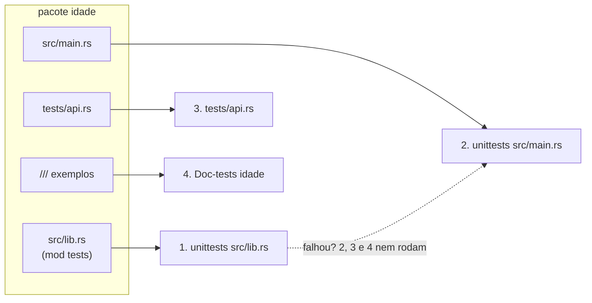

# 01 — Anatomia do `cargo test`

**Objetivos.** Ao final, você vai saber:

- o que o `cargo test` compila e em que ordem roda;
- filtrar, listar, ignorar e rodar testes em série;
- ver a saída que os testes imprimem;
- onde os doctests entram nessa história.

O [Módulo 01](../01-tour-da-sintaxe/10-kit-testes.md) mostrou o básico: `#[test]`, `assert_eq!`, `cargo test` e `cargo test nome`. Agora vamos olhar o que acontece por baixo, porque é isso que explica os blocos da saída, a ordem e algumas surpresas.

## Um executável de teste por *crate*

O projeto [`codigo/idade`](codigo/idade/) tem uma biblioteca (`src/lib.rs`, com testes unitários e um exemplo na documentação), um binário (`src/main.rs`) e um teste de integração (`tests/api.rs`). Um `cargo test` nele mostra quatro blocos:

```text
     Running unittests src/lib.rs (target/debug/deps/idade-ee6660764323c997)

running 12 tests
test tests::idade_acima_do_limite ... ok
test tests::idade_valida ... ok
...
test tests::todas_as_idades_validas ... ignored, lento: roda só com --ignored
test tests::porcentagem_de_zero_panica - should panic ... ok
test tests::idades_lidas_de_arquivo ... ok

test result: ok. 11 passed; 0 failed; 1 ignored; 0 measured; 0 filtered out; finished in 0.00s

     Running unittests src/main.rs (target/debug/deps/idade-08889def0bd299eb)

running 0 tests
...
     Running tests/api.rs (target/debug/deps/api-ede0989d0c5c287c)

running 1 test
test api_publica_funciona ... ok
...
   Doc-tests idade

running 1 test
test src/lib.rs - idade (line 27) ... ok

test result: ok. 1 passed; 0 failed; 0 ignored; 0 measured; 0 filtered out; finished in 0.01s

all doctests ran in 0.50s; merged doctests compilation took 0.17s
```

Cada bloco é um **programa separado**. O Cargo compila a biblioteca com `--test` (os `#[cfg(test)]` passam a existir), faz o mesmo com cada binário, compila cada arquivo de `tests/` como uma crate própria, e por fim pede ao `rustdoc` que transforme os exemplos da documentação em programas (os *doctests*, que o [Módulo 08](../08-modulos-e-crates/README.md) ensina a escrever).



Dois detalhes importantes:

- **A ordem é fixa e o Cargo para no primeiro bloco que falha.** Com quatro testes quebrados na biblioteca, a saída termina assim:

  ```text
       Running unittests src/lib.rs (target/debug/deps/idade-ee6660764323c997)
  test result: FAILED. 12 passed; 4 failed; 1 ignored; 0 measured; 0 filtered out; finished in 0.00s
  error: test failed, to rerun pass `--lib`
  ```

  O binário, o `tests/api.rs` e os doctests nem rodaram. Para rodar todos mesmo assim, use `cargo test --no-fail-fast`, que no fim lista quem falhou:

  ```text
  error: 1 target failed:
      `--lib`
  ```

- **Dentro de um bloco, os testes rodam em paralelo**, uma thread por teste (por isso a ordem muda a cada execução), e o *harness* (o `libtest`, a biblioteca que fornece o `main` dos testes) **captura** o que eles imprimem.

## Argumentos do Cargo e argumentos do executável

O `cargo test` aceita dois tipos de argumento, separados por `--`. Os de antes são do Cargo (o que compilar). Os de depois vão para cada executável de teste (o que rodar):

| Objetivo | Comando |
|---|---|
| filtrar por pedaço do nome | `cargo test idade` |
| nome exato | `cargo test -- --exact tests::idade_valida` |
| filtrar e excluir | `cargo test idade -- --skip acima` |
| só a biblioteca / só um arquivo de `tests/` / só doctests | `cargo test --lib` / `--test api` / `--doc` |
| um membro do workspace | `cargo test -p nome` |
| listar sem rodar | `cargo test -- --list` |
| em série (uma thread) | `cargo test -- --test-threads=1` |
| ver a saída dos que passam | `cargo test -- --show-output` ou `--nocapture` |
| só os ignorados / todos | `cargo test -- --ignored` / `--include-ignored` |
| não parar no primeiro bloco que falha | `cargo test --no-fail-fast` |

O filtro é um pedaço do **caminho completo** (`tests::idade_valida`), e vale para todos os blocos. Repare no `filtered out` de cada um:

```text
$ cargo test idade -- --skip acima
running 3 tests
test tests::todas_as_idades_validas ... ignored, lento: roda só com --ignored
test tests::idade_valida ... ok
test tests::idades_lidas_de_arquivo ... ok
test result: ok. 2 passed; 0 failed; 1 ignored; 0 measured; 9 filtered out; finished in 0.00s
...
running 0 tests
test result: ok. 0 passed; 0 failed; 0 ignored; 0 measured; 1 filtered out; finished in 0.00s
```

Só o **primeiro** filtro posicional vale. Para dois testes de nomes sem nada em comum, rode dois comandos (ou use um prefixo comum, que é uma boa razão para agrupar testes em módulos).

O `--list` é útil para conferir se um teste existe mesmo (e se o `#[test]` não ficou esquecido):

```text
$ cargo test -- --list
     Running unittests src/lib.rs (target/debug/deps/idade-ee6660764323c997)
tests::idade_acima_do_limite: test
tests::idade_valida: test
...
12 tests, 0 benchmarks
     Running unittests src/main.rs (target/debug/deps/idade-08889def0bd299eb)
0 tests, 0 benchmarks
     Running tests/api.rs (target/debug/deps/api-ede0989d0c5c287c)
api_publica_funciona: test

1 test, 0 benchmarks
   Doc-tests idade
src/lib.rs - idade (line 27): test
```

## Testes ignorados

Um teste lento ou que depende de algo externo (rede, banco) pode ficar fora da execução normal com `#[ignore]`. Dê o motivo, que aparece na saída:

```rust
#[test]
#[ignore = "lento: roda só com --ignored"]
fn todas_as_idades_validas() {
    for n in 0..=IDADE_MAXIMA {
        assert_eq!(idade(&n.to_string()).unwrap(), n);
    }
}
```

`cargo test -- --ignored` roda **só** os ignorados; `--include-ignored` roda tudo. Atenção: o `#[ignore]` é decidido na compilação. Não é um *skip* condicional como o `pytest.skip()` chamado dentro do teste, nem o `GTEST_SKIP()` do GoogleTest.

## A saída dos testes

Um teste que passa não mostra nada do que imprimiu. Isso mantém a saída limpa, mas confunde quem coloca um `println!` para investigar. Com um teste que imprime `calculando...`:

```text
$ cargo test --lib saida -- --show-output
running 1 test
test saida::imprime ... ok

successes:

---- saida::imprime stdout ----
calculando...


successes:
    saida::imprime
```

```text
$ cargo test --lib saida -- --nocapture
running 1 test
calculando...
test saida::imprime ... ok
```

`--show-output` junta a saída no fim, separada por teste. `--nocapture` imprime na hora, e com vários testes em paralelo as linhas se misturam (junte com `--test-threads=1` se precisar). Quando um teste **falha**, a saída dele sempre aparece.

## E os doctests?

Eles são o quarto bloco e só existem para a **biblioteca**: exemplos em `src/main.rs` nunca rodam. Na edition 2024, os doctests compatíveis são compilados juntos num único programa (daí a linha `merged doctests compilation took ...`). Para rodar só eles: `cargo test --doc`.

Um detalhe que pega quem copia exemplos antigos: o atributo `compile_fail` aceita um código de erro, mas, na stable, **o código não é conferido**. Este doctest passa, embora o erro real seja de tipo (E0308) e não de *move* (E0382):

````rust
/// ```compile_fail,E0382
/// let s = String::from("oi");
/// let n: u32 = s; // erro de tipo (E0308), não de move
/// ```
pub fn consome(s: String) -> usize {
    s.len()
}
````

```text
test src/lib.rs - consome (line 3) - compile fail ... ok
```

Ou seja: `compile_fail` só garante que o código **não compila**, por qualquer motivo. Mantenha o exemplo curto, para não falhar pelo motivo errado.

## Comparação

| | Python (pytest) | C++ (GoogleTest/Catch2) | Rust |
|---|---|---|---|
| framework | `pytest`, externo | biblioteca externa, ligada pelo CMake | `libtest`, embutido no compilador |
| descoberta | nome `test_*` | macro `TEST(...)` registra | atributo `#[test]` |
| filtrar | `pytest -k nome` | `--gtest_filter=` | `cargo test nome` |
| paralelo | plugin (`pytest-xdist`) | `ctest -j` (por executável) | padrão, uma thread por teste |
| ver `print` | `-s` | sempre aparece | `--nocapture` / `--show-output` |
| pular | `@pytest.mark.skip` | `DISABLED_`, `GTEST_SKIP()` | `#[ignore = "motivo"]` |

## Armadilhas comuns

- **"0 tests" e tudo verde.** Um filtro com erro de digitação roda zero testes e passa. Sempre olhe o `N filtered out` e o `running N tests`.
- **Testes que só falham às vezes.** Quase sempre é estado compartilhado entre testes em paralelo (o mesmo arquivo, a mesma variável de ambiente). A lição 02 trata disso. `--test-threads=1` ajuda a confirmar o diagnóstico, mas não é a correção.
- **Achar que o binário foi testado.** Um erro nos testes da biblioteca impede os blocos seguintes de rodar. Corrija o primeiro bloco ou use `--no-fail-fast`.

## Resumo

- `cargo test` gera um executável por crate de teste: biblioteca, cada binário, cada arquivo de `tests/`, e os doctests da biblioteca.
- Os blocos rodam em ordem, e o Cargo para no primeiro que falha (`--no-fail-fast` muda isso).
- Dentro de um bloco, os testes rodam em paralelo e a saída dos que passam é capturada.
- Argumentos antes de `--` são do Cargo; depois, do executável de teste (`--exact`, `--skip`, `--list`, `--ignored`, `--show-output`).
- `compile_fail` não confere o código de erro na stable.

## Exercícios

Esta lição não tem exercício próprio: os comandos aparecem em todos os exercícios de [`exercicios.md`](exercicios.md).

## Leitura complementar

- [The Rust Programming Language, 11.2 Controlling How Tests Are Run](https://doc.rust-lang.org/stable/book/ch11-02-running-tests.html)
- [The Cargo Book: `cargo test`](https://doc.rust-lang.org/cargo/commands/cargo-test.html)
- [The rustc book: Tests](https://doc.rust-lang.org/rustc/tests/index.html) (todas as opções do executável de teste)
- [The rustdoc book: Documentation tests](https://doc.rust-lang.org/rustdoc/write-documentation/documentation-tests.html)

---

[Índice do módulo](README.md) · [Próxima lição →](02-testes-unitarios-a-fundo.md)
