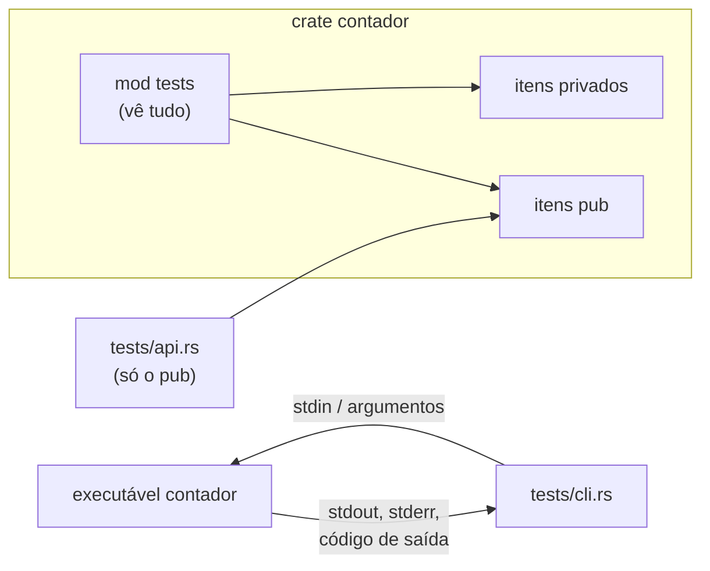

# 04 — Testes de integração

**Objetivos.** Ao final, você vai saber:

- o que é um teste em `tests/` e o que ele enxerga;
- testar o executável de verdade com `CARGO_BIN_EXE_<nome>` e `Command`;
- compartilhar helpers entre arquivos com `tests/common/mod.rs`, e o problema do `dead_code`;
- usar `[dev-dependencies]` como `tempfile`.

Você já usou testes de integração duas vezes: no exercício 2 do [Módulo 05](../05-tratamento-de-erros/exercicios.md) (o `conta-linhas`) e no `tests/cli.rs` do [Projeto 1](../../projetos/01-minigrep/README.md). Agora vamos ver o que está acontecendo ali. O exemplo desta lição é [`codigo/contador`](codigo/contador/), um `wc` simplificado: uma biblioteca que conta linhas, palavras e bytes, e um binário que lê um arquivo ou a entrada padrão.

## Cada arquivo de `tests/` é uma crate separada

```text
contador/
├── Cargo.toml
├── src/
│   ├── lib.rs        # a biblioteca, com o seu mod tests
│   └── main.rs       # o binário
└── tests/
    ├── api.rs        # testa a biblioteca pela API pública
    ├── cli.rs        # testa o executável
    └── common/
        └── mod.rs    # helpers compartilhados (não é um teste)
```

O Cargo compila cada arquivo de `tests/` como uma crate própria, que **depende da sua biblioteca** como qualquer usuário externo. Não precisa de `#[cfg(test)]` nem de `mod tests`: o arquivo inteiro só existe no `cargo test`.

```rust
// tests/api.rs
mod common;

use contador::{Contagem, contar, formatar};

#[test]
fn conta_o_poema() {
    assert_eq!(
        contar(common::POEMA),
        Contagem {
            linhas: 2,
            palavras: 8,
            bytes: 46,
        }
    );
}
```

Como é de fora, só enxerga o que é `pub`:

```text
error[E0603]: function `eh_separador` is private
  --> tests/api.rs:26:23
   |
26 |     assert!(contador::eh_separador(' '));
   |                       ^^^^^^^^^^^^ private function
```

E tem mais: a biblioteca que os testes de integração usam é compilada **sem** `cfg(test)`. Nada do `mod tests` dela existe para eles:

```text
error[E0433]: cannot find `tests` in `contador`
  --> tests/api.rs:26:26
   |
26 |     assert_eq!(contador::tests::texto_vazio(), ());
   |                          ^^^^^ could not find `tests` in `contador`
   |
note: found an item that was configured out
  --> src/lib.rs:34:5
```

É o ponto do teste de integração: garantir que a API pública, usada como um usuário usaria, funciona. Os detalhes internos ficam para os testes unitários.



### Crate só binária não tem API

Se o pacote só tem `src/main.rs`, não há biblioteca para importar:

```text
error[E0432]: unresolved import `sobin`
 --> tests/a.rs:1:5
  |
1 | use sobin::main;
  |     ^^^^^ use of unresolved module or unlinked crate `sobin`
```

É mais um argumento para a divisão `lib.rs` + `main.rs` da [lição 09 do Módulo 01](../01-tour-da-sintaxe/09-kit-modulos-lib-e-main.md): a lógica na biblioteca, testável, e o `main` fino.

## Testando o executável: `CARGO_BIN_EXE_<nome>`

O binário também pode ser testado, rodando-o de verdade. Antes de compilar os testes de integração, o Cargo compila os binários do pacote e define, **em tempo de compilação**, uma variável `CARGO_BIN_EXE_<nome-do-binário>` com o caminho do executável. A macro `env!` lê essa variável:

```rust
use std::process::Command;

pub fn contador() -> Command {
    Command::new(env!("CARGO_BIN_EXE_contador"))
}
```

Com o `Command` da std, o teste roda o programa, passa argumentos, escreve na entrada padrão e lê a saída e o código de saída:

```rust
#[test]
fn arquivo_inexistente_sai_com_1() {
    let saida = contador().arg("nao-existe.txt").output().unwrap();
    assert_eq!(saida.status.code(), Some(1));
    assert!(saida.stdout.is_empty());
    let erro = String::from_utf8_lossy(&saida.stderr);
    assert!(
        erro.starts_with("erro: não consegui ler nao-existe.txt"),
        "stderr foi: {erro}"
    );
}
```

`output()` roda o processo até o fim e devolve um `Output` com `status`, `stdout` e `stderr` (os dois em bytes, daí o `from_utf8_lossy`).

### O `tests/cli.rs` do Projeto 1, comentado

O `tests/cli.rs` do minigrep usa todas as peças. O helper mais interessante é o que manda texto pela entrada padrão:

```rust
fn run_with_stdin(args: &[&str], input: &str) -> Output {
    let mut child = minigrep()
        .args(args)
        .stdin(Stdio::piped())   // 1. cria um "cano" para a entrada do filho
        .stdout(Stdio::piped())  //    e para as duas saídas
        .stderr(Stdio::piped())
        .spawn()                 // 2. inicia o processo, sem esperar
        .unwrap();
    child
        .stdin
        .take()                  // 3. tira a ponta de escrita do `child`...
        .unwrap()
        .write_all(input.as_bytes())
        .unwrap();               //    ...e ela é fechada (Drop) ao fim da instrução: o filho vê EOF
    child.wait_with_output().unwrap() // 4. espera terminar e coleta as saídas
}
```

O `take()` não é detalhe: se a ponta de escrita continuasse viva dentro de `child`, o minigrep esperaria mais entrada para sempre. Outros pontos do arquivo:

- `.env("IGNORE_CASE", "1")` define a variável **só para o processo filho**. É o jeito seguro de testar variáveis de ambiente (lição 02).
- `temp_file` monta um nome com `process::id()` e o nome do teste, para os testes paralelos não disputarem o mesmo arquivo. Funciona, mas o arquivo fica para trás se o teste falhar antes do `remove_file`. O `tempfile`, abaixo, resolve isso.
- `closed_pipe_is_not_a_panic` fecha a saída do filho antes de ele escrever (`drop(child.stdout.take())`), simulando o `| head`.

## Helpers compartilhados: `tests/common/mod.rs`

`api.rs` e `cli.rs` usam o mesmo texto de exemplo, e `cli.rs` usa helpers para rodar o executável. Para compartilhar, crie um módulo e declare `mod common;` em cada arquivo de teste.

O lugar do módulo importa. Se você criar `tests/common.rs`, o Cargo acha que é **mais um teste**, e compila e roda um executável vazio:

```text
     Running tests/common.rs (target/debug/deps/common-eb93ad535ba249fa)

running 0 tests

test result: ok. 0 passed; 0 failed; 0 ignored; 0 measured; 0 filtered out; finished in 0.00s
```

Por isso a convenção é `tests/common/mod.rs`: o Cargo só olha os arquivos que estão direto em `tests/`, e não as subpastas. É a exceção do curso ao estilo `nome.rs` + pasta (Módulo 08): aqui o `mod.rs` tem um motivo.

### O aviso de `dead_code`, e por que `allow` (e não `expect`)

Cada arquivo de teste compila o `common` **de novo**, como um módulo seu. `api.rs` usa só o `POEMA`, então, para essa crate, os outros helpers são código morto:

```text
warning: function `contador` is never used
  --> tests/common/mod.rs:14:8
   |
14 | pub fn contador() -> Command {
   |        ^^^^^^^^
   |
   = note: `#[warn(dead_code)]` (part of `#[warn(unused)]`) on by default

warning: function `rodar_com_stdin` is never used
...
warning: `contador` (test "api") generated 3 warnings
```

A tentação é usar o `#[expect(dead_code)]` (lição 05), que silencia o aviso e reclama se ele deixar de aparecer. Só que, em `cli.rs`, os helpers **são** usados, e lá a expectativa não se cumpre:

```text
warning: this lint expectation is unfulfilled
 --> tests/common/mod.rs:7:11
  |
7 | #![expect(dead_code, reason = "nem todo arquivo de teste usa todos os helpers")]
  |           ^^^^^^^^^
  |
  = note: nem todo arquivo de teste usa todos os helpers
  = note: `#[warn(unfulfilled_lint_expectations)]` on by default

warning: `contador` (test "cli") generated 1 warning
```

O mesmo código é compilado em dois contextos, e o lint dispara num e não no outro. É o caso em que o certo é o `allow`, com o motivo:

```rust
// tests/common/mod.rs
#![allow(dead_code, reason = "nem todo arquivo de teste usa todos os helpers")]
```

## `[dev-dependencies]` e o `tempfile`

Dependências usadas só nos testes (e nos exemplos e benchmarks) ficam em `[dev-dependencies]`. Elas não vão para quem usa a sua biblioteca:

```bash
cargo add --dev tempfile
```

```toml
[dev-dependencies]
tempfile = "3.27.0"
```

`tempfile::tempdir()` cria uma pasta com nome aleatório e a apaga, com tudo dentro, quando o valor sai de escopo. É o `ArquivoTemporario` da lição 02, pronto e mais robusto:

```rust
#[test]
fn le_de_um_arquivo() {
    // A pasta (e o arquivo dentro dela) somem quando `pasta` sai de escopo.
    let pasta = tempfile::tempdir().unwrap();
    let caminho = pasta.path().join("poema.txt");
    fs::write(&caminho, POEMA).unwrap();

    let saida = contador().arg(&caminho).output().unwrap();
    assert_eq!(saida.status.code(), Some(0));
    assert_eq!(stdout(&saida), "2 8 46\n");
}
```

Para testes de CLI, as crates `assert_cmd` e `predicates` deixam as asserções mais legíveis (`Command::cargo_bin("contador")?.assert().success().stdout("2 8 46\n")`). O curso fica na std, como no Projeto 1, para você ver as peças.

## Custo: um executável por arquivo

Cada arquivo de `tests/` é compilado e ligado separadamente. Com dezenas de arquivos, isso pesa. Projetos grandes costumam usar um único `tests/integracao/main.rs` com submódulos (`mod api; mod cli;`), o que gera um executável só.

## Comparação

Em Python, a pasta `tests/` do pytest importa o pacote como qualquer outro código, e nada impede de importar um módulo "privado" (`_interno`). Em C++, um teste de integração é outro executável ligado à biblioteca, e o que ele vê depende dos *headers* públicos. Rust fica perto do C++, mas com a regra garantida pelo compilador: o arquivo de `tests/` só vê o `pub`.

## Armadilhas comuns

- **`tests/common.rs`**: vira um executável de teste vazio. Use `tests/common/mod.rs`.
- **`#[expect(dead_code)]` no `common`**: não se cumpre nos arquivos que usam os helpers. Use `allow` com `reason`.
- **`CARGO_BIN_EXE_*` num workspace**: a variável só existe para os testes **do mesmo pacote** do binário. Teste da CLI fica no pacote da CLI.
- **Esquecer o `take()` da stdin**: o filho nunca recebe EOF e o teste trava.

## Resumo

- Cada arquivo de `tests/` é uma crate que usa a sua biblioteca de fora: só o `pub`, e sem `cfg(test)`.
- Crate só binária não tem o que importar; divida em `lib.rs` + `main.rs`.
- `env!("CARGO_BIN_EXE_<nome>")` + `Command` testam o executável de verdade: argumentos, stdin, stdout, stderr e código de saída.
- Helpers compartilhados vão em `tests/common/mod.rs`, com `#![allow(dead_code, reason = "...")]`.
- Dependências de teste vão em `[dev-dependencies]`; `tempfile` cuida de arquivos temporários.

## Exercícios

Veja o exercício 2 em [`exercicios.md`](exercicios.md).

## Leitura complementar

- [The Rust Programming Language, 11.3 Test Organization](https://doc.rust-lang.org/stable/book/ch11-03-test-organization.html)
- [The Cargo Book: variáveis que o Cargo define (`CARGO_BIN_EXE_<name>`)](https://doc.rust-lang.org/cargo/reference/environment-variables.html#environment-variables-cargo-sets-for-crates)
- [Documentação de `std::process::Command`](https://doc.rust-lang.org/std/process/struct.Command.html)
- [Documentação do `tempfile`](https://docs.rs/tempfile/latest/tempfile/)

---

[← Lição anterior](03-assert-matches-e-asserts.md) · [Índice do módulo](README.md) · [Próxima lição →](05-lints-allow-expect-deny.md)
