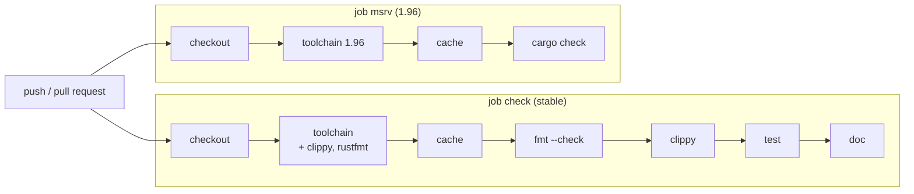

# 07 — CI com GitHub Actions

> Última revisão: 2026-10-15 (versões das actions).

**Objetivos.** Ao final, você vai saber:

- montar um workflow de CI para um projeto Rust: fmt, clippy, testes e documentação;
- o papel de cada peça (`dtolnay/rust-toolchain`, `Swatinem/rust-cache`, `CARGO_BUILD_WARNINGS`, `--locked`);
- verificar a versão mínima (MSRV) num job separado.

*CI* (*continuous integration*, integração contínua) é rodar as verificações do projeto a cada *push* e *pull request*, numa máquina limpa. Os princípios valem para qualquer linguagem: a CI precisa ser **rápida**, **determinística** (o mesmo commit dá o mesmo resultado), **sempre verde** (um vermelho permanente ensina todo mundo a ignorar) e rodar **o mesmo que você roda localmente**.

## O workflow

O arquivo completo está em [`codigo/linha-csv/.github/workflows/ci.yml`](codigo/linha-csv/.github/workflows/ci.yml):

```yaml
name: CI

on:
  push:
    branches: [main]
  pull_request:

env:
  CARGO_TERM_COLOR: always
  CARGO_BUILD_WARNINGS: deny

jobs:
  check:
    name: fmt, clippy, test, doc
    runs-on: ubuntu-latest
    steps:
      - uses: actions/checkout@v7
      - uses: dtolnay/rust-toolchain@stable
        with:
          components: clippy, rustfmt
      - uses: Swatinem/rust-cache@v2
      - run: cargo fmt --all --check
      - run: cargo clippy --all-targets --locked
      - run: cargo test --locked
      - run: cargo doc --no-deps --locked

  msrv:
    name: MSRV (1.96)
    runs-on: ubuntu-latest
    steps:
      - uses: actions/checkout@v7
      - uses: dtolnay/rust-toolchain@1.96
      - uses: Swatinem/rust-cache@v2
      - run: cargo check --all-targets --locked
```

> [!WARNING]
> O GitHub só lê workflows em `.github/workflows/` **na raiz do repositório**. O arquivo dentro do curso não roda: ele está lá para você copiar a pasta `.github/` para a raiz do seu repositório (onde fica o `Cargo.toml` do projeto).



Os dois *jobs* rodam em paralelo, em máquinas separadas. Os passos de cada um rodam em ordem, e o primeiro que falha interrompe o job.

## Peça por peça

**`on`**: quando rodar. Aqui, em todo *push* para `main` e em todo *pull request*.

**`env` no topo**: vale para todos os passos de todos os jobs.

- `CARGO_BUILD_WARNINGS: deny` faz qualquer aviso do `rustc`, do clippy ou do `rustdoc` falhar o passo (lição 06), sem mexer nas flags do compilador e sem invalidar o cache.
- `CARGO_TERM_COLOR: always` deixa a saída colorida no log do GitHub.

**`actions/checkout@v7`**: baixa o código do repositório. O `@v7` é a versão principal da action (recebe correções sem quebrar).

**`dtolnay/rust-toolchain@stable`**: instala o Rust pelo `rustup`. A versão vem do *ref* depois do `@`: `@stable`, `@nightly`, `@1.96`. O `components` acrescenta o clippy e o rustfmt. As máquinas do GitHub já trazem um Rust instalado, mas fixar a toolchain deixa explícito qual versão roda.

**`Swatinem/rust-cache@v2`**: guarda `~/.cargo` (as dependências baixadas) e `target/` entre execuções. Sem cache, cada execução recompila todas as dependências, e um projeto com `criterion` e `proptest` leva minutos.

**Os passos `run`**: os mesmos comandos que você roda na sua máquina.

- `cargo fmt --all --check` vem primeiro porque é o mais rápido e o mais comum de falhar.
- `cargo clippy --all-targets` inclui testes e benchmarks.
- `cargo test` roda testes unitários, de integração e doctests.
- `cargo doc --no-deps` gera a documentação só do seu pacote; com `CARGO_BUILD_WARNINGS`, um link quebrado nela falha a CI.

**`--locked`**: falha se o `Cargo.lock` precisar mudar. Garante que a CI compila exatamente as versões que estão no repositório (por isso o `Cargo.lock` é commitado). Sem ele, a CI pode testar uma versão de dependência que ninguém testou localmente.

## O job de MSRV

O `rust-version = "1.96"` do `Cargo.toml` é uma promessa: "este pacote compila na 1.96". Nada garante isso, a não ser compilar na 1.96. É o que o job `msrv` faz.

Ele roda só `cargo check` (o mais barato) e não roda o clippy, por dois motivos: os lints mudam entre versões, e, como vimos na lição 06, o Cargo 1.96 **ignora** o `CARGO_BUILD_WARNINGS`. O job só responde "compila?". A versão mínima das dependências também conta: `proptest` 1.12 exige a 1.88, e `criterion` 0.8 exige a 1.86. O resolvedor do Cargo já evita escolher versões que exigem um Rust mais novo que o `rust-version` (o *resolver* 3 da edition 2024, Módulo 08).

## O que fica para depois

Este workflow é o mínimo útil. Projetos maiores costumam acrescentar:

- **matriz de sistemas**: `strategy.matrix.os: [ubuntu-latest, macos-latest, windows-latest]`, para código que lida com caminhos, processos ou terminal;
- **combinações de *features***: `cargo hack --feature-powerset check` (a crate `cargo-hack`);
- **cobertura** com `cargo-llvm-cov` (lição 10);
- **auditoria de dependências** com `cargo deny` ou `cargo audit` (Módulo 17);
- **job agendado** (`on: schedule`) que roda com as dependências mais novas, para saber antes que uma atualização quebra o projeto.

Uma alternativa às duas actions de toolchain e cache é a `actions-rust-lang/setup-rust-toolchain@v2`, que faz as duas coisas e já usa `CARGO_BUILD_WARNINGS`. Em muitos projetos você vai ver também `RUSTFLAGS: "-D warnings"` no `env`: é o jeito antigo (lição 06), que invalida o cache.

## Comparação

O workflow em si é o mesmo para qualquer linguagem; o que muda são os passos. Num projeto Python, os passos seriam `ruff format --check`, `ruff check`, `mypy` e `pytest`; num projeto C++, `cmake --build` com `-Werror`, `clang-tidy` e `ctest`, muitas vezes com uma matriz de compiladores. Em Rust, a toolchain traz tudo (`fmt`, `clippy`, `test`, `doc`) e o Cargo dá a mesma interface em todo projeto, então o workflow quase não muda de um projeto para outro.

## Armadilhas comuns

- **Workflow fora da raiz.** `projeto/.github/workflows/ci.yml` num repositório com várias pastas não roda. Só `.github/` na raiz.
- **`Cargo.lock` fora do git com `--locked`.** O passo falha. Commite o lockfile.
- **Clippy sem `--all-targets`.** A CI fica verde com avisos nos testes.
- **Contar com o `CARGO_BUILD_WARNINGS` no job de MSRV.** É ignorado na 1.96.
- **Benchmarks na CI.** Máquinas compartilhadas têm ruído demais para comparar tempos (lição 09). Na CI, no máximo, compile os benchmarks (`cargo clippy --all-targets` já faz isso).

## Resumo

- A CI roda fmt, clippy, test e doc a cada *push* e *pull request*, os mesmos comandos de casa.
- `dtolnay/rust-toolchain@<versão>` instala o Rust; `Swatinem/rust-cache@v2` guarda dependências e `target/`.
- `CARGO_BUILD_WARNINGS: deny` no `env` faz qualquer aviso falhar; `--locked` exige o `Cargo.lock` em dia.
- Um job de MSRV com `cargo check` na versão do `rust-version` cumpre a promessa do `Cargo.toml`.
- O GitHub só lê `.github/workflows/` na raiz do repositório.

## Exercícios

Veja o exercício 4 em [`exercicios.md`](exercicios.md).

## Leitura complementar

- [The Cargo Book: Continuous Integration](https://doc.rust-lang.org/cargo/guide/continuous-integration.html)
- [Clippy: GitHub Actions](https://doc.rust-lang.org/clippy/continuous_integration/github_actions.html)
- [`dtolnay/rust-toolchain`](https://github.com/dtolnay/rust-toolchain) e [`Swatinem/rust-cache`](https://github.com/Swatinem/rust-cache)
- [GitHub Docs: sintaxe de workflows](https://docs.github.com/actions/writing-workflows/workflow-syntax-for-github-actions)
- [Effective Rust, Item 32: Set up a continuous integration (CI) system](https://effective-rust.com/ci.html)

---

[← Lição anterior](06-clippy-e-rustfmt-a-fundo.md) · [Índice do módulo](README.md) · [Próxima lição →](08-property-testing-com-proptest.md)
