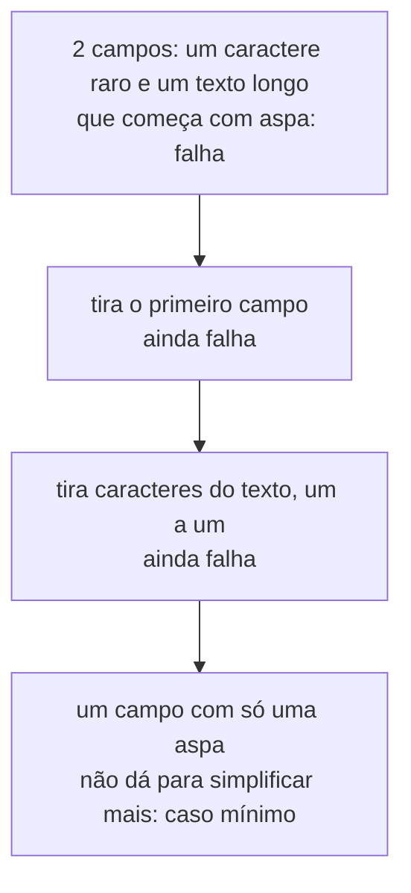

# 08 — Property testing com `proptest`

**Objetivos.** Ao final, você vai saber:

- a diferença entre testar exemplos e testar propriedades;
- escrever uma propriedade com `proptest!` e as estratégias básicas;
- ler um caso mínimo encontrado pelo *shrinking* e guardar a falha;
- reconhecer as propriedades clássicas: ida e volta, invariante, oráculo.

## Exemplos x propriedades

Um teste comum verifica um exemplo que você escolheu: `codificar(&["a", "b,c"])` deve dar `a,"b,c"`. O problema é que você só escolhe os casos em que pensou, e os bugs moram nos casos em que você **não** pensou.

Um teste de propriedade descreve algo que vale para **qualquer** entrada, e deixa uma biblioteca gerar centenas de entradas aleatórias. Para um par codificar/decodificar, a propriedade natural é a **ida e volta**: decodificar o que foi codificado devolve o original.

O exemplo é [`codigo/linha-csv`](codigo/linha-csv/): `codificar(campos) -> String` junta campos numa linha CSV, pondo entre aspas os campos que precisam; `decodificar(linha) -> Result<Vec<String>, ErroLinha>` faz o caminho inverso. (O Projeto 2 faz a versão completa, com várias linhas.)

## A primeira propriedade

O `proptest` é uma *dev-dependency*:

```bash
cargo add --dev proptest
```

```rust
#[cfg(test)]
mod tests {
    use super::*;
    use proptest::prelude::*;

    proptest! {
        /// Ida e volta: decodificar o que foi codificado devolve os mesmos campos.
        #[test]
        fn ida_e_volta(campos in prop::collection::vec("\\PC*", 1..5)) {
            let linha = codificar(&campos);
            prop_assert_eq!(decodificar(&linha), Ok(campos));
        }
    }
}
```

Lendo por partes:

- `proptest! { ... }` é uma macro que transforma cada função dentro dela num `#[test]` que roda **256 vezes** (o padrão), com entradas diferentes.
- `campos in <estratégia>` declara o parâmetro e de onde ele vem. Uma **estratégia** (*strategy*) sabe gerar valores e também simplificá-los.
- `"\\PC*"` é uma expressão regular: uma `String` de qualquer tamanho, com quaisquer caracteres que não sejam de controle (acentos, emojis, aspas, vírgulas...).
- `prop::collection::vec(estrategia, 1..5)` gera um `Vec` de 1 a 4 elementos.
- `prop_assert_eq!` é o `assert_eq!` do proptest: em vez de panicar, devolve a falha para a biblioteca, o que ajuda a simplificar o caso.

## O *shrinking* encontrando um bug real

A primeira versão de `codificar` só punha aspas quando o campo tinha vírgula:

```rust
fn precisa_de_aspas(campo: &str) -> bool {
    campo.contains(',')
}
```

Os testes de exemplo passavam. A propriedade não:

```text
---- tests::ida_e_volta stdout ----
proptest: Saving this and future failures in .../linha-csv/proptest-regressions/lib.txt
proptest: If this test was run on a CI system, you may wish to add the following line to your copy of the file. (You may need to create it.)
cc 27e7c69ed8f5778b78e3f354a56e90c0f129964715da07c360e1593161bf7426

thread 'tests::ida_e_volta' (156377) panicked at src/lib.rs:115:5:
Test failed: assertion failed: `(left == right)`
  left: `Err(AspasAbertas)`,
 right: `Ok(["\""])` at src/lib.rs:124.
minimal failing input: campos = [
    "\"",
]
	successes: 20
	local rejects: 0
	global rejects: 0
```

O caso mínimo é **um campo com uma aspa só**. `codificar` devolve `"` sem proteger, e `decodificar` lê isso como o começo de um campo entre aspas que nunca fecha.

O proptest não encontrou esse caso de primeira. O primeiro caso aleatório que falhou era grande, e ele foi simplificando enquanto o teste continuasse falhando. Com `PROPTEST_VERBOSE=1`, dá para ver os passos. O primeiro caso que falhou foi `["𐆒", "\"ௗ𑂔Ⱥ<~..."]` (dois campos, o segundo com dezenas de caracteres), e daí:



Esse processo se chama *shrinking* (encolhimento). É o que torna o property testing prático: em vez de uma string de dezenas de caracteres em vários alfabetos, você recebe a causa exata.

A correção é proteger também campos com aspas (e quebras de linha):

```rust
fn precisa_de_aspas(campo: &str) -> bool {
    campo.contains([',', '"', '\n', '\r'])
}
```

## O arquivo `proptest-regressions/`

Na falha, o proptest grava a semente do caso em `proptest-regressions/lib.txt` (para testes em `src/lib.rs`):

```text
# Seeds for failure cases proptest has generated in the past. It is
# automatically read and these particular cases re-run before any
# novel cases are generated.
#
# It is recommended to check this file in to source control so that
# everyone who runs the test benefits from these saved cases.
cc 27e7c69ed8f5778b78e3f354a56e90c0f129964715da07c360e1593161bf7426 # shrinks to campos = ["\""]
```

Nas próximas execuções, esses casos rodam **antes** dos aleatórios. Commite o arquivo, como ele mesmo pede: assim o bug não volta sem ninguém perceber. O projeto de exemplo inclui o arquivo dessa falha.

Para testes de integração (`tests/api.rs`), o proptest avisa que não achou o `lib.rs` e grava `tests/api.proptest-regressions`, ao lado do teste. Commite esse também.

O Proptest Book recomenda mais um passo: transformar o caso mínimo num teste de exemplo **com nome**, que documenta o bug:

```rust
/// O caso mínimo que o proptest encontrou na versão com bug.
#[test]
fn campo_que_e_so_uma_aspa() {
    let campos = ["\""];
    assert_eq!(codificar(&campos), r#""""""#);
    assert_eq!(decodificar(&codificar(&campos)).unwrap(), campos);
}
```

## Estratégias

| Estratégia | Gera |
|---|---|
| `0..100u32`, `-1.0..1.0f64` | números numa faixa |
| `any::<T>()` | qualquer valor de `T` (inteiros, `bool`, `char`, `String`, tuplas...) |
| `"[a-z,\"]{0,4}"` | strings que casam com a regex |
| `prop::collection::vec(e, 1..5)` | `Vec` de 1 a 4 elementos gerados por `e` |
| `(e1, e2)` | tuplas |
| `e.prop_map(\|x\| ...)` | transforma o valor gerado (para montar structs) |
| `prop_oneof![e1, e2]` | um ou outro |

Uma regex estreita encontra bugs mais rápido. A segunda propriedade do projeto usa só letras, vírgulas e aspas, onde mora a complicação:

```rust
#[test]
fn mesmo_numero_de_campos(campos in prop::collection::vec("[a-z,\"]{0,4}", 1..6)) {
    let n = decodificar(&codificar(&campos)).map(|c| c.len());
    prop_assert_eq!(n, Ok(campos.len()));
}
```

Para descartar entradas que não interessam, há `prop_assume!(condicao)`. Use pouco: se a maioria for descartada, é melhor uma estratégia que já gere o que você quer.

O número de casos se ajusta por bloco (o projeto usa 100, para manter o `cargo test` rápido):

```rust
proptest! {
    #![proptest_config(ProptestConfig::with_cases(100))]
    // ...
}
```

## Propriedades clássicas

- **Ida e volta**: `decodificar(codificar(x)) == x`, `x.to_string().parse() == Ok(x)`. A mais útil para parsers e serialização.
- **Invariante**: algo que não muda. Ordenar mantém o tamanho e deixa ordenado; codificar e decodificar mantém o número de campos.
- **Oráculo**: comparar com uma implementação simples e lenta, mas obviamente certa (a versão otimizada contra a ingênua).
- **Idempotência**: aplicar duas vezes dá o mesmo que uma: `normalizar(normalizar(x)) == normalizar(x)`.

## Comparação

O `proptest` é inspirado no Hypothesis do Python, e a ideia é a mesma:

```python
from hypothesis import given, strategies as st

@given(st.lists(st.text(), min_size=1, max_size=4))
def test_ida_e_volta(campos):
    assert decodificar(codificar(campos)) == campos
```

Os dois encolhem a falha e guardam os casos encontrados (o Hypothesis numa pasta `.hypothesis/`). Em C++, o equivalente é o RapidCheck, bem menos usado. Uma vantagem do lado Rust: com tipos fortes, as estratégias quase sempre saem do próprio tipo (`any::<u32>()`) e o gerador não produz valores que a função nem aceitaria.

## Armadilhas comuns

- **Propriedade que repete a implementação.** `codificar(x) == minha_codificacao(x)` com o mesmo algoritmo não testa nada. Prefira ida e volta e invariantes.
- **Não commitar `proptest-regressions/`.** A falha some da sua máquina, mas não da do colega.
- **Estratégia larga demais.** Strings de qualquer Unicode raramente acertam o caso difícil (uma aspa sozinha). Combine uma propriedade ampla com uma estreita.
- **Propriedade errada.** Às vezes a falha é do teste, e não do código. Leia o caso mínimo antes de "corrigir" a função.

## Resumo

- Um teste de propriedade descreve o que vale para qualquer entrada; o `proptest` gera os casos (256 por padrão).
- `proptest! { #[test] fn nome(x in estrategia) { prop_assert_eq!(...) } }`.
- Na falha, o *shrinking* reduz a entrada ao caso mínimo, e a semente vai para `proptest-regressions/`, que você commita.
- Transforme cada caso mínimo num teste com nome.
- Propriedades clássicas: ida e volta, invariante, oráculo, idempotência.

## Exercícios

Veja o exercício 5 em [`exercicios.md`](exercicios.md).

## Leitura complementar

- [Proptest Book: Getting started](https://proptest-rs.github.io/proptest/proptest/getting-started.html)
- [Documentação do `proptest`](https://docs.rs/proptest/latest/proptest/)
- [Effective Rust, Item 30: Write more than unit tests](https://effective-rust.com/testing.html)
- [Hypothesis](https://hypothesis.readthedocs.io/), para comparar

---

[← Lição anterior](07-ci-com-github-actions.md) · [Índice do módulo](README.md) · [Próxima lição →](09-benchmarks-com-criterion.md)
