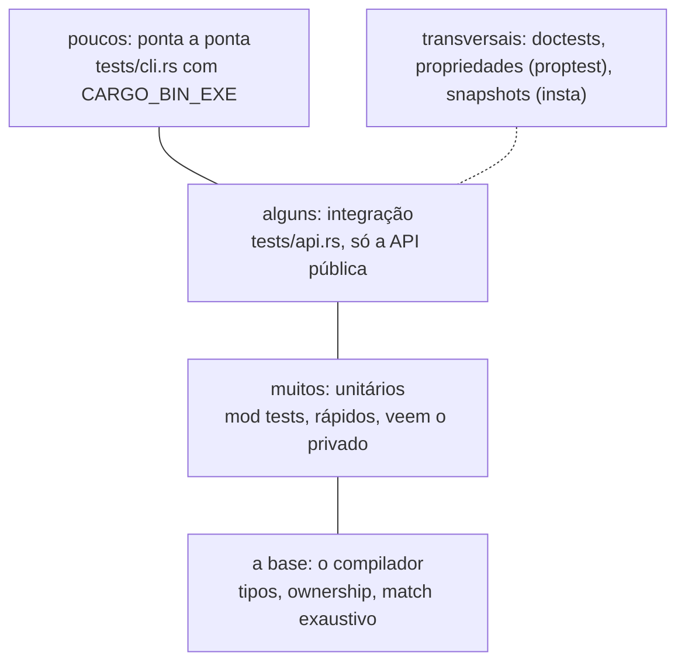

# 10 — Outras ferramentas de teste

> Última revisão: 2026-10-26 (versões das crates).

**Objetivos.** Ao final, você vai saber:

- parametrizar testes e usar *fixtures* com `rstest`;
- testar saídas grandes com snapshots do `insta`;
- substituir dependências nos testes com uma *trait*, sem biblioteca de *mocks*;
- o que fazem `cargo-nextest`, `cargo-llvm-cov` e `cargo-fuzz`, e como montar a pirâmide de testes.

Esta lição é um panorama curto. Os exemplos de `rstest` e `insta` estão em [`codigo/outras-ferramentas`](codigo/outras-ferramentas/); o resto é só apresentação. O Módulo 17 compara as alternativas do ecossistema.

## `rstest`: um teste por caso

Na lição 02 vimos que uma função de teste não recebe argumentos. O `rstest` (0.28) contorna isso com uma macro que gera **um teste por caso**, como o `@pytest.mark.parametrize`:

```rust
use rstest::{fixture, rstest};

#[rstest]
#[case::dez(10.0, 'A')]
#[case::fronteira_do_a(9.0, 'A')]
#[case::quase_a(8.95, 'B')]
#[case::fronteira_do_c(5.0, 'C')]
#[case::reprovado(4.9, 'D')]
fn conceitos(#[case] nota: f64, #[case] esperado: char) {
    assert_eq!(conceito(nota), esperado);
}
```

```text
test tests::conceitos::case_1_dez ... ok
test tests::conceitos::case_4_fronteira_do_c ... ok
test tests::conceitos::case_3_quase_a ... ok
test tests::conceitos::case_2_fronteira_do_a ... ok
test tests::conceitos::case_5_reprovado ... ok
```

Comparado com o laço sobre uma tabela do Módulo 01, cada caso falha **sozinho**, com nome próprio, e os outros continuam rodando. O nome depois de `case::` é opcional (sem ele, o teste se chama só `case_1`).

O `rstest` também tem *fixtures*: uma função marcada com `#[fixture]` é chamada e injetada em todo teste que tiver um parâmetro **com o mesmo nome**:

```rust
#[fixture]
fn turma() -> Vec<(&'static str, f64)> {
    vec![("ana", 9.5), ("bruno", 6.0), ("carla", 4.0)]
}

#[rstest]
fn turma_tem_um_reprovado(turma: Vec<(&'static str, f64)>) {
    let reprovados = turma.iter().filter(|(_, n)| conceito(*n) == 'D').count();
    assert_eq!(reprovados, 1);
}
```

É o `@pytest.fixture`, mas resolvido na compilação. A limpeza continua sendo o `Drop`.

## `insta`: snapshots

Algumas saídas são grandes demais para escrever num `assert_eq!`: um relatório, uma mensagem de erro formatada, um JSON. O `insta` (1.49) guarda o valor esperado, o *snapshot*, e compara nas próximas execuções:

```rust
#[rstest]
fn boletim_da_turma(turma: Vec<(&'static str, f64)>) {
    insta::assert_snapshot!(boletim(&turma), @"
    ana       9.5  A
    bruno     6.0  C
    carla     4.0  D
    ");
}
```

O `@"..."` é um snapshot *inline*, gravado no próprio código. Sem ele (`assert_snapshot!(valor)`), o snapshot fica num arquivo em `src/snapshots/`. Quando a saída muda, a falha mostra um diff:

```text
━━━━━━━━━━━━━━━━━━━━━━━━━━━━━━━ Snapshot Summary ━━━━━━━━━━━━━━━━━━━━━━━━━━━━━━━
Snapshot: boletim_da_turma
Source: src/lib.rs:79
────────────────────────────────────────────────────────────────────────────────
Expression: boletim(&turma)
────────────────────────────────────────────────────────────────────────────────
-old snapshot
+new results
────────────┬───────────────────────────────────────────────────────────────────
    1     1 │ ana       9.5  A
    2       │-bruno     6.0  C
          2 │+bruno     6.0  D
    3     3 │ carla     4.0  D
────────────┴───────────────────────────────────────────────────────────────────
To update snapshots run `cargo insta review`
```

O valor novo fica pendente num arquivo ao lado (`src/.lib.rs.pending-snap`), e a ferramenta `cargo-insta` (instalada à parte, com `cargo install cargo-insta`) mostra cada mudança para você aceitar ou recusar. Na CI (quando a variável `CI` está definida), o `insta` não grava nada: só falha. Em Python, o paralelo é o `syrupy`; em C++, o ApprovalTests.

Snapshot é ótimo para "a saída não mudou sem querer". Não serve para "a saída está certa": revise o primeiro snapshot com atenção.

## *Mocks*: uma trait e duas implementações

Em Python, `unittest.mock.patch` troca uma função por outra em tempo de execução. Em Rust não dá. A resposta é o desenho: a função recebe a dependência por uma *trait* ([Módulo 06](../06-traits-e-generics/README.md)), e o teste passa uma implementação falsa:

```rust
pub trait Relogio {
    /// Segundos desde 1970-01-01 (*Unix time*).
    fn agora(&self) -> u64;
}

pub fn venceu(prazo: u64, relogio: &impl Relogio) -> bool {
    relogio.agora() > prazo
}

// nos testes:
struct RelogioParado(u64);

impl Relogio for RelogioParado {
    fn agora(&self) -> u64 {
        self.0
    }
}

#[test]
fn prazo_vencido() {
    assert!(venceu(100, &RelogioParado(101)));
    assert!(!venceu(100, &RelogioParado(100)));
}
```

Em produção, `RelogioDoSistema` implementa a mesma trait com `SystemTime::now()`. O teste controla o tempo sem truque nenhum, e o código ficou mais honesto sobre o que depende do mundo de fora. O Projeto 3 usa a mesma ideia para o armazenamento das tarefas. Para interfaces grandes, a crate `mockall` gera a implementação falsa com `#[automock]`, como o gMock do C++.

## Ferramentas do Cargo

Três subcomandos instalados à parte (`cargo install ...`), só para você saber que existem:

- **`cargo-nextest`**: um executor de testes alternativo. Roda cada teste num processo próprio, mostra uma saída mais clara, repete testes intermitentes (*retries*) e costuma ser mais rápido em projetos grandes. Não roda doctests (use `cargo test --doc` junto).
- **`cargo-llvm-cov`**: cobertura de código (quais linhas os testes executaram), com relatório em HTML ou no formato do Codecov. O paralelo do `coverage.py` e do gcov/lcov. Lembre que cobertura alta não prova nada sobre as asserções: um teste sem `assert` "cobre" o código.
- **`cargo-fuzz`**: *fuzzing* com o libFuzzer (precisa da nightly). Gera entradas aleatórias guiadas por cobertura, à procura de *panics*. Vale para código que lê entrada não confiável, como um parser de CSV.

Do lado de C++, os *sanitizers* (ASan, UBSan, TSan) são a ferramenta que todo projeto sério roda na CI, porque o compilador não garante a memória. Em Rust seguro, o compilador já impede a maioria desses erros; para código `unsafe`, o equivalente é o Miri (Módulo 15).

## A pirâmide de testes



A forma é a de sempre: muitos testes unitários (rápidos e precisos), alguns de integração, poucos de ponta a ponta (lentos, mas são os que garantem que o programa funciona de verdade). Doctests e propriedades atravessam as camadas.

E há uma camada que Python não tem: o compilador. Muita coisa que em Python precisaria de teste (o tipo do argumento, o `None` esquecido, o caso que o `match` não cobre) nem compila em Rust. Os testes podem se concentrar na lógica.

## Comparação

| Python | C++ | Rust |
|---|---|---|
| `@pytest.mark.parametrize` | `TEST_P` + `INSTANTIATE_TEST_SUITE_P` | laço sobre tabela, ou `rstest` `#[case]` |
| `@pytest.fixture` | `SetUp`/`TearDown` | função + `Drop`, ou `rstest` `#[fixture]` |
| `syrupy` | ApprovalTests | `insta` |
| `unittest.mock` | gMock | trait + implementação de teste, ou `mockall` |
| `pytest-xdist` | `ctest -j` | paralelo por padrão; `cargo-nextest` |
| `coverage.py` | gcov/lcov | `cargo-llvm-cov` |
| `atheris` | libFuzzer | `cargo-fuzz` |

## Resumo

- `rstest`: `#[case]` gera um teste por caso; `#[fixture]` injeta valores pelo nome do parâmetro.
- `insta`: snapshots inline ou em arquivo, revisados com `cargo insta review`.
- *Mock* em Rust é desenho: a dependência entra por uma trait, e o teste passa uma implementação falsa.
- `cargo-nextest` (executor), `cargo-llvm-cov` (cobertura) e `cargo-fuzz` (fuzzing) completam a caixa de ferramentas.
- Muitos testes unitários, alguns de integração, poucos de ponta a ponta, sobre a base do compilador.

## Exercícios

Esta lição não tem exercício próprio. Para praticar, reescreva com `rstest` os testes de tabela do exercício 1.

## Leitura complementar

- [Documentação do `rstest`](https://docs.rs/rstest/latest/rstest/)
- [Documentação do `insta`](https://insta.rs/docs/)
- [`cargo-nextest`](https://nexte.st/), [`cargo-llvm-cov`](https://github.com/taiki-e/cargo-llvm-cov), [Rust Fuzz Book](https://rust-fuzz.github.io/book/)
- [Comprehensive Rust: Testing](https://google.github.io/comprehensive-rust/testing.html)
- [Effective Rust, Item 30: Write more than unit tests](https://effective-rust.com/testing.html)

---

[← Lição anterior](09-benchmarks-com-criterion.md) · [Índice do módulo](README.md)
