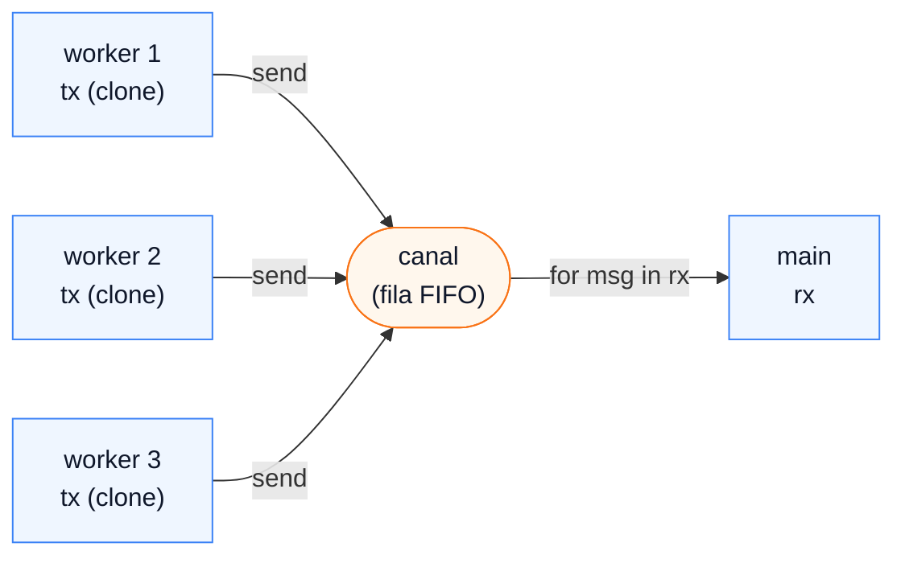
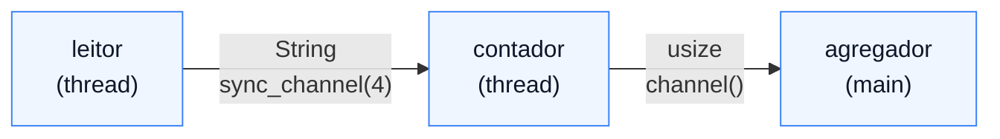

# 03 — Canais: passagem de mensagens com `mpsc`

**Objetivos.** Ao final, você vai saber:

- mandar valores de uma thread para outra com `mpsc::channel`, e o que acontece com a posse deles;
- juntar vários produtores num consumidor, e saber quando o laço de recebimento termina;
- limitar a fila com `sync_channel` e esperar com prazo com `recv_timeout`;
- montar um *pipeline* de estágios ligados por canais.

## A ideia: não compartilhe, mande

Um jeito de evitar dados compartilhados é não tê-los: cada thread é dona dos seus dados e, quando outra precisa de algo, recebe uma mensagem. O Rust Book cita o lema da documentação de Go: *"Do not communicate by sharing memory; instead, share memory by communicating."*

Um canal tem duas pontas: o `Sender` (transmissor) e o `Receiver` (receptor). O da std está em `std::sync::mpsc`, sigla de *multiple producer, single consumer*: vários transmissores, um receptor.

```rust
use std::sync::mpsc;
use std::thread;

fn main() {
    let (tx, rx) = mpsc::channel();
    thread::spawn(move || {
        tx.send(String::from("oi do worker")).unwrap();
    });
    let msg = rx.recv().unwrap();
    println!("{msg}");
}
```

`send` devolve `Err` se o receptor já foi descartado (não há quem leia). `recv` bloqueia até chegar uma mensagem, e devolve `Err` quando o canal está vazio **e** todos os transmissores foram descartados: nunca mais vai chegar nada. O tipo da mensagem (`String`, aqui) é deduzido do primeiro `send`.

## `send` move a posse

Depois de `tx.send(valor)`, `valor` é do canal, e depois de quem recebe. A thread que enviou não pode mais usá-lo:

```rust
// ❌ NÃO COMPILA
let s = String::from("relatório");
tx.send(s).unwrap();
println!("{s}");
```

```text
error[E0382]: borrow of moved value: `s`
 --> src/main.rs:7:16
  |
5 |     let s = String::from("relatório");
  |         - move occurs because `s` has type `String`, which does not implement the `Copy` trait
6 |     tx.send(s).unwrap();
  |             - value moved here
7 |     println!("{s}");
  |                ^ value borrowed here after move
```

É o mesmo *move* de sempre, e é ele que torna o canal seguro: a mensagem nunca é acessível por duas threads ao mesmo tempo. Em C++ ou Python, nada impede que você mande um ponteiro ou um objeto para uma fila e continue mexendo nele.

As mensagens precisam ser `Send`. Mandar um `Rc` pelo canal dá o erro da lição 02, com uma nota a mais: `required for std::sync::mpsc::Sender<Rc<String>> to implement Send`. O `Sender` herda o `Send` do tipo da mensagem.

## Vários produtores

`Sender` implementa `Clone`. Cada thread recebe o seu clone, e o receptor pode ser usado como iterador:

```rust
let (tx, rx) = mpsc::channel();
for id in 1..=3 {
    let tx = tx.clone();
    thread::spawn(move || {
        for i in 1..=2 {
            tx.send(format!("worker {id}: msg {i}")).unwrap();
        }
    });
}
drop(tx);
for msg in rx {
    println!("{msg}");
}
println!("todos os produtores terminaram");
```

Duas execuções:

```text
worker 3: msg 1                   worker 2: msg 1
worker 3: msg 2                   worker 1: msg 1
worker 2: msg 1                   worker 3: msg 1
worker 2: msg 2                   worker 2: msg 2
worker 1: msg 1                   worker 1: msg 2
worker 1: msg 2                   worker 3: msg 2
todos os produtores terminaram    todos os produtores terminaram
```

A ordem entre threads varia. O que o canal garante é a ordem **de cada transmissor**: o `msg 1` de um worker sempre chega antes do `msg 2` dele (o canal é FIFO).



### O `drop(tx)` não é enfeite

O `for msg in rx` só termina quando **todos** os `Sender` foram descartados. Os clones morrem com as threads, mas o `tx` original continua vivo em `main`. Sem o `drop(tx)`:

```rust
// ⚠️ TRAVA: o for nunca termina
let (tx, rx) = mpsc::channel();
for id in 1..=2 {
    let tx = tx.clone();
    thread::spawn(move || tx.send(id).unwrap());
}
for msg in rx {
    println!("{msg}");
}
println!("fim");
```

```text
2
1
```

E o programa fica parado ali, sem imprimir `fim`. Não é erro de compilação nem *panic*: o receptor está esperando uma mensagem de um transmissor que ainda existe, o do próprio `main`. Se o seu laço de recebimento não termina, procure o `Sender` esquecido.

## Fila limitada: `sync_channel`

`mpsc::channel()` tem fila ilimitada: se o produtor for mais rápido que o consumidor, a fila cresce até acabar a memória. `mpsc::sync_channel(n)` cria uma fila com capacidade `n`, e `send` **bloqueia** quando ela está cheia. Isso é *backpressure* (contrapressão): o produtor rápido é freado pelo consumidor lento.

```rust
let (tx, rx) = mpsc::sync_channel::<String>(4);
```

Com `sync_channel(0)`, o canal não guarda nada: cada `send` espera até um `recv` pegar a mensagem (um "encontro" entre as duas threads).

## Esperar com prazo, ou sem esperar

| Método | Comportamento |
|---|---|
| `recv()` | bloqueia até chegar algo, ou `Err` se não há mais transmissores |
| `try_recv()` | não bloqueia: `Err(TryRecvError::Empty)` se não há nada agora |
| `recv_timeout(d)` | bloqueia até `d`; depois, `Err(RecvTimeoutError::Timeout)` |
| `iter()` / `for msg in rx` | `recv()` em laço, até os transmissores acabarem |

```rust
let (tx, rx) = mpsc::channel::<&str>();
let h = thread::spawn(move || {
    thread::sleep(Duration::from_millis(50));
    tx.send("atrasado").unwrap();
});
match rx.recv_timeout(Duration::from_millis(10)) {
    Ok(m) => println!("chegou: {m}"),
    Err(e) => println!("timeout: {e}"),
}
println!("depois: {:?}", rx.recv());
h.join().unwrap();
```

```text
timeout: timed out waiting on channel
depois: Ok("atrasado")
```

## Um pipeline

Canais encadeados formam um pipeline: cada estágio é uma thread que lê de um canal e escreve no próximo. Os estágios rodam em paralelo, cada um num item diferente.



```rust
fn pipeline(texto: &str) -> (usize, usize) {
    let linhas: Vec<String> = texto.lines().map(String::from).collect();

    let (tx_linhas, rx_linhas) = mpsc::sync_channel::<String>(4);
    let (tx_contagens, rx_contagens) = mpsc::channel::<usize>();

    let leitor = thread::spawn(move || {
        for linha in linhas {
            tx_linhas.send(linha).unwrap();
        }
    });

    let contador = thread::spawn(move || {
        for linha in rx_linhas {
            tx_contagens.send(linha.split_whitespace().count()).unwrap();
        }
    });

    let mut n_linhas = 0;
    let mut n_palavras = 0;
    for c in rx_contagens {
        n_linhas += 1;
        n_palavras += c;
    }
    leitor.join().unwrap();
    contador.join().unwrap();
    (n_linhas, n_palavras)
}
```

```text
pipeline: 3 linhas, 9 palavras
```

Repare como o fim se propaga sozinho: o `leitor` termina e descarta `tx_linhas`; o `for` do `contador` acaba e descarta `tx_contagens`; o `for` do `main` acaba. Não é preciso nenhuma mensagem especial de "fim". Código completo, com testes, em [`codigo/canais`](codigo/canais/src/main.rs).

## Comparando com C++ e Python

O Python tem `queue.Queue`, que é segura para threads e muito parecida com um `sync_channel` (`Queue(maxsize=4)`). As diferenças: qualquer thread pode ler ou escrever na mesma fila, o objeto enviado continua acessível por quem enviou, e o fim da produção precisa ser sinalizado à mão (um `None` como sentinela, por exemplo).

A biblioteca padrão do C++ não tem canal; o usual é uma fila com `std::mutex` e `std::condition_variable`, escrita à mão ou tirada de uma biblioteca. Em Rust, o `mpsc` da std é implementado sobre o código da crate `crossbeam-channel` desde a 1.67.

> [!NOTE]
> O `Receiver` não é `Clone`: só um consumidor. Para vários consumidores, as opções são a crate `crossbeam-channel` (canais *mpmc*), ou o padrão do capítulo 21 do Rust Book: um `Arc<Mutex<Receiver<T>>>` compartilhado pelos workers. A std tem um `std::sync::mpmc`, mas ele ainda é **experimental** (só no nightly).

## Armadilhas comuns

- **O `Sender` esquecido.** O laço `for msg in rx` nunca termina. Faça `drop(tx)` depois de distribuir os clones, ou mova o `tx` original para a última thread.
- **`unwrap` no `send` quando o receptor pode sair antes.** Se o consumidor pode parar cedo (encontrou o que procurava, por exemplo), o `send` dos produtores passa a devolver `Err`. Trate esse `Err` como "pare de produzir", em vez de dar *panic*.
- **Fila ilimitada com produtor rápido.** Se a memória sobe sem parar, troque `channel()` por `sync_channel(n)`.
- **Mandar referências.** Uma mensagem `&str` de um `String` local esbarra no `'static` do `spawn` (lição 01). Mande valores com dono (`String`, `Vec`), ou use `thread::scope`.

## Resumo

- `mpsc::channel()` cria `(Sender, Receiver)`. `send` move a mensagem; `recv` bloqueia.
- Clone o `Sender` para ter vários produtores. A ordem entre threads varia; a de cada produtor é preservada.
- `for msg in rx` termina quando todos os `Sender` são descartados. Esquecer um trava o programa.
- `sync_channel(n)` limita a fila e freia o produtor; `recv_timeout` e `try_recv` evitam esperar para sempre.
- Pipelines: uma thread por estágio, canais entre eles, e o fim se propaga pelo drop dos transmissores.

## Exercícios

Veja o exercício 2 em [`exercicios.md`](exercicios.md).

## Leitura complementar

- [The Rust Programming Language, 16.2 Using Message Passing to Transfer Data Between Threads](https://doc.rust-lang.org/stable/book/ch16-02-message-passing.html)
- [Documentação de `std::sync::mpsc`](https://doc.rust-lang.org/std/sync/mpsc/index.html)
- [Comprehensive Rust: Channels](https://google.github.io/comprehensive-rust/concurrency/channels.html)

---

[← Lição anterior](02-send-e-sync.md) · [Índice do módulo](README.md) · [Próxima lição →](04-mutex-e-rwlock.md)
