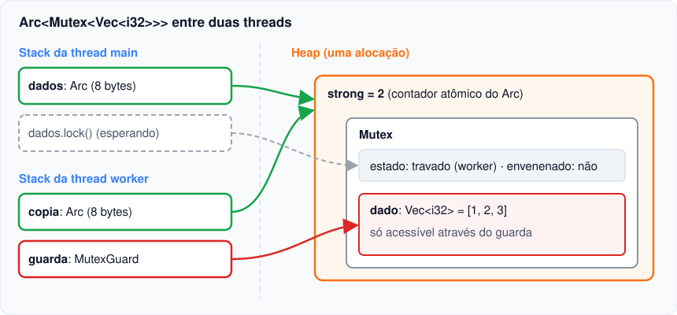

# 04 — `Mutex` e `RwLock`: estado compartilhado e mutável

**Objetivos.** Ao final, você vai saber:

- compartilhar um valor mutável entre threads com `Arc<Mutex<T>>`;
- controlar quanto tempo o *lock* fica preso, pelo guarda;
- entender o *poisoning* (envenenamento) e decidir o que fazer com ele;
- escolher entre `Mutex` e `RwLock`, e evitar os *deadlocks* mais comuns, inclusive o do `match` na edition 2024.

## O `Mutex` do Rust é dono do dado

Um *mutex* (*mutual exclusion*, exclusão mútua) garante que só uma thread por vez acesse um dado. Em C++, o `std::mutex` fica **ao lado** do dado, e a ligação entre os dois é uma convenção:

```cpp
std::mutex m;
int contador = 0;   // "protegido por m", segundo o comentário

void incrementar() {
    std::lock_guard<std::mutex> g(m);
    contador++;
}

void bug() { contador++; }  // compila: nada liga contador a m
```

Em Rust, o `Mutex<T>` **contém** o `T`. A única forma de chegar ao dado é chamar `lock()`, que devolve um `MutexGuard<T>`:

```rust
use std::sync::Mutex;

let m = Mutex::new(5);
{
    let mut g = m.lock().unwrap();
    *g += 1;
} // o guarda sai de escopo aqui, e o lock é solto
println!("{:?}", m.lock().unwrap()); // 6
```

O `MutexGuard` é o mesmo padrão de guarda que você viu no Módulo 10: implementa `Deref`/`DerefMut` para dar acesso ao `T`, e o `Drop` dele destrava. Não existe um `unlock()` para esquecer, e não existe acesso ao dado sem o lock. É o `RefCell` (Módulo 10) com uma diferença: quando o dado está ocupado, o `RefCell` dá *panic*, e o `Mutex` **espera**.

Por que `lock()` devolve `Result`, e por que todo mundo faz `.unwrap()`? Isso é o *poisoning*, mais abaixo.

## `Arc<Mutex<T>>`: vários donos, um dado mutável

Para várias threads, o `Mutex` precisa de vários donos. Tentar mover o mesmo `Mutex` para cada thread esbarra no *move*:

```rust
// ❌ NÃO COMPILA
let contador = Mutex::new(0);
let mut handles = Vec::new();
for _ in 0..4 {
    let h = thread::spawn(move || {
        *contador.lock().unwrap() += 1;
    });
    handles.push(h);
}
```

```text
error[E0382]: use of moved value: `contador`
 --> src/main.rs:8:31
  |
5 |     let contador = Mutex::new(0);
  |         -------- move occurs because `contador` has type `std::sync::Mutex<i32>`, which does not implement the `Copy` trait
6 |     let mut handles = Vec::new();
7 |     for _ in 0..4 {
  |     ------------- inside of this loop
8 |         let h = thread::spawn(move || {
  |                               ^^^^^^^ value moved into closure here, in previous iteration of loop
```

A primeira volta do laço moveu o `Mutex` para a primeira thread. A solução é a tabela da lição 02: `Rc<RefCell<T>>` vira `Arc<Mutex<T>>`.

```rust
use std::sync::{Arc, Mutex};
use std::thread;

fn main() {
    let contador = Arc::new(Mutex::new(0));
    let mut handles = Vec::new();
    for _ in 0..4 {
        let contador = Arc::clone(&contador);
        handles.push(thread::spawn(move || {
            for _ in 0..1000 {
                *contador.lock().unwrap() += 1;
            }
        }));
    }
    for h in handles {
        h.join().unwrap();
    }
    println!("total: {}", *contador.lock().unwrap());
}
```

```text
total: 4000
```

Sempre 4000, ao contrário do contador do C++ da lição 02. O `let contador = Arc::clone(&contador);` dentro do laço é o idioma: cada thread recebe o seu `Arc`, com o mesmo nome, e o original continua em `main`.



Se as threads não precisam viver além da função, `thread::scope` (lição 01) dispensa o `Arc`: todas elas podem emprestar o mesmo `&Mutex<T>`, porque `Mutex<T>` é `Sync`.

## Quanto tempo o lock fica preso

O lock fica preso enquanto o guarda existir. Isso tem três consequências práticas.

**1. Temporários soltam na hora.** Em `*contador.lock().unwrap() += 1;`, o guarda é um temporário e morre no fim da instrução. É o jeito mais curto e seguro.

**2. Guardas com nome soltam no fim do escopo.** Se você fizer um trabalho lento depois de usar o dado, solte antes, com um bloco ou com `drop` (como o Módulo 02 adiantou):

```rust
let mut fila = tarefas.lock().unwrap();
let proxima = fila.pop();
drop(fila);              // solta o lock aqui
if let Some(t) = proxima {
    processar(t);        // trabalho lento, sem segurar ninguém
}
```

Uma boa regra: dentro do lock, só o que mexe no dado. Cálculo, E/S e `println!` ficam fora. No exemplo de [`codigo/estado-compartilhado`](codigo/estado-compartilhado/src/main.rs), cada thread conta as palavras num `HashMap` local e trava o mapa global **uma vez**, só para somar.

**3. `let _ =` não segura nada.** O Módulo 02 mostrou que `let _ = valor;` descarta o valor na hora. Com um lock, isso seria um bug silencioso: o código "protegido" logo abaixo rodaria sem proteção. Hoje o compilador recusa:

```rust
// ❌ NÃO COMPILA
let _ = saldo.lock().unwrap();
```

```text
error: non-binding let on a synchronization lock
  --> src/main.rs:23:9
   |
23 |     let _ = saldo.lock().unwrap();
   |         ^ this lock is not assigned to a binding and is immediately dropped
   |
   = note: `#[deny(let_underscore_lock)]` (part of `#[deny(let_underscore)]`) on by default
help: consider binding to an unused variable to avoid immediately dropping the value
   |
23 |     let _unused = saldo.lock().unwrap();
   |          ++++++
```

O lint `let_underscore_lock` é *deny* por padrão: vira erro. Para segurar o lock, dê um nome (`let _guarda = ...`). Para travar e soltar de propósito, escreva `drop(saldo.lock().unwrap())`.

## *Poisoning*: um pânico com o lock na mão

O que acontece se uma thread entra em *panic* enquanto segura o guarda? O guarda é descartado durante o *unwinding* e solta o lock, mas o dado pode ter ficado pela metade (uma transferência que debitou e não creditou, por exemplo). O `Mutex` registra isso: ele fica **envenenado**, e todo `lock()` seguinte devolve `Err(PoisonError)`.

```rust
let saldo = Arc::new(Mutex::new(100));
let s = Arc::clone(&saldo);
let _ = thread::spawn(move || {
    let mut g = s.lock().unwrap();
    *g -= 30;
    panic!("falhou no meio da transferência");
})
.join();

match saldo.lock() {
    Ok(g) => println!("saldo: {g}"),
    Err(envenenado) => {
        println!("mutex envenenado: {envenenado}");
        println!("valor lá dentro: {}", envenenado.into_inner());
    }
}
```

```text
thread '<unnamed>' (94528) panicked at src/main.rs:125:9:
falhou no meio da transferência
note: run with `RUST_BACKTRACE=1` environment variable to display a backtrace
mutex envenenado: poisoned lock: another task failed inside
valor lá dentro: 70
```

(O `let _ = ....join()` aqui é permitido: descarta um `Result`, não um lock.)

O `PoisonError` não impede o acesso, ele só obriga você a decidir. `into_inner()` devolve o guarda assim mesmo, e `is_poisoned()`/`clear_poison()` consultam e limpam o estado. As escolhas comuns:

- **`.lock().unwrap()`**: se outra thread quebrou com o lock na mão, há um bug, e propagar o pânico é razoável. É o que a maioria do código faz, e o que o Rust Book usa.
- **`.lock().unwrap_or_else(|e| e.into_inner())`**: quando o dado continua válido mesmo depois de um pânico no meio (um cache, um contador de estatísticas).

> [!NOTE]
> Em C++, se uma exceção escapa com um `std::lock_guard` ativo, o mutex é destravado e ninguém fica sabendo que o dado pode estar inconsistente. Em Rust, o próximo a travar fica sabendo. A std tem versões sem envenenamento em `std::sync::nonpoison`, mas elas ainda são experimentais.

## `RwLock`: muitos leitores ou um escritor

`RwLock<T>` é a regra do *borrow checker* em tempo de execução, entre threads: vários `read()` ao mesmo tempo **ou** um `write()` sozinho.

```rust
use std::sync::RwLock;

struct Config {
    dados: RwLock<HashMap<String, String>>,
}

impl Config {
    fn ler(&self, chave: &str) -> Option<String> {
        self.dados.read().unwrap().get(chave).cloned()
    }

    fn gravar(&self, chave: &str, valor: &str) {
        self.dados
            .write()
            .unwrap()
            .insert(chave.to_string(), valor.to_string());
    }
}
```

Vale a pena quando as leituras são muito mais frequentes que as escritas e cada leitura demora um pouco (configuração, cache, tabela de rotas). Para seções curtas, um `Mutex` costuma ser tão rápido quanto, ou mais, porque o `RwLock` tem mais estado para controlar. Na dúvida, comece com `Mutex` e meça.

`RwLock<T>` só é `Sync` se `T` for `Send + Sync` (vários leitores veem o mesmo `&T` ao mesmo tempo). `Mutex<T>` pede só `T: Send`, porque um leitor por vez nunca compartilha o `&T`. É por isso que `Mutex<Cell<T>>` é `Sync` e `RwLock<Cell<T>>` não.

## Deadlocks

Um *deadlock* (impasse) é quando threads esperam umas pelas outras para sempre. Não é *undefined behavior*: o programa simplesmente para. O compilador não detecta, e o `Mutex` da std também não.

### Travar duas vezes na mesma thread

A documentação de `Mutex::lock` diz que travar de novo um mutex que a própria thread já segura "pode dar *panic* ou deadlock", e que a chamada **nunca retorna**. O caso clássico é um guarda temporário que vive mais do que parece:

```rust
// ⚠️ TRAVA (deadlock)
use std::sync::Mutex;

fn main() {
    let fila = Mutex::new(Vec::<i32>::new());
    match fila.lock().unwrap().first() {
        Some(x) => println!("primeiro: {x}"),
        None => fila.lock().unwrap().push(1),
    }
    println!("fim");
}
```

O programa não imprime nada e não termina. O guarda criado na expressão do `match` é um temporário, e temporários da expressão do `match` vivem até o fim do `match` inteiro. Dentro do braço `None`, o segundo `lock()` espera o primeiro guarda, que só seria solto depois do braço.

Com `if let`, a história mudou na edition 2024, como o Módulo 10 mostrou com `RefCell`:

```rust
let fila = Mutex::new(Vec::<i32>::new());
if let Some(x) = fila.lock().unwrap().first() {
    println!("primeiro: {x}");
} else {
    fila.lock().unwrap().push(1);
}
println!("{:?}", fila.lock().unwrap());
```

```text
# edition 2021: trava, não imprime nada

# edition 2024
[1]
```

Na edition 2024, o temporário da condição do `if let` é descartado antes do `else`. O `match` continua como era. Com `RefCell` o sintoma era um *panic*; com `Mutex` é um programa parado, que é bem mais difícil de diagnosticar. A correção vale para os dois: **termine o lock antes de decidir**.

```rust
// ✅
let primeiro = fila.lock().unwrap().first().copied();
match primeiro {
    Some(x) => println!("primeiro: {x}"),
    None => fila.lock().unwrap().push(1),
}
```

Ou trave uma vez só e faça tudo com o mesmo guarda:

```rust
// ✅
let mut g = fila.lock().unwrap();
match g.first() {
    Some(x) => println!("primeiro: {x}"),
    None => g.push(1),
}
```

### Dois locks em ordens diferentes

A thread A trava `contas[1]` e espera `contas[2]`; a thread B trava `contas[2]` e espera `contas[1]`. Nenhuma das duas solta. A regra clássica, igual em qualquer linguagem: **sempre trave na mesma ordem** (por exemplo, pelo menor id primeiro), ou junte os dados num `Mutex` só.

## `Condvar`: esperar uma condição

Às vezes uma thread precisa esperar até que o dado protegido fique de um jeito (uma fila deixar de estar vazia). `std::sync::Condvar` faz isso junto com um `Mutex`, como o `std::condition_variable` do C++. Na maioria dos programas, um canal (lição 03) resolve o mesmo problema com menos código. Se precisar, a documentação de [`Condvar`](https://doc.rust-lang.org/std/sync/struct.Condvar.html) e o capítulo 1 de *Rust Atomics and Locks* têm exemplos.

## Armadilhas comuns

- **Lock preso durante trabalho lento.** As outras threads ficam esperando, e o programa paralelo vira sequencial. Copie o que precisa, solte o guarda, depois trabalhe.
- **`match` em `lock()`.** O guarda vive até o fim do `match`. Se um braço travar de novo, é deadlock.
- **`Arc<Mutex<T>>` para tudo.** Se cada thread pode trabalhar com dados próprios e só juntar no fim, prefira canais, `thread::scope` com `chunks_mut` ou o `rayon` (lição 07). Compartilhar é o último recurso, como o `Rc<RefCell<T>>` era no Módulo 10.
- **Para um número só, `Mutex<u64>`.** Funciona, mas um atômico (próxima lição) faz o mesmo sem lock.

## Resumo

- `Mutex<T>` é dono do `T`; `lock()` devolve um `MutexGuard`, que dá acesso ao dado e destrava no `Drop`.
- Para várias threads: `Arc<Mutex<T>>`, com `Arc::clone` antes de cada `spawn` (ou `&Mutex<T>` dentro de `thread::scope`).
- O lock dura o tempo do guarda: temporário (uma instrução), com nome (até o fim do escopo ou `drop`). `let _ = m.lock()` é erro de compilação.
- *Poisoning*: um pânico com o lock na mão faz os próximos `lock()` devolverem `Err`; `into_inner()` recupera o acesso.
- `RwLock`: vários leitores ou um escritor. Deadlocks são possíveis: não trave duas vezes na mesma thread (cuidado com `match`) e trave sempre na mesma ordem.

## Exercícios

Veja o exercício 3 em [`exercicios.md`](exercicios.md).

## Leitura complementar

- [The Rust Programming Language, 16.3 Shared-State Concurrency](https://doc.rust-lang.org/stable/book/ch16-03-shared-state.html)
- Documentação de [`Mutex`](https://doc.rust-lang.org/std/sync/struct.Mutex.html) (seção sobre *poisoning*) e de [`RwLock`](https://doc.rust-lang.org/std/sync/struct.RwLock.html)
- [Edition Guide: `if let` temporary scope](https://doc.rust-lang.org/edition-guide/rust-2024/temporary-if-let-scope.html)
- [Rust Atomics and Locks, cap. 1: Locking](https://marabos.nl/atomics/basics.html#locking) (Mara Bos)
- [Comprehensive Rust: Shared State](https://google.github.io/comprehensive-rust/concurrency/shared-state.html)

---

[← Lição anterior](03-canais.md) · [Índice do módulo](README.md) · [Próxima lição →](05-atomicos.md)
