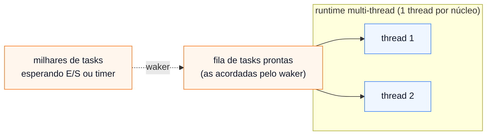

# 02 — Tokio: runtime, `join!` e tasks

**Objetivos.** Ao final, você vai saber:

- o que o `#[tokio::main]` faz e como escolher as *features* do tokio;
- rodar futures ao mesmo tempo com `join!` e `try_join!`;
- criar *tasks* com `tokio::spawn` e `JoinSet`, e ler os erros de `Send` e `'static`;
- comparar tasks com as threads do Módulo 11.

## `#[tokio::main]`

O atributo transforma o seu `async fn main` num `main` comum que cria o runtime e executa a future até o fim. A expansão é, em essência:

```rust
fn main() {
    tokio::runtime::Builder::new_multi_thread()
        .enable_all()
        .build()
        .unwrap()
        .block_on(async {
            // o corpo do seu async fn main
        })
}
```

`block_on` é a ponte entre o mundo síncrono e o assíncrono: bloqueia a thread atual até a future terminar. O runtime padrão é *multi-thread*: um conjunto de threads (uma por núcleo) que executam as tasks. Com `#[tokio::main(flavor = "current_thread")]`, tudo roda numa só thread, o que é útil em ferramentas pequenas e nos testes.

Nos testes, use `#[tokio::test]` no lugar de `#[test]`. Ele cria um runtime `current_thread` para cada teste:

```rust
#[tokio::test]
async fn join_roda_as_duas() {
    let (a, b) = tokio::join!(buscar("x", 1), buscar("y", 1));
    assert_eq!(a, "x (1 ms)");
    assert_eq!(b, "y (1 ms)");
}
```

### Features

O tokio é dividido em *features* (Módulo 08) para você compilar só o que usa. `"full"` liga todas, e é o que os exemplos do curso usam. Num projeto real, é comum enxugar:

```toml
tokio = { version = "1.54", features = ["rt-multi-thread", "macros", "time", "net", "sync", "io-util"] }
```

| Feature | O que liga |
|---|---|
| `rt`, `rt-multi-thread` | o runtime (uma thread ou várias) |
| `macros` | `#[tokio::main]`, `#[tokio::test]`, `join!`, `select!` |
| `time` | `sleep`, `timeout`, `interval` |
| `net`, `io-util` | TCP/UDP e os métodos `read`/`write_all` |
| `sync` | canais e `Mutex` assíncronos |
| `fs` | arquivos (`tokio::fs`) |

Se faltar uma, o erro é do tipo "não encontrei `tokio::time`": confira as features antes de procurar outro problema.

## Esperar uma de cada vez x esperar todas juntas

O `.await` em sequência espera uma future terminar antes de começar a próxima:

```rust
async fn buscar(nome: &str, ms: u64) -> String {
    sleep(Duration::from_millis(ms)).await; // simula a espera pela rede
    format!("{nome} ({ms} ms)")
}

let inicio = Instant::now();
let a = buscar("usuarios", 300).await;
let b = buscar("pedidos", 200).await;
println!("sequencial: {a}, {b} em {:?}", inicio.elapsed());

let inicio = Instant::now();
let (a, b) = tokio::join!(buscar("usuarios", 300), buscar("pedidos", 200));
println!("join!:      {a}, {b} em {:?}", inicio.elapsed());
```

```text
sequencial: usuarios (300 ms), pedidos (200 ms) em 503.709625ms
join!:      usuarios (300 ms), pedidos (200 ms) em 302.307666ms
```

`join!` faz *poll* nas duas futures alternadamente: enquanto uma espera, a outra avança. O tempo total é o da mais lenta, não a soma. As duas rodam **na mesma task**, e portanto na mesma thread: é concorrência sem paralelismo, que é exatamente o que se quer para esperas.

Quando as futures devolvem `Result`, `try_join!` para no primeiro erro e devolve `Err`, sem esperar as outras:

```rust
let r = tokio::try_join!(ler_config(), conectar_banco());
println!("{r:?}");
```

```text
Err("banco fora do ar")
```

Se tudo der certo, `r` é `Ok((config, conexao))`.

Em Python, o equivalente é `asyncio.gather(buscar(...), buscar(...))`.

## Tasks: `tokio::spawn`

`join!` só serve quando você sabe, ao escrever o código, quantas futures são. Para um número que muda em tempo de execução (uma por conexão, uma por arquivo), você cria **tasks**:

```rust
let h = tokio::spawn(async move { nomes.join(" e ") });
println!("a task devolveu {:?}", h.await.unwrap());
```

```text
a task devolveu "ana e bia"
```

Uma task é uma future entregue ao runtime, que passa a cuidar dela por conta própria. É o equivalente assíncrono do `thread::spawn`:

| | thread (Módulo 11) | task (tokio) |
|---|---|---|
| criar | `thread::spawn(closure)` | `tokio::spawn(future)` |
| começa a rodar | na hora | na hora (não precisa de `.await`) |
| esperar o resultado | `h.join()` → `Result<T, _>` | `h.await` → `Result<T, JoinError>` |
| quem escalona | o sistema operacional (preemptivo) | o runtime, a cada `.await` (cooperativo) |
| custo | uma pilha de MB, chamada ao SO | algumas centenas de bytes no heap |
| requisitos | `F: Send + 'static` | `F: Future + Send + 'static` |

A última linha é a importante: as regras são as mesmas do `thread::spawn`, pelas mesmas razões. O runtime multi-thread pode mover a task entre threads a cada `.await` (por isso `Send`), e a task pode viver mais que a função que a criou (por isso `'static`).

O `JoinHandle` não precisa ser esperado: a task roda mesmo assim. Mas, quando o `main` termina, o runtime é desligado e as tasks que ainda estavam rodando são descartadas no meio, como as threads no Módulo 11.

### `'static`: o E0373 de novo

```rust
// ❌ NÃO COMPILA
#[tokio::main]
async fn main() {
    let nomes = vec!["ana", "bia"];
    let h = tokio::spawn(async {
        println!("{nomes:?}");
    });
    h.await.unwrap();
}
```

```text
error[E0373]: async block may outlive the current function, but it borrows `nomes`, which is owned by the current function
 --> src/main.rs:4:26
  |
4 |     let h = tokio::spawn(async {
  |                          ^^^^^ may outlive borrowed value `nomes`
5 |         println!("{nomes:?}");
  |                    ----- `nomes` is borrowed here
  |
  = note: async blocks are not executed immediately and must either take a reference or ownership of outside variables they use
help: to force the async block to take ownership of `nomes` (and any other referenced variables), use the `move` keyword
  |
4 |     let h = tokio::spawn(async move {
  |                                ++++
```

É o mesmo erro da closure de `thread::spawn`, e a correção é a mesma: `async move`, que leva as variáveis para dentro da future. Se você precisa dos dados também depois, clone antes do `move` (ou use `Arc`, como no Módulo 11).

### `Send`: o que atravessa um `.await`

```rust
// ❌ NÃO COMPILA
use std::rc::Rc;
use tokio::time::{Duration, sleep};

#[tokio::main]
async fn main() {
    let h = tokio::spawn(async {
        let nomes = Rc::new(vec!["ana", "bia"]);
        sleep(Duration::from_millis(10)).await;
        println!("{nomes:?}");
    });
    h.await.unwrap();
}
```

```text
error: future cannot be sent between threads safely
   --> src/main.rs:6:13
    |
  6 |       let h = tokio::spawn(async {
    |  _____________^
  7 | |         let nomes = Rc::new(vec!["ana", "bia"]);
  8 | |         sleep(Duration::from_millis(10)).await;
  9 | |         println!("{nomes:?}");
 10 | |     });
    | |______^ future created by async block is not `Send`
    |
    = help: within `{async block@src/main.rs:6:26: 6:31}`, the trait `Send` is not implemented for `Rc<Vec<&str>>`
note: future is not `Send` as this value is used across an await
   --> src/main.rs:8:42
    |
  7 |         let nomes = Rc::new(vec!["ana", "bia"]);
    |             ----- has type `Rc<Vec<&str>>` which is not `Send`
  8 |         sleep(Duration::from_millis(10)).await;
    |                                          ^^^^^ await occurs here, with `nomes` maybe used later
note: required by a bound in `tokio::spawn`
...
176 |         F: Future + Send + 'static,
    |                     ^^^^ required by this bound in `spawn`
```

Leia a nota do meio: *this value is used across an await*. Lembre da lição 01: tudo que está vivo num `.await` vira campo da future. A future contém um `Rc`, e o runtime pode retomá-la em outra thread, com o contador do `Rc` sendo mexido sem sincronização. Por isso ela não é `Send`.

O detalhe é que só importa o que **atravessa** um `.await`. Um `Rc` criado e descartado entre dois `.await` não entra no estado da future. As correções, em ordem de preferência:

1. use `Arc` no lugar de `Rc` (o caso deste exemplo);
2. limite o `Rc` a um bloco `{ }` que termina antes do `.await`;
3. se a task realmente precisa de tipos não-`Send`, há `tokio::task::LocalSet` e `spawn_local`, que mantêm a task numa thread só (fora do escopo do curso).

O mesmo vale para o `MutexGuard` da std, com uma surpresa que fica para a lição 05.

### Panic numa task

Um *panic* dentro de uma task não derruba o programa: ele aparece no stderr, e o `JoinHandle` devolve `Err(JoinError)`:

```rust
let h = tokio::spawn(async {
    panic!("deu ruim na task");
});
match h.await {
    Ok(()) => println!("ok"),
    Err(e) => println!("a task falhou: {e} (panic? {})", e.is_panic()),
}
```

```text
thread 'tokio-rt-worker' (274049) panicked at src/main.rs:19:9:
deu ruim na task
note: run with `RUST_BACKTRACE=1` environment variable to display a backtrace
a task falhou: task 11 panicked with message "deu ruim na task" (panic? true)
```

`h.abort()` cancela a task; o `.await` seguinte devolve um `JoinError` com `is_cancelled() == true`. Cancelamento é o assunto da lição 06.

## Muitas tasks: `JoinSet`

Para um grupo de tasks, guardar os `JoinHandle` num `Vec` funciona, mas o tokio tem uma estrutura própria. `JoinSet` entrega os resultados **na ordem em que terminam**, e cancela tudo o que ainda está rodando quando é descartado:

```rust
async fn na_ordem_de_chegada(tempos: &[(&'static str, u64)]) -> Vec<&'static str> {
    let mut set = JoinSet::new();
    for &(nome, ms) in tempos {
        set.spawn(async move {
            sleep(Duration::from_millis(ms)).await;
            nome
        });
    }
    let mut ordem = Vec::new();
    while let Some(r) = set.join_next().await {
        ordem.push(r.expect("a task não deve dar panic"));
    }
    ordem
}
```

```text
ordem de chegada: ["b", "c", "a"]
```

Com tempos de 30, 10 e 20 ms, `b` chega primeiro. Esse "cancela ao descartar" é uma forma de *structured concurrency* (concorrência estruturada): as tasks não sobrevivem ao escopo que as criou, parecido com o `thread::scope` do Módulo 11.

## Threads x tasks, em números

O mesmo trabalho, dormir 100 ms e devolver um número, com tasks e com threads (`--release`, Apple Silicon de 10 núcleos):

```rust
let mut handles = Vec::new();
for i in 0..100_000u64 {
    handles.push(tokio::spawn(async move {
        sleep(Duration::from_millis(100)).await;
        i
    }));
}
let mut soma = 0;
for h in handles {
    soma += h.await.unwrap();
}
```

```text
100000 tasks, soma 4999950000, em 133.547459ms
2000 threads, soma 1999000, em 127.450667ms
```

E 10 000 threads deram o *panic* `failed to spawn thread` que abriu a lição 01. As tasks custam pouco porque não têm pilha própria: cada uma é só a sua máquina de estados, do tamanho das variáveis que atravessam `.await`. E trocar de task não passa pelo sistema operacional.



O preço é que o escalonamento é **cooperativo**: uma task só larga a thread num `.await`. Uma task que calcula por um segundo sem `.await` segura a thread por um segundo. Esse é o assunto da lição 03.

Código completo, com testes, em [`codigo/tasks-e-join`](codigo/tasks-e-join/src/main.rs).

## Armadilhas comuns

- **`join!` com coisas que dependem uma da outra.** Se `b` precisa do resultado de `a`, não há concorrência possível: use `.await` em sequência.
- **Esperar que `tokio::spawn` empreste.** Ele exige `'static`, como `thread::spawn`. Mova (`async move`), clone ou use `Arc`.
- **`Rc`, `RefCell` ou `MutexGuard` vivos num `.await`** dentro de uma task: a future deixa de ser `Send`. Procure a nota *used across an await* no erro.
- **Esquecer que o `main` termina.** Tasks sem `.await` no `JoinHandle` morrem no meio quando o `main` retorna.

## Resumo

- `#[tokio::main]` cria o runtime e chama `block_on`; `#[tokio::test]` faz o mesmo nos testes.
- `join!`/`try_join!` rodam futures ao mesmo tempo dentro da mesma task; o tempo é o da mais lenta.
- `tokio::spawn` cria uma task, com os mesmos requisitos `Send + 'static` do `thread::spawn`.
- `JoinSet` entrega resultados por ordem de término e cancela o resto ao ser descartado.
- Tasks são baratas (100 000 sem esforço), mas cooperativas: só trocam de vez nos `.await`.

## Exercícios

Veja os exercícios 1 e 2 em [`exercicios.md`](exercicios.md).

## Leitura complementar

- [Tutorial do Tokio: Hello Tokio](https://tokio.rs/tokio/tutorial/hello-tokio) e [Spawning](https://tokio.rs/tokio/tutorial/spawning)
- [Documentação de `tokio::task`](https://docs.rs/tokio/latest/tokio/task/index.html) e de [`JoinSet`](https://docs.rs/tokio/latest/tokio/task/struct.JoinSet.html)
- [The Rust Programming Language, 17.6 Futures, Tasks, and Threads](https://doc.rust-lang.org/stable/book/ch17-06-futures-tasks-threads.html)
- [Async Book: Structured concurrency](https://rust-lang.github.io/async-book/part-reference/structured.html)

---

[← Lição anterior](01-futures-e-async-await.md) · [Índice do módulo](README.md) · [Próxima lição →](03-tempo-e-bloqueio.md)
