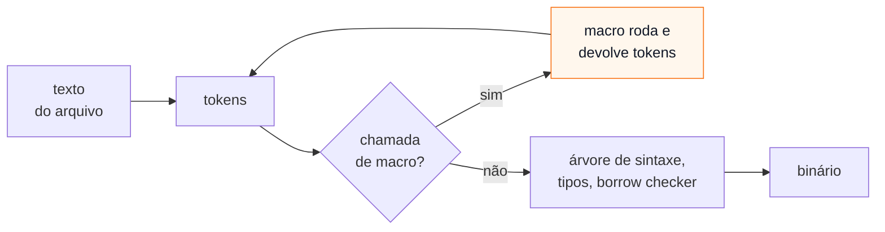

# 01 — O que são macros

**Objetivos.** Ao final, você vai saber:

- que problema uma macro resolve que uma função não resolve;
- o que uma macro recebe (tokens) e quando ela roda (na compilação);
- os quatro tipos de macro do Rust;
- ver o código que uma macro gera, com `cargo expand`.

## O que uma função não consegue fazer

Desde o Módulo 01 você usa `println!`, `vec!` e `assert_eq!`. Nenhuma delas poderia ser uma função comum:

- `println!("{} e {}", a, b)` recebe **qualquer número** de argumentos. Rust não tem funções variádicas.
- `println!` confere a *format string* **na compilação**: um `{}` sem argumento é erro de compilação.
- `assert_eq!(a, b)` mostra, na falha, o **código** que você escreveu (`left == right`), e não só os valores.
- `#[derive(Debug)]` escreve um `impl Debug for Ponto` inteiro. Uma função roda em tempo de execução e não pode criar um `impl`.

Uma **macro** é código que escreve código. Ela roda **durante a compilação**, recebe um pedaço do seu programa e devolve outro pedaço, que o compilador compila no lugar da chamada. Por isso consegue o que uma função não consegue: aceitar uma sintaxe livre, gerar itens (structs, `impl`s, funções) e validar coisas antes de o programa existir.

## O que uma macro recebe: tokens

O compilador lê o código-fonte em três passos: texto → *tokens* (palavras, números, símbolos) → árvore de sintaxe → tipos e código de máquina. As macros entram entre o segundo e o terceiro: recebem **tokens**, não texto, e devolvem tokens.



Os tokens vêm agrupados em *token trees* (árvores de tokens): tudo o que está entre `( )`, `[ ]` ou `{ }` forma um grupo só. Duas consequências práticas:

- os parênteses, colchetes e chaves da chamada precisam estar balanceados (`m!(a, (b)` não chega nem à macro);
- uma expressão passada para a macro chega como **uma unidade**, e não como texto solto. Isso evita o problema mais famoso das macros do C, que você vai ver daqui a pouco.

A macro expande **antes** da verificação de tipos e do *borrow checker*. Ela não sabe o tipo de nada: só vê a forma do código. O código que ela gera, por outro lado, passa por **todas** as verificações normais, como se você o tivesse escrito à mão.

## Os quatro tipos

| Tipo | Como se usa | Como se escreve | Exemplo |
|---|---|---|---|
| declarativa | `nome!(...)` | `macro_rules!`, na própria crate | `vec!`, `println!`, `matches!` |
| procedural *derive* | `#[derive(Nome)]` | função Rust numa crate `proc-macro` | `Debug`, `serde::Serialize` |
| procedural de atributo | `#[nome]` em cima de um item | idem | `#[tokio::main]`, `#[test]` |
| procedural *function-like* | `nome!(...)` | idem | `sqlx::query!`, `html!` de frameworks web |

As **declarativas** (*macros by example*) são regras de "se a entrada tem esta forma, gere aquilo", parecidas com um `match`. Cobrem a maioria dos casos e são o assunto das lições 02 a 04.

As **procedurais** são funções Rust de verdade, compiladas e executadas pelo compilador, que recebem os tokens e podem fazer qualquer cálculo com eles. São mais poderosas e mais trabalhosas, e ficam numa crate separada. Lições 05 a 07.

## Ver o que a macro gerou: `cargo expand`

A ferramenta `cargo expand` (de David Tolnay, autor do `syn` e do `serde`) mostra o seu código depois de todas as macros expandidas. Ela não vem com o Rust:

```bash
cargo install cargo-expand
```

Ela funciona no compilador estável e formata a saída com o `rustfmt`. Para este programa:

```rust
macro_rules! quadrado {
    ($x:expr) => {
        $x * $x
    };
}

#[derive(Debug)]
struct Ponto {
    x: i32,
    y: i32,
}

fn main() {
    let p = Ponto { x: 1, y: quadrado!(3) };
    println!("{p:?}");
}
```

`cargo expand` mostra (saída real, encurtada no começo):

```rust
struct Ponto {
    x: i32,
    y: i32,
}
#[automatically_derived]
impl ::core::fmt::Debug for Ponto {
    #[inline]
    fn fmt(&self, f: &mut ::core::fmt::Formatter) -> ::core::fmt::Result {
        ::core::fmt::Formatter::debug_struct_field2_finish(
            f,
            "Ponto",
            "x",
            &self.x,
            "y",
            &&self.y,
        )
    }
}
fn main() {
    let p = Ponto { x: 1, y: 3 * 3 };
    {
        ::std::io::_print(format_args!("{0:?}\n", p));
    };
}
```

Três coisas para notar:

- o `#[derive(Debug)]` virou um `impl` completo, como prometido na [lição de derive do Módulo 06](../06-traits-e-generics/04-traits-da-std-e-derive.md);
- `quadrado!(3)` virou `3 * 3`: a macro sumiu, e só o resultado foi compilado;
- `println!` virou uma chamada a `format_args!`, uma macro embutida no compilador (que confere a format string) e uma função interna, `_print`.

O código gerado usa caminhos absolutos como `::core::fmt::Debug`. Isso não é capricho: a macro não sabe o que você importou, e `::core::...` funciona em qualquer lugar. Você vai fazer o mesmo nas suas macros.

> [!TIP]
> `cargo expand` aceita um caminho para expandir só um item: `cargo expand main` ou `cargo expand modulo::funcao`. Em projetos reais, a saída inteira fica enorme. Ela também mostra detalhes internos da std que você não deve copiar (por exemplo, `vec![...]` aparece como `box_assume_init_into_vec_unsafe`).

## Comparação: o pré-processador do C++

O C e o C++ têm macros desde sempre, com `#define`. Mas o pré-processador roda **antes** de qualquer análise e trabalha com **texto**:

```cpp
#include <iostream>
#define QUADRADO(x) x * x

int main() {
    std::cout << QUADRADO(1 + 2) << "\n";   // imprime 5
}
```

`QUADRADO(1 + 2)` vira o texto `1 + 2 * 1 + 2`, que vale 5. Em C++ a regra é pôr parênteses em tudo (`((x) * (x))`). A mesma macro em Rust dá 9, porque `$x:expr` recebe `1 + 2` como **uma** expressão, já agrupada:

```rust
println!("{}", quadrado!(1 + 2)); // 9
```

| | Pré-processador C/C++ | `macro_rules!` |
|---|---|---|
| Trabalha com | texto | tokens agrupados (expressões, tipos, identificadores) |
| Respeita escopo | não: `#define` vale do ponto em diante, inclusive para quem incluir o cabeçalho | sim: módulos, visibilidade, exportação explícita |
| Variáveis internas | podem colidir com as do chamador | **higiênicas**: não colidem (lição 04) |
| Erros | no código já expandido, longe da chamada | apontam para a chamada e para a regra |
| Pode gerar | qualquer texto, até código inválido | só tokens; o resultado tem de ser Rust válido |

Os `template`s e o `constexpr` do C++ são o equivalente mais próximo de várias coisas que as macros do Rust fazem (gerar código por tipo, calcular na compilação). Em Rust, os genéricos e o `const fn` cumprem esse papel, e as macros ficam para o que eles não alcançam (lição 08).

## Comparação: decorators e metaclasses do Python

No Python, quem "escreve código" são os **decorators** e as **metaclasses**, e eles rodam **em tempo de execução**, quando o módulo é importado:

```python
from dataclasses import dataclass


@dataclass
class Ponto:
    x: int
    y: int


print(Ponto(1, 2))                 # Ponto(x=1, y=2)
print(Ponto(1, 2) == Ponto(1, 2))  # True
```

`@dataclass` inspeciona a classe já criada e acrescenta `__init__`, `__repr__` e `__eq__`. É o papel do `#[derive(Debug, PartialEq)]`, com uma diferença de fundo: o `derive` gera o código **antes** da compilação, e o código gerado é verificado pelo compilador como qualquer outro. Um campo sem `Debug` é erro de compilação, e não um `TypeError` quando a linha rodar. E não há custo no início do programa.

| Python | Rust |
|---|---|
| `@dataclass`, metaclasse | `#[derive(...)]` |
| decorator de função (`@functools.cache`) | macro de atributo (`#[cronometrar]`, lição 07) |
| roda ao importar o módulo, com acesso a valores | roda na compilação, só com tokens (sem valores, sem tipos) |

## Armadilhas comuns

- **Achar que a macro conhece os tipos.** Ela vê só a forma do código. `quadrado!(x)` não sabe se `x` é `i32` ou `String`; quem descobre é o compilador, depois, no código gerado.
- **Ler erros sem olhar a expansão.** Quando um erro aponta para dentro de uma macro, rode `cargo expand` e leia o código que ela gerou. Quase sempre o problema fica óbvio.
- **Copiar a saída do `cargo expand`.** Ela usa itens internos e instáveis da std (`::alloc::...`, `#![feature(...)]`). Serve para entender, não para colar no seu código.

## Resumo

- Uma macro roda na compilação: recebe tokens do seu código e devolve tokens que são compilados no lugar.
- Ela faz o que uma função não faz: argumentos variáveis, sintaxe própria, gerar itens, validar na compilação.
- Tipos: declarativas (`macro_rules!`) e procedurais (derive, atributo, function-like).
- Diferente do `#define` do C, trabalha com expressões agrupadas e respeita escopo. Diferente dos decorators do Python, roda antes da compilação.
- `cargo expand` (`cargo install cargo-expand`) mostra o código gerado.

## Exercícios

Os exercícios do módulo começam na lição 02. Veja [`exercicios.md`](exercicios.md).

## Leitura complementar

- [The Rust Programming Language, cap. 20.5: Macros](https://doc.rust-lang.org/stable/book/ch20-05-macros.html)
- [The Rust Reference: Macros](https://doc.rust-lang.org/reference/macros.html)
- [The Little Book of Rust Macros](https://lukaswirth.dev/tlborm/)
- [cargo-expand](https://github.com/dtolnay/cargo-expand)

---

[Índice do módulo](README.md) · [Próxima lição →](02-macro-rules.md)
