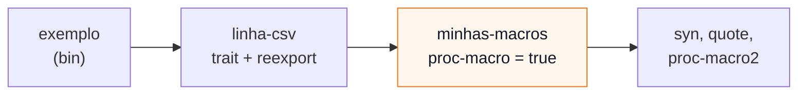

# 05 — Macros procedurais: um `derive` com `syn` e `quote`

**Objetivos.** Ao final, você vai saber:

- por que uma macro procedural precisa de uma crate só para ela;
- o papel de `proc_macro`, `syn`, `quote` e `proc-macro2`;
- escrever um `#[derive]` com atributos auxiliares e suporte a genéricos;
- organizar trait, derive e usuário num workspace pequeno.

## Por que procedural

Com `macro_rules!` dá para fazer muita coisa, mas não tudo. Uma regra não consegue, por exemplo, percorrer os campos de uma struct qualquer, ler atributos em cada um e decidir o que gerar a partir disso. Para isso, você precisa de **código Rust de verdade** rodando na compilação: uma macro procedural.

Uma macro procedural é uma função que recebe um `TokenStream` (a sequência de tokens da entrada) e devolve outro. O compilador **compila essa função antes**, carrega-a como um *plugin* e a chama a cada uso. Daí a regra principal:

> Uma macro procedural mora numa crate própria, com `proc-macro = true`, e essa crate **só pode exportar macros**.

A crate é compilada para a máquina onde o compilador roda (não para o alvo do seu programa) e carregada por ele. Nada de funções, tipos ou traits públicos lá dentro. Por isso, uma biblioteca com derive costuma ser **duas** crates: `serde` (a trait) e `serde_derive` (a macro), `thiserror` e `thiserror-impl`, e assim por diante. A convenção de nome do Rust Book é `foo` e `foo_derive`.

## O exemplo: `#[derive(LinhaCsv)]`

O Projeto 2 leu CSV. Agora o caminho inverso: transformar structs em linhas de CSV, sem escrever um `impl` por struct.

```rust
use linha_csv::{LinhaCsv, para_csv};

#[derive(LinhaCsv)]
struct Venda {
    produto: String,
    #[csv(renomear = "qtd")]
    quantidade: u32,
    total: f64,
}

let vendas = vec![
    Venda { produto: "Café".into(), quantidade: 2, total: 37.0 },
    Venda { produto: "Pão de queijo, congelado".into(), quantidade: 1, total: 22.9 },
];
print!("{}", para_csv(&vendas));
```

```text
produto,qtd,total
Café,2,37
"Pão de queijo, congelado",1,22.9
```

O derive gera o cabeçalho a partir dos nomes dos campos (com `#[csv(renomear = "...")]` para trocar um título e `#[csv(pular)]` para ignorar um campo) e a linha a partir dos valores.

## O workspace

São três crates num [workspace](../08-modulos-e-crates/07-workspaces.md) (Módulo 08):

```text
macros-procedurais/
├── Cargo.toml          # [workspace] members = ["minhas-macros", "linha-csv", "exemplo"]
├── minhas-macros/      # proc-macro: o derive (e as macros da lição 07)
├── linha-csv/          # lib: a trait LinhaCsv, a função para_csv e o reexport do derive
└── exemplo/            # bin: usa tudo
```



O `Cargo.toml` da crate de macros:

```toml
[package]
name = "minhas-macros"
version = "0.1.0"
edition = "2024"
rust-version = "1.96"

# Esta crate só exporta macros procedurais.
[lib]
proc-macro = true

[dependencies]
proc-macro2 = "1.0.107"
quote = "1.0.47"
syn = { version = "3.0.9", features = ["full"] }
```

As três dependências são de David Tolnay e estão em praticamente toda macro procedural do ecossistema:

| Crate | Papel |
|---|---|
| `proc_macro` | a API do compilador (`TokenStream`, `Span`). Vem com o Rust, não vai no `Cargo.toml`, e só funciona **dentro** de uma macro sendo expandida |
| `proc-macro2` | os mesmos tipos, mas utilizáveis em qualquer lugar, inclusive em testes. `syn` e `quote` trabalham com eles |
| `syn` | o *parser*: transforma tokens numa árvore de sintaxe (`DeriveInput`, `ItemFn`, `Expr`...) |
| `quote` | o caminho de volta: um *template* com `quote! { ... }` que vira tokens |

O `syn` divide o parser em *features* para compilar mais rápido. O padrão já entende structs e enums (o suficiente para um derive); `"full"` acrescenta funções, blocos e expressões, que a macro de atributo da lição 07 usa.

> [!NOTE]
> A versão atual do `syn` é a **3** (novembro de 2026). O Rust Book e quase todos os tutoriais ainda usam a 2. Para um derive como este, o código é igual. As diferenças aparecem em detalhes da árvore: por exemplo, `ItemFn` ganhou um campo `modifiers`, e `Signature::unsafety` virou `safety`.

## A função do derive

A porta de entrada, em `minhas-macros/src/lib.rs`:

```rust
use proc_macro::TokenStream;
use syn::{DeriveInput, parse_macro_input};

mod linha_csv;

/// Gera `impl linha_csv::LinhaCsv` para uma struct com campos nomeados.
#[proc_macro_derive(LinhaCsv, attributes(csv))]
pub fn derive_linha_csv(entrada: TokenStream) -> TokenStream {
    let entrada = parse_macro_input!(entrada as DeriveInput);
    linha_csv::expandir(entrada)
        .unwrap_or_else(syn::Error::into_compile_error)
        .into()
}
```

- `#[proc_macro_derive(LinhaCsv, attributes(csv))]` registra o derive `LinhaCsv` e declara `csv` como **atributo auxiliar**: dentro de uma struct com esse derive, `#[csv(...)]` é aceito e ignorado pelo compilador, ficando para a macro ler.
- A função recebe **a struct inteira** como tokens. Um derive não altera a struct: o que ele devolve é **acrescentado** depois dela.
- `parse_macro_input!` transforma os tokens em `syn::DeriveInput`. Se a entrada não for uma struct, enum ou union, a macro já devolve o erro de parse.
- O trabalho fica em `expandir`, que devolve `syn::Result`. O `unwrap_or_else(syn::Error::into_compile_error)` transforma um erro num `compile_error!` apontando o lugar certo (lição 06).

Esse formato (uma função fina com `proc_macro` e uma interna com `proc_macro2` e `Result`) é o recomendado: a função interna pode ser testada como qualquer função.

## Lendo a struct com `syn`

`DeriveInput` tem o nome (`ident`), os genéricos, os atributos e os dados (`data`). Os dados são um enum: `Data::Struct`, `Data::Enum` ou `Data::Union`. E os campos de uma struct são outro enum: nomeados (`{ a: T }`), de tupla (`(T, U)`) ou nenhum.

```rust
use proc_macro2::TokenStream;
use quote::quote;
use syn::{Data, DeriveInput, Fields, LitStr};

pub fn expandir(entrada: DeriveInput) -> syn::Result<TokenStream> {
    let nome = &entrada.ident;

    // 1. Só aceitamos structs com campos nomeados.
    let campos = match &entrada.data {
        Data::Struct(s) => match &s.fields {
            Fields::Named(campos) => &campos.named,
            outros => {
                return Err(syn::Error::new_spanned(
                    outros,
                    "`LinhaCsv` precisa de campos nomeados",
                ));
            }
        },
        _ => {
            return Err(syn::Error::new_spanned(
                nome,
                "`LinhaCsv` só pode ser derivada para structs",
            ));
        }
    };
```

É *pattern matching* comum (Módulo 04), só que sobre a árvore de sintaxe do seu código.

### Os atributos auxiliares

Cada campo (`syn::Field`) tem `ident`, `ty` e `attrs`. Para ler `#[csv(renomear = "qtd")]` e `#[csv(pular)]`, o `syn` oferece `parse_nested_meta`, que chama uma closure para cada item dentro dos parênteses:

```rust
    // 2. Para cada campo, o título da coluna e o nome do campo.
    let mut titulos = Vec::new();
    let mut idents = Vec::new();
    for campo in campos {
        let ident = campo.ident.as_ref().expect("campo nomeado tem nome");
        let mut titulo = ident.to_string();
        let mut pular = false;

        for attr in &campo.attrs {
            if !attr.path().is_ident("csv") {
                continue; // outro atributo, como `#[allow(...)]`: não é nosso
            }
            attr.parse_nested_meta(|meta| {
                if meta.path.is_ident("renomear") {
                    let valor: LitStr = meta.value()?.parse()?;
                    titulo = valor.value();
                    Ok(())
                } else if meta.path.is_ident("pular") {
                    pular = true;
                    Ok(())
                } else {
                    Err(meta.error("opção desconhecida; use `renomear = \"...\"` ou `pular`"))
                }
            })?;
        }

        if !pular {
            titulos.push(titulo);
            idents.push(ident);
        }
    }
```

`meta.value()?` consome o `=` e `.parse()?` lê o que vem depois como um literal de string (`LitStr`). Se o usuário escrever `renomear = 42`, o `parse` falha com um erro apontando o `42`. Opções desconhecidas viram erro em vez de serem ignoradas: um `#[csv(renomar = ...)]` com erro de digitação não pode passar calado.

## Gerando o código com `quote!`

```rust
    // 3. O código gerado.
    let (impl_generics, ty_generics, where_clause) = entrada.generics.split_for_impl();
    Ok(quote! {
        impl #impl_generics ::linha_csv::LinhaCsv for #nome #ty_generics #where_clause {
            fn cabecalho() -> ::std::vec::Vec<&'static str> {
                ::std::vec![#(#titulos),*]
            }

            fn linha(&self) -> ::std::vec::Vec<::std::string::String> {
                ::std::vec![#(::std::string::ToString::to_string(&self.#idents)),*]
            }
        }
    })
}
```

O `quote!` é um *template*:

- `#nome` insere uma variável Rust (qualquer coisa que implemente `ToTokens`: um `Ident`, um tipo, outro `TokenStream`, uma `String` vira um literal de string);
- `#(#titulos),*` é a repetição, com a mesma ideia do `macro_rules!`: um item por elemento do `Vec`, separados por vírgula;
- `#(... &self.#idents ...),*` repete a expressão inteira, trocando `#idents` a cada vez.

**Genéricos.** Para `struct Par<T: Display> { ... }`, o `impl` precisa ser `impl<T: Display> LinhaCsv for Par<T>`. `split_for_impl` devolve exatamente os três pedaços: os parâmetros com bounds (para depois do `impl`), os parâmetros sem bounds (para depois do nome) e a cláusula `where`. Esquecer isso faz o derive falhar em qualquer struct genérica.

**Caminhos absolutos.** Pelo mesmo motivo do `$crate` da lição 04, o código gerado não pode depender do que o usuário importou: `::std::vec::Vec`, `::std::string::ToString::to_string(...)`. E a trait aparece como `::linha_csv::LinhaCsv`. Uma macro procedural **não tem `$crate`**; ela supõe que o usuário depende da crate `linha_csv` com esse nome. É a convenção do ecossistema (o `serde` gera `_serde::...` com um truque parecido). Se alguém renomear a dependência no `Cargo.toml`, o código gerado quebra; crates maiores aceitam um atributo como `#[serde(crate = "...")]` para esses casos.

## A crate da trait e o reexport

```rust
// linha-csv/src/lib.rs

/// O `derive` mora numa crate `proc-macro` separada. Reexportá-lo aqui deixa
/// quem usa escrever só `use linha_csv::LinhaCsv;` e ganhar a trait e o derive.
pub use minhas_macros::LinhaCsv;

/// Um tipo que vira uma linha de CSV.
pub trait LinhaCsv {
    /// Os títulos das colunas.
    fn cabecalho() -> Vec<&'static str>;
    /// Os valores desta linha, na ordem do cabeçalho.
    fn linha(&self) -> Vec<String>;
}
```

A trait e o derive têm o **mesmo nome** sem conflito: macros e tipos vivem em *namespaces* diferentes. Um `use linha_csv::LinhaCsv;` traz os dois, e é por isso que `use serde::Serialize;` serve tanto para `#[derive(Serialize)]` quanto para `T: Serialize`. O `serde` põe o reexport atrás da feature `derive` ([Módulo 08](../08-modulos-e-crates/06-features.md)), para quem não quer compilar `syn`.

> [!TIP]
> Como a trait e o derive evoluem juntos, a crate da trait costuma depender da crate derive com a versão **exata**, `minhas-macros = { version = "=0.1.0", ... }`, o `"=1.2.3"` da [lição de dependências](../08-modulos-e-crates/05-dependencias-e-semver.md) do Módulo 08. Assim, um usuário nunca combina uma trait nova com um derive velho.

## O resultado, com `cargo expand`

Na pasta `exemplo`, `cargo expand` mostra o `impl` gerado (saída real; o `vec!` aparece expandido em funções internas da std):

```rust
struct Venda {
    produto: String,
    #[csv(renomear = "qtd")]
    quantidade: u32,
    total: f64,
}
impl ::linha_csv::LinhaCsv for Venda {
    fn cabecalho() -> ::std::vec::Vec<&'static str> {
        ::alloc::boxed::box_assume_init_into_vec_unsafe(
            ::alloc::intrinsics::write_box_via_move(
                ::alloc::boxed::Box::new_uninit(),
                ["produto", "qtd", "total"],
            ),
        )
    }
    fn linha(&self) -> ::std::vec::Vec<::std::string::String> {
        ::alloc::boxed::box_assume_init_into_vec_unsafe(
            ::alloc::intrinsics::write_box_via_move(
                ::alloc::boxed::Box::new_uninit(),
                [
                    ::std::string::ToString::to_string(&self.produto),
                    ::std::string::ToString::to_string(&self.quantidade),
                    ::std::string::ToString::to_string(&self.total),
                ],
            ),
        )
    }
}
```

O atributo `#[csv(...)]` continua na struct (atributos auxiliares são inertes), e o resto é o código que você escreveria à mão.

Código completo em [`codigo/macros-procedurais`](codigo/macros-procedurais/), já com a melhoria de mensagens de erro da lição 06: a macro em [`minhas-macros/src/linha_csv.rs`](codigo/macros-procedurais/minhas-macros/src/linha_csv.rs), a trait em [`linha-csv/src/lib.rs`](codigo/macros-procedurais/linha-csv/src/lib.rs).

## Armadilhas comuns

- **Pôr a trait na crate `proc-macro`.** Não compila: uma crate com `proc-macro = true` só exporta macros. A trait vai numa crate normal, que reexporta o derive.
- **Usar o derive dentro da própria crate da trait.** `::linha_csv::LinhaCsv` não existe dentro de `linha_csv` (lá, o caminho seria `crate::LinhaCsv`). Teste o derive em `tests/` (outra crate) ou em outro membro do workspace. Algumas crates resolvem com `extern crate self as linha_csv;` na raiz.
- **Ignorar genéricos.** Sem `split_for_impl`, o derive funciona nos seus testes e quebra no primeiro `struct Pacote<T>` de um usuário.
- **Ignorar atributos desconhecidos.** Um erro de digitação em `#[csv(...)]` deve virar erro de compilação, não um comportamento silencioso.
- **`syn` sem a feature certa.** `syn::ItemFn` e outros tipos de função só existem com `features = ["full"]`; o erro é um simples "não encontrado".

## Resumo

- Macros procedurais são funções `TokenStream -> TokenStream` numa crate `proc-macro = true`, que só pode exportar macros.
- `syn` lê os tokens como árvore (`DeriveInput`, `Data`, `Fields`); `quote!` gera tokens com `#var` e `#(...),*`; `proc-macro2` permite testar fora do compilador.
- `#[proc_macro_derive(Nome, attributes(aux))]` declara o derive e os atributos auxiliares; `parse_nested_meta` lê esses atributos.
- Use `split_for_impl` para genéricos e caminhos absolutos (`::std`, `::sua_crate`) no código gerado.
- Reexporte o derive na crate da trait, com o mesmo nome.

## Exercícios

Veja o exercício 5 em [`exercicios.md`](exercicios.md).

## Leitura complementar

- [The Rust Programming Language, cap. 20.5: Custom `derive` macros](https://doc.rust-lang.org/stable/book/ch20-05-macros.html#custom-derive-macros)
- [The Rust Reference: Procedural macros](https://doc.rust-lang.org/reference/procedural-macros.html)
- Documentação de [`syn`](https://docs.rs/syn/3/syn/) (veja o exemplo `heapsize` no repositório), [`quote`](https://docs.rs/quote) e [`proc-macro2`](https://docs.rs/proc-macro2)
- [proc-macro-workshop](https://github.com/dtolnay/proc-macro-workshop), de David Tolnay: cinco macros para implementar, com testes, começando por um `derive(Builder)`

---

[← Lição anterior](04-higiene-e-escopo.md) · [Índice do módulo](README.md) · [Próxima lição →](06-erros-e-testes.md)
