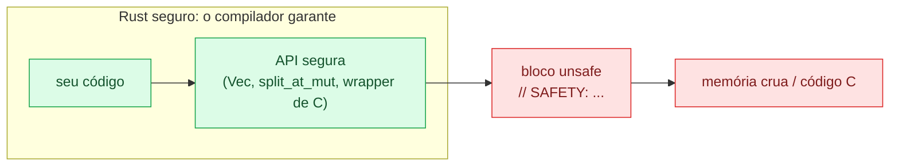

# 01 — O que `unsafe` permite (e o que não permite)

**Objetivos.** Ao final, você vai saber:

- quais são as cinco coisas que só `unsafe` libera, e o que continua verificado dentro dele;
- a diferença entre um bloco `unsafe`, uma `unsafe fn` e uma `unsafe trait`;
- documentar código `unsafe` com `// SAFETY:` e `# Safety`, e quais lints ajudam;
- por que o `unsafe` do Rust é diferente do "tudo pode" do C++.

## Por que existe `unsafe`

O compilador do Rust prova muita coisa: que nenhuma referência fica pendurada, que não há dois `&mut` para o mesmo dado, que nenhuma thread lê enquanto outra escreve. Mas há código correto que ele não consegue provar. Exemplos que você já viu: `split_at_mut` (Módulo 03), `Cell` e `RefCell` (Módulo 10), os canais e o `Mutex` (Módulo 11). E há código que está fora do alcance dele por definição, como uma função escrita em C.

Para esses casos, Rust tem `unsafe`. Ele não desliga as verificações. Ele libera **cinco operações** a mais, e você assume a responsabilidade de usá-las corretamente:

1. desreferenciar um ponteiro cru (`*const T`, `*mut T`);
2. chamar uma função ou método marcado `unsafe` (incluindo funções de C);
3. acessar ou modificar uma variável `static mut`;
4. implementar uma trait marcada `unsafe` (como `Send` e `Sync`);
5. ler campos de uma `union`.

O Rust Book chama essas cinco de *unsafe superpowers*. Todo o resto é igual ao Rust seguro.

## O que `unsafe` não desliga

Um erro comum de quem chega de C++ é achar que `unsafe { }` é um "modo C" onde o *borrow checker* some. Não é:

```rust
// ❌ NÃO COMPILA
fn main() {
    let mut v = vec![1, 2, 3];
    let r = &mut v;
    unsafe {
        let a = &v;
        r.push(4);
        println!("{a:?}");
    }
}
```

```text
warning: unnecessary `unsafe` block
 --> src/main.rs:4:5
  |
4 |     unsafe {
  |     ^^^^^^ unnecessary `unsafe` block
  |
  = note: `#[warn(unused_unsafe)]` (part of `#[warn(unused)]`) on by default

error[E0502]: cannot borrow `v` as immutable because it is also borrowed as mutable
 --> src/main.rs:5:17
  |
3 |     let r = &mut v;
  |             ------ mutable borrow occurs here
4 |     unsafe {
5 |         let a = &v;
  |                 ^^ immutable borrow occurs here
6 |         r.push(4);
  |         - mutable borrow later used here
```

O compilador reclama duas vezes: o erro de empréstimo continua lá, e o bloco `unsafe` nem é necessário, porque não há nenhuma das cinco operações dentro dele. Referências continuam sendo verificadas, tipos continuam sendo verificados, *moves* continuam valendo. O `unsafe` só abre a porta para os superpoderes, e é com eles (ponteiros crus, principalmente) que você contorna o checker.

## Superpoder 1: desreferenciar um ponteiro cru

Criar um ponteiro cru é seguro. Usá-lo, não:

```rust
// ❌ NÃO COMPILA
fn main() {
    let x = 5;
    let p = &raw const x;
    println!("{}", *p);
}
```

```text
error[E0133]: dereference of raw pointer is unsafe and requires unsafe block
 --> src/main.rs:4:20
  |
4 |     println!("{}", *p);
  |                    ^^ dereference of raw pointer
  |
  = note: raw pointers may be null, dangling or unaligned; they can violate aliasing rules and cause data races: all of these are undefined behavior
```

A nota resume o motivo: um ponteiro cru pode ser nulo, estar pendurado, desalinhado, ou violar as regras de *aliasing* (quem pode ler e escrever o quê ao mesmo tempo). Desreferenciá-lo nesse estado é *comportamento indefinido* (*undefined behavior*, UB), assunto da lição 04. A lição 02 é inteira sobre ponteiros crus.

```rust
// ✅
let x = 5;
let p = &raw const x;
// SAFETY: `p` aponta para `x`, que está viva e inicializada.
println!("{}", unsafe { *p });
```

## Superpoder 2: chamar funções `unsafe`

Uma `unsafe fn` é uma função com **pré-condições que o compilador não verifica**. Quem chama precisa garanti-las, e por isso a chamada fica dentro de `unsafe`:

```rust
// ❌ NÃO COMPILA
/// # Safety
/// `p` precisa apontar para um `i32` valido.
unsafe fn ler(p: *const i32) -> i32 {
    *p
}

fn main() {
    let x = 7;
    println!("{}", unsafe { ler(&x) });
    println!("{}", ler(&x));
}
```

```text
warning[E0133]: dereference of raw pointer is unsafe and requires unsafe block
 --> src/main.rs:4:5
  |
4 |     *p
  |     ^^ dereference of raw pointer
  |
  = note: raw pointers may be null, dangling or unaligned; they can violate aliasing rules and cause data races: all of these are undefined behavior
note: an unsafe function restricts its caller, but its body is safe by default
 --> src/main.rs:3:1
  |
3 | unsafe fn ler(p: *const i32) -> i32 {
  | ^^^^^^^^^^^^^^^^^^^^^^^^^^^^^^^^^^^
  = note: for more information, see <https://doc.rust-lang.org/edition-guide/rust-2024/unsafe-op-in-unsafe-fn.html>
  = note: `#[warn(unsafe_op_in_unsafe_fn)]` (part of `#[warn(rust_2024_compatibility)]`) on by default

error[E0133]: call to unsafe function `ler` is unsafe and requires unsafe block
  --> src/main.rs:10:20
   |
10 |     println!("{}", ler(&x));
   |                    ^^^^^^^ call to unsafe function
   |
   = note: consult the function's documentation for information on how to avoid undefined behavior
```

Há duas mensagens, e as duas importam:

- O **erro** está na chamada sem `unsafe`, na linha 10. A primeira chamada, dentro de `unsafe { }`, passou.
- O **aviso** está no corpo da função. Até a edition 2021, o corpo inteiro de uma `unsafe fn` era um bloco `unsafe` implícito. Na 2024, a nota diz o novo entendimento: *"an unsafe function restricts its caller, but its body is safe by default"*. O `unsafe fn` diz algo a quem chama; as operações perigosas dentro dela precisam do próprio bloco:

```rust
// ✅
/// # Safety
/// `p` precisa apontar para um `i32` valido.
unsafe fn ler(p: *const i32) -> i32 {
    // SAFETY: o contrato da função exige um ponteiro válido.
    unsafe { *p }
}
```

Assim cada operação perigosa fica marcada, mesmo numa `unsafe fn` de 50 linhas.

A std tem várias funções `unsafe`, sempre com uma versão segura ao lado: `get_unchecked` (sem verificação de índice) ao lado de `get`, `str::from_utf8_unchecked` ao lado de `str::from_utf8`, `Box::from_raw`, `slice::from_raw_parts`. E, desde a edition 2024, `std::env::set_var` e `remove_var`: mudar o ambiente do processo com outra thread lendo é UB em várias plataformas (Módulo 09).

## Superpoderes 3, 4 e 5: `static mut`, traits `unsafe` e `union`

**`static mut`** é uma global mutável sem proteção (Módulo 11). Toda leitura e escrita exige `unsafe`, e criar uma referência para ela é erro na 2024. A lição 02 mostra o jeito certo de acessá-la, quando ela é inevitável.

**Traits `unsafe`** são traits cuja implementação promete algo que o compilador não verifica. `Send` e `Sync` são as famosas:

```rust
// ❌ NÃO COMPILA
struct Alca(*mut u8);
impl Send for Alca {}
```

```text
error[E0200]: the trait `Send` requires an `unsafe impl` declaration
 --> src/main.rs:2:1
  |
2 | impl Send for Alca {}
  | ^^^^^^^^^^^^^^^^^^
  |
  = note: the trait `Send` enforces invariants that the compiler can't check. Review the trait documentation and make sure this implementation upholds those invariants before adding the `unsafe` keyword
help: add `unsafe` to this trait implementation
  |
2 | unsafe impl Send for Alca {}
  | ++++++
```

Você também pode declarar uma trait `unsafe` (`unsafe trait Zeravel {}`) quando o código `unsafe` de outra pessoa vai confiar na implementação dela. A lição 03 implementa `Send` à mão num caso legítimo.

**`union`** é como a `union` do C: todos os campos ocupam a mesma memória, e o compilador não sabe qual foi escrito por último. Ler um campo exige `unsafe`:

```rust
#[repr(C)]
union Bits {
    inteiro: u32,
    real: f32,
}

fn main() {
    let b = Bits { real: 1.0 };
    // SAFETY: todo padrão de 32 bits é um `u32` válido.
    println!("{:#x}", unsafe { b.inteiro });
    println!("{:#x}", 1.0f32.to_bits());
}
```

```text
0x3f800000
0x3f800000
```

Sem o `unsafe`, o erro é `E0133: access to union field is unsafe and requires unsafe block`, com a nota *"the field may not be properly initialized"*. Em Rust, `union` aparece quase só em FFI; para reinterpretar bits, a std tem funções seguras, como o `to_bits` da última linha.

## O contrato: `// SAFETY:` e `# Safety`

Um bloco `unsafe` é uma afirmação: "verifiquei que as condições para isso são verdadeiras aqui". A convenção é escrever essa afirmação num comentário `// SAFETY:` logo acima do bloco, e listar as pré-condições de uma `unsafe fn` numa seção `# Safety` da documentação (Módulo 08):

```rust
/// Lê o elemento `i` sem verificar o índice.
///
/// # Safety
///
/// `i` precisa ser menor que `v.len()`.
pub unsafe fn pegar(v: &[i32], i: usize) -> i32 {
    // SAFETY: quem chama garante `i < v.len()`.
    unsafe { *v.get_unchecked(i) }
}
```

Os dois lados se encaixam: o `# Safety` diz o que o chamador deve garantir, e o `// SAFETY:` em cada chamada explica **por que** a garantia vale ali. Um revisor pode conferir um bloco de cada vez, sem ler o programa inteiro.

O clippy ajuda a manter o hábito:

- `missing_safety_doc` (ativo por padrão): `warning: unsafe function's docs are missing a # Safety section` numa `pub unsafe fn` sem a seção.
- `undocumented_unsafe_blocks` (do grupo *restriction*, desligado por padrão): com `#![warn(clippy::undocumented_unsafe_blocks)]`, todo bloco sem comentário gera `warning: unsafe block missing a safety comment`. Vale ligar em crates com muito `unsafe`.
- `not_unsafe_ptr_arg_deref` (erro por padrão): pega uma função **pública e segura** que recebe um ponteiro cru e o desreferencia: `error: this public function might dereference a raw pointer but is not marked unsafe`. Quem chama uma função segura pode passar qualquer ponteiro, então ela precisa ser `unsafe` ou não desreferenciar.

E, no outro extremo, `#![forbid(unsafe_code)]` (Módulo 09) proíbe `unsafe` no crate inteiro. É o padrão sensato para código de aplicação: o `unsafe` fica nas bibliotecas que precisam dele, bem testadas.

## C++: UB em todo lugar, contra UB isolado

Em C++, qualquer linha pode ter UB: um `v[10]` num vetor de 3 elementos, uma referência guardada antes de um `push_back`, um iterador invalidado, um `int` com overflow. Não há marca no código, e uma revisão precisa olhar tudo.

Em Rust, o UB só pode nascer em código marcado com `unsafe`: um bloco, um `unsafe impl` ou um atributo como `#[unsafe(no_mangle)]` (lição 06). Se um programa Rust tem UB, a causa está num desses blocos, ou num código que quebrou uma invariante de que um deles dependia (lição 03). Isso não torna o `unsafe` mais fácil de escrever do que C++. Na verdade, as regras de aliasing do Rust são mais rígidas (lição 04). Mas reduz o lugar onde procurar de "o programa inteiro" para "estas 20 linhas", e permite que bibliotecas encapsulem o `unsafe` atrás de APIs que ninguém consegue usar errado.



Em Python, a situação é parecida com a do Rust, mas com a fronteira em outro lugar: o código Python não tem UB, e todo o risco fica nas extensões escritas em C (como partes do NumPy) e no `ctypes`. A lição 07 volta a isso.

## Armadilhas comuns

- **Achar que `unsafe` desliga o borrow checker.** Não desliga (E0502 acima). Para contornar o checker, você usa ponteiros crus, e aí a responsabilidade pelas regras de aliasing passa a ser sua.
- **Blocos `unsafe` grandes.** Um `unsafe { }` em volta de 30 linhas esconde quais delas são perigosas. Deixe só a operação dentro do bloco e escreva um `// SAFETY:` para ela.
- **Marcar uma função `unsafe` "por precaução".** `unsafe fn` significa "tem pré-condições que quem chama deve cumprir". Se não há pré-condição (a função verifica tudo), ela deve ser segura, mesmo que use `unsafe` por dentro.
- **Função segura que aceita ponteiro cru e o desreferencia.** Qualquer chamador seguro pode passar lixo. Ou a função vira `unsafe fn` (com `# Safety`), ou recebe uma referência.

## Resumo

- `unsafe` libera cinco operações: desreferenciar ponteiro cru, chamar `unsafe fn`, acessar `static mut`, implementar trait `unsafe`, ler campo de `union`. Todo o resto continua verificado.
- `unsafe fn` = "quem chama precisa garantir algo". Na 2024, o corpo dela não é mais um bloco `unsafe` implícito (`unsafe_op_in_unsafe_fn`).
- `// SAFETY:` explica por que cada bloco está correto; `# Safety` lista as pré-condições de cada `unsafe fn`.
- O UB do Rust só nasce em código `unsafe`. Em C++, ele pode estar em qualquer linha.

## Exercícios

Veja o exercício 1 em [`exercicios.md`](exercicios.md).

## Leitura complementar

- [The Rust Programming Language, 20.1 Unsafe Rust](https://doc.rust-lang.org/stable/book/ch20-01-unsafe-rust.html)
- [The Rustonomicon: Meet Safe and Unsafe](https://doc.rust-lang.org/nomicon/meet-safe-and-unsafe.html)
- [Edition Guide: `unsafe_op_in_unsafe_fn` warning](https://doc.rust-lang.org/edition-guide/rust-2024/unsafe-op-in-unsafe-fn.html)
- [The Rust Reference: Unsafety](https://doc.rust-lang.org/reference/unsafety.html)

---

[← Índice do módulo](README.md) · [Próxima lição →](02-ponteiros-crus.md)
