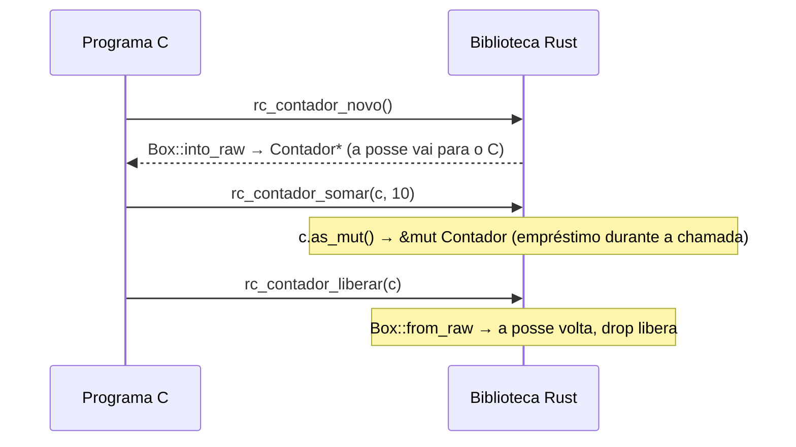

# 06 — Expondo Rust para C

**Objetivos.** Ao final, você vai saber:

- exportar funções com `#[unsafe(no_mangle)] pub extern "C" fn`;
- gerar uma biblioteca para C com `crate-type = ["cdylib"]` ou `["staticlib"]`, e compilar um programa C contra ela;
- entregar objetos Rust ao C como ponteiros opacos, com funções de criação e liberação;
- impedir que um panic atravesse a fronteira, com `catch_unwind`.

## O caminho inverso

A lição anterior chamou C a partir de Rust. Agora o Rust é a biblioteca: um programa em C (ou em qualquer linguagem que fale a ABI de C, como Python, Go, Swift ou C#) chama funções escritas em Rust. É assim que partes de projetos grandes são reescritas aos poucos: o Firefox, o kernel Linux e bibliotecas como a `librsvg` trocaram módulos de C por Rust mantendo a mesma interface.

O projeto completo é [`codigo/rust-para-c`](codigo/rust-para-c/):

```text
rust-para-c/
├── Cargo.toml
├── include/rust_para_c.h   ← o cabeçalho para quem usa em C
├── c/main.c                ← um programa C de exemplo
├── python/usar_ctypes.py   ← o mesmo, em Python (lição 07)
└── src/lib.rs
```

## Exportando uma função

```rust
/// Soma simples: tipos primitivos atravessam a fronteira sem conversão.
#[unsafe(no_mangle)]
pub extern "C" fn rc_somar(a: i32, b: i32) -> i32 {
    a.wrapping_add(b)
}
```

- `extern "C"` faz a função usar a convenção de chamada de C.
- `#[unsafe(no_mangle)]` mantém o nome do símbolo como `rc_somar`. Normalmente o compilador "decora" os nomes (*name mangling*) com o caminho do módulo e um hash, para que funções com o mesmo nome em crates diferentes não colidam. O C procura pelo nome exato, então a decoração precisa sair.
- O prefixo `rc_` é por conta do C, que não tem *namespaces*: toda função exportada de uma biblioteca divide o mesmo espaço de nomes.

Por que o atributo é `unsafe`? Porque dois símbolos com o mesmo nome no programa final são UB: se outra biblioteca também exportar `rc_somar`, o *linker* pode escolher qualquer uma, e o código que chamava uma vai rodar a outra. Na edition 2024, o compilador exige que você reconheça isso:

```text
error: unsafe attribute used without unsafe
 --> src/main.rs:5:3
  |
5 | #[no_mangle]
  |   ^^^^^^^^^ usage of unsafe attribute
  |
help: wrap the attribute in `unsafe(...)`
  |
5 | #[unsafe(no_mangle)]
  |   +++++++         +
```

O mesmo vale para `#[unsafe(export_name = "outro_nome")]`, que exporta com um nome diferente do da função, e para `#[unsafe(link_section = "...")]`.

## `cdylib` e `staticlib`

Por padrão, uma biblioteca Rust vira um `.rlib`, que só o próprio Rust sabe usar (Módulo 08). Para C, peça outro tipo de saída no `Cargo.toml`:

```toml
[lib]
# "lib": o crate Rust normal (usado pelos testes).
# "cdylib": biblioteca dinâmica para C (.so, .dylib ou .dll).
# "staticlib": biblioteca estática para C (.a ou .lib).
crate-type = ["lib", "cdylib", "staticlib"]
```

```bash
cargo build --release
ls target/release/ | grep rust_para_c
```

```text
librust_para_c.a
librust_para_c.d
librust_para_c.dylib
librust_para_c.rlib
```

(No Linux, a dinâmica é `.so`; no Windows, `.dll` e a estática `.lib`.) As duas embutem a std e tudo de que o crate depende, então o programa C não precisa de mais nada do Rust. A `staticlib` é ligada dentro do executável; a `cdylib` é carregada em tempo de execução, e é o formato que Python e outras linguagens dinâmicas usam.

## O cabeçalho

O C precisa das declarações. Para uma biblioteca pequena, escreva o `.h` à mão:

```c
#ifndef RUST_PARA_C_H
#define RUST_PARA_C_H

#include <stdint.h>

/* Tipo opaco: o C só manipula ponteiros para ele. */
typedef struct Contador Contador;

int32_t rc_somar(int32_t a, int32_t b);
int64_t rc_contar_palavras(const char *texto);

Contador *rc_contador_novo(void);
uint64_t rc_contador_somar(Contador *c, uint64_t n);
void rc_contador_liberar(Contador *c);

int32_t rc_dividir(int32_t a, int32_t b, int32_t *saida);
void rc_panico(void);

#endif
```

Um cabeçalho escrito à mão tem o mesmo problema das declarações à mão da lição 05: nada confere se ele bate com o Rust. Para projetos maiores, o [`cbindgen`](https://github.com/mozilla/cbindgen) gera o `.h` a partir do código Rust (é o inverso do `bindgen`), normalmente num `build.rs` ou num passo da CI.

## Recebendo dados do C

Uma função que recebe ponteiros do C não tem como saber se eles são válidos. Ela é, por natureza, uma `unsafe fn`, com o contrato numa seção `# Safety`:

```rust
use std::ffi::{CStr, c_char};

/// Conta as palavras de uma string C em UTF-8.
/// Devolve -1 se `texto` for nulo ou não for UTF-8 válido.
///
/// # Safety
///
/// `texto` precisa ser nulo ou apontar para uma string terminada em '\0',
/// válida durante a chamada.
#[unsafe(no_mangle)]
pub unsafe extern "C" fn rc_contar_palavras(texto: *const c_char) -> i64 {
    if texto.is_null() {
        return -1;
    }
    // SAFETY: não é nulo, e o contrato da função garante uma string C válida.
    let texto = unsafe { CStr::from_ptr(texto) };
    match texto.to_str() {
        Ok(s) => s.split_whitespace().count() as i64,
        Err(_) => -1,
    }
}
```

Para o C, o `unsafe` não muda nada (não existe esse conceito lá). Para quem chama de Rust (os testes, por exemplo), ele exige um bloco `unsafe`. E ele documenta o contrato: aceitar nulo é uma gentileza barata, e vale a pena; validar UTF-8 também. Mas um ponteiro pendurado não tem como ser detectado, e por isso o contrato existe.

Erros viram **códigos de retorno**, como em qualquer API de C: `-1`, `NULL`, ou um `int` de status com o resultado gravado num ponteiro de saída. `Result` e `Option` não atravessam a fronteira.

## Objetos opacos: posse atravessando a fronteira

Para dar ao C um objeto Rust com estado (um `String` dentro, por exemplo), o padrão é o **ponteiro opaco**: o C recebe um `Contador*`, mas nunca vê os campos (o `typedef struct Contador Contador;` do cabeçalho declara o tipo sem defini-lo). Toda operação passa por uma função da biblioteca.

```rust
/// Um tipo Rust que o C só enxerga como ponteiro opaco.
pub struct Contador {
    valor: u64,
    nome: String,
}

/// Cria um contador. Libere com `rc_contador_liberar`.
#[unsafe(no_mangle)]
pub extern "C" fn rc_contador_novo() -> *mut Contador {
    let c = Contador {
        valor: 0,
        nome: String::from("contador"),
    };
    // A posse passa para o C, que devolve o ponteiro em `rc_contador_liberar`.
    Box::into_raw(Box::new(c))
}

/// # Safety
///
/// `c` precisa ser nulo ou um ponteiro devolvido por `rc_contador_novo` que
/// ainda não foi liberado, sem outro acesso simultâneo.
#[unsafe(no_mangle)]
pub unsafe extern "C" fn rc_contador_somar(c: *mut Contador, n: u64) -> u64 {
    // SAFETY: pelo contrato, `c` é nulo (`as_mut` devolve `None`) ou válido
    // e exclusivo durante a chamada.
    match unsafe { c.as_mut() } {
        Some(c) => {
            c.valor += n;
            c.valor
        }
        None => 0,
    }
}

/// # Safety
///
/// `c` precisa ser nulo ou um ponteiro de `rc_contador_novo` ainda não
/// liberado. Depois desta chamada, o ponteiro não pode mais ser usado.
#[unsafe(no_mangle)]
pub unsafe extern "C" fn rc_contador_liberar(c: *mut Contador) {
    if c.is_null() {
        return;
    }
    // SAFETY: pelo contrato, `c` veio de `Box::into_raw` e é liberado uma vez.
    let c = unsafe { Box::from_raw(c) };
    println!("[rust] liberando {} com valor {}", c.nome, c.valor);
}
```



É o `Box::into_raw`/`from_raw` da lição 02, agora com o C segurando o ponteiro no meio. As regras de posse do Rust continuam valendo, mas quem as cumpre é o programador C: chamar `liberar` uma vez, e não usar o ponteiro depois. É o mesmo contrato do `fopen`/`fclose`.

## Panics não atravessam a fronteira

O que acontece se o código Rust der panic dentro de uma função chamada pelo C? O *unwind* (desempilhar os frames rodando os `Drop`) não sabe atravessar frames de C. Desde a 1.81, um panic que tenta sair de uma função `extern "C"` **aborta o processo**:

```rust
/// Exemplo do que NÃO fazer: um panic dentro de `extern "C"` aborta o processo.
#[unsafe(no_mangle)]
pub extern "C" fn rc_panico() {
    panic!("panic dentro de extern \"C\"");
}
```

```text
thread '<unnamed>' (387620) panicked at src/lib.rs:113:5:
panic dentro de extern "C"

thread '<unnamed>' (387620) panicked at /rustc/b940084d7eb6a299eb4bfeb8e34901bc051e7ac4/library/core/src/panicking.rs:225:5:
panic in a function that cannot unwind
stack backtrace:
...
  19:        0x104c8f358 - _rc_panico
  20:        0x104c00960 - _main
thread caused non-unwinding panic. aborting.
```

O processo termina com código 134 (SIGABRT). É melhor que o UB de antigamente, mas derruba o programa C inteiro por causa de um erro numa biblioteca.

A defesa é a que o Módulo 05 mencionou: `std::panic::catch_unwind`, que roda uma closure e transforma um panic em `Err`:

```rust
use std::panic;

/// Divide `a` por `b` e grava em `*saida`. Devolve 0 em caso de sucesso,
/// -1 se `saida` for nulo e -2 se o código Rust der panic (divisão por zero).
///
/// # Safety
///
/// `saida` precisa ser nulo ou apontar para um `i32` gravável.
#[unsafe(no_mangle)]
pub unsafe extern "C" fn rc_dividir(a: i32, b: i32, saida: *mut i32) -> i32 {
    if saida.is_null() {
        return -1;
    }
    // Um panic não pode atravessar uma função `extern "C"`: se escapar daqui,
    // o processo é abortado. `catch_unwind` o transforma num código de erro.
    match panic::catch_unwind(|| a / b) {
        Ok(q) => {
            // SAFETY: `saida` não é nulo e, pelo contrato, é gravável.
            unsafe { saida.write(q) };
            0
        }
        Err(_) => -2,
    }
}
```

Toda função exportada que chama código capaz de dar panic (indexação, `unwrap`, aritmética, código de outras crates) deveria passar por um `catch_unwind`. Duas ressalvas: com `panic = "abort"` no perfil, não há o que capturar; e o *hook* padrão de panic continua imprimindo a mensagem no stderr, como você vai ver abaixo.

> [!NOTE]
> Quando o *unwind* **precisa** atravessar a fronteira (por exemplo, C++ com exceções chamando Rust, que chama C++ de volta), existe a ABI `extern "C-unwind"`. Ela é para casos específicos; numa biblioteca para C comum, use `extern "C"` e `catch_unwind`.

## Compilando o programa C

O `c/main.c` usa todas as funções:

```c
#include <stdio.h>
#include <string.h>
#include "rust_para_c.h"

int main(int argc, char **argv) {
    /* O C e o Rust têm buffers de saída separados. Sem buffer no lado C,
       as linhas dos dois aparecem na ordem em que foram escritas. */
    setvbuf(stdout, NULL, _IONBF, 0);

    printf("rc_somar(2, 40) = %d\n", rc_somar(2, 40));
    printf("palavras = %lld\n", (long long)rc_contar_palavras("Rust chamado de C"));

    Contador *c = rc_contador_novo();
    rc_contador_somar(c, 10);
    printf("contador = %llu\n", (unsigned long long)rc_contador_somar(c, 5));
    rc_contador_liberar(c);

    int32_t q = 0;
    int32_t r = rc_dividir(9, 2, &q);
    printf("dividir(9, 2) -> %d, q = %d\n", r, q);
    r = rc_dividir(9, 0, &q);
    printf("dividir(9, 0) -> %d\n", r);

    if (argc > 1 && strcmp(argv[1], "panico") == 0) {
        rc_panico();
        printf("esta linha nunca aparece\n");
    }
    return 0;
}
```

Com a biblioteca estática, tudo vai para dentro do executável:

```bash
cargo build --release
cc c/main.c -Iinclude target/release/librust_para_c.a -o main_estatico
./main_estatico
```

```text
rc_somar(2, 40) = 42
palavras = 4
contador = 15
[rust] liberando contador com valor 15
dividir(9, 2) -> 0, q = 4

thread '<unnamed>' (387315) panicked at src/lib.rs:100:34:
attempt to divide by zero
note: run with `RUST_BACKTRACE=1` environment variable to display a backtrace
dividir(9, 0) -> -2
```

A divisão por zero deu panic, a mensagem foi impressa pelo hook, e o `catch_unwind` devolveu `-2` ao C, que seguiu em frente. Com `./main_estatico panico`, as mesmas linhas aparecem, seguidas do abort da seção anterior.

No Linux, ligar a `staticlib` pode exigir as bibliotecas do sistema que a std usa (`-lpthread -ldl -lm`, por exemplo); o comando `cargo rustc --release --lib --crate-type staticlib -- --print native-static-libs` lista as necessárias para o seu alvo (aqui, no macOS, ele imprimiu `-lSystem -lc -lm`, que o `cc` já liga sozinho).

Com a dinâmica, o executável fica pequeno e carrega a biblioteca ao rodar:

```bash
cc c/main.c -Iinclude -Ltarget/release -lrust_para_c -o main_dinamico
```

Aqui, o executável estático ficou com 1,4 MB e o dinâmico com 33 KB. Em produção, a biblioteca dinâmica precisa estar onde o sistema a procura (`LD_LIBRARY_PATH` no Linux, ao lado do `.exe` no Windows; no macOS, o caminho fica gravado no executável).

## Comparando com C++

Em C++, exportar para C é igual: `extern "C"` desliga a decoração de nomes, e só tipos compatíveis com C atravessam (nada de `std::string`, templates ou exceções). Exceções escapando de uma função `extern "C"` também são problema em C++ (o costume é um `try { } catch (...) { }` em cada função exportada, exatamente o papel do `catch_unwind`). A diferença do lado Rust está no contrato: cada função que recebe ponteiro é `unsafe fn` com `# Safety`, e cada `Box::into_raw` tem um `from_raw` correspondente explicado num `// SAFETY:`.

## Armadilhas comuns

- **Esquecer o `#[unsafe(no_mangle)]`.** A função compila, mas o *linker* do C reclama de símbolo não encontrado, porque o nome real é algo como `_ZN11rust_para_c8rc_somar17h...E`.
- **Panic escapando.** Qualquer `unwrap`, índice ou divisão numa função exportada pode abortar o programa C. Use `catch_unwind` e devolva um código de erro.
- **Liberar com `free` o que o Rust alocou.** O C precisa chamar a sua função de liberação, que faz `Box::from_raw`. Documente isso no cabeçalho.
- **Struct Rust com campos expostos sem `#[repr(C)]`.** Se o C precisa ver os campos, a struct precisa de `#[repr(C)]`; se não precisa, use um ponteiro opaco, que é mais seguro e permite mudar a struct sem quebrar o C.
- **Saída fora de ordem.** C e Rust têm buffers de stdout separados. Num terminal, as linhas saem na ordem; num pipe, podem trocar de lugar. O `setvbuf` no `main.c` resolve.

## Resumo

- `#[unsafe(no_mangle)] pub extern "C" fn` exporta uma função com nome e ABI de C. O atributo é `unsafe` porque símbolos duplicados são UB.
- `crate-type = ["cdylib"]` gera `.so`/`.dylib`/`.dll`; `["staticlib"]` gera `.a`/`.lib`. O cabeçalho é escrito à mão ou gerado pelo `cbindgen`.
- Funções que recebem ponteiros são `unsafe extern "C" fn` com `# Safety`; erros viram códigos de retorno.
- Objetos opacos: `Box::into_raw` na criação, `as_mut` nas operações, `Box::from_raw` na liberação.
- Panic em `extern "C"` aborta o processo; `catch_unwind` o converte em erro.

## Exercícios

Veja o exercício 5 em [`exercicios.md`](exercicios.md).

## Leitura complementar

- [The Rust Programming Language, 20.1: Calling Rust Functions from Other Languages](https://doc.rust-lang.org/stable/book/ch20-01-unsafe-rust.html#calling-rust-functions-from-other-languages)
- [Edition Guide: Unsafe attributes](https://doc.rust-lang.org/edition-guide/rust-2024/unsafe-attributes.html)
- [The Rust Reference: Linkage](https://doc.rust-lang.org/reference/linkage.html) (`crate-type`)
- [Documentação de `catch_unwind`](https://doc.rust-lang.org/std/panic/fn.catch_unwind.html)
- [The Rustonomicon: FFI and unwinding](https://doc.rust-lang.org/nomicon/ffi.html#ffi-and-unwinding)
- [cbindgen](https://github.com/mozilla/cbindgen)

---

[← Lição anterior](05-chamando-c.md) · [Índice do módulo](README.md) · [Próxima lição →](07-python-e-cpp.md)
