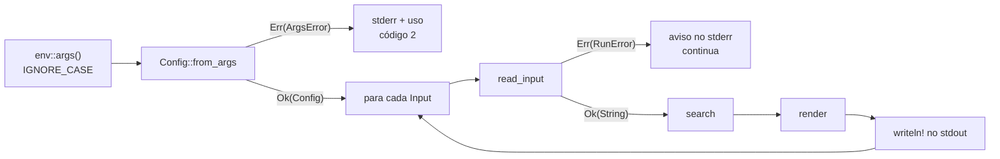

# Projeto 1 — `minigrep` melhorado

O Rust Book termina a parte básica com o `minigrep`, uma versão mínima do `grep`: um padrão, um arquivo, nenhuma flag. Neste projeto você constrói uma versão que se comporta como uma ferramenta de verdade: várias entradas, flags, erros tipados, códigos de saída e um caso que quase todo mundo esquece, o pipe fechado (`minigrep ... | head`).

O projeto fecha a Fase 1 e junta o que você viu nos Módulos 00 a 05. Não há conceito novo: o desafio é fazer as peças conversarem.

**Pré-requisitos:** Módulos [00](../../modulos/00-introducao/README.md) a [05](../../modulos/05-tratamento-de-erros/README.md).

**Objetivos.** Ao final, você vai ter:

- uma função de busca que devolve referências para dentro do texto, sem copiar nada (*lifetimes* numa struct);
- um parser de argumentos escrito à mão com `match`, `let...else` e um enum de erro;
- erros tipados que não derrubam o programa: um arquivo ruim gera um aviso, e os outros continuam sendo processados;
- um `main` que devolve `ExitCode` e trata o pipe fechado sem *panic*;
- testes unitários e de integração cobrindo tudo isso.

## O que o programa deve fazer

```text
uso: minigrep [-i] [-n] [-v] [-c] [--] PADRÃO [ARQUIVO...]
```

O `minigrep` imprime as linhas que **contêm** o `PADRÃO` (texto simples, sem expressões regulares).

| Opção | Forma longa | Efeito |
|---|---|---|
| `-i` | `--ignore-case` | ignora maiúsculas e minúsculas |
| `-n` | `--line-number` | mostra o número da linha (começando em 1) antes do texto |
| `-v` | `--invert-match` | mostra as linhas que **não** contêm o padrão |
| `-c` | `--count` | mostra só a quantidade de linhas, em vez das linhas |
| `--` | | encerra as opções: tudo o que vem depois é padrão ou arquivo, mesmo que comece com `-` |

Regras:

- **Entradas.** Sem arquivo, lê da entrada padrão (*stdin*). O nome `-` também quer dizer stdin, e pode ser misturado com arquivos.
- **Prefixo.** Com mais de uma entrada, cada linha de saída começa com o nome da entrada e `:` (a stdin aparece como `(entrada padrão)`). Com `-c`, a contagem também ganha o prefixo.
- **Ordem do prefixo.** `nome:número:linha`.
- **Opções em qualquer posição.** `minigrep foo -n a.txt` é o mesmo que `minigrep -n foo a.txt`. Opções combinadas (`-in`) **não** precisam funcionar (veja "Para ir além").
- **`IGNORE_CASE`.** Se a variável de ambiente `IGNORE_CASE` estiver definida (com qualquer valor), o programa age como se tivesse recebido `-i`. É o mesmo comportamento do minigrep do Book.
- **Erros.** Mensagens vão para a saída de erro (*stderr*), começando com `minigrep: `. Erro de argumento mostra também a linha de uso. Um arquivo que não abre gera um aviso, e o programa **continua** com as outras entradas.
- **Padrão vazio.** `minigrep ""` casa com todas as linhas, como no `grep` (todo texto contém o texto vazio).

**Códigos de saída** (a mesma convenção do `grep`, para o programa funcionar em scripts):

| Código | Quando |
|---|---|
| `0` | pelo menos uma linha foi mostrada (ou contada) e não houve erro |
| `1` | nenhuma linha casou e não houve erro |
| `2` | houve erro: argumento inválido ou alguma entrada que não pôde ser lida (mesmo que outras tenham casado) |

O pipe fechado não é erro: se quem lê a saída (`head`, por exemplo) fechar o pipe antes do fim, o programa termina em silêncio, com código `0`.

**Fora do escopo:** expressões regulares (crate `regex`, Módulo 17), busca recursiva em diretórios, `clap` (Módulo 16), cores e paralelismo (Projeto 4). Use **só a biblioteca padrão**.

### Exemplos

O arquivo [`inicial/poem.txt`](inicial/poem.txt) é o poema do Book ("I'm Nobody! Who are you?", de Emily Dickinson, em domínio público). Todas as saídas abaixo vêm da solução.

```bash
cargo run -q -- nobody poem.txt
```

```text
I'm nobody! Who are you?
Are you nobody, too?
```

```bash
cargo run -q -- -i -n NOBODY poem.txt
```

```text
1:I'm nobody! Who are you?
2:Are you nobody, too?
```

```bash
IGNORE_CASE=1 cargo run -q -- how poem.txt
```

```text
How dreary to be somebody!
How public, like a frog
```

```bash
cargo run -q -- -c you poem.txt
```

```text
4
```

```bash
cargo run -q -- -v -n e poem.txt
```

```text
5:
9:To an admiring bog!
```

(A linha 5 é a linha em branco entre as estrofes.)

Arquivo e stdin juntos, com prefixo:

```bash
echo "a frog in the bog" | cargo run -q -- frog poem.txt -
```

```text
poem.txt:How public, like a frog
(entrada padrão):a frog in the bog
```

`--` para buscar um texto que começa com `-`:

```bash
cargo run -q -- -- - poem.txt
```

```text
Then there's a pair of us - don't tell!
```

Um arquivo que não existe não impede o outro de ser lido, mas o código de saída avisa do problema:

```bash
cargo run -q -- frog poem.txt nao-existe.txt; echo "código: $?"
```

```text
poem.txt:How public, like a frog
minigrep: nao-existe.txt: No such file or directory (os error 2)
código: 2
```

Nenhuma linha casou:

```bash
cargo run -q -- rust poem.txt; echo "código: $?"
```

```text
código: 1
```

Erros de uso:

```bash
cargo run -q -- -x frog poem.txt
```

```text
minigrep: opção desconhecida: -x
uso: minigrep [-i] [-n] [-v] [-c] [--] PADRÃO [ARQUIVO...]
```

```bash
cargo run -q
```

```text
minigrep: faltou o padrão de busca
uso: minigrep [-i] [-n] [-v] [-c] [--] PADRÃO [ARQUIVO...]
```

Arquivo que não é texto UTF-8:

```text
minigrep: foto.bin: o arquivo não é UTF-8 válido
```

## Como começar

O projeto inicial está em [`inicial/`](inicial/). Ele já compila e passa no `clippy`: a estrutura, os tipos e as assinaturas estão prontos, os corpos das funções são `todo!()` e **todos os testes já estão escritos**. Seu trabalho é fazer os testes passarem, etapa por etapa.

```bash
cd projetos/01-minigrep/inicial
cargo build      # compila
cargo test       # falha: é o esperado, nada foi implementado ainda
```

Um teste de uma etapa que você ainda não fez falha assim:

```text
thread 'search::step1_tests::case_sensitive' (227433) panicked at src/search.rs:34:5:
not yet implemented
```

Os testes estão agrupados por etapa em módulos `stepN_tests`, então dá para rodar só os da etapa atual com um filtro: `cargo test step1`.

> [!TIP]
> Copie a pasta `inicial/` para fora do repositório (ou crie um branch) antes de começar, para poder comparar com o original depois.

### Estrutura

```text
inicial/
├── Cargo.toml
├── poem.txt          # texto para testes manuais
├── src/
│   ├── lib.rs        # RunError, read_input, render (e declara os módulos)
│   ├── search.rs     # Match<'a>, SearchOptions, search
│   ├── config.rs     # Input, Config, OutputOptions, ArgsError, Config::from_args
│   └── main.rs       # lê o ambiente, chama a biblioteca, imprime, ExitCode
└── tests/
    └── cli.rs        # testes de integração: rodam o executável de verdade
```

A divisão segue uma regra simples: **a biblioteca não imprime nada nem encerra o programa**. Ela recebe dados (o texto, os argumentos) e devolve dados (`Vec<Match>`, `Config`, `Vec<String>`, erros). Quem toca no mundo de fora (variáveis de ambiente, stdout, stderr, código de saída) é o `main.rs`. É o padrão do [Módulo 01](../../modulos/01-tour-da-sintaxe/README.md) (`lib.rs` + `main.rs`), levado a sério: tudo o que está na biblioteca pode ser testado com um `assert_eq!`, sem rodar o programa.

O fluxo completo:



## Etapas

Faça na ordem: cada etapa usa a anterior. Em cada uma há o objetivo, o conceito que ela pratica, o comando que deve passar no fim e dicas escondidas, para abrir só se travar.

### Etapa 1 — Busca com número de linha

**Pratica:** *lifetimes* em structs e em assinaturas ([Módulo 03](../../modulos/03-borrowing-e-lifetimes/README.md)), `lines()` e `enumerate()` ([Módulo 01](../../modulos/01-tour-da-sintaxe/README.md)).

**Objetivo.** Implemente `search` em `src/search.rs`, por enquanto ignorando o parâmetro `opts`. Ela devolve uma `Match` para cada linha que contém o padrão, com o número da linha (a partir de 1) e uma fatia `&str` da linha.

```rust
pub struct Match<'a> {
    pub line_no: usize,
    pub line: &'a str,
}

pub fn search<'a>(pattern: &str, contents: &'a str, opts: SearchOptions) -> Vec<Match<'a>>
```

**Teste:** `cargo test step1`.

A assinatura já vem pronta, mas vale entender por que ela é assim. `Match` guarda uma referência para dentro de `contents`: nenhuma linha é copiada (o teste `results_borrow_from_contents` confere isso comparando ponteiros). Por isso o compilador precisa saber de qual parâmetro o resultado empresta. Tire os `'a` e veja:

```rust
// ❌ NÃO COMPILA
pub fn search(pattern: &str, contents: &str) -> Vec<Match> {
```

```text
error[E0106]: missing lifetime specifier
 --> src/main.rs:6:53
  |
6 | pub fn search(pattern: &str, contents: &str) -> Vec<Match> {
  |                        ----            ----         ^^^^^ expected named lifetime parameter
  |
  = help: this function's return type contains a borrowed value, but the signature does not say whether it is borrowed from `pattern` or `contents`
help: consider introducing a named lifetime parameter
  |
6 | pub fn search<'a>(pattern: &'a str, contents: &'a str) -> Vec<Match<'a>> {
  |              ++++           ++                 ++                  ++++
```

A sugestão do `help` compila, mas amarra **os dois** parâmetros ao resultado. Isso diz ao compilador que o padrão também precisa viver tanto quanto as `Match`, o que é falso e restringe quem chama. Com essa versão, o teste `pattern_can_be_dropped_before_results`, que descarta o padrão antes de usar o resultado, deixa de compilar:

```text
error[E0597]: `pattern` does not live long enough
  --> src/main.rs:21:26
   |
20 |         let pattern = String::from("tape");
   |             ------- binding `pattern` declared here
21 |         matches = search(&pattern, poem);
   |                          ^^^^^^^^ borrowed value does not live long enough
22 |     }
   |     - `pattern` dropped here while still borrowed
23 |     println!("{}", matches[0].line);
   |                    ------- borrow later used here
```

A assinatura certa põe `'a` só em `contents`, de onde as fatias realmente vêm. Moral: a sugestão do compilador resolve o erro, mas não necessariamente expressa a sua intenção. Leia, entenda e decida.

<details>
<summary>Dica 1: o laço</summary>

`contents.lines()` percorre as linhas (sem o `\n`), e `.enumerate()` entrega o par `(índice, linha)`, com o índice começando em 0:

```rust
for (i, line) in contents.lines().enumerate() {
    // i + 1 é o número da linha
}
```

</details>

<details>
<summary>Dica 2: por que <code>line</code> já tem o lifetime certo</summary>

`lines()` chamado sobre um `&'a str` devolve fatias `&'a str` do mesmo texto. Então `Match { line_no: i + 1, line }` já é uma `Match<'a>`, sem nenhuma conversão. Se você usar `line.to_string()`, o tipo não bate: o campo é `&str`, não `String`.

</details>

### Etapa 2 — Opções de busca

**Pratica:** structs com `#[derive(Default)]` e a sintaxe de atualização `..Default::default()` ([Módulo 04](../../modulos/04-structs-enums-e-patterns/README.md)), `to_lowercase` e Unicode ([Módulo 02](../../modulos/02-ownership/README.md)).

**Objetivo.** Faça `search` respeitar as duas opções de `SearchOptions`:

```rust
#[derive(Debug, Clone, Copy, Default, PartialEq, Eq)]
pub struct SearchOptions {
    pub ignore_case: bool, // -i
    pub invert: bool,      // -v
}
```

**Teste:** `cargo test step2` (e `cargo test step1` continua passando).

Os testes montam as opções assim, mudando só o campo que interessa:

```rust
let opts = SearchOptions {
    ignore_case: true,
    ..Default::default()
};
```

`SearchOptions` é `Copy` (são só dois `bool`), então passá-la por valor não move nada que você vá sentir falta depois.

<details>
<summary>Dica 1: ignorar maiúsculas</summary>

Converta o padrão para minúsculas **uma vez**, antes do laço, e cada linha dentro do laço. `to_lowercase()` devolve um `String` novo: a linha original continua intacta, e é ela que vai para a `Match`.

</details>

<details>
<summary>Dica 2: inverter sem <code>if</code> aninhado</summary>

Calcule `let is_hit: bool = ...` e guarde a linha quando `is_hit != opts.invert`. Monte a tabela verdade das quatro combinações e confira.

</details>

> [!NOTE]
> `to_lowercase` resolve bem o caso comum, mas comparar textos ignorando maiúsculas não é 100% correto em todas as línguas (o `ß` alemão e o `İ` turco são os exemplos clássicos). O Book faz a mesma ressalva. Para este projeto, basta.

### Etapa 3 — Argumentos

**Pratica:** `match` em `&str`, `let...else` ([Módulo 04](../../modulos/04-structs-enums-e-patterns/README.md)), `String` x `&str` e `clone` ([Módulo 02](../../modulos/02-ownership/README.md)), enum de erro com `Display` ([Módulo 05](../../modulos/05-tratamento-de-erros/README.md)).

**Objetivo.** Implemente, em `src/config.rs`:

- `Config::from_args(args: &[String], ignore_case_env: bool) -> Result<Config, ArgsError>`, seguindo a especificação acima;
- `Input::name`, que devolve o nome usado no prefixo;
- o `Display` de `ArgsError`.

**Teste:** `cargo test step3`.

`args` não inclui o nome do programa: o `main` vai chamar `env::args().skip(1)`. E `ignore_case_env` vem de fora porque a função não deve ler o ambiente sozinha. Se lesse, os testes precisariam alterar a variável do processo com `env::set_var`, que é `unsafe` na edition 2024 (outro teste rodando em paralelo pode estar lendo o ambiente ao mesmo tempo). Receber um `bool` deixa a função pura e fácil de testar.

Uma armadilha no caminho: comparar um `&String` direto com literais não compila.

```rust
// ❌ NÃO COMPILA
for arg in args {
    match arg {
        "-i" => println!("i"),
        _ => {}
    }
}
```

```text
error[E0308]: mismatched types
  --> src/main.rs:20:13
   |
19 |         match arg {
   |               --- this expression has type `&String`
20 |             "-i" => println!("i"),
   |             ^^^^ expected `&String`, found `&str`
   |
   = note: expected reference `&String`
              found reference `&'static str`
```

Os padrões de um `match` precisam ter o mesmo tipo da expressão, e `"-i"` é `&str`. A correção é `match arg.as_str()`.

<details>
<summary>Dica 1: a estrutura geral</summary>

Uma passada só pelos argumentos. Cada um é **opção** (começa com `-`) ou **posicional**. Guarde os posicionais num `Vec<&str>`. No fim, o primeiro posicional é o padrão e o resto são as entradas.

```rust
let mut positional: Vec<&str> = Vec::new();
for arg in args {
    if /* não é opção */ {
        positional.push(arg);
        continue;
    }
    match arg.as_str() {
        "-i" | "--ignore-case" => search.ignore_case = true,
        // ...
        _ => return Err(ArgsError::UnknownFlag(arg.clone())),
    }
}
```

`positional.push(arg)` funciona com `arg: &String` porque o compilador converte `&String` em `&str` sozinho (*deref coercion*, que o Módulo 06 explica).

</details>

<details>
<summary>Dica 2: os casos especiais</summary>

- `-` sozinho começa com `-`, mas não é opção: é posicional (stdin). Teste isso **antes** do `match`.
- Depois de `--`, tudo é posicional. Um `bool` (`only_positional`) resolve.
- Sem nenhum posicional, falta o padrão. `let...else` deixa isso numa linha:

```rust
let Some(pattern) = positional.first() else {
    return Err(ArgsError::MissingPattern);
};
```

- Sem nenhuma entrada depois do padrão, `inputs` deve ser `vec![Input::Stdin]`.

</details>

<details>
<summary>Dica 3: <code>&[String]</code> e as cópias</summary>

Como `from_args` recebe uma fatia emprestada, ela não é dona dos `String`. Para guardar o padrão e o `UnknownFlag` dentro de valores que vão viver mais que `args`, é preciso copiar: `pattern.to_string()`, `arg.clone()`, `PathBuf::from(file)`. O Book faz o mesmo e chama isso de troca deliberada: são poucas strings, e o código fica simples. No Módulo 07 você vai reescrever a função consumindo um iterador, movendo as `String` em vez de copiá-las.

</details>

<details>
<summary>Dica 4: <code>Display</code> à mão</summary>

É a receita do Módulo 05: um `match self` com um `write!` por variante.

```rust
match self {
    ArgsError::MissingPattern => write!(f, "faltou o padrão de busca"),
    ArgsError::UnknownFlag(flag) => write!(f, "opção desconhecida: {flag}"),
}
```

</details>

### Etapa 4 — Lendo as entradas, com erros tipados

**Pratica:** `Result`, `?`, `map_err`, `io::ErrorKind`, `Display` + `Error` + `source()` ([Módulo 05](../../modulos/05-tratamento-de-erros/README.md)), enum com dados ([Módulo 04](../../modulos/04-structs-enums-e-patterns/README.md)).

**Objetivo.** Em `src/lib.rs`, implemente `read_input` e os `impl Display` e `impl Error` de `RunError`:

```rust
#[derive(Debug)]
pub enum RunError {
    Read { path: PathBuf, source: io::Error },
    NotUtf8 { path: PathBuf },
    Stdin(io::Error),
}

pub fn read_input(input: &Input) -> Result<String, RunError>
```

**Teste:** `cargo test step4`.

Repare na diferença em relação ao Book. Lá, o `run` devolve `Box<dyn Error>`: funciona, mas quem chama só consegue imprimir o erro, sem saber qual foi. Aqui o tipo diz exatamente o que pode dar errado, e cada variante carrega o contexto (o caminho do arquivo) junto da causa (o `io::Error`). É o mesmo papel do `raise ErroDeLeitura(path) from e` do Python, só que visível na assinatura.

O `String` que `read_input` devolve pertence a quem chamou. É dele que as `Match` da etapa 1 vão emprestar as linhas. Por isso o `main` guarda o texto numa variável antes de chamar `search`.

<details>
<summary>Dica 1: convertendo o erro</summary>

`fs::read_to_string(path)` devolve `Result<String, io::Error>`. Com `map_err`, você troca o tipo do erro e mantém o `Ok` como está:

```rust
fs::read_to_string(path).map_err(|source| RunError::Read {
    path: path.clone(),
    source,
})
```

Para a stdin, uma variante de tupla funciona como função, então `map_err(RunError::Stdin)` basta.

</details>

<details>
<summary>Dica 2: detectando "não é UTF-8"</summary>

Quando o arquivo não é UTF-8 válido, `read_to_string` falha com `io::ErrorKind::InvalidData`. Dentro da closure do `map_err`, olhe `source.kind()` e escolha a variante.

</details>

<details>
<summary>Dica 3: a causa aparece no texto?</summary>

O Módulo 05 recomenda **não** repetir no `Display` a causa que já sai por `source()`. Aqui fazemos uma exceção consciente: o `main` imprime só `{e}`, sem percorrer a cadeia de causas, e o usuário quer ver o motivo (`nao-existe.txt: No such file or directory (os error 2)`). Se você preferir a versão "pura", deixe o `Display` só com o caminho e faça o `main` percorrer `source()`, como a função `report` do Módulo 05. As duas escolhas são defensáveis. O importante é escolher uma e deixar comentado.

</details>

> [!NOTE]
> Por que não `thiserror`? Daria menos código, e é a escolha certa numa biblioteca de verdade. Aqui os `impl` à mão servem para consolidar a receita do Módulo 05 e deixam o projeto sem dependências. Trocar por `thiserror` está em "Para ir além", e a comparação do tamanho do código antes e depois é instrutiva.

### Etapa 5 — Formatando a saída

**Pratica:** `format!`, `Option<&str>`, fatias ([Módulo 01](../../modulos/01-tour-da-sintaxe/README.md), [Módulo 04](../../modulos/04-structs-enums-e-patterns/README.md)).

**Objetivo.** Implemente `render` em `src/lib.rs`. Ela recebe as `Match` de uma entrada e devolve as linhas de saída prontas, sem imprimir:

```rust
pub fn render(matches: &[Match<'_>], name: Option<&str>, opts: OutputOptions) -> Vec<String>
```

- `name` é `Some("arquivo")` quando o prefixo deve aparecer, e `None` quando não;
- com `opts.line_numbers`, cada linha ganha `N:` depois do prefixo;
- com `opts.count_only`, a saída é uma linha só, com a contagem (e o prefixo, se houver).

**Teste:** `cargo test step5`. Ao terminar, apague o `#![allow(unused)]` do topo do `lib.rs` e rode `cargo clippy`: não deve sobrar aviso.

O `'_` em `Match<'_>` diz "tem um lifetime aqui, e não preciso dar nome a ele". Como o retorno (`Vec<String>`) não empresta nada, nenhuma relação precisa ser declarada.

<details>
<summary>Dica</summary>

Monte o prefixo uma vez, como `String` (vazia quando `name` é `None`), e use-o em todos os `format!`:

```rust
let prefix = match name {
    Some(name) => format!("{name}:"),
    None => String::new(),
};
```

</details>

### Etapa 6 — `main`, códigos de saída e pipe fechado

**Pratica:** `fn main() -> ExitCode`, `?` com `io::Result`, *guards* no `match`, `eprintln!` ([Módulo 05](../../modulos/05-tratamento-de-erros/README.md)); testes de integração (prévia do Módulo 09).

**Objetivo.** Escreva `main` e `run` em `src/main.rs`:

- `main` lê os argumentos e `IGNORE_CASE`, chama `Config::from_args`, trata o erro de argumento (mensagem + uso, código 2) e transforma o resultado de `run` em `ExitCode`;
- `run` percorre as entradas, chama `read_input`, `search` e `render`, escreve cada linha no stdout e devolve o código (0, 1 ou 2). Um `RunError` vira aviso no stderr, e o laço segue (`continue`).

**Teste:** `cargo test --test cli` e, no fim, `cargo test` inteiro. Apague o `#![allow(unused)]` do `main.rs` e rode `cargo clippy`.

O `tests/cli.rs` já está pronto. Ele roda o executável de verdade (o Cargo informa o caminho em `env!("CARGO_BIN_EXE_minigrep")`) e confere a saída, o stderr e o código de saída. Leia os testes: eles são a especificação em forma de código. O Módulo 09 explica testes de integração em detalhe.

O teste que mais pega é o `closed_pipe_is_not_a_panic`. Com `println!`, o programa funciona até alguém fazer isto:

```rust
// 💥 PANIC EM RUNTIME (com o pipe fechado)
for line in render(&matches, prefix, cfg.output) {
    println!("{line}");
}
```

```bash
yes "linha a" | head -100000 | cargo run -q -- a | head -1
```

```text
linha a

thread 'main' (213925) panicked at /rustc/b940084d7eb6a299eb4bfeb8e34901bc051e7ac4/library/std/src/io/stdio.rs:1168:9:
failed printing to stdout: Broken pipe (os error 32)
note: run with `RUST_BACKTRACE=1` environment variable to display a backtrace
```

O `head` leu a linha de que precisava e fechou o pipe. A próxima escrita do `minigrep` falha, e o `println!` transforma essa falha em *panic*. Mas a falha é **esperada**, não um bug: pela regra do Módulo 05, ela deve ser um `Result`. A correção é escrever com `writeln!` num `io::stdout().lock()`, que devolve `io::Result<()>`, propagar com `?` até o `main` e lá tratar `io::ErrorKind::BrokenPipe` como fim normal.

Comparando com outras linguagens: em C e C++, escrever num pipe fechado dispara o sinal `SIGPIPE`, que por padrão encerra o processo em silêncio. Em Python, o `print` levanta `BrokenPipeError`, com um *traceback* parecido com o panic acima. O Rust ignora o `SIGPIPE` ao iniciar o programa e entrega o problema como um `io::Error` comum, que você decide como tratar.

<details>
<summary>Dica 1: o esqueleto do <code>main</code></summary>

```rust
let args: Vec<String> = env::args().skip(1).collect();
let ignore_case_env = env::var("IGNORE_CASE").is_ok();

let cfg = match Config::from_args(&args, ignore_case_env) {
    Ok(cfg) => cfg,
    Err(e) => {
        eprintln!("minigrep: {e}");
        eprintln!("{USAGE}");
        return ExitCode::from(ERROR);
    }
};
```

</details>

<details>
<summary>Dica 2: o <code>match</code> do resultado de <code>run</code></summary>

Um *guard* separa o pipe fechado dos outros erros de escrita:

```rust
match run(&cfg) {
    Ok(code) => ExitCode::from(code),
    Err(e) if e.kind() == io::ErrorKind::BrokenPipe => ExitCode::from(FOUND),
    Err(e) => {
        eprintln!("minigrep: erro ao escrever a saída: {e}");
        ExitCode::from(ERROR)
    }
}
```

</details>

<details>
<summary>Dica 3: o laço do <code>run</code></summary>

```rust
let mut stdout = io::stdout().lock();
for input in &cfg.inputs {
    let contents = match read_input(input) {
        Ok(contents) => contents,
        Err(e) => {
            eprintln!("minigrep: {e}");
            had_error = true;
            continue;
        }
    };
    let matches = search::search(&cfg.pattern, &contents, cfg.search);
    // atualize `found`, monte o prefixo e escreva com writeln!(stdout, "{line}")?
}
```

O `writeln!` num `StdoutLock` precisa do `use std::io::Write`, que já está no topo do arquivo. É uma *trait*, assunto do Módulo 06: por ora, basta saber que o import precisa estar lá.

Atenção ao prefixo: `input.name()` devolve um `String` novo. Guarde-o numa variável (`let name = input.name();`) antes de pegar `name.as_str()`. Escrever `Some(input.name().as_str())` direto dá E0716 (*temporary value dropped while borrowed*): o `String` temporário seria destruído no fim da instrução, e a referência ficaria apontando para o nada.

</details>

<details>
<summary>Dica 4: por que não <code>process::exit</code></summary>

O Book usa `process::exit(1)`. Ele encerra o processo na hora, sem rodar os `Drop` pendentes: um `BufWriter` sobre um arquivo, por exemplo, perderia o que ainda estivesse no buffer. Devolver um `ExitCode` do `main` deixa o programa terminar normalmente, destruindo tudo na ordem certa. E, se o `exit` estivesse dentro da biblioteca, nenhum teste conseguiria chamá-la.

</details>

### Etapa 7 — Acabamento

**Objetivo.** Deixe o projeto pronto para mostrar a alguém:

- `cargo test` passa inteiro (35 testes: 25 unitários e 10 de integração);
- nenhum `#![allow(unused)]` sobrou;
- `cargo clippy` e `cargo fmt --check` não mostram nada;
- teste à mão os exemplos do começo deste README, inclusive com `| head -1`.

Depois compare com a [solução](../../solucoes/projeto-01-minigrep/) e leia o README dela, que comenta as decisões.

## Critérios de aceite

- [ ] Todas as opções e regras da especificação funcionam, inclusive `--`, `-` e `IGNORE_CASE`.
- [ ] Os códigos de saída são 0, 1 e 2, conforme a tabela.
- [ ] Um arquivo ilegível gera um aviso e não interrompe os outros.
- [ ] `minigrep ... | head -1` não dá panic.
- [ ] Nenhum `unwrap`, `expect` ou `process::exit` fora dos testes.
- [ ] `search` não copia as linhas (o teste de ponteiros passa).
- [ ] `cargo test`, `cargo clippy` e `cargo fmt --check` limpos.

## Para ir além

Em ordem aproximada de dificuldade. Para cada item, escreva o teste primeiro.

1. **`thiserror`.** Troque os `impl Display` e `impl Error` à mão de `ArgsError` e `RunError` por `#[derive(thiserror::Error)]` (`cargo add thiserror`). Conte as linhas antes e depois. Cuidado com a armadilha da mensagem duplicada do Módulo 05.
2. **`-h`/`--help`.** Mostra o uso no **stdout** e sai com 0. Dica: uma nova variante no resultado de `from_args`, ou um campo em `Config`.
3. **Opções combinadas** (`-in`, `-vc`). Percorra os caracteres depois do `-` com `chars()` e faça `match` em cada `char`. O erro de opção desconhecida deve citar só a letra inválida.
4. **`-w` (palavra inteira).** Casar `cat` em "the cat sat", mas não em "concatenate". Sem regex: olhe o caractere antes e depois de cada ocorrência (`match_indices` + `char::is_alphanumeric`).
5. **Destacar o trecho casado** com códigos ANSI (`\x1b[31m` ... `\x1b[0m`), só quando a saída for um terminal (`std::io::IsTerminal`).
6. **Arquivos que não são UTF-8.** Em vez de recusar, leia os bytes com `fs::read` e converta com `String::from_utf8_lossy`. Repare que o retorno é um `Cow<str>` (Módulo 10): o que muda para o lifetime das `Match`?
7. **Contexto `-A N` / `-B N`** (linhas depois e antes de cada casamento, como no `grep`). É o mais difícil: exige guardar as linhas, lidar com sobreposição e imprimir `--` entre grupos.

## Este projeto volta

O `minigrep` não acaba aqui. Ele foi escrito só com o que você sabe até o Módulo 05, e algumas partes ficaram mais verbosas que o necessário, de propósito:

- **Módulo 06 (traits e generics):** `run` passa a receber `out: &mut impl Write` e fica testável sem rodar o executável.
- **Módulo 07 (iteradores e closures):** `search` vira uma cadeia de `filter`/`map`/`collect`, e `from_args` passa a consumir o iterador de `env::args()` em vez de copiar as `String`.
- **Módulo 16 (ecossistema):** o parser escrito à mão dá lugar ao `clap`, com ajuda, opções combinadas e mensagens de erro geradas automaticamente. O parser manual daqui serve para você entender o problema que o `clap` resolve, não como modelo de "jeito Rust".

## Leitura complementar

- [The Rust Programming Language, cap. 12: An I/O Project](https://doc.rust-lang.org/stable/book/ch12-00-an-io-project.html) (o minigrep original)
- [Command Line Applications in Rust](https://rust-cli.github.io/book/) (saída, códigos de saída e testes de CLI)
- std: [`std::env::args`](https://doc.rust-lang.org/std/env/fn.args.html), [`std::io::stdin`](https://doc.rust-lang.org/std/io/fn.stdin.html), [`std::process::ExitCode`](https://doc.rust-lang.org/std/process/struct.ExitCode.html), [`str::lines`](https://doc.rust-lang.org/std/primitive.str.html#method.lines)
- The Cargo Book: [`CARGO_BIN_EXE_<name>`](https://doc.rust-lang.org/cargo/reference/environment-variables.html#environment-variables-cargo-sets-for-crates)

---

[← Anterior](../../modulos/05-tratamento-de-erros/README.md) · [Índice do curso](../../README.md)
