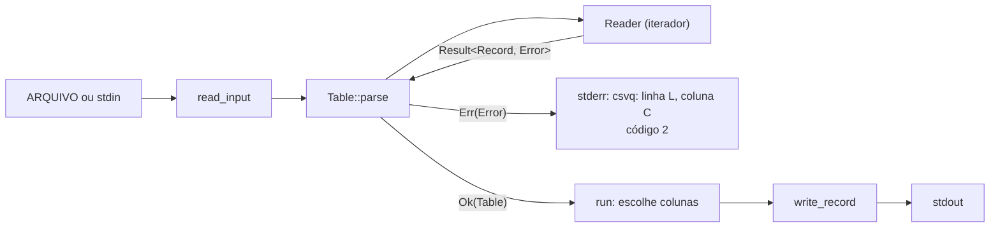

# Projeto 2 — `csvlite`: uma biblioteca de CSV com testes de verdade

CSV parece o formato mais fácil do mundo: `linha.split(',')` e pronto. Até aparecer um campo `"Rio; RJ"`, uma aspa dentro do texto (`"Carla ""Cacá"" Souza"`) ou um endereço com quebra de linha dentro das aspas. Aí *registro* deixa de ser *linha*, e o `split` quebra.

Neste projeto você escreve uma biblioteca, a `csvlite`, que lê e escreve CSV com aspas, e uma CLI pequena, a `csvq`, que usa essa biblioteca. As duas ficam num *workspace*. O foco não é só o parser: é entregar uma biblioteca **com cara de biblioteca**, ou seja, com API pública enxuta, documentação com exemplos que rodam, testes unitários, de integração e de propriedade, lints pedânticos, CI e um benchmark.

O projeto fecha a parte de biblioteca da Fase 2 e junta os Módulos 04 a 09.

> [!NOTE]
> Isto é um projeto de estudo. Para CSV em produção, use a crate [`csv`](https://docs.rs/csv), que o Módulo 17 apresenta. Ela é rápida, completa e testada há anos.

**Pré-requisitos:** Módulos [04](../../modulos/04-structs-enums-e-patterns/README.md) e [05](../../modulos/05-tratamento-de-erros/README.md), e principalmente [06](../../modulos/06-traits-e-generics/README.md), [07](../../modulos/07-colecoes-iteradores-e-closures/README.md), [08](../../modulos/08-modulos-e-crates/README.md) e [09](../../modulos/09-testes-e-qualidade/README.md).

**Objetivos.** Ao final, você vai ter:

- um iterador próprio, `Reader<'a>`, que empresta o texto e devolve `Result<Record, Error>` (uma pequena máquina de estados sobre `Peekable<Chars>`);
- erros com linha e coluna, que dizem exatamente onde o CSV está quebrado;
- uma API genérica (`impl Write`, `AsRef<str>`, `IntoIterator`) e uma trait própria, `FromRecord`;
- um workspace com lints compartilhados, uma fachada com `pub use` e documentação com doctests;
- uma propriedade do `proptest` que encontra bugs que você não imaginou, e um benchmark com `criterion`.

## O que a biblioteca aceita

Um subconjunto da [RFC 4180](https://www.rfc-editor.org/rfc/rfc4180):

- Registros separados por `\n` ou `\r\n`. A última linha pode não ter quebra.
- Campos separados pelo `delimiter` (padrão `,`; configurável, por exemplo `;`, o padrão do Excel em português).
- Um campo pode estar entre aspas duplas. Dentro das aspas, o separador e a quebra de linha são texto comum, e `""` representa uma aspa.
- Depois de fechar as aspas, só pode vir o separador, o fim da linha ou o fim da entrada. Qualquer outra coisa é erro.
- Fora das aspas, uma `"` no meio do campo é texto comum. A RFC proíbe, mas o módulo `csv` do Python aceita, e nós também.
- **Modo estrito** (padrão): todo registro tem o mesmo número de campos que o primeiro. Com `flexible: true`, essa verificação é desligada.
- Um erro encerra a leitura: o iterador devolve `Some(Err(..))` e depois só `None`.
- Linhas e colunas começam em 1. Para aspas não fechadas, a posição é a da aspa que **abriu**.

A API pública (tudo reexportado na raiz da crate):

```rust
pub struct Options { pub delimiter: char, pub flexible: bool }   // Default: ',' e false

pub struct Reader<'a> { /* privado */ }
impl<'a> Reader<'a> {
    pub fn new(input: &'a str, opts: Options) -> Self;
}
impl Iterator for Reader<'_> { type Item = Result<Record, Error>; }

pub struct Record { /* privado */ }
impl Record {
    pub fn from_fields<I, S>(fields: I) -> Self where I: IntoIterator<Item = S>, S: Into<String>;
    pub fn get(&self, i: usize) -> Option<&str>;
    pub fn len(&self) -> usize;
    pub fn is_empty(&self) -> bool;
    pub fn line(&self) -> usize;                    // linha em que o registro começa
    pub fn iter(&self) -> impl Iterator<Item = &str>;
}
impl<'a> IntoIterator for &'a Record { type Item = &'a str; /* ... */ }

pub struct Table { /* privado */ }
impl Table {
    pub fn parse(input: &str, opts: Options) -> Result<Self, Error>;   // 1º registro = cabeçalho
    pub fn headers(&self) -> &Record;
    pub fn rows(&self) -> &[Record];
    pub fn column(&self, name: &str) -> Option<impl Iterator<Item = &str>>;
    pub fn deserialize<T: FromRecord>(&self) -> Result<Vec<T>, Error>;
}

pub trait FromRecord: Sized {
    fn from_record(record: &Record) -> Result<Self, Error>;
}

pub fn write_record<W: Write, S: AsRef<str>>(out: &mut W, fields: &[S], delimiter: char) -> io::Result<()>;

pub struct Error { pub kind: ErrorKind, pub line: usize, pub column: usize }
pub enum ErrorKind {
    UnterminatedQuote,
    CharAfterQuote(char),
    FieldCount { expected: usize, found: usize },
    InvalidField { index: usize, message: String },  // usado por FromRecord
}
// Display: "linha L, coluna C: <descrição>"; Error implementa std::error::Error
```

## O que a CLI faz

```text
uso: csvq [-d SEP] [-c COL,COL...] [--count] [ARQUIVO]
```

| Opção | Efeito |
|---|---|
| `-d SEP` | separador (um caractere; padrão `,`) |
| `-c COLS` | só as colunas listadas, na ordem pedida (pelo nome no cabeçalho) |
| `--count` | só o número de registros (sem contar o cabeçalho) |
| `ARQUIVO` | sem arquivo, ou com `-`, lê da entrada padrão |

A saída é CSV válido (cabeçalho e registros), com aspas só onde precisa e o mesmo separador da entrada. Erros vão para o stderr com o prefixo `csvq: ` e código de saída 2. Erro de uso mostra também a linha de uso. Sucesso sai com 0. O parser de argumentos é escrito à mão, como no Projeto 1: o `clap` só aparece no Módulo 16.

**Fora do escopo:** inferir tipos de coluna, `serde`, ler arquivos maiores que a memória (`BufRead`), configurar o caractere de aspas, tirar espaços. Alguns desses itens estão em "Para ir além".

### Exemplos

O arquivo [`inicial/alunos.csv`](inicial/alunos.csv) usa `;`, tem um campo com `;` entre aspas, aspas duplicadas e uma quebra de linha dentro de um campo. As saídas abaixo vêm da solução, rodando na raiz do workspace com `cargo run -q -p csvq --`.

```text
$ cat alunos.csv
nome;cidade;nota
Ana;"Rio; RJ";9,5
Bruno;Recife;7
"Carla ""Cacá"" Souza";"São Paulo
SP";8
```

```text
$ csvq -d ';' -c nome,nota alunos.csv
nome;nota
Ana;9,5
Bruno;7
"Carla ""Cacá"" Souza";8
```

```text
$ csvq -d ';' -c nota,nome alunos.csv
nota;nome
9,5;Ana
7;Bruno
8;"Carla ""Cacá"" Souza"
```

```text
$ csvq -d ';' --count alunos.csv
3
```

São 3 registros, embora o arquivo tenha 5 linhas depois do cabeçalho: o último registro ocupa duas.

Esquecer o separador é um bom exemplo de erro útil. Com `,`, o cabeçalho tem 1 campo, e a linha 2 tem 2 (por causa da vírgula de `9,5`):

```text
$ csvq -c nome alunos.csv; echo "código: $?"
csvq: linha 2, coluna 1: esperava 1 campo, encontrei 2
código: 2
```

```text
$ printf 'a,b\n"x"y,2\n' | csvq; echo "código: $?"
csvq: linha 2, coluna 4: caractere 'y' depois de fechar aspas
código: 2
```

```text
$ printf 'a,b\n"x,y\n' | csvq
csvq: linha 2, coluna 1: aspas não fechadas
```

```text
$ csvq -d ';' -c idade alunos.csv
csvq: coluna inexistente: idade
$ csvq -x
csvq: opção desconhecida: -x
uso: csvq [-d SEP] [-c COL,COL...] [--count] [ARQUIVO]
$ csvq nao-existe.csv
csvq: nao-existe.csv: No such file or directory (os error 2)
```

A saída é CSV, então dá para encadear:

```text
$ csvq -d ';' alunos.csv | csvq -d ';' --count -
3
```

## Como começar

O projeto inicial está em [`inicial/`](inicial/). Ele compila e passa no `clippy`: a estrutura, os tipos e as assinaturas públicas estão prontos, os corpos das funções são `todo!()`, e os testes já estão escritos, agrupados em módulos `stepN_tests`. Seu trabalho é fazê-los passar, etapa por etapa.

```bash
cd projetos/02-csvlite/inicial
cargo build --workspace
cargo test --workspace     # falha: é o esperado, nada foi implementado ainda
cargo test step1           # só os testes da etapa 1
```

Um teste de uma etapa que você ainda não fez falha assim:

```text
thread 'reader::step1_tests::plain_records::case_1_simple' (37534) panicked at csvlite/src/reader.rs:51:9:
not yet implemented
```

> [!TIP]
> Copie a pasta `inicial/` para fora do repositório (ou crie um branch) antes de começar. Assim você pode comparar com o original depois e usar a pasta como raiz de um repositório seu na etapa 8 (CI).

### Estrutura

```text
inicial/
├── Cargo.toml                 # workspace virtual: resolver 3, [workspace.package], [workspace.lints]
├── Cargo.lock                 # um só, para o workspace inteiro
├── alunos.csv                 # exemplo para testes manuais
├── .github/workflows/ci.yml   # modelo de CI, para copiar para o seu repositório
├── csvlite/                   # a biblioteca
│   ├── Cargo.toml             # dev-dependencies: proptest, rstest, criterion; [[bench]] harness = false
│   ├── src/
│   │   ├── lib.rs             # //! doc da crate, módulos privados, pub use (a fachada)
│   │   ├── error.rs           # Error, ErrorKind, Display, std::error::Error
│   │   ├── record.rs          # Record, IntoIterator for &Record
│   │   ├── reader.rs          # Options, Reader (a máquina de estados)
│   │   ├── writer.rs          # write_record
│   │   ├── table.rs           # Table: parse, column, deserialize
│   │   └── from_record.rs     # a trait FromRecord
│   ├── tests/api.rs           # só a API pública: propriedade de ida e volta e FromRecord
│   └── benches/parse.rs       # criterion: Reader x Table em 10 mil registros
└── csvq/                      # a CLI
    ├── Cargo.toml             # csvlite.workspace = true
    ├── src/main.rs            # parse_args, read_input, run, main
    └── tests/cli.rs           # roda o executável (CARGO_BIN_EXE_csvq)
```

A regra do Projeto 1 continua valendo, agora entre crates: **a biblioteca não imprime nada**. Ela recebe texto e devolve dados ou erros. Quem lê arquivos, escreve no stdout e escolhe o código de saída é a `csvq`.



## Etapas

Faça na ordem. Cada etapa diz o que pratica, o que fazer, o comando que deve passar no fim e traz dicas escondidas.

### Etapa 0 — Conhecer o workspace

**Pratica:** workspaces, `[workspace.package]`, `[workspace.lints]`, `-p` ([Módulo 08](../../modulos/08-modulos-e-crates/README.md)).

**Objetivo.** Sem escrever código, explore o projeto por 10 minutos:

```bash
cargo build --workspace
cargo test -p csvlite step1     # só a biblioteca, só a etapa 1
cargo tree -p csvq
```

Responda: quantos `Cargo.lock` e quantas pastas `target/` existem depois do build? (Uma de cada, na raiz: o workspace compartilha as duas.) O que acontece se você apagar a linha `resolver = "3"` do `Cargo.toml` da raiz?

```text
warning: virtual workspace defaulting to `resolver = "1"` despite one or more workspace members being on edition 2024 which implies `resolver = "3"`
  |
  = note: to keep the current resolver, specify `workspace.resolver = "1"` in the workspace root's manifest
  = note: to use the edition 2024 resolver, specify `workspace.resolver = "3"` in the workspace root's manifest
```

Num pacote sozinho, a edition 2024 já implica o resolver 3. Num workspace *virtual* (sem `[package]` na raiz), não há edition na raiz, então o Cargo volta ao resolver 1 e avisa. Ponha a linha de volta.

Leia também os `Cargo.toml` dos membros: `version.workspace = true`, `edition.workspace = true` e `[lints] workspace = true` herdam da raiz. O `pedantic` do clippy está ligado para o workspace inteiro.

**Teste:** nenhum.

### Etapa 1 — Registros simples

**Pratica:** `Peekable<Chars>`, `match` em `char` com guardas, `let...else` ([Módulo 04](../../modulos/04-structs-enums-e-patterns/README.md)); `Iterator` e `Option<Self::Item>` ([Módulo 07](../../modulos/07-colecoes-iteradores-e-closures/README.md)).

**Objetivo.** Em `csvlite/src/reader.rs`, implemente `Reader::new` e `Iterator for Reader` para entradas **sem aspas**: separador, `\n`, `\r\n`, campos vazios, última linha sem quebra e entrada vazia (nenhum registro).

**Teste:** `cargo test step1`.

O `Reader` guarda um `Peekable<Chars<'a>>`, um iterador de caracteres que deixa olhar o próximo sem consumir (`peek`). Por isso ele tem o lifetime `'a`: empresta o texto de quem chamou. Os testes desta etapa leem `record.fields` direto: o campo é `pub(crate)`, visível dentro da crate e invisível para quem a usa ([Módulo 08](../../modulos/08-modulos-e-crates/README.md)).

<details>
<summary>Dica 1: por que não <code>lines()</code> e <code>split()</code></summary>

Funciona nesta etapa, e quebra na próxima: `"São Paulo\nSP"` é um campo só, e `lines()` corta no meio. Comece já com o laço de caracteres; a etapa 2 só acrescenta um caso.

</details>

<details>
<summary>Dica 2: posição num lugar só</summary>

Escreva um método `bump(&mut self) -> Option<char>` que consome um caractere e atualiza `line` e `column` (num `\n`, `line += 1` e `column = 1`; senão, `column += 1`). Se todo consumo passar por ele, as posições dos erros da etapa 2 saem de graça.

</details>

<details>
<summary>Dica 3: a forma do <code>next</code></summary>

```rust
fn next(&mut self) -> Option<Self::Item> {
    self.chars.peek()?;            // acabou a entrada: None
    Some(self.read_record())       // read_record lê campos até o fim do registro
}
```

Um método auxiliar que lê um campo e diz **como ele terminou** (um `enum End { Field, Record }` privado) deixa o `read_record` com um laço de quatro linhas. `\r` seguido de `\n` termina o registro: consuma os dois.

</details>

### Etapa 2 — Aspas

**Pratica:** máquina de estados, `peek` para decidir sem consumir ([Módulo 07](../../modulos/07-colecoes-iteradores-e-closures/README.md)), guardas no `match` ([Módulo 04](../../modulos/04-structs-enums-e-patterns/README.md)).

**Objetivo.** Campos entre aspas, com separador, `""` e quebra de linha dentro. Erros `UnterminatedQuote` (na posição em que a aspa **abriu**) e `CharAfterQuote`.

**Teste:** `cargo test step2`. Os erros são testados com `rstest`, um caso por linha:

```rust
#[rstest]
#[case::open_quote("a,\"b", ErrorKind::UnterminatedQuote, 1, 3)]
#[case::open_quote_on_line_2("a,b\n\"x,y\n", ErrorKind::UnterminatedQuote, 2, 1)]
#[case::junk_after_quotes("\"a\"b,c", ErrorKind::CharAfterQuote('b'), 1, 4)]
#[case::junk_on_line_2("a,b\n\"x\"y,2\n", ErrorKind::CharAfterQuote('y'), 2, 4)]
fn errors_with_position(#[case] input: &str, #[case] kind: ErrorKind, #[case] line: usize, #[case] column: usize) {
    // ...
    assert_eq!(read_all(input, opts), Err(Error { kind, line, column }));
}
```

<details>
<summary>Dica 1: as aspas duplicadas</summary>

Dentro das aspas, ao encontrar uma `"`, olhe o próximo com `peek`. Se for outra `"`, é uma aspa literal: consuma e guarde `"`. Se não for, as aspas fecharam. Uma guarda resolve:

```rust
match self.bump() {
    None => return Err(/* UnterminatedQuote */),
    Some('"') if self.chars.peek() == Some(&'"') => { self.bump(); field.push('"'); }
    Some('"') => break,
    Some(c) => field.push(c),
}
```

</details>

<details>
<summary>Dica 2: a posição do erro de aspas abertas</summary>

Quando a entrada acaba, `line` e `column` apontam para o **fim** do texto, talvez muitas linhas depois. Uma mensagem "linha 300, coluna 1: aspas não fechadas" não ajuda ninguém a achar o problema. Guarde `(self.line, self.column)` **antes** de consumir a aspa de abertura e use esses valores no erro.

</details>

<details>
<summary>Dica 3: depois de fechar</summary>

Depois de fechar as aspas, reaproveite a lógica de "fim de campo" da etapa 1: separador, `\n`, `\r\n` ou fim da entrada. Qualquer outro caractere vira `CharAfterQuote(c)`, na posição dele (guarde a posição antes do `bump`).

</details>

### Etapa 3 — Erros, `Display` e modo estrito

**Pratica:** `Display` à mão e `std::error::Error` ([Módulo 05](../../modulos/05-tratamento-de-erros/README.md), [Módulo 06](../../modulos/06-traits-e-generics/README.md)), `Option::get_or_insert`, `assert_matches!` ([Módulo 09](../../modulos/09-testes-e-qualidade/README.md)).

**Objetivo.**

- `FieldCount` quando `flexible == false` e um registro tem um número de campos diferente do primeiro (posição: início do registro, coluna 1);
- depois de devolver um `Err`, o iterador devolve sempre `None`;
- `impl Display` para `ErrorKind` e `Error`, no formato `linha L, coluna C: ...`, com "1 campo" no singular.

**Teste:** `cargo test step3`. Um dos testes usa `assert_matches!`, que mostra o valor quando falha:

```rust
let mut it = Reader::new("a,b\nc,d,e\nf,g\n", Options::default());
assert_matches!(it.next(), Some(Ok(_)));
assert_matches!(it.next(), Some(Err(Error { kind: ErrorKind::FieldCount { .. }, .. })));
assert_matches!(it.next(), None);
```

<details>
<summary>Dica 1: lembrar do primeiro registro</summary>

O campo `expected: Option<usize>` começa `None`. `*self.expected.get_or_insert(record.len())` devolve o valor guardado ou, na primeira vez, guarda e devolve o tamanho atual. Uma linha só, sem `if`.

</details>

<details>
<summary>Dica 2: parar depois do erro</summary>

Sem o campo `done`, o iterador continuaria lendo do meio de um campo quebrado e produziria lixo. Antes de devolver `Some(Err(..))`, ponha `self.done = true`; no começo do `next`, `if self.done { return None; }`. É a mesma ideia de um iterador "fundido" (`Iterator::fuse`), só que por conta própria.

</details>

### Etapa 4 — `Record`, `Table` e a fachada

**Pratica:** `IntoIterator` com tipo associado, `impl Iterator` no retorno, `move` em closures ([Módulo 06](../../modulos/06-traits-e-generics/README.md), [Módulo 07](../../modulos/07-colecoes-iteradores-e-closures/README.md)); `collect::<Result<_, _>>()` e `transpose` ([Módulo 05](../../modulos/05-tratamento-de-erros/README.md)); módulos privados e `pub use` ([Módulo 08](../../modulos/08-modulos-e-crates/README.md)).

**Objetivo.** Os métodos de `Record` e de `Table` e o `into_iter` de `IntoIterator for &Record`.

**Teste:** `cargo test step4`. O doctest `compile_fail` do `lib.rs` (`cargo test --doc`) garante que `csvlite::reader::Reader` **não** existe para quem usa a crate. Sem ele, um `pub mod reader;` esquecido passaria despercebido. Num exemplo à parte (`csvlite/examples/x.rs`), o erro que ele espera aparece assim:

```text
error[E0603]: module `reader` is private
  --> csvlite/examples/x.rs:1:14
   |
 1 | use csvlite::reader::Reader;
   |              ^^^^^^  ------ struct `Reader` is not publicly re-exported
   |              |
   |              private module
```

(Na stable, o `compile_fail` só confere que **não compila**; o código do erro não é verificado.)

Em `record.rs` e `table.rs`, `iter` e `column` vêm com um `todo!() as ...` estranho. Ele só existe para o projeto inicial compilar: uma função que devolve `impl Iterator` precisa de um tipo concreto, e `todo!()` não tem nenhum. Troque a linha inteira pela sua implementação.

<details>
<summary>Dica 1: o tipo de <code>IntoIter</code></summary>

O tipo já vem pronto, e vale entender por quê:

```rust
type IntoIter = Map<slice::Iter<'a, String>, fn(&String) -> &str>;
```

O natural seria `type IntoIter = impl Iterator<Item = &'a str>;`, mas isso ainda não existe na stable:

```text
error[E0658]: `impl Trait` in associated types is unstable
  --> csvlite/src/record.rs:74:21
   |
74 |     type IntoIter = impl Iterator<Item = &'a str>;
   |                     ^^^^^^^^^^^^^^^^^^^^^^^^^^^^^
```

E deixar o compilador adivinhar (`Map<slice::Iter<'a, String>, _>`) também não: o tipo de uma closure não tem nome. A saída é usar um **ponteiro de função** (`fn(&String) -> &str`), que tem nome. `String::as_str` serve, sem closure nenhuma: `self.fields.iter().map(String::as_str)`.

</details>

<details>
<summary>Dica 2: <code>Table::parse</code> em três linhas</summary>

O primeiro registro é o cabeçalho, mas a entrada pode estar vazia. `reader.next()` é um `Option<Result<Record, Error>>`; `transpose()` o vira `Result<Option<Record>, Error>`, e aí o `?` funciona:

```rust
let headers = reader.next().transpose()?.unwrap_or_default();
let rows = reader.collect::<Result<Vec<_>, _>>()?;
```

O `collect` para `Result<Vec<_>, _>` para no primeiro `Err`.

</details>

<details>
<summary>Dica 3: <code>column</code></summary>

Ache o índice com `self.headers.iter().position(|h| h == name)?` e devolva `Some(self.rows.iter().map(move |row| ...))`. O `move` é necessário porque a closure usa `index`, uma variável local que morre quando `column` retorna. Uma linha curta demais (modo flexível) contribui com `""`.

</details>

### Etapa 5 — Escrever, e a propriedade de ida e volta

**Pratica:** generics com `W: Write` e `S: AsRef<str>` ([Módulo 06](../../modulos/06-traits-e-generics/README.md)), `str::contains` com um array de `char`, `proptest` ([Módulo 09](../../modulos/09-testes-e-qualidade/README.md)).

**Objetivo.** Implemente `write_record` em `writer.rs`: campos separados pelo `delimiter`, registro terminado por `\n`, aspas **só quando precisa** e `"` duplicada dentro das aspas.

**Teste:** `cargo test step5`. Ele roda os testes de `writer.rs` e a propriedade de `tests/api.rs`, já escrita:

```rust
proptest! {
    #![proptest_config(ProptestConfig::with_cases(64))]

    #[test]
    fn round_trip(records in prop::collection::vec(prop::collection::vec("\\PC*", 1..4), 1..20)) {
        let text = write_all(&records);
        let opts = Options { flexible: true, ..Options::default() };
        let read: Vec<Vec<String>> = Reader::new(&text, opts)
            .map(|r| r.unwrap().iter().map(String::from).collect())
            .collect();
        prop_assert_eq!(read, records);
    }
}
```

Em vez de exemplos escolhidos por você, o `proptest` gera até 20 registros de 1 a 3 campos com qualquer texto Unicode imprimível (`\PC*`), escreve, lê de volta e compara.

Aqui está a melhor lição do projeto. **Escreva primeiro a versão ingênua**: aspas só quando o campo contém o separador. Os testes unitários de `writer.rs` vão reclamar, mas rode só a propriedade (`cargo test --test api round_trip`):

```text
thread 'step5_tests::round_trip' (170547) panicked at csvlite/tests/api.rs:18:5:
Test failed: called `Result::unwrap()` on an `Err` value: Error { kind: UnterminatedQuote, line: 1, column: 1 }.
minimal failing input: records = [
    [
        "\"",
    ],
]
```

O proptest achou uma entrada que quebra e depois a **encolheu** (*shrinking*) até o mínimo: um registro com um campo que é só uma aspa. A versão ingênua escreve `"` sem aspas em volta, e o leitor entende que um campo entre aspas começou e nunca fechou. Ele também grava a semente em `csvlite/tests/api.proptest-regressions`, para repetir esse caso primeiro nas próximas execuções. Commite esse arquivo.

Um segundo experimento: troque, na propriedade, `Options { flexible: true, .. }` por `Options::default()`.

```text
Test failed: called `Result::unwrap()` on an `Err` value: Error { kind: FieldCount { expected: 2, found: 1 }, line: 2, column: 1 }.
minimal failing input: records = [
    [
        "",
        "",
    ],
    [
        "",
    ],
]
```

Agora o bug não é do código: é da **propriedade**. Os registros gerados têm tamanhos diferentes, e o leitor estrito está certo em recusar. O teste também pode estar errado. Volte o `flexible: true`.

Os dois casos estão guardados como testes com nome em `tests/api.rs` (`lone_quote_round_trips` e `records_of_different_lengths_need_flexible`). É um bom hábito: o caso que o proptest achou vira um teste de exemplo legível.

<details>
<summary>Dica 1: quando pôr aspas</summary>

Um campo precisa de aspas se contém o separador, `"`, `\n` ou `\r`. `str::contains` aceita um array de caracteres como padrão:

```rust
if field.contains([delimiter, '"', '\n', '\r']) { /* aspas */ }
```

</details>

<details>
<summary>Dica 2: <code>W: Write</code> e <code>S: AsRef&lt;str&gt;</code></summary>

`W: Write` faz a mesma função escrever num `Vec<u8>` (testes), no stdout (a `csvq`) ou num arquivo. `S: AsRef<str>` aceita `&[&str]` e `&[String]`: chame `field.as_ref()` para ter um `&str`. Use `write!`/`writeln!` e propague com `?`; é por isso que o retorno é `io::Result<()>`.

</details>

### Etapa 6 — `FromRecord`

**Pratica:** definir e implementar uma trait própria, `T: FromRecord` como *bound*, `T::from_record` como função ([Módulo 06](../../modulos/06-traits-e-generics/README.md)), closures que constroem erros, `ok_or_else` e `map_err` ([Módulo 05](../../modulos/05-tratamento-de-erros/README.md), [Módulo 07](../../modulos/07-colecoes-iteradores-e-closures/README.md)).

**Objetivo.**

- `Error::invalid_field` (em `error.rs`) e `Table::deserialize::<T>()`;
- em `tests/api.rs`, **escreva você** o corpo de `FromRecord for Person { name: String, age: u32 }`: campo ausente vira `"campo ausente"`, idade inválida vira a mensagem do erro de `parse`.

**Teste:** `cargo test step6`. A mensagem esperada para `Bruno,vinte` na linha 3:

```text
linha 3, coluna 1: campo 2: invalid digit found in string
```

No fim da etapa, apague os atributos provisórios `#![allow(unused)]` e `#![allow(clippy::needless_pass_by_value)]` do topo do `lib.rs` e o `#[allow(unused_variables)]` de `tests/api.rs`.

O `#[derive(Deserialize)]` da crate `serde` gera, para cada struct, exatamente esse tipo de código: ler cada campo, converter, e montar um erro com contexto quando algo falha. O Projeto 3 usa o `serde` de verdade, como receita, e o Módulo 16 explica.

<details>
<summary>Dica 1: <code>deserialize</code></summary>

`self.rows.iter().map(T::from_record).collect()`. A função associada da trait funciona como função comum no `map`, e o `collect` para `Result<Vec<T>, Error>` faz o resto.

</details>

<details>
<summary>Dica 2: uma closure para cada campo</summary>

```rust
let field = |i: usize| {
    record.get(i).ok_or_else(|| Error::invalid_field(record, i, "campo ausente"))
};
let name = field(0)?.to_string();
```

O `message: impl Display` de `invalid_field` aceita tanto um `&str` quanto o `ParseIntError` do `parse`.

</details>

### Etapa 7 — A CLI `csvq`

**Pratica:** dependência entre membros do workspace ([Módulo 08](../../modulos/08-modulos-e-crates/README.md)), parser manual com `while let` e `match` (Projeto 1), `ExitCode` ([Módulo 05](../../modulos/05-tratamento-de-erros/README.md)), `io::stdout().lock()` como `impl Write` ([Módulo 06](../../modulos/06-traits-e-generics/README.md)).

**Objetivo.** `parse_args`, `read_input`, `run` e `main` em `csvq/src/main.rs`, seguindo a especificação. `CliError` e o `Display` dele já estão prontos.

**Teste:** `cargo test -p csvq`. São os testes unitários de `main.rs` (`step7_tests`) e o `tests/cli.rs`, que roda o executável com `CARGO_BIN_EXE_csvq`. Esse arquivo fica em `csvq/tests/`, e não em `csvlite/tests/`, porque o Cargo só define `CARGO_BIN_EXE_<nome>` para os testes do pacote que tem o binário. No fim, apague o `#![allow(...)]` do topo do `main.rs`.

<details>
<summary>Dica 1: <code>run</code> testável</summary>

`run(args, input, out: &mut impl Write)` recebe o texto já lido e escreve em `out`. Nos testes unitários, `out` é um `Vec<u8>`; no `main`, é `io::stdout().lock()`. É o `run` com `&mut impl Write` que o Projeto 1 prometeu para o Módulo 06.

</details>

<details>
<summary>Dica 2: colunas na ordem pedida</summary>

Transforme os nomes em índices uma vez, antes do laço, com `position` e `ok_or_else(|| CliError::UnknownColumn(..))`, coletando para `Result<Vec<usize>, _>`. Sem `-c`, os índices são `0..headers.len()`. Depois, para o cabeçalho e cada registro (`std::iter::once(table.headers()).chain(table.rows())`), monte um `Vec<&str>` com os campos escolhidos e chame `write_record`.

</details>

<details>
<summary>Dica 3: o <code>main</code></summary>

```rust
match result {
    Ok(()) => ExitCode::SUCCESS,
    Err(CliError::Write(e)) if e.kind() == io::ErrorKind::BrokenPipe => ExitCode::SUCCESS,
    Err(e) => {
        eprintln!("csvq: {e}");
        if matches!(e, CliError::Usage(_)) {
            eprintln!("{USAGE}");
        }
        ExitCode::from(2)
    }
}
```

O pipe fechado (`csvq ... | head -1`) é o mesmo caso do Projeto 1.

</details>

### Etapa 8 — Documentação, lints e CI

**Pratica:** `//!`, `///`, seções `# Errors` e `# Examples`, doctests com `?` e `Ok::<(), E>(())` ([Módulo 08](../../modulos/08-modulos-e-crates/README.md)); `missing_docs`, clippy pedântico, `CARGO_BUILD_WARNINGS`, CI ([Módulo 09](../../modulos/09-testes-e-qualidade/README.md)).

**Objetivo.**

1. Apague o `#![allow(clippy::missing_errors_doc)]` do `lib.rs`. O clippy vai pedir uma seção `# Errors` em cada função pública que devolve `Result`:

   ```text
   warning: docs for function returning `Result` missing `# Errors` section
     --> csvlite/src/table.rs:14:5
      |
   14 |     pub fn parse(input: &str, opts: Options) -> Result<Self, Error> {
      |     ^^^^^^^^^^^^^^^^^^^^^^^^^^^^^^^^^^^^^^^^^^^^^^^^^^^^^^^^^^^^^^^
      |
      = note: `-W clippy::missing-errors-doc` implied by `-W clippy::pedantic`
   ```

2. Escreva doctests: pelo menos um exemplo da crate com `;` no `//!` do `lib.rs`, um em `Record::from_fields` e um em `write_record` (com `?` e `# Ok::<(), std::io::Error>(())` no fim, escondido da documentação).
3. Deixe tudo limpo:

```bash
cargo fmt --all --check
CARGO_BUILD_WARNINGS=deny cargo clippy --workspace --all-targets
cargo test --workspace
CARGO_BUILD_WARNINGS=deny cargo doc --workspace --no-deps
cargo +1.96 check --workspace --all-targets   # se tiver a toolchain 1.96 instalada
```

4. Copie a pasta `inicial/` para a raiz de um repositório seu, com a pasta `.github/`, e veja o CI rodar. O GitHub só executa os workflows que estão em `.github/workflows/` **na raiz** do repositório, por isso o arquivo aqui é só um modelo.

Duas pegadinhas que já estão resolvidas no `main.rs` da `csvq`, e que vale entender. O `missing_docs = "warn"` do workspace vale também para a crate binária. Sem o `//!` no topo do `main.rs`:

```text
warning: missing documentation for the crate
   --> csvq/src/main.rs:1:1
```

E a linha de uso no `//!` fica num bloco ` ```text `, porque `[ARQUIVO]` entre colchetes vira um link da documentação para um item que não existe:

```text
warning: unresolved link to `ARQUIVO`
 --> csvq/src/main.rs:3:51
  |
3 | //! uso: csvq [-d SEP] [-c COL,COL...] [--count] [ARQUIVO]
  |                                                   ^^^^^^^ no item named `ARQUIVO` in scope
  |
  = help: to escape `[` and `]` characters, add '\' before them like `\[` or `\]`
```

Com `CARGO_BUILD_WARNINGS=deny`, os dois avisos derrubam o CI.

### Etapa 9 — Medir

**Pratica:** `criterion`, `std::hint::black_box`, `cargo bench` ([Módulo 09](../../modulos/09-testes-e-qualidade/README.md)).

**Objetivo.** O benchmark de `csvlite/benches/parse.rs` está pronto: ele compara ler 10 mil registros com o `Reader`, um por vez (`reader_iter`), e montar a `Table` inteira (`table_parse`). Rode e anote os números aqui no README:

```bash
cargo bench -p csvlite --bench parse -- --warm-up-time 1 --measurement-time 3
```

O `--bench parse` importa: sem ele, o Cargo passa as opções do criterion também para o executável de testes da biblioteca, que não as conhece (`error: Unrecognized option: 'warm-up-time'`).

Na solução (Apple Silicon):

```text
reader_iter             time:   [2.3864 ms 2.3920 ms 2.3978 ms]
table_parse             time:   [2.3720 ms 2.3874 ms 2.4101 ms]
```

Os três números são o limite inferior, a estimativa e o limite superior do tempo por iteração. **Por que os dois são praticamente iguais**, se a `Table` guarda tudo e o `Reader` não guarda nada? Pense antes de abrir.

<details>
<summary>Resposta</summary>

Os dois alocam uma `String` para cada campo, 30 mil por iteração. Guardar ou não os registros num `Vec` custa pouco perto disso. Para ficar mais rápido, o caminho é **não copiar**: um campo sem aspas é uma fatia da entrada e poderia ser um `&'a str`. Só os campos com `""` precisam de uma `String` nova. É exatamente o que o `Cow<'a, str>` do Módulo 10 permite, e é o item 1 de "Para ir além".

</details>

Depois, compare com a [solução](../../solucoes/projeto-02-csvlite/) e leia o README dela, que comenta as decisões.

## Critérios de aceite

- [ ] `cargo test --workspace` passa inteiro.
- [ ] Nenhum `pub mod` no `lib.rs`: a API é só o que a raiz reexporta.
- [ ] Toda função pública tem `///`; as que devolvem `Result` têm `# Errors`; `cargo doc` sem avisos.
- [ ] `CARGO_BUILD_WARNINGS=deny cargo clippy --workspace --all-targets` limpo, com o `pedantic` ligado.
- [ ] `cargo fmt --all --check` limpo.
- [ ] Nenhum `unwrap` ou `expect` fora dos testes e do benchmark.
- [ ] A propriedade de ida e volta passa, e o arquivo `proptest-regressions` está commitado.
- [ ] O README tem os seus números do benchmark e a explicação.

## Para ir além

1. **Zero-copy com `Cow<'a, str>`** (depois do Módulo 10): campos sem aspas viram `Cow::Borrowed`, só os com `""` alocam. Meça de novo com o criterion.
2. **`BufRead` em vez de `&str`**: ler arquivos grandes aos poucos. O `Reader` passa a ser dono de um buffer, e você vai ver por que o lifetime `'a` estava lá.
3. **Feature `serde`**: uma feature opcional que implementa `FromRecord` para qualquer `T: Deserialize`. Exercita `optional = true`, `dep:serde` e `#[cfg(feature = "serde")]` (Módulos 08 e 16).
4. **`csvq --where coluna=valor`**: um filtro simples, com o parser de argumentos crescendo.
5. **Fuzzing** com `cargo-fuzz` (nightly) no `Reader`: nenhuma entrada pode dar *panic*.
6. **Comparar com a crate `csv`**: mesmos dados, mesma tarefa, medir. Depois, leia o `csv-core`, uma máquina de estados movida a tabela.

## Este projeto volta

- **Módulo 10:** `Cow` no `Record` (item 1 acima).
- **Módulo 16:** `clap` no lugar do parser manual da `csvq`, e `serde` no lugar do `FromRecord` à mão.

## Leitura complementar

- [RFC 4180](https://www.rfc-editor.org/rfc/rfc4180) e o [módulo `csv` do Python](https://docs.python.org/3/library/csv.html) (para comparar `delimiter` e o tratamento de aspas)
- The Rust Programming Language: [13.2 iteradores](https://doc.rust-lang.org/stable/book/ch13-02-iterators.html), [14.2 documentação](https://doc.rust-lang.org/stable/book/ch14-02-publishing-to-crates-io.html), [14.3 workspaces](https://doc.rust-lang.org/stable/book/ch14-03-cargo-workspaces.html), [cap. 11 testes](https://doc.rust-lang.org/stable/book/ch11-00-testing.html)
- std: [`Iterator`](https://doc.rust-lang.org/std/iter/trait.Iterator.html), [`Peekable`](https://doc.rust-lang.org/std/iter/struct.Peekable.html), [`io::Write`](https://doc.rust-lang.org/std/io/trait.Write.html)
- docs.rs: [proptest](https://docs.rs/proptest/latest/proptest/), [rstest](https://docs.rs/rstest/latest/rstest/), [criterion](https://docs.rs/criterion/latest/criterion/), [`csv`](https://docs.rs/csv/latest/csv/)

---

[← Anterior](../../modulos/09-testes-e-qualidade/README.md) · [Índice do curso](../../README.md) · [Próximo →](../03-tarefas/README.md)
