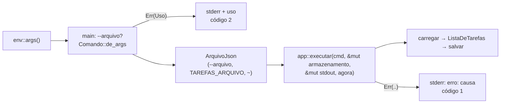

# Projeto 3 — `tarefas`: uma lista de tarefas com persistência em JSON

O Projeto 2 foi uma biblioteca. Este é uma **aplicação**: uma lista de tarefas na linha de comando, que grava tudo num arquivo JSON. O problema é simples de propósito, para sobrar atenção para o que a Fase 2 ensinou sobre organizar código: uma *trait* para trocar o arquivo por memória nos testes, a saída como `&mut impl Write`, o relógio passado como parâmetro, erros com cadeia de causas e uma gravação que não corrompe o arquivo se o programa cair no meio.

O JSON é feito com `serde` e `serde_json`, usados **como receita**: um `#[derive]` e três atributos. O que o `derive` gera e como o `serde` funciona por dentro ficam para o Módulo 16. O parser de argumentos é escrito à mão, com *slice patterns*; o `clap` também é assunto do Módulo 16.

**Pré-requisitos:** Módulos [04](../../modulos/04-structs-enums-e-patterns/README.md) e [05](../../modulos/05-tratamento-de-erros/README.md), e principalmente [06](../../modulos/06-traits-e-generics/README.md), [07](../../modulos/07-colecoes-iteradores-e-closures/README.md), [08](../../modulos/08-modulos-e-crates/README.md) e [09](../../modulos/09-testes-e-qualidade/README.md). O [Projeto 2](../02-csvlite/README.md) não é obrigatório, mas a etapa 2 compara o `serde` com o `FromRecord` de lá.

**Objetivos.** Ao final, você vai ter:

- tipos com `FromStr`, `Display` (com `f.pad`) e `Ord` derivado, e o JSON gerado por `#[derive(Serialize, Deserialize)]`;
- uma trait `Armazenamento` com duas implementações: o arquivo de verdade e uma `Memoria` para os testes;
- uma função `executar` que não toca no mundo (arquivo, stdout e relógio chegam por parâmetro) e por isso tem testes unitários;
- gravação segura (arquivo temporário + `rename`) e erros com linha e coluna quando o JSON está quebrado;
- testes do executável que nunca tocam no seu `~/.tarefas.json`.

## O que o programa deve fazer

```text
uso: tarefas [--arquivo CAMINHO] <add TÍTULO... [-p PRIORIDADE] | list [--todas] | done ID | rm ID | stats>
```

| Comando | Efeito | Saída |
|---|---|---|
| `add TÍTULO... [-p alta\|media\|baixa]` | cria a tarefa; o título são as palavras juntadas por espaço; prioridade padrão `media` (aceita `a`, `m`, `b` e `média`, sem diferenciar maiúsculas) | `tarefa N criada` |
| `list` | as pendentes, ordenadas por prioridade (alta primeiro) e id | uma linha por tarefa |
| `list --todas` | também as feitas, depois das pendentes | idem |
| `done ID` | marca como feita | nada |
| `rm ID` | remove | `removida: TÍTULO` |
| `stats` | contagem | `N tarefas, F feitas, P pendentes` |

Formato da linha: `[x]   2  media  Revisar o Projeto 2` (`[ ]` ou `[x]`, o id alinhado à direita em 3 colunas, a prioridade alinhada à esquerda em 5, o título).

Regras:

- **Arquivo:** `--arquivo CAMINHO` (no começo), senão a variável `TAREFAS_ARQUIVO`, senão `~/.tarefas.json`.
- **Ids nunca são reaproveitados:** o arquivo guarda `proximo_id`, e um `rm` não libera o número.
- **Arquivo inexistente é lista vazia.** Ele só é criado na primeira gravação.
- **Gravação segura:** grava em `ARQUIVO.tmp` e renomeia por cima do original. Se o programa cair no meio, o arquivo antigo fica inteiro.
- **Códigos de saída:** `0` sucesso; `1` erro de execução (id inexistente, arquivo ilegível, JSON inválido); `2` erro de uso (mostra também a linha de uso).
- **Erros** vão para o stderr com o prefixo `tarefas: `, seguidos das causas (`: causa`).

**Fora do escopo:** datas legíveis, prazos, editar o título, desfazer, cores, `clap` e dois processos gravando ao mesmo tempo (o último a gravar ganha; veja "Para ir além").

### Exemplos

Todas as saídas abaixo vêm da solução.

```text
$ tarefas add Estudar o Módulo 09 -p alta
tarefa 1 criada
$ tarefas add Revisar o Projeto 2
tarefa 2 criada
$ tarefas add Comprar café -p b
tarefa 3 criada
$ tarefas done 2
$ tarefas list
[ ]   1  alta   Estudar o Módulo 09
[ ]   3  baixa  Comprar café
$ tarefas list --todas
[ ]   1  alta   Estudar o Módulo 09
[ ]   3  baixa  Comprar café
[x]   2  media  Revisar o Projeto 2
$ tarefas stats
3 tarefas, 1 feitas, 2 pendentes
$ tarefas rm 3
removida: Comprar café
$ tarefas add Ler o Módulo 10
tarefa 4 criada
```

O id 3 não volta: a nova tarefa é a 4. O arquivo fica assim:

```json
{
  "versao": 1,
  "proximo_id": 5,
  "tarefas": [
    {
      "id": 1,
      "titulo": "Estudar o Módulo 09",
      "prioridade": "alta",
      "feita": false,
      "criada_em": 1793015307
    },
    {
      "id": 2,
      "titulo": "Revisar o Projeto 2",
      "prioridade": "media",
      "feita": true,
      "criada_em": 1793015307
    },
    {
      "id": 4,
      "titulo": "Ler o Módulo 10",
      "prioridade": "media",
      "feita": false,
      "criada_em": 1793015307
    }
  ]
}
```

Erros:

```text
$ tarefas done 9; echo "código: $?"
tarefas: não existe tarefa com id 9
código: 1
$ tarefas add; echo "código: $?"
tarefas: faltou o título
uso: tarefas [--arquivo CAMINHO] <add TÍTULO... [-p PRIORIDADE] | list [--todas] | done ID | rm ID | stats>
código: 2
$ tarefas add x -p urgente
tarefas: prioridade inválida: urgente (use alta, media ou baixa)
uso: tarefas [--arquivo CAMINHO] <add TÍTULO... [-p PRIORIDADE] | list [--todas] | done ID | rm ID | stats>
```

Um arquivo editado à mão (caminho encurtado) e um que nem é JSON. Os erros do `serde_json` já trazem linha e coluna:

```text
tarefas: …/demo.json não é um arquivo de tarefas válido: unknown variant `urgente`, expected one of `baixa`, `media`, `alta` at line 15 column 29
tarefas: bad2.json não é um arquivo de tarefas válido: expected value at line 1 column 1
```

## Como começar

O projeto inicial está em [`inicial/`](inicial/). Ele compila e passa no `clippy`. Os tipos, as assinaturas e os testes estão prontos; os corpos são `todo!()`. Nas etapas 4, 5 e 6, além de fazer os testes prontos passarem, você **escreve** um teste seu.

```bash
cd projetos/03-tarefas/inicial
cargo test          # falha: é o esperado
cargo test step1    # só a etapa 1
```

> [!WARNING]
> Não rode `cargo run` sem `--arquivo` enquanto estiver desenvolvendo: o padrão é o `~/.tarefas.json` de verdade. Use `cargo run -q -- --arquivo /tmp/t.json list`, ou `TAREFAS_ARQUIVO=/tmp/t.json cargo run -q -- list`.

### Estrutura

```text
inicial/
├── Cargo.toml          # serde (feature derive), serde_json, thiserror; dev: rstest, insta, tempfile; [lints]
├── clippy.toml         # allow-unwrap-in-tests = true
├── src/
│   ├── lib.rs          # declara os módulos; reexporta Erro
│   ├── erro.rs         # enum Erro (thiserror): Uso, NaoEncontrada, Io, Json, Saida (pronto)
│   ├── tarefa.rs       # Prioridade (FromStr, Display, Ord, Default), Tarefa (Display)
│   ├── lista.rs        # ListaDeTarefas: adicionar, concluir, remover, listar, contagem
│   ├── armazenamento.rs# trait Armazenamento; ArquivoJson (.tmp + rename); Memoria
│   ├── comando.rs      # enum Comando, Comando::de_args (slice patterns), USO
│   ├── app.rs          # executar(cmd, &mut impl Armazenamento, &mut impl Write, agora)
│   └── main.rs         # --arquivo/variável/pasta pessoal, relógio, stdout, ExitCode
└── tests/
    └── cli.rs          # roda o executável, sempre numa pasta temporária
```



O `executar` só conhece a trait `Armazenamento` e um `impl Write`. No programa, eles são o arquivo e o stdout; nos testes, uma `Memoria` e um `Vec<u8>`.

## Etapas

### Etapa 1 — O modelo: `Prioridade` e `Tarefa`

**Pratica:** `derive` de `PartialOrd`/`Ord`/`Default` com `#[default]`, `FromStr`, `Display` à mão com `f.pad` ([Módulo 06](../../modulos/06-traits-e-generics/README.md)); `rstest` com `#[case]` ([Módulo 09](../../modulos/09-testes-e-qualidade/README.md)).

**Objetivo.** Em `src/tarefa.rs`: `FromStr for Prioridade` (com apelidos, com e sem acento, sem diferenciar maiúsculas), o `Display` de `Prioridade` e o de `Tarefa`.

**Teste:** `cargo test step1`.

A ordem `Baixa < Media < Alta` não precisa de código: o `#[derive(PartialOrd, Ord)]` de um enum segue a ordem das variantes. É por isso que elas estão declaradas de baixo para cima. O `#[default]` em `Media` diz o que `Prioridade::default()` devolve.

<details>
<summary>Dica 1: <code>FromStr</code></summary>

```rust
match s.to_lowercase().as_str() {
    "alta" | "a" => Ok(Prioridade::Alta),
    // ...
    _ => Err(format!("prioridade inválida: {s} (use alta, media ou baixa)")),
}
```

`"MÉDIA".to_lowercase()` é `"média"`: o `to_lowercase` do Rust trata Unicode, então basta listar a forma com acento.

</details>

<details>
<summary>Dica 2: por que <code>f.pad</code></summary>

O `Display` de `Tarefa` usa `{:<5}` na prioridade, para alinhar as colunas. Quem respeita largura e alinhamento é a implementação do `Display` do tipo, não o `format!`. Com `write!(f, "{nome}")`, o `{:<5}` é ignorado e as colunas desalinham (o teste `display_respeita_largura` pega isso). `f.pad(nome)` aplica a largura, o alinhamento e o preenchimento pedidos.

</details>

<details>
<summary>Dica 3: a linha de <code>Tarefa</code></summary>

```rust
write!(f, "[{marca}] {:>3}  {:<5}  {}", self.id, self.prioridade, self.titulo)
```

</details>

### Etapa 2 — JSON como receita

**Pratica:** features de dependências ([Módulo 08](../../modulos/08-modulos-e-crates/README.md)), atributos do `serde`, snapshot com `insta` ([Módulo 09](../../modulos/09-testes-e-qualidade/README.md)).

**Objetivo.** Os tipos já têm `#[derive(Serialize, Deserialize)]`. Faltam dois atributos em `tarefa.rs`, nos lugares marcados:

- `#[serde(rename_all = "lowercase")]` em `Prioridade`, para gravar `"alta"` em vez de `"Alta"`;
- `#[serde(default, skip_serializing_if = "Vec::is_empty")]` em `etiquetas`: o campo some do JSON quando está vazio, e arquivos antigos, gravados antes de o campo existir, continuam carregando.

**Teste:** `cargo test step2`. Sem os atributos, o snapshot do `insta` mostra a diferença:

```text
-old snapshot
+new results
────────────┬───────────────────────────────────────────────────────────────────
    1       │-{"id":1,"titulo":"Estudar o M09","prioridade":"alta","feita":false,"criada_em":0}
          1 │+{"id":1,"titulo":"Estudar o M09","prioridade":"Alta","feita":false,"criada_em":0,"etiquetas":[]}
```

E o arquivo antigo não carrega:

```text
called `Result::unwrap()` on an `Err` value: Error("unknown variant `baixa`, expected one of `Baixa`, `Media`, `Alta`", line: 1, column: 41)
```

O snapshot fica no próprio código (`@r#"..."#`, um *inline snapshot*). Quando ele falha, o `insta` grava um arquivo `.pending-snap` ao lado do fonte, para você revisar com `cargo insta review` (instalado à parte, com `cargo install cargo-insta`). Aqui você não deve aceitar o novo valor: quem está errado é o código. Apague o `.pending-snap` quando o teste passar.

O campo `etiquetas` ainda não é usado por nenhum comando (veja "Para ir além"). Ele está aí para mostrar como um formato de arquivo evolui sem quebrar os arquivos que já existem.

> [!NOTE]
> **O que o `derive` faz.** Lembra do `FromRecord` do Projeto 2, que lia cada campo, convertia e montava um erro com a posição? `#[derive(Deserialize)]` gera esse código para você, para qualquer formato que o `serde` suporte (JSON, TOML, YAML...). O Módulo 16 explica como.

Dois erros que vale provocar, para reconhecer depois. Tire `features = ["derive"]` da linha do `serde` no `Cargo.toml`:

```text
error: cannot find derive macro `Serialize` in this scope
   --> src/lista.rs:9:39
    |
  9 | #[derive(Debug, Clone, PartialEq, Eq, Serialize, Deserialize)]
    |                                       ^^^^^^^^^
    |
note: `Serialize` is a trait, not a derive macro
   --> …/serde_core-1.0.229/src/ser/mod.rs:234:1
    |
234 | pub trait Serialize {
    | ^^^^^^^^^^^^^^^^^^^
    = help: consider implementing `Serialize` for your type manually
```

O nome `Serialize` existe (é a trait), mas a macro de mesmo nome só vem com a feature `derive`. Ponha a feature de volta e, agora, tire o `Serialize` do `derive` de `Prioridade`:

```text
error[E0277]: the trait bound `Prioridade: serde::Serialize` is not satisfied
    --> src/tarefa.rs:47:39
     |
  47 | #[derive(Debug, Clone, PartialEq, Eq, Serialize, Deserialize)]
     |                                       ^^^^^^^^^ unsatisfied trait bound
...
  51 |     pub prioridade: Prioridade,
     |     --- required by a bound introduced by this call
     |
help: the trait `Serialize` is not implemented for `Prioridade`
    --> src/tarefa.rs:10:1
     |
  10 | pub enum Prioridade {
     | ^^^^^^^^^^^^^^^^^^^
     = note: for local types consider adding `#[derive(serde::Serialize)]` to your `Prioridade` type
     = note: for types from other crates check whether the crate offers a `serde` feature flag
```

O `derive` de `Tarefa` só funciona se cada campo também for `Serialize`. A segunda `note` é a ligação com o Módulo 08: muitas crates (`uuid`, `chrono`, `jiff`...) só implementam as traits do `serde` com uma feature ligada.

### Etapa 3 — `ListaDeTarefas`

**Pratica:** iteradores (`iter_mut().find`, `position`, `filter`, `count`), `sort_by_key` com tupla e `std::cmp::Reverse` ([Módulo 07](../../modulos/07-colecoes-iteradores-e-closures/README.md)), `ok_or` ([Módulo 05](../../modulos/05-tratamento-de-erros/README.md)).

**Objetivo.** Os cinco métodos de `src/lista.rs`: `adicionar(titulo, prioridade, agora) -> u32`, `concluir`, `remover`, `listar(todas) -> Vec<&Tarefa>` e `contagem() -> (total, feitas)`.

**Teste:** `cargo test step3`.

Por que `agora` é parâmetro, e não `SystemTime::now()` dentro de `adicionar`? Porque um teste não controla o relógio. Em Python você trocaria a função em tempo de execução (`freezegun`, `monkeypatch`); em Rust isso não existe, e o desenho testável é receber o valor de fora. Quem lê o relógio de verdade é o `main`.

<details>
<summary>Dica 1: achar ou dar erro</summary>

```rust
let tarefa = self.tarefas.iter_mut().find(|t| t.id == id).ok_or(Erro::NaoEncontrada(id))?;
tarefa.feita = true;
```

Para `remover`, `position` dá o índice, e `Vec::remove(i)` devolve a tarefa.

</details>

<details>
<summary>Dica 2: a ordem da listagem numa linha</summary>

`sort_by_key` aceita uma tupla, comparada campo a campo: `(t.feita, Reverse(t.prioridade), t.id)`. `false < true` põe as pendentes antes; `Reverse` inverte a ordem da prioridade (alta primeiro); o id desempata. A ordenação é estável, mas com o id na chave nem é preciso contar com isso.

</details>

### Etapa 4 — Persistência

**Pratica:** trait própria com duas implementações ([Módulo 06](../../modulos/06-traits-e-generics/README.md)), `io::ErrorKind::NotFound`, enum de erro com `thiserror` e `#[source]` ([Módulo 05](../../modulos/05-tratamento-de-erros/README.md)), `tempfile::tempdir()` ([Módulo 09](../../modulos/09-testes-e-qualidade/README.md)).

**Objetivo.** Em `src/armazenamento.rs`: `temporario`, `carregar` e `salvar` de `ArquivoJson`, e a `Memoria`.

**Teste:** `cargo test step4`. O teste `json_quebrado_vira_erro_com_posicao` espera a causa `expected value at line 2 column 13`, que vem pronta do `serde_json`.

**Escreva você** um teste a mais: salvar uma lista com uma tarefa, remover a tarefa, salvar de novo e conferir que o arquivo agora tem a lista vazia (o `rename` substitui o destino). Use `tempfile::tempdir()`: a pasta é criada pelo teste e apagada quando a variável sai de escopo, e nenhum teste toca em arquivo fora dela.

<details>
<summary>Dica 1: por que <code>.tmp</code> + <code>rename</code></summary>

Se o programa escrever direto no arquivo e cair no meio (falta de luz, `Ctrl+C`, disco cheio), sobra um JSON pela metade, e a lista inteira se perde. Escrevendo num arquivo à parte e depois renomeando, o pior caso é um `.tmp` sobrando: o original continua inteiro. Em Unix, `fs::rename` substitui o destino de uma vez só (é atômico) quando os dois estão no mesmo sistema de arquivos, por isso o `.tmp` fica na mesma pasta.

</details>

<details>
<summary>Dica 2: <code>temporario</code></summary>

`Path::with_extension("tmp")` trocaria `tarefas.json` por `tarefas.tmp`, o que funciona mas confunde. Para acrescentar, trabalhe com o `OsString`:

```rust
let mut nome = caminho.as_os_str().to_owned();
nome.push(".tmp");
PathBuf::from(nome)
```

</details>

<details>
<summary>Dica 3: o <code>expect</code> do <code>salvar</code></summary>

`serde_json::to_string_pretty` devolve `Result`, mas, para uma struct de campos simples (sem mapas com chaves que não são texto), ele não tem como falhar. Um `expect("ListaDeTarefas sempre vira JSON")` com um comentário explicando é o uso legítimo de `expect` do Módulo 05: documenta uma garantia. O `Cargo.toml` liga o lint `clippy::unwrap_used`, que proíbe `unwrap`, mas não `expect`.

</details>

### Etapa 5 — Comandos

**Pratica:** *slice patterns* com `@ ..` e literais ([Módulo 04](../../modulos/04-structs-enums-e-patterns/README.md)), `map_err(Erro::Uso)` passando a variante como função ([Módulo 05](../../modulos/05-tratamento-de-erros/README.md), [Módulo 07](../../modulos/07-colecoes-iteradores-e-closures/README.md)), `rstest` ([Módulo 09](../../modulos/09-testes-e-qualidade/README.md)).

**Objetivo.** `Comando::de_args` e `id` em `src/comando.rs`.

**Teste:** `cargo test step5`.

**Escreva você** mais um `#[case]` na tabela `invalidos`: `["add", "-p", "alta"]`. Antes de rodar, pense: o que o seu `de_args` faz com ele?

Compare com o laço `while let` do Projeto 1 e da `csvq`: aqui, cada forma válida da linha de comando é um padrão.

<details>
<summary>Dica 1: o esqueleto</summary>

```rust
match args {
    ["add", resto @ ..] => { /* título e prioridade */ }
    ["list"] => Ok(Comando::Listar { todas: false }),
    ["list", "--todas"] => Ok(Comando::Listar { todas: true }),
    ["done", n] => Ok(Comando::Concluir(id(n)?)),
    // rm, stats...
    [] => Err(Erro::Uso("faltou o comando".into())),
    [outro, ..] => Err(Erro::Uso(format!("comando desconhecido ou argumentos errados: {outro}"))),
}
```

</details>

<details>
<summary>Dica 2: a prioridade no fim</summary>

Um segundo `match`, agora sobre `resto`, separa a prioridade do título:

```rust
let (palavras, prioridade) = match resto {
    [inicio @ .., "-p", p] => (inicio, p.parse().map_err(Erro::Uso)?),
    _ => (resto, Prioridade::default()),
};
```

`p.parse()` dá `Result<Prioridade, String>`, e `Erro::Uso` é uma função `String -> Erro`. Depois, se `palavras` estiver vazio, é `"faltou o título"`; senão, `palavras.join(" ")`.

</details>

### Etapa 6 — `executar` testável

**Pratica:** `&mut impl Armazenamento` e `&mut impl Write` ([Módulo 06](../../modulos/06-traits-e-generics/README.md)), um *mock* feito à mão com uma trait ([Módulo 09](../../modulos/09-testes-e-qualidade/README.md)).

**Objetivo.** `app::executar`. Carregue a lista, aplique o comando, grave só se ela mudou, e escreva a saída em `saida`. No fim, apague o `#![allow(unused)]` do `lib.rs`.

**Teste:** `cargo test step6`. Os testes contam as gravações (`memoria.gravacoes`): `Concluir` grava uma vez, `Listar` e um id inexistente não gravam nada.

**Escreva você** o teste de que `Estatisticas` também não grava.

A `Memoria` é um *mock* sem biblioteca nenhuma: uma struct que implementa a mesma trait e guarda o que aconteceu. Para isso, basta o código depender da trait, e não do tipo concreto. Crates como `mockall` geram esses tipos automaticamente, mas aqui não precisa.

<details>
<summary>Dica</summary>

Os erros de `writeln!` são `io::Error`, e a variante `Erro::Saida(#[from] io::Error)` deixa o `?` convertê-los sozinho. No `Adicionar`, grave **antes** de escrever `tarefa N criada`: se a gravação falhar, o usuário não vê uma mensagem de sucesso falsa.

</details>

### Etapa 7 — `main`, códigos de saída e testes do executável

**Pratica:** `ExitCode`, percorrer `source()` ([Módulo 05](../../modulos/05-tratamento-de-erros/README.md)), *slice patterns* para `--arquivo` ([Módulo 04](../../modulos/04-structs-enums-e-patterns/README.md)), `CARGO_BIN_EXE` e `Command::env` ([Módulo 09](../../modulos/09-testes-e-qualidade/README.md)).

**Objetivo.** Em `src/main.rs`: `caminho_padrao`, `agora`, `rodar` e `main`. No fim, apague o `#![allow(unused)]` do `main.rs`.

**Teste:** `cargo test --test cli` e depois `cargo test` inteiro.

Leia o `tests/cli.rs` antes de começar. Todo teste cria uma pasta com `tempfile::tempdir()` e passa o arquivo por `--arquivo` ou por `Command::env("TAREFAS_ARQUIVO", ...)`. O teste da pasta pessoal faz `Command::env("HOME", pasta_temporaria)`: a variável muda **só no processo filho**. Nunca use `std::env::set_var` num teste: na edition 2024 ele é `unsafe`, porque altera o ambiente do processo inteiro enquanto outros testes, rodando em paralelo, podem estar lendo.

<details>
<summary>Dica 1: <code>--arquivo</code> com slice pattern</summary>

```rust
let (caminho, resto) = match args {
    ["--arquivo", caminho, resto @ ..] => (Some(PathBuf::from(caminho)), resto),
    _ => (None, args),
};
```

Interprete o comando (`Comando::de_args(resto)?`) **antes** de procurar o caminho padrão: um erro de uso deve aparecer mesmo sem pasta pessoal.

</details>

<details>
<summary>Dica 2: o caminho padrão</summary>

`env::var_os("TAREFAS_ARQUIVO")` devolve `Option<OsString>` (não falha com caminhos que não são UTF-8). Senão, `env::home_dir()` com `.join(".tarefas.json")`. Se ela devolver `None`, é um `Erro::Uso` pedindo `--arquivo`.

</details>

<details>
<summary>Dica 3: a cadeia de causas</summary>

O `Display` de `Erro::Json` diz só o contexto (`... não é um arquivo de tarefas válido`); a posição do erro vem da causa. Percorra `source()` como no Módulo 05:

```rust
let mut mensagem = format!("tarefas: {e}");
let mut causa = e.source();
while let Some(c) = causa {
    mensagem.push_str(&format!(": {c}"));
    causa = c.source();
}
```

`source()` é um método da trait `std::error::Error`, que precisa estar em escopo (`use std::error::Error as _;`). Depois, `Erro::Uso(_)` sai com 2 (e a linha de uso), o resto com 1, e `Erro::Saida` com pipe fechado, com 0.

</details>

### Etapa 8 — Acabamento

- `cargo test` passa inteiro (52 testes na solução: 46 unitários, contando os três que você escreveu, e 6 do executável);
- `CARGO_BUILD_WARNINGS=deny cargo clippy --all-targets` e `cargo fmt --check` limpos, sem nenhum `#![allow(unused)]`;
- o único `expect` fora dos testes tem um comentário explicando;
- copie o `.github/workflows/ci.yml` do [Projeto 2](../02-csvlite/inicial/.github/workflows/ci.yml) para um repositório seu com este projeto, tirando os `--workspace` e o passo do `cargo bench`;
- teste à mão os exemplos do começo (com `--arquivo`) e um JSON corrompido de propósito.

Repare num detalhe do `tests/cli.rs`: ele tem um `#![allow(clippy::unwrap_used)]`. O `allow-unwrap-in-tests` do `clippy.toml` só vale para funções `#[test]` e código em `#[cfg(test)]`, e as funções auxiliares do arquivo (`tarefas`, `stdout`) não são nem uma coisa nem outra.

Depois compare com a [solução](../../solucoes/projeto-03-tarefas/) e leia o README dela.

## Critérios de aceite

- [ ] Todos os comandos e regras da especificação funcionam; códigos de saída 0, 1 e 2.
- [ ] Ids nunca se repetem, mesmo depois de `rm`.
- [ ] Arquivo inexistente vira lista vazia; JSON inválido gera mensagem com linha e coluna, sem *panic*.
- [ ] A gravação usa `.tmp` + `rename`, e o `.tmp` não sobra.
- [ ] `executar` está na biblioteca e tem testes com `Memoria`; nenhum teste usa o arquivo real do usuário.
- [ ] Nenhum `unwrap` fora dos testes; no máximo o `expect` documentado.
- [ ] `cargo test`, `cargo clippy --all-targets` (com `CARGO_BUILD_WARNINGS=deny`) e `cargo fmt --check` limpos.

## Para ir além

1. **`edit ID TÍTULO...`** e **`tag ID ETIQUETA`**, usando o campo `etiquetas` que já existe, e `list --tag x`.
2. **Migração de versão:** um arquivo `"versao": 2` com um campo novo obrigatório. Leia a versão primeiro (com `serde_json::Value`) e converta. É para isso que o campo `versao` existe.
3. **Prazos com `jiff`**: `add ... --ate 2026-11-01` e `list --atrasadas`.
4. **Trocar o parser pelo `clap`** (derive, subcomandos): é o que o Módulo 16 faz. Compare as mensagens de erro e o `--help` gerados.
5. **Propriedade com `proptest`:** para qualquer sequência de comandos, o total é igual às adições menos as remoções bem-sucedidas, e os ids são estritamente crescentes.
6. **Trava de arquivo** contra dois processos gravando ao mesmo tempo (`File::lock`, estável desde a 1.89).
7. **`list --json`**, reaproveitando o `Serialize`.

## Este projeto volta

- **Módulo 16:** `clap` com subcomandos derivados no lugar de `de_args`, e o `serde` explicado (o que o `derive` gera, os atributos, TOML).
- **Projeto 6 (API REST):** o mesmo domínio de tarefas, agora como recurso HTTP com `axum` e `sqlx`. A trait `Armazenamento` ganha uma implementação com banco de dados.

## Leitura complementar

- [serde.rs](https://serde.rs/): [derive](https://serde.rs/derive.html), [atributos de container](https://serde.rs/container-attrs.html), [atributos de campo](https://serde.rs/field-attrs.html)
- docs.rs: [serde_json](https://docs.rs/serde_json/latest/serde_json/), [thiserror](https://docs.rs/thiserror/latest/thiserror/), [tempfile](https://docs.rs/tempfile/latest/tempfile/), [insta](https://docs.rs/insta/latest/insta/), [rstest](https://docs.rs/rstest/latest/rstest/)
- std: [`fs::rename`](https://doc.rust-lang.org/std/fs/fn.rename.html), [`SystemTime`](https://doc.rust-lang.org/std/time/struct.SystemTime.html), [`env::home_dir`](https://doc.rust-lang.org/std/env/fn.home_dir.html), [`Formatter::pad`](https://doc.rust-lang.org/std/fmt/struct.Formatter.html#method.pad)
- [Command Line Applications in Rust: testes](https://rust-cli.github.io/book/tutorial/testing.html)

---

[← Anterior](../02-csvlite/README.md) · [Índice do curso](../../README.md) · [Próximo →](../../modulos/10-smart-pointers/README.md)
