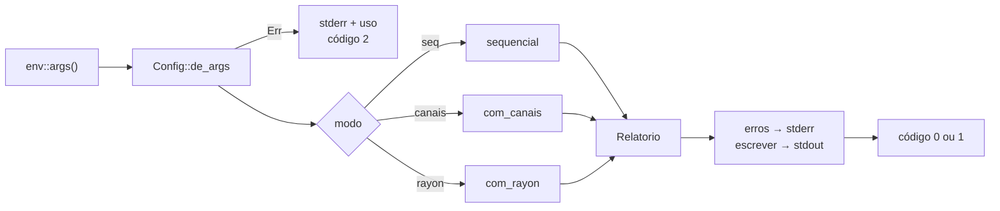
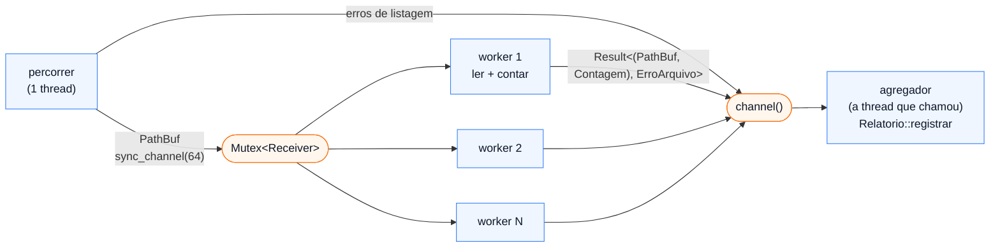

# Projeto 4 — `contapal`: um processador paralelo de arquivos

Contar palavras de um arquivo é um laço. Contar as de dez mil arquivos é o tipo de trabalho que cabe em vários núcleos: cada arquivo é independente, e no fim os resultados se juntam. Neste projeto você escreve o `contapal`, que percorre diretórios, conta linhas e palavras de cada arquivo e mostra as palavras mais frequentes, de **três** jeitos: sequencial, com threads e canais, e com `rayon`. Depois mede os três na sua máquina.

O projeto fecha os Módulos 10 e 11. Ele não traz conceito novo de linguagem: o desafio é montar com as peças do Módulo 11 um programa que não trava, não perde resultados e dá exatamente a mesma resposta nos três modos.

**Pré-requisitos:** [Módulo 11](../../modulos/11-concorrencia/README.md), em especial as lições [01](../../modulos/11-concorrencia/01-threads-e-scope.md) (`thread::scope`), [03](../../modulos/11-concorrencia/03-canais.md) (canais e pipeline), [04](../../modulos/11-concorrencia/04-mutex-e-rwlock.md) (`Mutex` e o escopo do guarda) e [07](../../modulos/11-concorrencia/07-rayon.md) (`rayon`). Do [Módulo 10](../../modulos/10-smart-pointers/README.md), o escopo dos temporários. Os erros seguem o [Projeto 1](../01-minigrep/README.md) e o [Projeto 3](../03-tarefas/README.md).

**Objetivos.** Ao final, você vai ter:

- uma contagem que se divide e se junta (`juntar`), a base de qualquer paralelismo de dados;
- uma busca recursiva em diretórios com `walkdir`, em que um arquivo ruim vira aviso e não derruba o resto;
- um pipeline de três estágios com `thread::scope`, `sync_channel` e *workers* que dividem um `Mutex<Receiver>`;
- a mesma coisa com `rayon` (`fold` + `reduce`) num *thread pool* com o tamanho que você escolher;
- testes que provam que os três modos dão o mesmo resultado, e medições reais que mostram quanto cada um ganhou.

## O que o programa deve fazer

```text
uso: contapal [-m seq|canais|rayon] [-j THREADS] [-n TOP] [--arquivos] [--tempo] CAMINHO...
```

O `contapal` percorre cada `CAMINHO` recursivamente (um arquivo também vale), lê todos os arquivos e mostra o total de linhas e palavras e as palavras mais frequentes.

| Opção | Forma longa | Efeito | Padrão |
|---|---|---|---|
| `-m` | `--modo` | `seq`, `canais` ou `rayon` | `rayon` |
| `-j` | `--threads` | workers (modo `canais`) ou threads do pool (modo `rayon`); `0` = uma por núcleo | `0` |
| `-n` | `--top` | quantas palavras mais frequentes mostrar | `10` |
| | `--arquivos` | uma linha por arquivo antes do resumo | desligado |
| | `--tempo` | mostra no stderr quanto o processamento levou | desligado |

Regras:

- **Palavra** é uma sequência de letras e dígitos (`char::is_alphanumeric`), comparada em minúsculas: `Rust`, `rust` e `RUST` são a mesma. Pontuação separa palavras.
- **Ordem.** Os diretórios são percorridos em ordem alfabética, e a lista `--arquivos` sai ordenada pelo caminho, em qualquer modo. No top, empates saem em ordem alfabética.
- **Links simbólicos** não são seguidos (assim não há risco de laço).
- **Erros por arquivo.** Um arquivo que não abre, que não é UTF-8 ou um caminho que não existe vira um aviso no stderr (`contapal: CAMINHO: motivo`), e o resto continua. O relatório conta quantos deram erro.
- **Códigos de saída:** `0` tudo certo; `1` algum arquivo deu erro (o relatório sai mesmo assim); `2` erro de uso. Pipe fechado (`contapal ... | head`) sai com 0, sem mensagem, como no Projeto 1.
- **Os três modos imprimem exatamente a mesma coisa.** Só o tempo muda.

### Exemplos

Uma pasta com três textos, uma foto e um arquivo sem permissão de leitura (saídas reais):

```text
$ contapal -n 5 textos
contapal: textos/foto.jpg: o arquivo não é UTF-8 válido
contapal: textos/privado.txt: Permission denied (os error 13)
arquivos: 3 lidos, 2 com erro
linhas:   7
palavras: 40
mais frequentes:
       3  do
       2  caminho
       2  gorjeiam
       2  meio
       2  no
$ echo $?
1
```

```text
$ contapal -m canais -n 3 --arquivos textos 2>/dev/null
  linhas  palavras  arquivo
       4        17  textos/poemas/cancao.txt
       2        14  textos/poemas/pedra.txt
       1         9  textos/trava-lingua.txt

arquivos: 3 lidos, 2 com erro
linhas:   7
palavras: 40
mais frequentes:
       3  do
       2  caminho
       2  gorjeiam
```

```text
$ contapal textos/nada outro
contapal: outro: No such file or directory (os error 2)
contapal: textos/nada: No such file or directory (os error 2)
arquivos: 0 lidos, 2 com erro
linhas:   0
palavras: 0
$ contapal -j x textos
contapal: -j: número inválido: x
uso: contapal [-m seq|canais|rayon] [-j THREADS] [-n TOP] [--arquivos] [--tempo] CAMINHO...
$ echo $?
2
```

**Fora do escopo:** respeitar `.gitignore`, filtrar por extensão, arquivos maiores que a memória (o arquivo é lido inteiro), detectar codificações além de UTF-8, `clap` (Módulo 16) e async (Módulo 12). Algumas dessas ideias estão em "Para ir além".

## Como começar

O projeto inicial está em [`inicial/`](inicial/). Ele compila e passa no `clippy`. Os tipos, as assinaturas e **todos os testes** estão prontos; os corpos são `todo!()`. O parser de argumentos (`config.rs`), o `main.rs` e a impressão do relatório (`Relatorio::escrever`) também vêm prontos: o assunto aqui é outro.

```bash
cd projetos/04-processador-paralelo/inicial
cargo test          # falha: é o esperado
cargo test step1    # só a etapa 1
```

Um teste de uma etapa que você ainda não fez falha assim:

```text
thread 'contagem::step1_tests::conta_linhas_e_palavras' (181047) panicked at src/contagem.rs:30:5:
not yet implemented
```

### Estrutura

```text
inicial/
├── Cargo.toml          # rayon, walkdir, thiserror; dev: tempfile
├── src/
│   ├── lib.rs          # declara os módulos e reexporta os tipos principais
│   ├── contagem.rs     # Contagem, palavras, contar, juntar, mais_frequentes   (etapa 1)
│   ├── arquivos.rs     # ErroArquivo (pronto), percorrer, ler, processar       (etapa 2)
│   ├── relatorio.rs    # Arquivo, Relatorio: registrar, juntar, ordenado; escrever (pronto) (etapa 3)
│   ├── processar.rs    # sequencial (3), com_canais (4), com_rayon (5)
│   ├── config.rs       # Modo, Config::de_args, USO (pronto)
│   └── main.rs         # args, escolhe o modo, avisos no stderr, ExitCode (pronto)
└── tests/
    └── cli.rs          # roda o executável numa pasta temporária
```

Os três modos têm a mesma assinatura, `fn(&[PathBuf], ...) -> Relatorio`, e o `main` só escolhe qual chamar:



## Etapas

Faça na ordem. Cada etapa diz o que pratica, o objetivo, o comando que deve passar e traz dicas escondidas.

### Etapa 1 — Uma contagem que se junta

**Pratica:** iteradores e closures (`split` com closure, `filter`, `map`), `HashMap::entry`, ordenação por chave com `std::cmp::Reverse` ([Módulo 07](../../modulos/07-colecoes-iteradores-e-closures/README.md)).

**Objetivo.** Em `src/contagem.rs`:

```rust
pub struct Contagem {
    pub linhas: usize,
    pub palavras: usize,
    pub frequencias: HashMap<String, usize>,
}

pub fn palavras(texto: &str) -> impl Iterator<Item = String>;
pub fn contar(texto: &str) -> Contagem;
impl Contagem {
    pub fn juntar(&mut self, outra: Contagem);
    pub fn mais_frequentes(&self, n: usize) -> Vec<(&str, usize)>;
}
```

O método que importa para o resto do projeto é o `juntar`. Paralelismo de dados é sempre "conte pedaços separados, junte no fim", e isso só funciona se juntar não depender da ordem: `a.juntar(b)` e `b.juntar(a)` precisam dar o mesmo resultado (há um teste para isso). Somas e contagens têm essa propriedade; "a última palavra lida", por exemplo, não teria.

No `inicial/`, o `palavras` começa com um `std::iter::from_fn(|| todo!())` em vez de `todo!()`: com um retorno `impl Iterator`, o compilador precisa de um tipo concreto que seja um iterador, e o `todo!()` sozinho não é (`` `!` is not an iterator ``). Troque a linha inteira.

**Teste:** `cargo test step1`.

<details>
<summary>Dica: palavras</summary>

`texto.split(|c: char| !c.is_alphanumeric())` corta em todo caractere que não é letra nem dígito. Dois separadores seguidos (`", "`) geram pedaços vazios; tire-os com `filter(|p| !p.is_empty())`, e termine com `map(str::to_lowercase)`.

</details>

<details>
<summary>Dica: mais_frequentes</summary>

Colete `(p.as_str(), q)` num `Vec` e ordene com `sort_unstable_by_key(|&(p, q)| (Reverse(q), p))`: a tupla compara primeiro a contagem (invertida, maior primeiro) e, no empate, a palavra. Depois, `truncate(n)`.

</details>

### Etapa 2 — Encontrar e ler os arquivos

**Pratica:** uma crate de terceiros e seu tipo de erro ([Módulo 08](../../modulos/08-modulos-e-crates/README.md)), enums de erro com `thiserror` e `#[source]`, `map_err`, `io::ErrorKind` ([Módulo 05](../../modulos/05-tratamento-de-erros/README.md)), testes com `tempfile` ([Módulo 09](../../modulos/09-testes-e-qualidade/README.md)).

**Por que `walkdir`.** Dá para percorrer diretórios só com a std: `fs::read_dir` e recursão. Mas aí você precisa ordenar cada diretório (o `read_dir` não garante ordem nenhuma), decidir o que fazer com links simbólicos (seguir um link para um diretório acima pode dar laço infinito) e montar o erro de cada entrada. A crate [`walkdir`](https://docs.rs/walkdir) resolve os três: `sort_by_file_name()` ordena, links não são seguidos por padrão, e cada item é um `Result`. E ela devolve um **iterador** preguiçoso, que encaixa direto no primeiro estágio do pipeline da etapa 4.

<details>
<summary>Para comparar: a versão só com a std</summary>

```rust
fn percorrer_std(dir: &Path, saida: &mut Vec<Result<PathBuf, ErroArquivo>>) {
    let entradas = match fs::read_dir(dir) {
        Ok(e) => e,
        Err(fonte) => {
            saida.push(Err(ErroArquivo::Io { caminho: dir.to_path_buf(), fonte }));
            return;
        }
    };
    let mut caminhos: Vec<PathBuf> = entradas.filter_map(Result::ok).map(|e| e.path()).collect();
    caminhos.sort();
    for c in caminhos {
        // `symlink_metadata` não segue links; `metadata` seguiria.
        match fs::symlink_metadata(&c) {
            Ok(m) if m.is_dir() => percorrer_std(&c, saida),
            Ok(m) if m.is_file() => saida.push(Ok(c)),
            Ok(_) => {} // link simbólico
            Err(fonte) => saida.push(Err(ErroArquivo::Io { caminho: c, fonte })),
        }
    }
}
```

Funciona, mas engole os erros de cada entrada do `read_dir` (o `filter_map(Result::ok)`), monta um `Vec` inteiro antes de devolver, e cada um desses detalhes é um teste a mais para escrever.

</details>

**Objetivo.** Em `src/arquivos.rs`, o `ErroArquivo` já vem pronto:

```rust
#[derive(Debug, Error)]
pub enum ErroArquivo {
    #[error("{}: {fonte}", caminho.display())]
    Io { caminho: PathBuf, #[source] fonte: io::Error },
    #[error("{}: o arquivo não é UTF-8 válido", caminho.display())]
    NaoUtf8 { caminho: PathBuf },
}
```

Implemente:

- `ErroArquivo::caminho(&self) -> &Path`;
- `percorrer(raizes: &[PathBuf]) -> impl Iterator<Item = Result<PathBuf, ErroArquivo>>`: os arquivos comuns de todas as raízes, em ordem, com os erros no meio da sequência;
- `ler(caminho: &Path) -> Result<String, ErroArquivo>`: `NaoUtf8` quando o arquivo não é texto, `Io` para o resto;
- `processar(caminho: PathBuf) -> Result<(PathBuf, Contagem), ErroArquivo>`: `ler` e `contar`. É **o** trabalho que as etapas 4 e 5 vão dividir entre threads.

Repare no tipo do `processar`: ele recebe o `PathBuf` por valor e o devolve junto com a contagem. Assim, um resultado carrega tudo o que o relatório precisa, e pode atravessar um canal sozinho.

**Teste:** `cargo test step2`.

<details>
<summary>Dica: percorrer</summary>

```rust
raizes.iter().flat_map(|raiz| {
    WalkDir::new(raiz)
        .sort_by_file_name()
        .into_iter()
        .filter_map(|item| match item {
            Ok(entrada) if entrada.file_type().is_file() => Some(Ok(entrada.into_path())),
            Ok(_) => None,
            Err(e) => todo!("converter em ErroArquivo::Io"),
        })
})
```

A closure interna usa `raiz` para montar o erro (veja a próxima dica).

</details>

<details>
<summary>Dica: o erro do walkdir</summary>

Pegue o caminho antes, com `e.path().unwrap_or(raiz).to_path_buf()`. Para a causa, use `e.into_io_error()`, que devolve o `io::Error` de dentro. Existe um `io::Error::from(e)`, mas a mensagem dele repete o caminho: `textos/nada: IO error for operation on textos/nada: No such file or directory`. O `into_io_error` devolve `None` só num laço de links, que não acontece sem `follow_links(true)`; use `unwrap_or_else(|| io::Error::other("laço de links simbólicos"))`.

</details>

<details>
<summary>Dica: ler</summary>

Igual ao Projeto 1: `fs::read_to_string` falha com `ErrorKind::InvalidData` quando os bytes não são UTF-8. Um `map_err` com um `if` dentro escolhe a variante.

</details>

### Etapa 3 — O relatório e a versão sequencial

**Pratica:** `fold` com um acumulador que é uma struct, `Result::and_then`, métodos que recebem e devolvem `self` por valor ([Módulos 02](../../modulos/02-ownership/README.md) e [07](../../modulos/07-colecoes-iteradores-e-closures/README.md)).

**Objetivo.** Em `src/relatorio.rs`:

```rust
impl Relatorio {
    pub fn registrar(&mut self, resultado: Result<(PathBuf, Contagem), ErroArquivo>);
    pub fn juntar(self, outro: Relatorio) -> Relatorio;
    pub fn ordenado(self) -> Relatorio;
}
```

`registrar` acrescenta um arquivo (`Arquivo { caminho, linhas, palavras }` em `arquivos`, a contagem somada em `total`) ou um erro (em `erros`). `juntar` concatena e soma dois relatórios. `ordenado` ordena `arquivos` e `erros` pelo caminho: threads terminam em qualquer ordem, e depois dele os três modos ficam comparáveis com `==`.

Depois, `processar::sequencial` em `src/processar.rs`. A cadeia inteira tem quatro passos, e vale escrever com calma, porque as etapas 4 e 5 são variações dela:

```rust
arquivos::percorrer(raizes)                              // Result<PathBuf, ErroArquivo>
    .map(|item| item.and_then(arquivos::processar))      // Result<(PathBuf, Contagem), ErroArquivo>
    .fold(Relatorio::default(), |mut r, resultado| { /* registrar */ r })
    .ordenado()
```

O `and_then` encadeia as duas fontes de erro: se a listagem já falhou, o erro passa direto; se não, o caminho vai para `processar`, que pode falhar por conta própria.

Teste à mão: `cargo run -q -- -m seq -n 5 src`.

**Teste:** `cargo test step3` (inclui `sequencial_no_corpus`, que cria 60 arquivos em 15 pastas, um binário e uma raiz que não existe).

### Etapa 4 — Threads e canais: workers e pipeline

**Pratica:** `thread::scope` ([M11/01](../../modulos/11-concorrencia/01-threads-e-scope.md)), `Send`/`Sync` ([M11/02](../../modulos/11-concorrencia/02-send-e-sync.md)), `sync_channel`, vários produtores e o `drop(tx)` ([M11/03](../../modulos/11-concorrencia/03-canais.md)), `Mutex` e o escopo do guarda ([M11/04](../../modulos/11-concorrencia/04-mutex-e-rwlock.md)).

**Objetivo.** `processar::com_canais(raizes, workers)`, um pipeline de três estágios:



1. **Estágio 1**, uma thread: percorre os diretórios e manda cada caminho para os workers por um `sync_channel(64)`. A fila limitada segura o produtor quando os workers estão atrás (listar é muito mais rápido que ler). Erros de listagem vão direto para o canal de resultados.
2. **Estágio 2**, `workers` threads (`0` = `threads_automatico`, que já vem pronto): cada uma tira um caminho da fila, chama `arquivos::processar` e manda o resultado adiante.
3. **Estágio 3**, a própria thread que chamou `com_canais`: um `for resultado in rx_resultados` que vai registrando num `Relatorio`.

Tudo dentro de um `thread::scope`: as threads emprestam `raizes` e o `Mutex`, sem `Arc` e sem `'static`. O `scope` devolve o valor da closure, que é o relatório.

O estágio 2 é o desenho do *thread pool* do [capítulo 21 do Rust Book](https://doc.rust-lang.org/stable/book/ch21-02-multithreaded.html): o `Receiver` não é `Clone` (`mpsc` é *um* consumidor), então os workers dividem um só, dentro de um `Mutex`. Quem trava o `Mutex` tira **um** caminho e solta. Tentar dividir o `Receiver` sem o `Mutex` é o erro de `Sync` da lição 02:

```rust
// ❌ NÃO COMPILA
let rx_caminhos = &rx_caminhos; // um &Receiver<PathBuf>, sem Mutex
for _ in 0..workers {
    let tx = tx_resultados.clone();
    s.spawn(move || {
        loop {
            let Ok(caminho) = rx_caminhos.recv() else {
                break;
            };
            // ...
        }
    });
}
```

```text
error[E0277]: `std::sync::mpsc::Receiver<PathBuf>` cannot be shared between threads safely
   --> src/processar.rs:76:21
    |
 76 |               s.spawn(move || {
    |  _______________-----_^
    | |               |
    | |               required by a bound introduced by this call
...
    = help: the trait `Sync` is not implemented for `std::sync::mpsc::Receiver<PathBuf>`
    = note: required for `&std::sync::mpsc::Receiver<PathBuf>` to implement `Send`
...
203 |         F: FnOnce() -> T + Send + 'scope,
    |                            ^^^^ required by this bound in `Scope::<'scope, 'env>::spawn`
```

Mandar `&T` para outra thread exige `T: Sync`, e o `Receiver` não é. Um `&Mutex<Receiver<_>>` é `Send`, porque `Mutex<T>` é `Sync` sempre que `T: Send`.

**Teste:** `cargo test step4` (compara com o sequencial usando 1, 2 e 8 workers, e com `0`).

<details>
<summary>Dica: o esqueleto</summary>

```rust
let workers = threads_automatico(workers);
let (tx_caminhos, rx_caminhos) = mpsc::sync_channel::<PathBuf>(64);
let (tx_resultados, rx_resultados) = mpsc::channel::<Resultado>();
let rx_caminhos = Mutex::new(rx_caminhos);

thread::scope(|s| {
    let tx_erros = tx_resultados.clone();
    s.spawn(move || { /* estágio 1: for item in arquivos::percorrer(raizes) */ });

    let rx_caminhos = &rx_caminhos;
    for _ in 0..workers {
        let tx = tx_resultados.clone();
        s.spawn(move || { /* estágio 2 */ });
    }

    drop(tx_resultados);
    /* estágio 3: for resultado in rx_resultados { ... } */
})
.ordenado()
```

O `let rx_caminhos = &rx_caminhos;` antes do laço existe por causa do `move`: a closure move a **referência** (que é `Copy`), e não o `Mutex`. Sem o `move`, ela tentaria emprestar o `tx` daquela volta do laço, que morre logo:

```text
error[E0373]: closure may outlive the current function, but it borrows `tx`, which is owned by the current function
  --> src/processar.rs:76:21
   |
...
76 |             s.spawn(|| {
   |                     ^^ may outlive borrowed value `tx`
...
86 |                     if tx.send(arquivos::processar(caminho)).is_err() {
   |                        -- `tx` is borrowed here
...
help: to force the closure to take ownership of `tx` (and any other referenced variables), use the `move` keyword
```

</details>

<details>
<summary>Dica: como cada estágio termina</summary>

Ninguém manda mensagem de "fim". O estágio 1 acaba o laço e descarta `tx_caminhos`; o `recv()` dos workers passa a devolver `Err` e eles saem; cada worker descarta o seu clone de `tx_resultados`; quando o último some, o `for` do agregador termina. É a corrente da lição 03. Por isso o `drop(tx_resultados)` é obrigatório: sem ele, o original continua vivo na thread do agregador, o `for` espera para sempre, e o `scope` nunca termina (validado: o programa fica parado até o `timeout`).

Se um `send` devolver `Err`, quem recebia já foi embora: pare o laço com `break` em vez de dar `unwrap`.

</details>

> [!WARNING]
> **O guarda que trava todo mundo.** O laço natural de um worker é
> `while let Ok(caminho) = rx_caminhos.lock().unwrap().recv() { ... }`. Ele compila, passa nos testes e é **tão lento quanto o sequencial**: 681 ms contra 150 ms nesta máquina. No `while let` (como no `match`), os temporários da expressão vivem até o fim do corpo. O `MutexGuard` fica preso enquanto o worker lê e conta o arquivo, e só um worker trabalha por vez. Use `loop` com `let ... else`: num `let`, o guarda morre no `;`.
>
> ```rust
> loop {
>     let Ok(caminho) = rx_caminhos.lock().unwrap().recv() else {
>         break;
>     };
>     // aqui o Mutex já está livre
> }
> ```
>
> É o mesmo cuidado do `match` com `lock()` da [lição 04](../../modulos/11-concorrencia/04-mutex-e-rwlock.md), e o Rust Book chega à mesma conclusão no capítulo 21.

### Etapa 5 — `rayon`: `fold`, `reduce` e um pool próprio

**Pratica:** `into_par_iter`, `fold` + `reduce` ([M11/07](../../modulos/11-concorrencia/07-rayon.md)), `rayon::ThreadPoolBuilder` e `ThreadPool::install`, `par_bridge`.

**Objetivo.** `processar::com_rayon(raizes, threads)`:

1. Colete `arquivos::percorrer(raizes)` num `Vec<Result<PathBuf, ErroArquivo>>`. Listar é rápido (15 ms para os 3600 arquivos da medição abaixo), e um `Vec` o rayon divide ao meio, e ao meio de novo, sem esforço.
2. Crie um pool com o número de threads pedido. O pool global do rayon tem uma thread por núcleo e só pode ser configurado uma vez por processo; um pool próprio deixa o `-j` (e os testes) escolherem o tamanho:

   ```rust
   let pool = rayon::ThreadPoolBuilder::new()
       .num_threads(threads) // 0 = o rayon escolhe
       .build()
       .expect("criar o pool só falha se o sistema não deixar criar threads");
   ```

3. Dentro de `pool.install(|| ...)`, que roda a closure no pool, a cadeia da etapa 3 com `into_par_iter()`, e o `fold` trocado pelo par da lição 07:

   ```rust
   .fold(Relatorio::default, |mut r, resultado| { r.registrar(resultado); r })
   .reduce(Relatorio::default, Relatorio::juntar)
   ```

Compare com a etapa 3. O `fold` do rayon recebe `Relatorio::default` (a função) em vez de `Relatorio::default()` (um valor), porque cada pedaço do trabalho começa com um relatório novo. O `reduce` junta os relatórios parciais dois a dois, e o `juntar(self, outro) -> Relatorio` da etapa 3 tem exatamente a forma que ele pede. Nenhum `Mutex`: cada relatório parcial tem um dono só.

Quando terminar, apague o `#![allow(unused)]` de `src/lib.rs`.

**Teste:** `cargo test step5` (inclui `os_tres_modos_concordam`).

<details>
<summary>Variante: <code>par_bridge</code>, sem o <code>Vec</code></summary>

`par_bridge()` (do `rayon::prelude`) transforma um iterador comum num paralelo, distribuindo os itens pelo pool à medida que eles saem. Dá para pular a coleta:

```rust
arquivos::percorrer(raizes)
    .par_bridge()
    .map(|item| item.and_then(arquivos::processar))
    .fold(Relatorio::default, |mut r, resultado| { r.registrar(resultado); r })
    .reduce(Relatorio::default, Relatorio::juntar)
    .ordenado()
```

Ele exige um iterador `Send` com itens `Send` (o do `walkdir` é), não mantém a ordem (o `ordenado` resolve) e, segundo a documentação, "pode ser menos eficiente" que partir de um `par_iter`. Aqui ele mediu 167 ms, contra 182 ms da versão com `Vec`: listar enquanto processa compensou um pouco. Serve quando a fonte é longa ou infinita, como linhas de um stdin.

</details>

### Etapa 6 — Medir

**Pratica:** medir em `--release`, `--tempo` (um `Instant` no `main`, já pronto), escalar o número de threads ([M11/07](../../modulos/11-concorrencia/07-rayon.md)).

Você precisa de muitos arquivos. Dois que quase toda instalação de Rust tem:

```bash
# o código-fonte da std (componente rust-src; `rustup component add rust-src` se faltar)
STD="$(rustc --print sysroot)/lib/rustlib/src/rust/library"
# o código das crates que o cargo já baixou
REG="$HOME/.cargo/registry/src"

cargo build --release
for m in seq canais rayon; do
  ./target/release/contapal -m "$m" --tempo -n 0 "$STD" > /dev/null 2> erros.txt
  tail -1 erros.txt
done
```

O `--tempo` e os avisos de arquivo vão para o stderr; o `tail -1` fica com a linha do tempo. Rode cada caso algumas vezes e descarte a primeira: na primeira execução, os arquivos vêm do disco; nas seguintes, do cache do sistema operacional. Aqui, o sequencial levou 2,3 s na primeira passada pelo registro do cargo e 1,3 s nas seguintes.

Medições desta máquina (Apple M2 Pro, 10 núcleos; `--release`; cache quente; o valor típico de 5 execuções):

| Corpus | Arquivos | `seq` | `canais` | `rayon` |
|---|---|---|---|---|
| std (`rust-src`) | 3598 lidos, 10 com erro, 2,1 milhões de linhas | 684 ms | 150 ms | 182 ms |
| `~/.cargo/registry/src` | 10 248 lidos, 2784 com erro, 3,0 milhões de linhas | 1,3 s | 293 ms | 360 ms |

E variando `-j` no corpus da std:

| `-j` | 1 | 2 | 4 | 8 | 10 (padrão) |
|---|---|---|---|---|---|
| `canais` | 682 ms | 380 ms | 235 ms | 166 ms | 150 ms |
| `rayon` | 699 ms | 415 ms | 273 ms | 205 ms | 182 ms |

> [!NOTE]
> Os seus números vão ser outros: dependem do processador, do disco, do sistema e de quantas crates o seu cargo baixou. Até na mesma máquina eles variam alguns por cento entre execuções. O que deve se repetir é a forma: com 1 thread, os paralelos empatam com o sequencial; o tempo cai com mais threads, mas cada vez menos.

O que dá para ler nesses números:

- **Cerca de 4,5 vezes mais rápido com 10 núcleos.** Não chega a 10. Este processador tem núcleos de desempenho e de eficiência, e parte do trabalho não escala: cada palavra vira uma `String` alocada, os mapas parciais precisam ser juntados, e há um único agregador (no `canais`) ou um último `reduce` (no `rayon`).
- **O pipeline ganhou do rayon.** Não era o esperado, e é por isso que se mede. Duas explicações prováveis: o `rayon` lista tudo antes de começar (15 ms aqui, só parte da diferença), e o `reduce` junta os mapas grandes no fim, enquanto o agregador do pipeline junta enquanto os workers ainda leem. Verificar isso é uma das ideias de "Para ir além".
- **O `rayon` deu o mesmo resultado com muito menos código**, e sem nenhuma chance de travar por um `drop` esquecido. Para a maioria dos programas, essa troca vale mais que 30 ms.
- **O `while let` da etapa 4** fica em 681 ms com 10 workers: o mesmo tempo do sequencial. Um teste de resultado não pega esse erro; só a medição.

### Etapa 7 — Acabamento

- `cargo test` passa inteiro (27 testes na solução: 24 unitários e 3 do executável);
- `CARGO_BUILD_WARNINGS=deny cargo clippy --all-targets` e `cargo fmt --check` limpos, sem o `#![allow(unused)]`;
- o único `expect` fora dos testes (o do pool) tem um comentário;
- rode `cargo run -q -- --arquivos SEU_DIRETORIO | head -3` e confira que sai sem *panic* e com código 0;
- teste à mão um arquivo sem permissão (`chmod 000 x.txt`) e um binário qualquer.

Depois compare com a [solução](../../solucoes/projeto-04-processador-paralelo/) e leia o README dela.

## Critérios de aceite

- [ ] Os três modos imprimem exatamente a mesma saída para a mesma entrada (há teste unitário e do executável para isso).
- [ ] Um arquivo ilegível, não UTF-8 ou um caminho inexistente vira aviso no stderr e não interrompe os outros; códigos de saída 0, 1 e 2.
- [ ] O modo `canais` usa `thread::scope`, uma fila limitada entre o primeiro e o segundo estágio, e termina sozinho, sem mensagem de "fim".
- [ ] Os workers não seguram o `Mutex` enquanto leem um arquivo (meça com `-j 1` e com o padrão: tem de haver diferença).
- [ ] O modo `rayon` usa `fold` + `reduce`, sem `Mutex` nem atômicos, e respeita o `-j`.
- [ ] Medições feitas em `--release`, com pelo menos dois valores de `-j`.
- [ ] `cargo test`, `cargo clippy --all-targets` (com `CARGO_BUILD_WARNINGS=deny`) e `cargo fmt --check` limpos.

## Para ir além

1. **Onde o rayon perde tempo?** Meça separadamente a listagem, o `fold` e o `reduce` (com `Instant` em cada fase), e teste uma versão em que o `fold` acumula só `(linhas, palavras)`. Confirme ou derrube as explicações da etapa 6.
2. **Menos alocação.** Cada palavra vira uma `String`, mesmo as repetidas. Conte primeiro com `HashMap<&str, usize>` emprestando do texto do arquivo, e só converta para `String` ao juntar. Meça de novo: o gargalo muda?
3. **`--ext rs,md`** para filtrar por extensão, e **`.gitignore`** com a crate [`ignore`](https://docs.rs/ignore), a que o `ripgrep` e o `tokei` usam. Ela tem um percorredor paralelo (`WalkBuilder::build_parallel`): compare com o seu pipeline.
4. **Cancelamento:** `--max-erros N` para tudo depois de N erros. No modo `canais`, um `AtomicBool` de parada ([M11/05](../../modulos/11-concorrencia/05-atomicos.md)) que o estágio 1 consulta; no `rayon`, `try_fold`/`try_reduce`.
5. **Progresso:** um contador `AtomicUsize` de arquivos lidos e uma thread que imprime `lidos: N` no stderr a cada 100 ms, até o trabalho acabar.
6. **Arquivos enormes:** em vez de `read_to_string`, ler com `BufReader::lines()` e contar linha a linha, para um log de vários GB não precisar caber na memória.
7. **`--json`** com `serde`, como no Projeto 3, e um teste de propriedade com `proptest` ([M09](../../modulos/09-testes-e-qualidade/README.md)): para qualquer conjunto de textos, os três modos dão o mesmo `Relatorio`.

## Este projeto volta

- **Módulo 12 e Projeto 5:** o outro tipo de concorrência. Aqui o gargalo era a CPU (contar); lá, milhares de conexões esperando a rede, com `async`/`await` e `tokio`.
- **Módulo 18:** *profiling* e otimização. O "Para ir além" 1 e 2 é o tipo de pergunta que um *profiler* responde direto.

## Leitura complementar

- [The Rust Programming Language, 21.2: From a Single-Threaded to a Multithreaded Server](https://doc.rust-lang.org/stable/book/ch21-02-multithreaded.html) (o thread pool com `Mutex<Receiver>` e o problema do `while let`)
- docs.rs: [rayon](https://docs.rs/rayon/latest/rayon/) ([`ParallelBridge`](https://docs.rs/rayon/latest/rayon/iter/trait.ParallelBridge.html), [`ThreadPoolBuilder`](https://docs.rs/rayon/latest/rayon/struct.ThreadPoolBuilder.html)), [walkdir](https://docs.rs/walkdir/latest/walkdir/), [thiserror](https://docs.rs/thiserror/latest/thiserror/)
- std: [`thread::scope`](https://doc.rust-lang.org/std/thread/fn.scope.html), [`mpsc::sync_channel`](https://doc.rust-lang.org/std/sync/mpsc/fn.sync_channel.html), [`thread::available_parallelism`](https://doc.rust-lang.org/std/thread/fn.available_parallelism.html)
- [ripgrep](https://github.com/BurntSushi/ripgrep) e [tokei](https://github.com/XAMPPRocky/tokei): ferramentas reais com o mesmo desenho (percorrer, processar em paralelo, juntar)
- [The Rust Performance Book](https://nnethercote.github.io/perf-book/) (antes de otimizar, meça)

---

[← Anterior: Módulo 11](../../modulos/11-concorrencia/README.md) · [Índice do curso](../../README.md) · [Próximo: Módulo 12 →](../../modulos/12-async/README.md)
