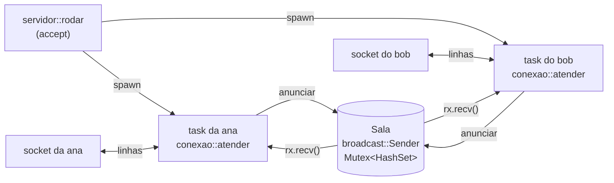

# Projeto 5 — `chat`: um servidor de chat TCP com `tokio`

> Última revisão: 2026-11-02 (`tokio` 1.54, `tokio-util` 0.7.20).

No Projeto 4, o gargalo era a CPU: dez núcleos contando palavras. Aqui é o contrário. Um servidor de chat passa quase o tempo todo **esperando**: a próxima linha de cada cliente, a próxima mensagem da sala. Com uma thread por conexão, mil clientes parados custam mil threads paradas. Com `async`, cada conexão é uma *task* (uma tarefa leve que o runtime agenda), e mil delas cabem em poucas threads.

Neste projeto você escreve o `chat`: um servidor TCP em que cada cliente conversa com todos os outros, com apelidos, alguns comandos e desligamento gracioso com Ctrl+C. O protocolo é de linhas de texto, então qualquer `nc` (*netcat*) serve de cliente. No fim, se quiser, você escreve um cliente próprio.

O projeto fecha os Módulos 11 e 12. As peças vêm dos dois: canais e `Mutex` do 11, tasks, `select!` e *cancellation safety* do 12. O desafio é encaixá-las sem travar, sem perder mensagens e sem deixar um cliente lento atrapalhar os outros.

**Pré-requisitos:** [Módulo 12](../../modulos/12-async/README.md) inteiro. Do [Módulo 11](../../modulos/11-concorrencia/README.md), as lições [02](../../modulos/11-concorrencia/02-send-e-sync.md) (`Send`), [03](../../modulos/11-concorrencia/03-canais.md) (canais), [04](../../modulos/11-concorrencia/04-mutex-e-rwlock.md) (`Mutex` e o escopo do guarda) e [05](../../modulos/11-concorrencia/05-atomicos.md) (atômicos). Os erros seguem o [Projeto 3](../03-tarefas/README.md) (`thiserror`).

**Objetivos.** Ao final, você vai ter:

- um servidor que aceita conexões num laço e cria uma task por cliente;
- estado compartilhado (`Arc` + `std::sync::Mutex`) usado do jeito seguro em código async;
- um canal `broadcast` que entrega cada mensagem a todos, em que um cliente lento perde mensagens antigas em vez de travar o servidor;
- um `select!` entre o socket e o canal, com cada ramo *cancel safe*;
- desligamento gracioso: Ctrl+C avisa todo mundo, e o servidor espera as tasks terminarem;
- testes de integração que sobem o servidor numa porta livre e conversam com ele por TCP, com tempo limite para nunca travar.

## O que o programa deve fazer

```text
uso: chat [ENDERECO]          (padrão: 127.0.0.1:7878)
```

O protocolo é de **linhas**: texto UTF-8, uma mensagem por linha, terminada em `\n` (um `\r\n`, como o do telnet, também vale). O servidor responde com linhas no mesmo formato.

| O cliente manda | O que acontece |
|---|---|
| `texto qualquer` | todos os **outros** recebem `ana: texto qualquer` |
| `/nick NOME` | troca o apelido; quem pediu recebe `*** agora você é NOME`, os outros `*** antigo agora é NOME` |
| `/quem` | só quem pediu recebe `*** online: ana, bob` (em ordem alfabética) |
| `/sair` (ou `/quit`) | recebe `*** até mais!` e a conexão fecha; os outros recebem `*** ana saiu` |
| `/outra-coisa` | `*** comando desconhecido: /outra-coisa` |
| linha em branco | nada |

Regras:

- **Apelido provisório.** Quem conecta recebe `*** bem-vindo, convidado-N! comandos: /nick NOME, /quem, /sair`, e os outros, `*** convidado-N entrou`. O `N` é o próximo número livre.
- **Apelido válido:** de 1 a 20 caracteres, só letras, dígitos, `-` e `_`, e ninguém mais usando. Erros voltam só para quem errou: `*** o apelido não pode ser vazio`, `*** o apelido pode ter no máximo 20 caracteres`, `*** caractere não permitido no apelido: ' '`, `*** o apelido ana já está em uso`.
- **Linhas de até 1024 bytes.** Uma linha maior recebe `*** linha longa demais (máximo 1024 bytes)` e a conexão fecha. Bytes que não são UTF-8 também fecham a conexão.
- **Cliente lento.** Se um cliente não lê, o servidor guarda até 64 mensagens para ele. Passou disso, ele perde as mais antigas e recebe `*** você perdeu N mensagens`. Os outros clientes não sentem nada.
- **Quem saiu:** com `/sair` ou fechando a conexão, os outros recebem `*** ana saiu` e o apelido fica livre.
- **Ctrl+C no servidor:** para de aceitar conexões, todos recebem `*** servidor encerrando`, as conexões fecham, e o processo termina com código 0 depois que a última task acabou.
- **Log no stderr:** `chat: escutando em ...`, `chat: 127.0.0.1:59711 conectou`, `... desconectou`, erros de conexão. Se o endereço não abre (porta ocupada), mensagem e código 1.

### Exemplo

O servidor num terminal e dois `nc` em outros dois (saídas reais; as linhas que você digita estão marcadas com `>`, que não aparece de verdade):

```text
$ cargo run -q
chat: escutando em 127.0.0.1:7878 (Ctrl+C para sair)
chat: 127.0.0.1:59711 conectou
chat: 127.0.0.1:59712 conectou
chat: 127.0.0.1:59711 desconectou
```

```text
$ nc 127.0.0.1 7878                                 # terminal da ana
*** bem-vindo, convidado-1! comandos: /nick NOME, /quem, /sair
> /nick ana
*** agora você é ana
*** convidado-2 entrou
*** convidado-2 agora é bob
> oi, bob
bob: oi, ana! tudo bem?
> /quem
*** online: ana, bob
> /sair
*** até mais!
```

```text
$ nc 127.0.0.1 7878                                 # terminal do bob
*** bem-vindo, convidado-2! comandos: /nick NOME, /quem, /sair
> /nick bob
*** agora você é bob
ana: oi, bob
> oi, ana! tudo bem?
*** ana saiu
> /nick ana
*** agora você é ana
> /xyz
*** comando desconhecido: /xyz
```

E o Ctrl+C com alguém conectado:

```text
chat: 127.0.0.1:59728 conectou
^Cchat: encerrando...
chat: 127.0.0.1:59728 desconectou
chat: até mais
```

O cliente conectado vê `*** servidor encerrando`, e o servidor fecha a conexão.

> [!TIP]
> No macOS e no Linux, o `nc` já vem instalado (ou está no pacote `netcat-openbsd`). No Windows, use `telnet 127.0.0.1 7878` (ative o "Cliente Telnet" nos recursos do sistema) ou o cliente da etapa 6. O telnet manda `\r\n`; o servidor aceita.

**Fora do escopo:** várias salas, mensagens privadas, histórico, autenticação, TLS, framing binário. Várias dessas estão em "Para ir além".

## Como começar

O projeto inicial está em [`inicial/`](inicial/). Ele compila e passa no `clippy`. Os tipos, as assinaturas e **todos os testes** estão prontos; os corpos são `todo!()`. O `main.rs` do servidor e a função `conexao::atender` (a moldura de cada conexão) também vêm prontos.

```bash
cd projetos/05-chat-tcp/inicial
cargo test --lib step1   # só a etapa 1
cargo test step3         # etapas com servidor: testes de integração
```

Um teste de uma etapa que você ainda não fez falha assim:

```text
thread 'protocolo::step1_tests::apelidos_invalidos' (272702) panicked at src/protocolo.rs:57:5:
not yet implemented
```

Os testes de integração (etapas 3 a 5) falham por tempo esgotado até o servidor responder: `tempo esgotado esperando uma linha`. É o tempo limite fazendo o trabalho dele.

### Estrutura

```text
inicial/
├── Cargo.toml           # tokio (full), tokio-util (codec, rt), futures-util (sink), thiserror
├── src/
│   ├── lib.rs           # declara os módulos, ENDERECO_PADRAO
│   ├── protocolo.rs     # Comando, ErroApelido (prontos); interpretar, validar_apelido   (etapa 1)
│   ├── sala.rs          # Evento, Membro (prontos); Sala: new, entrar, renomear, ...      (etapa 2)
│   ├── conexao.rs       # atender (pronto); conversar, tratar (3–5); receber (4)
│   ├── servidor.rs      # rodar: aceita conexões e cria as tasks                         (etapas 3 e 5)
│   ├── main.rs          # endereço, bind, Ctrl+C, chama rodar (pronto)
│   └── bin/cliente.rs   # o cliente opcional                                             (etapa 6)
└── tests/
    └── chat.rs          # sobe o servidor em 127.0.0.1:0 e conversa por TCP
```

Quem fala com quem, com dois clientes conectados:



Cada task fala com o próprio socket e com a sala, e nunca com outra task diretamente. A sala é um `Arc<Sala>`: o `Sender` do `broadcast` e o conjunto de apelidos ficam lá dentro.

## Etapas

Faça na ordem. Cada etapa diz o que pratica, o objetivo, o comando que deve passar e traz dicas escondidas.

### Etapa 1 — O protocolo

**Pratica:** `split_once`, `match` em `&str`, `chars()` ([Módulo 07](../../modulos/07-colecoes-iteradores-e-closures/README.md)), um enum de erro com `thiserror` ([Módulo 05](../../modulos/05-tratamento-de-erros/README.md)).

**Objetivo.** Em `src/protocolo.rs`, duas funções síncronas, sem rede nenhuma:

```rust
pub enum Comando { Vazio, Mensagem(String), Nick(String), Quem, Sair, Desconhecido(String) }

pub fn interpretar(linha: &str) -> Comando;
pub fn validar_apelido(apelido: &str) -> Result<(), ErroApelido>;
```

Separar o protocolo da rede é o que deixa testá-lo com `assert_eq!` comum, sem servidor. O resto do projeto só chama `interpretar` e faz um `match` no resultado.

Detalhes que os testes conferem: espaços nas pontas não contam (`"  oi  "` é `Mensagem("oi")`); `/quem extra` é `Quem` (argumentos sobrando são ignorados); `/nick` sem nome é `Nick("")`, e quem recusa é o `validar_apelido`; o limite de 20 é em **caracteres**, então `"é".repeat(20)` vale, embora tenha 40 bytes.

**Teste:** `cargo test --lib step1`.

<details>
<summary>Dica: interpretar</summary>

Depois do `trim()` e dos dois casos fáceis (vazio, não começa com `/`), `linha.split_once(' ').unwrap_or((linha, ""))` separa o nome do comando do argumento, e um `match nome { "/nick" => ..., "/sair" | "/quit" => ..., _ => ... }` resolve o resto.

</details>

### Etapa 2 — A sala: `broadcast` e um `Mutex` que nunca espera

**Pratica:** `tokio::sync::broadcast`, `std::sync::Mutex` e `AtomicU64` ([M11/04](../../modulos/11-concorrencia/04-mutex-e-rwlock.md), [M11/05](../../modulos/11-concorrencia/05-atomicos.md)), escopo do guarda.

**Objetivo.** Em `src/sala.rs`:

```rust
pub struct Evento { pub autor: u64, pub texto: String }
pub struct Membro { pub id: u64, pub apelido: String, pub rx: broadcast::Receiver<Evento> }

pub struct Sala {
    tx: broadcast::Sender<Evento>,
    apelidos: Mutex<HashSet<String>>,   // std::sync::Mutex
    proximo_id: AtomicU64,
}

impl Sala {
    pub fn new(capacidade: usize) -> Sala;
    pub fn entrar(&self) -> Membro;
    pub fn renomear(&self, atual: &str, novo: &str) -> Result<(), ErroApelido>;
    pub fn sair(&self, apelido: &str);
    pub fn quem(&self) -> Vec<String>;
    pub fn anunciar(&self, autor: u64, texto: String);
}
```

**Por que `broadcast`.** É o canal do tokio feito para isto: vários produtores, vários consumidores, e **cada** consumidor recebe **cada** valor. Cada membro ganha o seu `Receiver` com `tx.subscribe()` e só vê o que for enviado depois. O canal guarda o valor uma vez e o clona para cada receptor, por isso `Evento` precisa ser `Clone`.

O `broadcast` entrega o evento também para quem o enviou. O filtro fica na conexão: ela pula os eventos com `autor == membro.id`. Assim a sala não precisa saber quem é quem.

**Por que um `Mutex` da std, e não o do tokio.** Todos os métodos são **síncronos**: travam, mexem no `HashSet` e soltam antes de voltar. Não há `.await` com o guarda vivo, então o `std::sync::Mutex` serve, e é mais barato. A regra do tutorial do Tokio é essa: use o `Mutex` da std enquanto a trava não atravessa um `.await`; o `tokio::sync::Mutex` só existe para quando precisa atravessar (veja a armadilha da etapa 4). Deixar os métodos síncronos garante isso pela própria assinatura.

**Teste:** `cargo test --lib step2` (os testes usam `rx.try_recv()`, que não precisa de runtime).

<details>
<summary>Dica: o apelido provisório</summary>

O id vem de `self.proximo_id.fetch_add(1, Ordering::Relaxed)` (só precisa ser único; nenhuma outra memória depende dele, por isso `Relaxed`). Alguém pode já ter pegado `convidado-2` com `/nick` antes de o segundo convidado chegar. Procure o primeiro livre a partir do id:

```rust
let apelido = (id..)
    .map(|n| format!("convidado-{n}"))
    .find(|a| !apelidos.contains(a))
    .expect("os u64 não acabam antes de achar um apelido livre");
```

</details>

<details>
<summary>Dica: o <code>Err</code> do <code>send</code></summary>

`broadcast::Sender::send` devolve `Err` só quando **não há nenhum receptor**: a sala está vazia. Não há ninguém para avisar, então ignore com `let _ = ...` e um comentário dizendo por quê. No servidor, quem anuncia ainda está inscrito (o `Receiver` dele só morre no fim do `atender`), então o erro quase não acontece; mas a `Sala` não deve depender de quem a chama, e um `unwrap` ali derrubaria a task (há um teste, `anunciar_numa_sala_vazia_nao_da_panic`).

</details>

### Etapa 3 — O servidor: uma task por cliente

**Pratica:** `TcpListener::bind`/`accept`, `tokio::spawn` e `'static`, `Arc`, `Framed` + `LinesCodec`, `StreamExt::next` e `SinkExt::send` ([Módulo 12](../../modulos/12-async/README.md)).

**Objetivo.** Em `src/servidor.rs`, um `rodar` que aceita conexões para sempre e cria uma task para cada uma:

```rust
pub async fn rodar(listener: TcpListener, desligar: CancellationToken);
```

Por enquanto ignore o `desligar`. O laço é o do tutorial do Tokio: `listener.accept().await`, clone o `Arc<Sala>`, `tokio::spawn(async move { ... conexao::atender(stream, sala, desligar).await ... })`. O `spawn` exige uma future `'static` (ela pode viver mais que quem a criou), por isso cada task leva o próprio clone do `Arc`, e não uma referência. Um erro de uma conexão vira uma linha no stderr, nunca um `panic` no servidor.

O `rodar` recebe o listener pronto, em vez de um endereço, por causa dos testes: eles fazem `bind("127.0.0.1:0")`, o sistema escolhe uma porta livre, e cada teste tem o seu servidor isolado.

Em `src/conexao.rs`, o `atender` já vem pronto. Ele cria o `Framed`, chama `sala.entrar()`, chama o `conversar` (que é seu) e, **com `Ok` ou `Err`**, libera o apelido e anuncia a saída:

```rust
let resultado = conversar(&mut linhas, &sala, &mut membro, &desligar).await;
// Chega aqui com Ok ou com Err: a limpeza não pode ficar atrás de um `?`.
sala.sair(&membro.apelido);
```

Se o corpo inteiro estivesse numa função só, cheia de `?`, uma conexão que cai pularia a limpeza, e o apelido ficaria preso para sempre.

Escreva o `conversar` (boas-vindas, anúncio de entrada, e um `while let Some(linha) = linhas.next().await` que chama `tratar`) e o `tratar` (um braço por `Comando`). Nesta etapa, ninguém lê o `membro.rx`: as mensagens vão para a sala, mas não chegam a ninguém. Isso é a etapa 4.

**Por que `LinesCodec`, e não `BufReader::lines`.** Os dois quebram o fluxo de bytes em linhas, e os dois podem ir num `select!` (etapa 4). Três coisas decidiram:

- **Limite de tamanho.** `LinesCodec::new_with_max_length(1024)` recusa linhas grandes. Com `lines()`, um cliente que manda bytes sem nunca mandar `\n` faz a `String` do servidor crescer até acabar a memória.
- **Uma peça para os dois lados.** O `Framed<TcpStream, LinesCodec>` é um *stream* de linhas para ler (`next().await`, de `futures_util::StreamExt`) e um *sink* (destino) de linhas para escrever (`send(texto).await`, de `SinkExt`), que acrescenta o `\n` sozinho.
- **É o que o exemplo oficial de chat do tokio usa**, e o que você vai encontrar em código real. Ele também tira o `\r` do fim, o que deixa o telnet funcionar.

O custo é uma dependência a mais (`futures-util`, de onde vêm as traits `StreamExt` e `SinkExt`). O cliente da etapa 6 usa `BufReader::lines`, para você ver os dois.

**Teste:** `cargo test step3` (8 testes de integração: boas-vindas, `/nick`, `/quem`, erros, apelido em uso, `/sair`, `\r\n`, linha longa e 20 clientes ao mesmo tempo).

<details>
<summary>Dica: os testes de integração</summary>

Leia o começo de `tests/chat.rs`. O cliente de teste usa `TcpStream` puro com `BufReader::lines`, como o `nc` faria, sem nada do código do servidor. Toda leitura passa por `tokio::time::timeout(ESPERA, ...)`: se o servidor não responder em 2 segundos, o teste falha com uma mensagem, em vez de ficar travado para sempre. Num teste de rede, esse tempo limite não é opcional.

Para provar que algo **não** chegou, os testes não esperam um tempo e conferem o silêncio (isso seria lento e instável). Eles mandam um `/quem` e conferem que a próxima linha é a resposta dele.

</details>

<details>
<summary>Dica: linha longa demais</summary>

`linhas.next()` devolve `Option<Result<String, LinesCodecError>>`. O erro `LinesCodecError::MaxLineLengthExceeded` merece um aviso ao cliente antes de encerrar; `LinesCodecError::Io` (conexão caiu, bytes que não são UTF-8) só encerra.

Por que encerrar, e não pular a linha e continuar? A documentação do `LinesCodec` diz que, depois do erro, ele descarta o resto da linha. Mas quem chama o codec aqui é o `Framed`, e o `Framed` para de ler depois de **qualquer** erro do codec: o próximo `next()` é `None`. Esta solução tentou continuar, e o teste falhou com "o servidor fechou a conexão". Ler o código-fonte do `Framed` explicou.

</details>

### Etapa 4 — `select!`: ouvir o socket e a sala ao mesmo tempo

**Pratica:** `tokio::select!`, *cancellation safety*, `broadcast::error::RecvError::Lagged` ([Módulo 12](../../modulos/12-async/README.md)).

**Objetivo.** Agora cada conexão espera **duas** coisas: a próxima linha do seu cliente e o próximo evento da sala. Qual vem primeiro não dá para saber. É para isso que serve o `select!`: ele espera várias futures, roda o braço da primeira que termina e **cancela** (descarta) as outras.

Primeiro, em `conexao.rs`:

```rust
pub async fn receber(rx: &mut broadcast::Receiver<Evento>) -> Option<Evento>;
```

Ele chama `rx.recv().await` e trata os dois erros: `RecvError::Lagged(n)` vira um `Evento` com o aviso `*** você perdeu N mensagens` (use `1 mensagem` no singular), e `RecvError::Closed` vira `None`.

Depois, troque o `while let` do `conversar` por um `loop` com `select!`: um ramo para `linhas.next()`, outro para `receber(&mut membro.rx)`. Evento cujo `autor` é o próprio membro é pulado; os outros vão para o cliente com `linhas.send(evento.texto)`.

**Teste:** `cargo test step4` (3 unitários do `receber` e 4 de integração: a mensagem chega aos outros e não ao autor, entrou e saiu, 50 mensagens chegam em ordem a dois clientes, troca de apelido anunciada).

<details>
<summary>Dica: o laço</summary>

```rust
loop {
    tokio::select! {
        linha = linhas.next() => match linha {
            None => return Ok(()),                    // o cliente fechou
            Some(Err(erro)) => { /* etapa 3 */ }
            Some(Ok(linha)) => {
                if !tratar(&linha, linhas, sala, membro).await? {
                    return Ok(());                    // /sair
                }
            }
        },
        evento = receber(&mut membro.rx) => match evento {
            None => return Ok(()),
            Some(evento) if evento.autor == membro.id => {}
            Some(evento) => linhas.send(evento.texto).await?,
        },
    }
}
```

O braço de `linhas.next()` empresta `linhas`, e o corpo do braço de `receber` usa `linhas` de novo para o `send`. Isso compila porque o `select!` do tokio descarta todas as futures dos ramos **antes** de rodar o corpo do vencedor: quando o corpo roda, o empréstimo do outro ramo já acabou.

</details>

#### Armadilha 1: `read_line` num `select!` perde dados

Cancelar uma future no meio é normal no `select!`: toda volta do laço, o ramo que perdeu é descartado. Uma future é *cancel safe* se descartá-la no meio não perde nada. A documentação de cada método do tokio diz se ele é. `broadcast::Receiver::recv`, `TcpListener::accept`, `StreamExt::next` num `Framed` e `Lines::next_line` são. `AsyncBufReadExt::read_line` **não é**: "some data may have been partially read, and this data is lost".

Um teste com `read_line` num `select!` contra um relógio de 100 ms (no lugar dos eventos da sala). O cliente manda `"bom "`, espera 250 ms e manda `"dia\n"`:

```rust
// ⚠️ PERDE DADOS: read_line não é cancel safe
loop {
    tokio::select! {
        n = leitor.read_line(&mut linha) => {
            if n.unwrap() == 0 { break; }
            println!("linha: {linha:?}");
            linha.clear();
        }
        _ = relogio.tick() => println!("(evento do canal)"),
    }
}
```

```text
(evento do canal)
(evento do canal)
(evento do canal)
linha: "dia\n"
```

O `"bom "` sumiu: o `read_line` já o tinha lido quando o relógio ganhou, e o `select!` descartou a future com os bytes dentro. Num chat, isso é um pedaço de mensagem que desaparece só quando chega um evento no momento errado, o tipo de *bug* que nenhum teste simples pega. Com `BufReader::new(stream).lines()` e `next_line()` no mesmo lugar, a saída é `linha: "bom dia"`: o `Lines` guarda o pedaço lido dentro de si, e não dentro da future. O `Framed` faz o mesmo com o buffer dele, e o teste `desligar_no_meio_de_uma_linha` da etapa 5 exercita isso.

#### Armadilha 2: o cliente lento e o `Lagged`

O canal tem capacidade 64. Um cliente que não lê (a rede dele está lenta, ou o programa travou) enche o buffer TCP; o `linhas.send` da task dele fica esperando; a task não volta ao `rx.recv()`; e os eventos se acumulam no canal **para ele**. Quando passa de 64, o `broadcast` descarta o mais antigo, e o próximo `recv` dessa task devolve `Err(RecvError::Lagged(n))`. O receptor continua valendo: o `recv` seguinte já entrega o evento mais antigo que sobrou.

Medido: um cliente rápido mandou 200 000 linhas de uns 50 bytes enquanto outro, conectado, não lia nada. Quando o lento começou a ler, tinha recebido 9 151 mensagens e 95 avisos de `*** você perdeu N mensagens`, somando 190 849 perdidas. O cliente rápido e o servidor seguiram normais o tempo todo.

Compare com o exemplo de chat do repositório do tokio, que dá a cada cliente um `mpsc::unbounded_channel`: lá ninguém perde mensagem, mas a fila do cliente lento cresce sem limite, e um único cliente parado pode consumir a memória do servidor. Num chat, perder mensagens velhas de quem não está lendo é a troca certa. Num sistema em que nenhuma mensagem pode se perder, a resposta seria outra: um `mpsc` **com** limite e desconectar quem enche a fila, por exemplo.

#### Armadilha 3: segurar um `std::sync::Mutex` através de `.await`

Suponha que o `/quem` escrevesse um apelido por vez, direto do conjunto travado:

```rust
// ❌ NÃO COMPILA
async fn listar(apelidos: Arc<Mutex<HashSet<String>>>, mut socket: TcpStream) {
    let lista = apelidos.lock().unwrap();
    for apelido in lista.iter() {
        socket.write_all(apelido.as_bytes()).await.unwrap();
    }
}
// ...
tokio::spawn(listar(apelidos, socket));
```

```text
error: future cannot be sent between threads safely
   --> src/main.rs:18:18
    |
 18 |     tokio::spawn(listar(apelidos, socket));
    |                  ^^^^^^^^^^^^^^^^^^^^^^^^ future returned by `listar` is not `Send`
    |
    = help: within `impl Future<Output = ()>`, the trait `Send` is not implemented for `std::sync::MutexGuard<'_, HashSet<String>>`
note: future is not `Send` as this value is used across an await
   --> src/main.rs:10:46
    |
  8 |     let lista = apelidos.lock().unwrap();
    |         ----- has type `std::sync::MutexGuard<'_, HashSet<String>>` which is not `Send`
  9 |     for apelido in lista.iter() {
 10 |         socket.write_all(apelido.as_bytes()).await.unwrap();
    |                                              ^^^^^ await occurs here, with `lista` maybe used later
note: required by a bound in `tokio::spawn`
...
176 |         F: Future + Send + 'static,
    |                     ^^^^ required by this bound in `spawn`
```

O compilador está protegendo duas coisas. A primeira é a regra do `MutexGuard`: ele não é `Send`, porque em vários sistemas um mutex precisa ser destravado pela mesma thread que o travou, e uma task do tokio pode voltar de um `.await` em outra thread. A segunda é o que viria depois: mesmo numa thread só, segurar a trava enquanto espera a rede faria todas as outras conexões pararem no `lock()`, esperando o cliente mais lento.

A correção não é trocar pelo `tokio::sync::Mutex` (que compila, mas mantém o segundo problema). É não esperar com a trava na mão: copie o que precisa e solte antes do `.await`. É exatamente o que o `Sala::quem` faz, e por isso ele devolve um `Vec<String>` e não uma referência.

### Etapa 5 — Desligamento gracioso

**Pratica:** `tokio_util::sync::CancellationToken`, `tokio_util::task::TaskTracker`, `tokio::signal::ctrl_c`, um ramo de cancelamento no `select!`.

**Objetivo.** Ctrl+C não deve derrubar as conexões no meio de uma linha. O servidor precisa: parar de aceitar, avisar cada cliente, esperar cada task terminar, e só então sair. Duas peças do `tokio-util`, as que o guia de [graceful shutdown](https://tokio.rs/tokio/topics/shutdown) do Tokio recomenda:

- **`CancellationToken`**: um sinal que vários lugares esperam. `token.clone()` dá outra ponta do mesmo sinal; `token.cancel()` acorda todos os `token.cancelled().await`. É o "flag de parada" do [M11/05](../../modulos/11-concorrencia/05-atomicos.md), mas que dá para **esperar** num `select!`, em vez de consultar em laço.
- **`TaskTracker`**: conta as tasks criadas com `tarefas.spawn(..)`. Depois de `tarefas.close()`, `tarefas.wait().await` termina quando a última acabou. (Um `JoinSet` também esperaria, mas guarda o resultado de cada task até alguém buscá-lo; num servidor que roda por semanas, isso acumula.)

No `rodar`, ponha o `accept` num `select!` com `desligar.cancelled()`, troque o `tokio::spawn` por `tarefas.spawn`, e no fim faça `close` + `wait`. No `conversar`, acrescente o terceiro ramo: cancelado, mande `*** servidor encerrando` e volte. O `main.rs` (pronto) cria o token e uma task que espera o `signal::ctrl_c()` e chama `cancel()`. O `atender` (pronto) não anuncia "saiu" quando o servidor está desligando: todo mundo está saindo ao mesmo tempo, e os anúncios só fariam barulho.

**Teste:** `cargo test step5` (com dois clientes, sem nenhum, e com um cliente no meio de uma linha). Depois, à mão: `cargo run`, um `nc` em outro terminal, Ctrl+C no servidor.

<details>
<summary>Dica: o <code>rodar</code></summary>

```rust
loop {
    tokio::select! {
        () = desligar.cancelled() => break,
        aceito = listener.accept() => {
            // ... igual à etapa 3, com `tarefas.spawn` no lugar de `tokio::spawn`
        }
    }
}
drop(listener); // ninguém mais conecta
tarefas.close();
tarefas.wait().await;
```

O `accept` é cancel safe: se o token ganhar a corrida, nenhuma conexão foi aceita e perdida.

</details>

> [!NOTE]
> Um detalhe de TCP apareceu num dos testes: se o servidor fecha um socket com bytes que ele ainda não leu do sistema operacional, o TCP manda um RST em vez do encerramento normal, e o cliente vê *connection reset*. O teste `desligar_no_meio_de_uma_linha` espera 100 ms depois de mandar a meia linha, para o servidor ler esses bytes antes do Ctrl+C simulado.

### Etapa 6 — Um cliente (opcional)

**Pratica:** `TcpStream::into_split`, `BufReader::lines` + `next_line`, `tokio::io::stdin`, precondição num ramo do `select!`.

**Objetivo.** Em `src/bin/cliente.rs`, um cliente que faz o papel do `nc`: o que você digita vai para o servidor, o que o servidor manda aparece na tela. Rode com `cargo run -q --bin cliente`.

`stream.into_split()` dá duas metades com dono, uma de leitura e outra de escrita. Cada uma vira o que precisa: `BufReader::new(leitura).lines()` e a escrita com `write_all`. Um `select!` espera `do_servidor.next_line()` e `do_teclado.next_line()`; os dois são cancel safe.

Ctrl+D no teclado fecha o stdin: mande `/sair` e continue lendo até o servidor fechar. Mas cuidado: depois do fim, `next_line` do stdin devolve `None` **toda vez**, e o laço mandaria `/sair` sem parar. A primeira versão desta solução fez isso. A correção é desligar o ramo com uma precondição:

```rust
linha = do_teclado.next_line(), if teclado_aberto => match linha? { ... }
```

Com `teclado_aberto == false`, o `select!` nem cria a future desse ramo.

Sem testes nesta etapa: teste à mão, com o servidor e um `nc` conectados ao mesmo tempo.

### Etapa 7 — Acabamento

- `cargo test` passa inteiro (30 testes na solução: 15 unitários e 15 de integração). Rode algumas vezes: teste de rede instável é teste com *bug*;
- `CARGO_BUILD_WARNINGS=deny cargo clippy --all-targets` e `cargo fmt --check` limpos, sem os `#![allow(unused)]`;
- nenhum `unwrap` em `send` de canal ou de socket fora dos testes (um `send` que falha encerra a conexão, com `?`);
- teste à mão: dois `nc`, `/nick` repetido, `/quem`, Ctrl+C no `nc` (sem `/sair`), Ctrl+C no servidor, e o servidor rodando duas vezes na mesma porta (`chat: 127.0.0.1:7878: Address already in use (os error 48)`, código 1; o número do erro varia com o sistema).

Depois compare com a [solução](../../solucoes/projeto-05-chat-tcp/) e leia o README dela.

## Critérios de aceite

- [ ] Uma mensagem chega a todos os outros clientes e não volta para o autor.
- [ ] Os apelidos são únicos e validados; o apelido de quem sai (de qualquer jeito) fica livre.
- [ ] Nenhum guarda de `Mutex` atravessa um `.await` (os métodos da `Sala` são síncronos).
- [ ] Todos os ramos dos `select!` são cancel safe (nada de `read_line`).
- [ ] Um cliente que não lê recebe `*** você perdeu N mensagens` e não atrasa os outros.
- [ ] Linhas com mais de 1024 bytes não fazem o servidor guardar a linha inteira.
- [ ] Ctrl+C avisa todos, espera as tasks e sai com código 0.
- [ ] Os testes de integração usam porta efêmera e tempo limite; `cargo test`, `clippy` e `fmt` limpos.

## Para ir além

1. **Salas.** `/entrar SALA` e `/salas`. Um `HashMap<String, broadcast::Sender<Evento>>` atrás de um `Mutex`, criado sob demanda, e o `Receiver` do membro trocado ao mudar de sala. Quando a última pessoa sai, a sala some?
2. **Mensagem privada:** `/msg bob texto`. O `broadcast` não serve (todo mundo receberia). Dê a cada membro também um `mpsc::Sender` próprio, num mapa apelido → sender, e acrescente um ramo no `select!`.
3. **Framing com tamanho.** Troque o protocolo de linhas por mensagens binárias com o tamanho na frente (`tokio_util::codec::LengthDelimitedCodec`). O que muda nos testes e no `nc`? Por que protocolos binários fazem assim?
4. **Limite de taxa.** Um cliente que manda 200 000 linhas, como na medição da etapa 4, atrapalha todos. Limite a, digamos, 10 linhas por segundo por conexão com um `tokio::time::Interval`, e avise quem passar.
5. **Tempo ocioso.** Desconecte quem ficar 5 minutos sem mandar nada: um quarto ramo no `select!` com `tokio::time::sleep`, reiniciado a cada linha (veja `Sleep::reset`).
6. **Segundo Ctrl+C.** Se alguma task não terminar (um cliente que não lê, com o `send` preso), o desligamento espera para sempre. Ponha um `tokio::time::timeout` no `tarefas.wait()`, ou faça o segundo Ctrl+C sair na hora.
7. **Logs estruturados** com `tracing` no lugar dos `eprintln!`, como o exemplo do tokio faz (Módulo 16).
8. **TLS** com `tokio-rustls`: o mesmo servidor, mas com a conexão cifrada. O `Framed` não muda, só o tipo do stream. Ecossistema no Módulo 17.

## Este projeto volta

- **Projeto 6:** a API REST com `axum` roda no mesmo tokio. O servidor HTTP faz por você o `accept` e o `spawn` por conexão, e o desligamento gracioso usa o mesmo tipo de sinal.
- **Módulo 17:** o panorama de rede e async (`tokio-rustls`, `tracing`, alternativas ao tokio).

## Leitura complementar

- [Tutorial do Tokio](https://tokio.rs/tokio/tutorial): [Spawning](https://tokio.rs/tokio/tutorial/spawning), [Shared state](https://tokio.rs/tokio/tutorial/shared-state) (qual `Mutex` usar), [Channels](https://tokio.rs/tokio/tutorial/channels), [Select](https://tokio.rs/tokio/tutorial/select) (cancelamento e cancel safety), [Framing](https://tokio.rs/tokio/tutorial/framing)
- [Graceful Shutdown](https://tokio.rs/tokio/topics/shutdown), do site do Tokio (`CancellationToken`, `TaskTracker`)
- [O exemplo `chat.rs` do repositório do tokio](https://github.com/tokio-rs/tokio/blob/master/examples/chat.rs): o mesmo servidor, com um `mpsc` por cliente em vez de `broadcast`
- docs.rs: [`tokio::sync::broadcast`](https://docs.rs/tokio/latest/tokio/sync/broadcast/index.html), [`tokio::select!`](https://docs.rs/tokio/latest/tokio/macro.select.html), [`tokio_util::codec::LinesCodec`](https://docs.rs/tokio-util/latest/tokio_util/codec/struct.LinesCodec.html), [`CancellationToken`](https://docs.rs/tokio-util/latest/tokio_util/sync/struct.CancellationToken.html), [`TaskTracker`](https://docs.rs/tokio-util/latest/tokio_util/task/task_tracker/struct.TaskTracker.html)
- [Async Book: Cancellation](https://rust-lang.github.io/async-book/part-reference/cancellation.html)

---

[← Anterior: Módulo 12](../../modulos/12-async/README.md) · [Índice do curso](../../README.md) · [Próximo: Módulo 13 →](../../modulos/13-tipos-e-traits-avancados/README.md)
